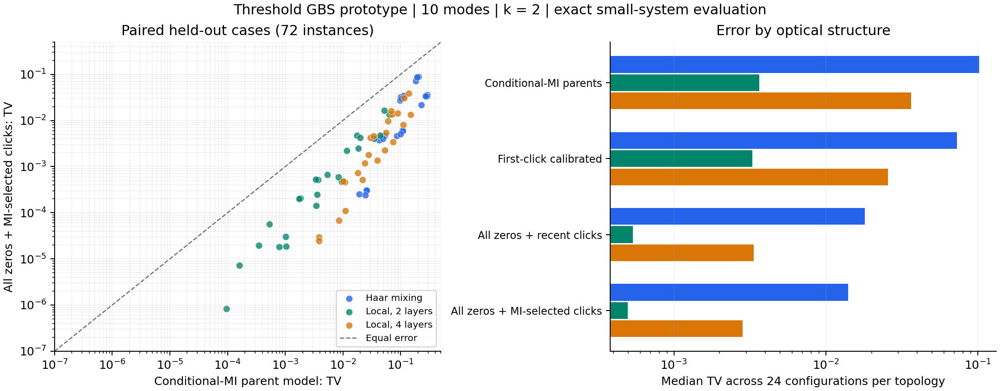

# GBS Classical Lab

一个用于探索经典 Gaussian Boson Sampling 算法的可复现实验项目。第一轮工作日期：**2026-11-03**。

**已经完成：**精确阈值 GBS 参考、独立 Fock 交叉验证、经典近似采样器、216 个不同小规模输入的 2,124 次模型评估，以及最大 64 模式的 60 次成本探测。47 项测试通过。

**当前结论：**“保留全部未点击历史，只保留少量点击约束”的原型在小规模完整分布误差上有值得跟进的表现。尚未与 FrugalGBS 等先进实现做同条件对赛；尚未战胜大型量子实验；原创性尚未确认。

先读 [RESEARCH_REPORT.md](RESEARCH_REPORT.md)。详细结果在 [summary_tables.md](results/analysis/summary_tables.md)，研究路线在 [prior_art_and_open_questions.md](research/prior_art_and_open_questions.md)。



## 快速运行

Python 3.10+；只依赖 NumPy、SciPy、Matplotlib。以下为 Bash/Linux 命令；本轮没有使用 GPU。

```bash
python -m venv .venv
source .venv/bin/activate
python -m pip install -e .
python -m unittest discover -s tests -v

OPENBLAS_NUM_THREADS=1 OMP_NUM_THREADS=1 \
  python -m gbslab.experiment --config configs/heldout.json --output results/my_heldout_run
python experiments/analyze.py
```

`experiments/analyze.py` 默认汇总仓库中已经归档的正式运行。要分析新运行，可以调整脚本中的输入目录；它不会把新结果覆盖为旧结果。

如果暂时不安装项目，可以在命令前设置 `PYTHONPATH=src`。标准库 `unittest` 足够，不依赖 pytest。

## 一个采样器示例

```python
import numpy as np
from gbslab.gaussian import haar_unitary, covariance_from_interferometer
from gbslab.exact import ThresholdModel
from gbslab.zero_memory import ZeroMemorySampler
from gbslab.photon_tail import photon_number_tail

rng = np.random.default_rng(42)
m, r, eta, k = 32, 0.6, 0.25, 2
U = haar_unitary(m, rng)
V = covariance_from_interferometer(U, r, loss=eta)
oracle = ThresholdModel(V, max_exact_modes=3, vacuum_cache_size=8192)
sampler = ZeroMemorySampler(oracle, max_clicks=k, selection="pairwise")
samples = sampler.sample(1000, rng)  # shape (1000, 32), each entry 0/1
bound = photon_number_tail(np.full(m, r), eta, k)
print(samples.shape, bound, sampler.cache_info())
```

`bound` 是均匀损耗假设下、在精确算术中成立的保守 TV 上界的浮点估计，不是经过区间舍入认证的数值证书。它可能接近 1。能生成样本不代表已经证明样本质量。

## 完整复现

```bash
OPENBLAS_NUM_THREADS=1 OMP_NUM_THREADS=1 \
  PYTHONPATH=src python experiments/reproduce.py --output-root results/reproduction
```

脚本按顺序运行全部配置。输出目录若已有 `metrics.csv` 会拒绝覆盖；换一个目录即可。预处理和采样时间会因硬件、系统负载与缓存而变化；在同一数值环境中，概率误差指标应可复现。

每个正式运行都保存了当时的完整 `gbslab` 源码快照、源代码 SHA-256、参数、种子、NumPy/SciPy 版本、输入矩阵、精确参考分布、逐方法记录及失败记录。也可直接通过 `PYTHONPATH=results/heldout_v1/source_snapshot` 运行冻结版本。

## 方法与范围

| 模块 | 用途 | 主要限制 |
|---|---|---|
| `exact.py` | 从 Gaussian 真空边缘经 Möbius 反演得到小规模完整阈值分布 | 随模式数指数增长；float64 行列式 |
| `fock.py` | 独立振幅递推、损耗与阈值测量校验 | 总光子截断；明确记录遗漏质量 |
| `surrogates.py` | 有界父集贝叶斯网络，按最近位置、互信息或条件互信息选取父模式 | 已知图模型基线，不是新算法 |
| `calibration.py` | 精确校准第一个点击的位置和无点击类别 | 保证前向 KL 不增加，不保证 TV 单调 |
| `zero_memory.py` | 保留全部零观测、保留 k 个点击约束 | 固定 k 仍有大矩阵行列式成本；选择策略不是普适最优 |
| `photon_tail.py` | 均匀损耗下可计算的光子数尾界 | 高计数时界很松；不支持一般非均匀输出损耗 |
| `cache.py` | 以配置和引擎代码哈希缓存精确参考 | 单写者；不允许多个进程同时写同一缓存目录 |

本轮研究的是**零均值 Gaussian 态的阈值点击分布**。不是完整 PNR 采样实现；没有模拟暗计数、模式失配、真实探测器时间复用或实验校准误差。`loss` 参数表示透过率 eta，不是丢失比例。

协方差约定为 hbar=2、真空 V=I、xxpp 顺序。分布数组下标是 little-endian bitmask，bit=1 表示对应模式至少一个光子到达。

## 目录与归档

- `src/gbslab/`：可运行实现。
- `tests/`：解析验证、独立 Fock 校验、支持与缓存检查。
- `configs/`：正式实验参数；预留种子与探索种子分开。
- `results/survey_v2/`、`adaptive_v2/`、`heldout_v1/`：正式完整分布比较。
- `results/scaling_v1/`：16/32/64 模式的成本探测，不包含完整 TV。
- `results/survey_v1/`、`adaptive_v1/`：初始探索记录，保留研究历史；不用于最终数值结论。
- `results/analysis/`：图、摘要和所有反例索引。
- `research/`：方法审计、查新记录和下一轮问题。
- `.cache/targets/`：可重建的精确参考缓存；不跟踪到 Git。归档压缩包保留本轮缓存。

未下载或复制论文全文。外部方法仅保存引用、链接和自己的分析；当前代码未包含上游软件副本。项目尚未选择对外开放源码许可证。

## GitHub 状态

本轮已建立本地 Git 历史和可移植研究归档。GitHub 连接能访问账号，但当前连接没有创建仓库接口，备用网页没有登录，因此**尚未创建或推送远程 GitHub 仓库**。

交付压缩包额外包含 `history.bundle`，可以用它恢复本地 Git 仓库；源码和本轮缓存也直接包含在压缩包内。若需要把恢复后的仓库上传到 GitHub，在已经登录 GitHub CLI 的本地环境中运行：

```bash
git clone history.bundle restored-gbs-lab
cd restored-gbs-lab
gh repo create gbs-classical-lab --private --source=. --remote=origin --push
```

该命令会实际创建私有远程仓库并推送；此处仅提供操作命令，没有声称已经执行。若名称被占用，应先核实已有仓库，再决定使用新的名称或既有仓库。
