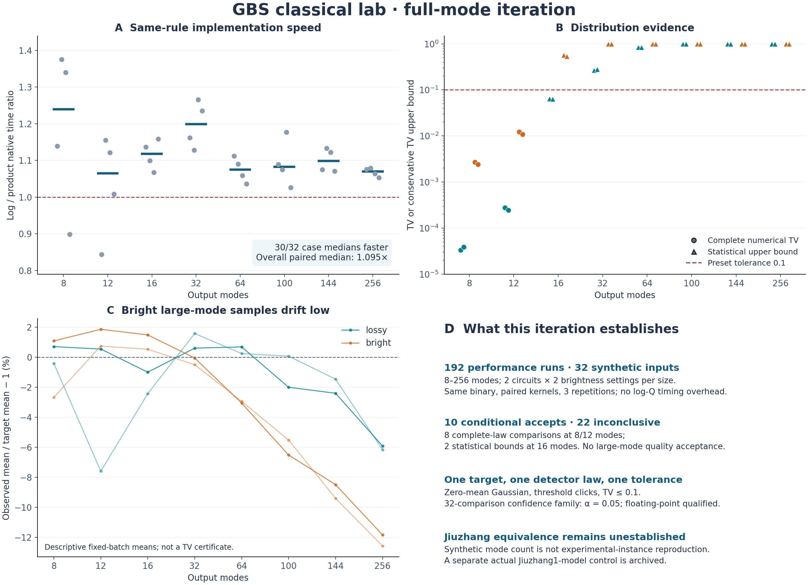

# deziroGBS / GBS Classical Lab

一个用于探索经典 Gaussian Boson Sampling 算法的可复现实验项目。最近一轮工作日期：**2026-11-04**。

**第四轮：全模式优化、两个判别器及官方 Frugal 对照。** 在8–256模式的32组新输入上完成192次配对性能运行：新product核有30/32组中位耗时下降，配对加速中位数1.095倍。32组固定质量批次在TV≤0.1标准下有10组有条件接受、22组证据不足、0组采样失败；其中只有8个8/12模式完整分布比较和2个低亮度16模式统计上界得到接受。大型高亮度的质量问题仍然存在。

第一判别器检查指定Gaussian阈值分布的物理模型、全局TV证据与必要见证；第二判别器分别检查真实九章实例、输出规模、探测输出、噪声、质量、协议和资源。二者都不会把“能出样本”变成“已复现九章”。默认最新前沿是2026年发表的九章四号：1024输入压缩态、8176输出模式。

官方FrugalGBS已加入相同判别器的额外对照，并用真实九章一号作者协方差进行固定批次实验：准备724.27秒、官方生成1024样本阶段130.22秒；我们额外加入的logQ审计在总预算1800秒时超时，未取得完整样本，质量未判定。论文原始声明审计区分了九章二号完整144位阈值任务、九章三号144位粗粒化任务，以及尚未建立的完整九章四号演示。本地实验不冒充论文千万样本GPU基准的复现。

超时后已增加“生成完成立即保存样本，再做密度审计”的独立v2接口，并通过4项小规模故障／一致性检查。本次100模式失败记录保持原样，没有被第二次采样替换。当前主对照运行器使用v2；历史计时仍明确绑定v1。

先读 [第四轮研究报告](RESEARCH_REPORT_ITERATION4.md)、[第四轮结果表](results/iteration4_analysis/summary_tables.md) 和 [Frugal声明审计](research/iteration4_frugal_claims.md)。当前方法仍是经典近似GBS采样器，没有战胜完整大型量子实验，原创性也尚未建立。

第四轮最终全项目153项测试通过，包含两个判别器和样本checkpoint修复；完整日志及源文件散列见 `results/iteration4_verification/`。



## 第四轮复现与接口

核心实现为 `experiments/click_sampler.cpp`，新增 `--vacuum-kernel product` 和 `--record-log-probabilities`；旧log核仍是默认。两个判别器为 `src/gbslab/gbs_identity.py`、`src/gbslab/jiuzhang_gap.py`，官方对照证据接口为 `src/gbslab/frugal_evidence.py`。入口和完整限定见 [第四轮报告第6节](RESEARCH_REPORT_ITERATION4.md#6-可复现性与审查)。

固定协议位于 `configs/iteration4_cross_mode.json` 和 `configs/iteration4_jiuzhang1_control.json`。性能与质量批次分别保存；任何无法可靠求出的目标点使用最坏分数，不丢弃、不重抽。结果只对具体输入、程序和容差有效；浮点估计不是严格区间证书。

## 第三轮原生C++对赛（历史）

两个 retained-click 选择器、Gaussian状态更新、概率内核、随机抽样和样本存储在第三轮迁入C++20。统一原生编译条件的官方Frugal对赛共有366次方法运行，0次失败，当时106项测试通过。修复了互信息舍入影响对照选集的问题；原始失败记录与旧结果保留。

第三轮k4选择器在27个10/12模式输入上，完整TV均低于官方Frugal K5；预处理加128样本短批在26/27组更快。不过8192样本小规模持续抽样中，候选抽样耗时约为Frugal的7–9倍。16/32/64模式只测成本，没有完整质量结论。这些历史输入此前参与探索，不能当作独立确认组。

详见 [原生C++报告](RESEARCH_REPORT_CPP.md)、[历史结果表](results/cpp_analysis/summary_tables.md) 和 [独立审查](research/cpp_independent_audit.md)。

## C++ 复现

构建、独立 CLI 采样和统一对赛命令见 [原生报告第 7 节](RESEARCH_REPORT_CPP.md#7-复现入口)。核心文件是 `experiments/click_sampler.cpp`，Python 包装层是 `src/gbslab/cpp_click.py`。本机版采用 `-O3 -march=native -ffp-contract=off`，未使用 fast-math；生成代码已含 SIMD，本轮没有手写汇编。移植使用浮点保护而非自动重试来处理不可靠条件概率。

当前 pairwise 采用修复后的稳定分数。要逐版本恢复旧 pairwise 结果，请使用历史源码快照或对应 Git 提交；直接用最新代码运行旧配置会使用新公式。归档保留首次原生试验的 13 个跨语言分布失败例，以及修复后的 27 个完整对照。

## 历史里程碑

第二轮完成了 63 个新输入上的 879 次完整分布方法评估，接入官方 FrugalGBS，增加条件点击影响选择器、Schur 内核、解析失败家族和无需完整枚举的 TV 统计验证。其报告 [RESEARCH_REPORT_PHASE2.md](RESEARCH_REPORT_PHASE2.md) 与 [结果表](results/phase2_analysis/summary_tables.md) 保留当时的 Python/C++ 实现差异；当时的性能结论已由本轮统一原生对赛推进。旧 pairwise 对照中的舍入敏感问题详见本轮报告。

第一轮报告 [RESEARCH_REPORT.md](RESEARCH_REPORT.md) 与数据保持原样，第一轮的 2,124 次模型评估、216 个输入和 60 次成本探测不计入第二轮数字。

## 第二轮复现

Python 近似采样器只需下文依赖；官方 FrugalGBS 对赛另需 C++20、OpenMP、Eigen。已附带固定提交的 FrugalGBS CPU 源码与 xsimd，原许可证一并保留。构建与验证方法见 [接入说明](research/frugal_integration.md)。

```bash
OPENBLAS_NUM_THREADS=1 OMP_NUM_THREADS=1 PYTHONPATH=src \
  python -m gbslab.phase2 --config configs/phase2_holdout.json --output results/new_holdout
python experiments/build_frugal.py
OPENBLAS_NUM_THREADS=1 OMP_NUM_THREADS=1 PYTHONPATH=src \
  python -m gbslab.frugal --validate --output .cache/frugal-build/validation.json
OPENBLAS_NUM_THREADS=1 OMP_NUM_THREADS=1 PYTHONPATH=src \
  python experiments/benchmark_frugal.py --output results/new_frugal_comparison
python experiments/analyze_phase2.py
```

对赛默认读取已归档的三组原始输入；要改变输入组，传 `--suites`。分析脚本默认总结已归档的正式结果。所有重复实验应使用新输出目录。

第二轮扩展模块包括 `conditional_memory.py`、`schur_memory.py`、`paired_stress.py`、`tv_validation.py` 和 `frugal.py`。全局统计上界明确依赖概率计算准确，不是经过向外舍入的数值证书。64 模式成本实验不提供完整分布质量结论。

## 快速运行

Python 3.10+；只依赖 NumPy、SciPy、Matplotlib。以下为 Bash/Linux 命令；本轮没有使用 GPU。

```bash
python -m venv .venv
source .venv/bin/activate
python -m pip install -e .
python -m unittest discover -s tests -v

OPENBLAS_NUM_THREADS=1 OMP_NUM_THREADS=1 \
  python -m gbslab.experiment --config configs/heldout.json --output results/my_heldout_run
python experiments/analyze.py
```

`experiments/analyze.py` 默认汇总仓库中已经归档的正式运行。要分析新运行，可以调整脚本中的输入目录；它不会把新结果覆盖为旧结果。

如果暂时不安装项目，可以在命令前设置 `PYTHONPATH=src`。标准库 `unittest` 足够，不依赖 pytest。

## 一个采样器示例

```python
import numpy as np
from gbslab.gaussian import haar_unitary, covariance_from_interferometer
from gbslab.exact import ThresholdModel
from gbslab.zero_memory import ZeroMemorySampler
from gbslab.photon_tail import photon_number_tail

rng = np.random.default_rng(42)
m, r, eta, k = 32, 0.6, 0.25, 2
U = haar_unitary(m, rng)
V = covariance_from_interferometer(U, r, loss=eta)
oracle = ThresholdModel(V, max_exact_modes=3, vacuum_cache_size=8192)
sampler = ZeroMemorySampler(oracle, max_clicks=k, selection="pairwise")
samples = sampler.sample(1000, rng)  # shape (1000, 32), each entry 0/1
bound = photon_number_tail(np.full(m, r), eta, k)
print(samples.shape, bound, sampler.cache_info())
```

`bound` 是均匀损耗假设下、在精确算术中成立的保守 TV 上界的浮点估计，不是经过区间舍入认证的数值证书。它可能接近 1。能生成样本不代表已经证明样本质量。

## 第一轮完整复现

```bash
OPENBLAS_NUM_THREADS=1 OMP_NUM_THREADS=1 \
  PYTHONPATH=src python experiments/reproduce.py --output-root results/reproduction
```

脚本按顺序运行第一轮全部配置。输出目录若已有 `metrics.csv` 会拒绝覆盖；换一个目录即可。预处理和采样时间会因硬件、系统负载与缓存而变化；在同一数值环境中，概率误差指标应可复现。

小规模完整分布运行保存了当时的完整 `gbslab` 源码快照、源代码 SHA-256、参数、种子、NumPy/SciPy 版本、输入矩阵、精确参考分布、逐方法记录及失败记录。较大规模成本和 TV 统计验证运行保存实际使用的输入、样本和诊断，不含未计算的完整目标分布。也可直接通过 `PYTHONPATH=results/heldout_v1/source_snapshot` 运行冻结版本。

## 方法与范围

| 模块 | 用途 | 主要限制 |
|---|---|---|
| `exact.py` | 从 Gaussian 真空边缘经 Möbius 反演得到小规模完整阈值分布 | 随模式数指数增长；float64 行列式 |
| `fock.py` | 独立振幅递推、损耗与阈值测量校验 | 总光子截断；明确记录遗漏质量 |
| `surrogates.py` | 有界父集贝叶斯网络，按最近位置、互信息或条件互信息选取父模式 | 已知图模型基线，不是新算法 |
| `calibration.py` | 精确校准第一个点击的位置和无点击类别 | 保证前向 KL 不增加，不保证 TV 单调 |
| `zero_memory.py` | 保留全部零观测、保留 k 个点击约束 | 固定 k 仍有大矩阵行列式成本；选择策略不是普适最优 |
| `photon_tail.py` | 均匀损耗下可计算的光子数尾界 | 高计数时界很松；不支持一般非均匀输出损耗 |
| `cache.py` | 以配置和引擎代码哈希缓存精确参考 | 单写者；不允许多个进程同时写同一缓存目录 |

本轮研究的是**零均值 Gaussian 态的阈值点击分布**。不是完整 PNR 采样实现；没有模拟暗计数、模式失配、真实探测器时间复用或实验校准误差。`loss` 参数表示透过率 eta，不是丢失比例。

协方差约定为 hbar=2、真空 V=I、xxpp 顺序。分布数组下标是 little-endian bitmask，bit=1 表示对应模式至少一个光子到达。

## 目录与归档

- `src/gbslab/`：可运行实现。
- `tests/`：解析验证、独立 Fock 校验、支持与缓存检查。
- `configs/`：正式实验参数；预留种子与探索种子分开。
- `results/survey_v2/`、`adaptive_v2/`、`heldout_v1/`：正式完整分布比较。
- `results/scaling_v1/`：16/32/64 模式的成本探测，不包含完整 TV。
- `results/survey_v1/`、`adaptive_v1/`：初始探索记录，保留研究历史；不用于最终数值结论。
- `results/analysis/`：图、摘要和所有反例索引。
- `research/`：方法审计、查新记录和下一轮问题。
- `.cache/targets/`：可重建的精确参考缓存；不跟踪到 Git。归档压缩包保留本轮缓存。

未下载或复制论文全文。`third_party/FrugalGBS`（MIT）和 `third_party/xsimd`（BSD-3-Clause）保存用于可复现对赛的上游源码子集，文件均核对固定提交的 Git blob；参见 [上游说明](third_party/README.md)。本项目自有新增代码尚未选择对外开放源码许可证。

## GitHub 状态

项目远程地址为 **[qiyuanhuakai/deziroGBS](https://github.com/qiyuanhuakai/deziroGBS)**，由用户于2026-11-04创建。仓库保存代码、报告、固定实验配置、实际结果及本地研究提交历史。Python包仍使用 `gbslab`，旧报告中的项目工作名为GBS Classical Lab。

编译产物、精确参考缓存和未公开再分发的作者协方差位于被忽略的 `.cache/`，单独归档，不推入远程源码树。旧里程碑压缩包中的 `history.bundle` 仍可恢复当时的研究历史。

```bash
git clone https://github.com/qiyuanhuakai/deziroGBS.git
cd deziroGBS
python -m pip install -e .
OPENBLAS_NUM_THREADS=1 OMP_NUM_THREADS=1 python -m unittest discover -s tests -v
```

原生集成测试在没有相应已编译程序时会跳过；本轮记录的153项全部通过是在归档本机二进制可用的环境中完成。重新编译后应重新验证对应的二进制散列，不能直接套用旧构建的验证门。
