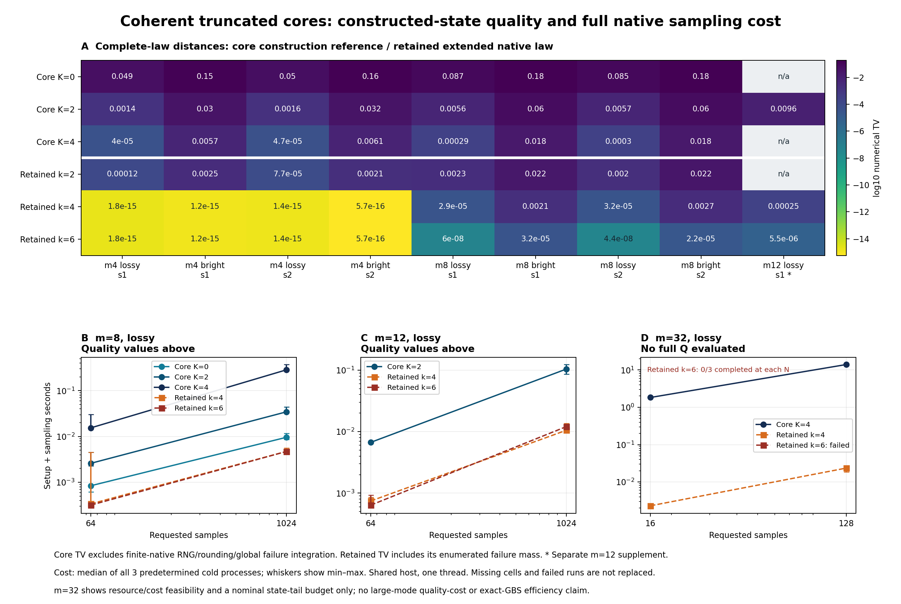
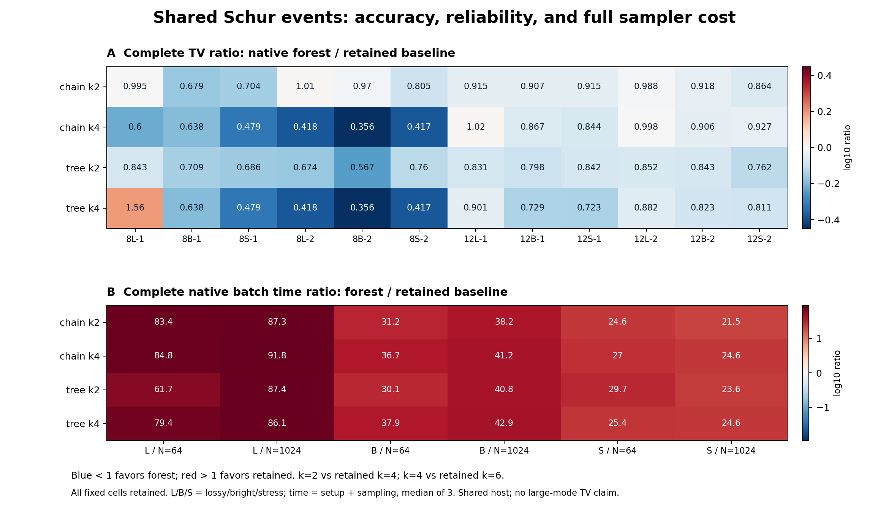
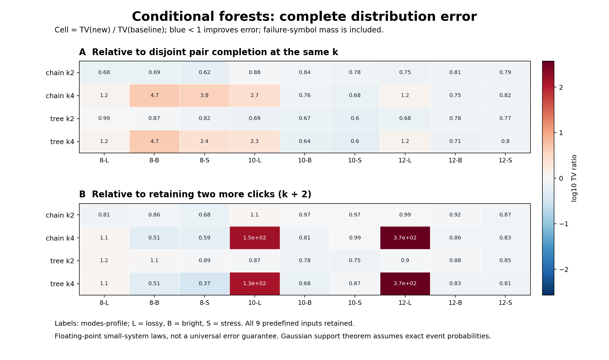
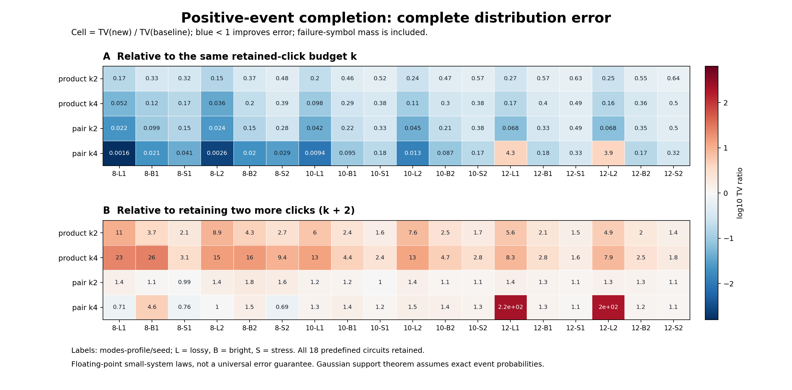
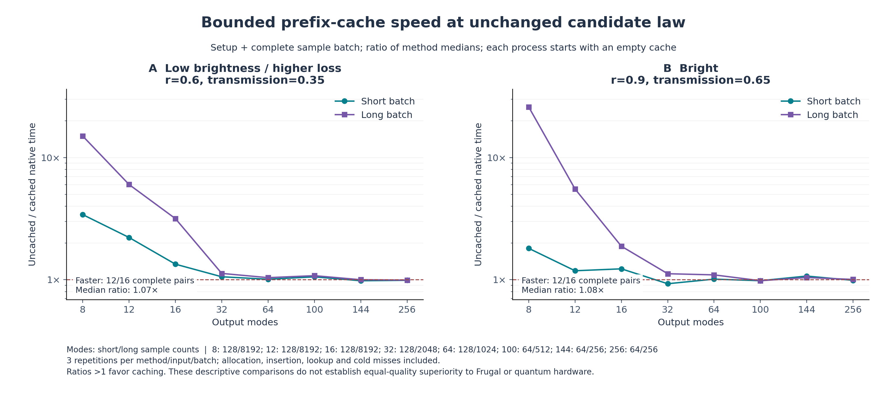

# deziroGBS / GBS Classical Lab

量子项目的可复现经典 Gaussian Boson Sampling 研究。最近完成：**第59轮秩4完整采样程序与连续参照，2026-11-10**。历轮代码、理论、原始成功和失败结果均按各自证据范围保留。

## 第59轮进展

秩4从理想通道保证推进到完整两模程序：三个物理输入、各局部维数3和4，共6项实验，核验7776个位移节点及42768个测量树节点。三组维数增加后的实际TV全部下降，改善因子1.26—1.43；实配对更受网格误差影响，两个复相位输入更受有限输入近似影响。

包含一个新混合方向物理输入留出，独立配对计数矩验证非对角相关情形；50项旧连续参照和12个直接密度控制通过。326853项核验通过；全库740运行、711通过、0失败，新增13项通过，既有跳过保留。仍为两物理模式，没有将第58轮81倍候选节点差解释成实测提速。

详见[第59轮报告](RESEARCH_REPORT_ITERATION59.md)、[方法与复现](research/iteration59_methods.md)、[先进工具与九章对照](research/iteration59_frontier_comparison.md)、[持续方向](research/iteration60_plan.md)。

## 第58轮进展

新增精确量化残差矩和联合纯Gaussian位移界，24项既有双驱动实验、32项新秩4理论配置的组合保证全部收紧。双驱动6组以108节点达到原324节点的完整程序保证；两个秩4输入以1296节点达到原104976节点的理想噪声保证，候选节点数少81倍，尚非实测提速。

联合界并非总优：24项旧实验中18项联合界更好、6项精确一阶界更好。等预算的认证选择仍有2/6组不是实际误差最优。1763项核验通过；全库727运行、698通过、0失败，新增12项通过，既有跳过保留。秩4仅为两个物理模式上的理论通道保证，尚未执行完整采样。

详见[第58轮报告](RESEARCH_REPORT_ITERATION58.md)、[证明与复现](research/iteration58_methods.md)、[先进工具与九章对照](research/iteration58_frontier_comparison.md)、[持续方向](research/iteration59_plan.md)。

## 第57轮进展

直接认证五个预声明完整144位输出的共同质量，得到严格但极弱的整体TV上界；K4上界仅比1小约2.61×10⁻²⁸，加入目标转移后仍为1。实用整体误差上界仍未解决，旧16位下界保持。

五输出事件物理质量约2.13×10⁻¹⁸，K4程序总质量低约81亿倍，事件内条件TV约0.378；不能据此推断无条件整体误差。十模1024完整输出与旧程序律逐项相同。39,027项核验通过；全库715运行、686通过、0失败，新增8项通过，既有跳过保留。数学更正和图形恢复均保留证据。

详见[第57轮报告](RESEARCH_REPORT_ITERATION57.md)、[证明与复现](research/iteration57_methods.md)、[先进工具与九章对照](research/iteration57_frontier_comparison.md)、[持续方向](research/iteration58_plan.md)。

## 第56轮进展

实际144模完整边缘扩至16位，K1—K4整体TV下界全部加强；K4从0.000315147升至0.000389769，增幅23.68%。新增32768份子集证书，全部65535份重新独立审核，旧15位原子区间、公开输出及路径不变。

逐父分支分解定位被合并掩盖的偏差；K4有12638个父分支的子差值认证异号。稀疏事件显示误差分散：4096个最强模式只保留约39%的完整前缀下界。1,706,575项核验通过；全库707运行、678通过、0失败，新增8项通过，既有跳过保留。仍无完整144模TV上界或匹配质量的九章规模速度结论。

详见[第56轮报告](RESEARCH_REPORT_ITERATION56.md)、[证明与复现](research/iteration56_methods.md)、[先进工具与九章对照](research/iteration56_frontier_comparison.md)、[持续方向](research/iteration57_plan.md)。

## 第55轮进展

24项双Gaussian驱动实验含8项预声明留出，加入被动混合双模输入，完整核验3456节点与24184个测量树节点。新增多变量解析连续参照，并通过26项旧秩1回归及24项原密度算法固定节点对照。

24次单轴细化对完整目标19改善、5退化，对有限连续参照14改善、10退化；相同108节点预算的方向选择，在两项留出上随参照目标而逆转。12组输入维数4→6配对全部改善。166,715项核验通过；全库699运行、670通过、0失败，新增12项通过，既有跳过保留。仍是小系统、实相空间秩2噪声，没有九章规模或同质量速度结论。

详见[第55轮报告](RESEARCH_REPORT_ITERATION55.md)、[方法与复现](research/iteration55_methods.md)、[先进工具与九章对照](research/iteration55_frontier_comparison.md)、[持续方向](research/iteration56_plan.md)。

## 第54轮进展

26项双模纠缠输入与共同Gaussian复方向位移实验，包含6项预声明留出；全部1524个位移节点、10666个测量树节点独立核验。新增解析有限态连续参照，并回归旧50项单模积分。同向与反向驱动可有完全相同的单模边缘，但联合分布TV约0.135009。

14次网格细化全部更接近有限连续参照，对真实Gaussian目标却为7改善、7退化；11组非真空输入增大局部维数后全部改善。73,419项核验通过；全库687运行、658通过、0失败，新增11项通过。范围仍为小系统、秩1相关噪声，没有九章规模或同质量速度结论。

详见[第54轮报告](RESEARCH_REPORT_ITERATION54.md)、[方法与复现](research/iteration54_methods.md)、[先进工具与九章对照](research/iteration54_frontier_comparison.md)、[持续方向](research/iteration55_plan.md)。

## 第53轮进展

实际144模完整边缘扩至15位，K1—K4整体TV下界全部加强，K4从0.000285223升至0.000315147，增幅10.49%。复用16383、新建16384份子集证书，并重新独立核验全部物理证据；旧公开输出及所有14层节点不变。

新增证书可重建的完整JSON约697 MiB，紧凑表示及无损gzip后52.4 MiB，约13.30倍缩减。精确整数变换与独立显式容斥的32768项区间完全相同。673,541项核验通过；全库676运行、647通过、0失败，新增9项通过。仍没有完整144模TV上界或九章规模、同质量速度结论。

详见[第53轮报告](RESEARCH_REPORT_ITERATION53.md)、[方法及复现](research/iteration53_methods.md)、[先进工具与九章对照](research/iteration53_frontier_comparison.md)、[持续方向](research/iteration54_plan.md)。

## 第52轮进展

新增8个精确理想局部Fock投影参照及20项八模MPS预算实验。12组键16到32配对全部更接近理想投影，但完整物理TV为10改善、2退化；最高预算仍仅在同一物理态的正逆序优于官方K4。理想投影是参照，不是所有有限维态的误差下限。

共享前缀把八模独立密度传递从2048降到510，六项原算法/Fock枚举对照完全相等；完整路径无损压缩约4.73倍。867,068项独立核验通过，全库667运行、638通过、0失败，新增9项通过。原重复审核停止后的未完成状态及图形修复均保留；没有同质量速度或九章规模模拟结论。

详见[第52轮报告](RESEARCH_REPORT_ITERATION52.md)、[方法及复现](research/iteration52_methods.md)、[先进工具与九章对照](research/iteration52_frontier_comparison.md)、[持续方向](research/iteration53_plan.md)。

## 第51轮进展

以N=4^k、R=k+1消除理想位移网格的固定尾部底限，给出显式收敛包络；完整程序仍分别计入有限输入和有限字误差。50项实验含36项旧参数配对、12项新参数留出、2项1024格控制。相同格数13改善、11退化、12项程序律相同；33次细化全都更接近有限连续参考，但对完整Gaussian目标仅10改善、23退化。

67,215项独立核验通过；旧4104节点全部回归。全库658运行、629通过、0失败，新增9项通过，既有跳过保留。理想噪声层收敛不等于完整GBS任意精度模拟，也没有新增九章规模或吞吐结论。

详见[第51轮报告](RESEARCH_REPORT_ITERATION51.md)、[方法及复现](research/iteration51_methods.md)、[先进工具与九章对照](research/iteration51_frontier_comparison.md)、[持续方向](research/iteration52_plan.md)。

## 第50轮进展

24项八模预算实验通过完整程序律验证，8个输入次序提高局部维数及键预算后TV下降1.48—2.95倍。最高预算在2个次序（同一物理态正逆序）上优于官方Frugal K4，另6个仍落后，不能推断普遍优势。MPS外层计时字段错误已冻结披露，排除成本比较。

双尾改映射到边界后，36项连续噪声实验的认证上界全部收紧，真实TV为27项改善、9项退化。940,288项独立核验通过；全库649运行、620通过、0失败，新增6项通过，既有跳过保留。没有完整144模上界或九章规模模拟结论。

详见[第50轮报告](RESEARCH_REPORT_ITERATION50.md)、[方法及复现](research/iteration50_methods.md)、[先进工具与九章对照](research/iteration50_frontier_comparison.md)、[持续方向](research/iteration51_plan.md)。

## 第49轮进展

实际144模前缀扩至14位，复用8191个旧子集、新建8192个子集，全部独立重验。K1—K4整体TV下界提高至约0.04639887、0.00630311、0.00141224、0.000285223；旧公共输出及13位前缀不变，仍没有完整上界。

36项离散随机位移程序接到真实连续Gaussian混态，计入输入尾部、节点选择、条件测量和网格误差。12组中10组从64格增至256格实际TV变大；解析连续积分说明尾部映射和输入偏差的抵消可能被细化破坏。最终354,506项独立核验通过；全库643运行、614通过、0失败，新增13项通过，既有跳过及首次积分核验失败保留。

详见[第49轮报告](RESEARCH_REPORT_ITERATION49.md)、[方法及复现](research/iteration49_methods.md)、[先进工具与九章对照](research/iteration49_frontier_comparison.md)、[持续方向](research/iteration50_plan.md)。

## 第48轮进展

六个单/双模Gaussian目标、30个MPS构造、60项固定测量配置完成无限输入误差认证，显式计入光子尾部、键截断、存储构造及浮点采样。有限测量数值误差约10⁻¹⁶，但完整输入误差仍可达0.266。strong配对态在键2下提高局部维数不改善；同步提高键预算则明显下降。

固定公平混合的改善等于误差抵消量减去两分支TV差的一半，48项旧面板重分析解释了留出中的改善和退化，未改变权重或新增留出声明。6,659项独立核验通过；全库630运行、601通过、0失败，新增14项通过，既有跳过保留。没有完整144模上界或九章规模模拟结论。

详见[第48轮报告](RESEARCH_REPORT_ITERATION48.md)、[方法与复现](research/iteration48_methods.md)、[先进工具与九章对照](research/iteration48_frontier_comparison.md)、[持续方向](research/iteration49_plan.md)。

## 第47轮进展

实际144模官方程序扩至13位前缀，68个旧公共输出及全部旧12位前缀保持不变。K1—K4完整输出TV下界提高至约0.04444391、0.00585451、0.00122335、0.00022491，转移至shifted物理目标后仍全部为正；仍没有完整上界。

固定正逆序公平混合接受12项新输入留出检验：2项明显优于两种单独次序，2项劣于较好的次序，不能从凸性推出普遍最佳准确性。位移证书扩至局部维数3、4、6和三模链，24个新控制及24个旧维数2回归通过，仍只认证有限输入态。

213,954项独立核验通过；全库616运行、587通过、0失败、0错误，新增13项测试通过，既有跳过保留。尚无同质量性能领先或九章规模模拟结论。

详见[第47轮报告](RESEARCH_REPORT_ITERATION47.md)、[方法与复现](research/iteration47_methods.md)、[先进工具与九章对照](research/iteration47_frontier_comparison.md)、[持续方向](research/iteration48_plan.md)。

## 第46轮进展

四个严格物理态的正逆序共8个输入次序，完成32个MPS、24个官方Frugal和20个矩完成配置。预声明最高预算MPS全部优于K2、全部落后K4；三阶真实最大熵继续优于二阶，但6项仍落后K2。不同算法资源预算不等价，未作吞吐排名。

八模strong的K4正逆序对齐分布TV约0.103477；具体事件概率分别约36.85%、26.50%，目标约31.48%。另24个维数2有限态位移控制通过严格指数函数区间和独立收缩验证，程序律对理想有限态测量的TV上界最高约2.225×10⁻¹⁶，尚不是无限Gaussian混态认证。

158,872项独立核验通过；全库603运行、574通过、0失败、0错误，新增11项测试通过，既有跳过保留。仍无完整144模TV上界或九章规模模拟结论。

详见[第46轮报告](RESEARCH_REPORT_ITERATION46.md)、[方法与复现](research/iteration46_methods.md)、[先进工具与九章对照](research/iteration46_frontier_comparison.md)、[持续方向](research/iteration47_plan.md)。

## 第45轮进展

18个四模MPS配置用两条精确整数路径核对有限张量概率律，再与严格物理目标及完整浮点采样律分别比较。采样律对张量状态的TV最高约3.36×10⁻¹⁶，而有限张量对物理目标仍有明显误差。保存重载导致的数组布局变化在6个配置上改变末位采样律，最大TV约1.01×10⁻¹⁶，首次核验失败和恢复证据完整保留。

30个矩完成配置中，12个输入均认证三阶真实最大熵解比二阶更接近目标；有理候选物理TV相对下降16.26%—90.14%。但8个非经典输入里只在2个上超过官方Frugal K2，全部落后K4。六个四模四阶结果是全信息校准，不能视为低阶算法突破。

34,420项独立核验通过；全库592运行、563通过、0失败、0错误，新增13项测试通过，既有跳过保留。仍无大规模GBS同质量吞吐优势或九章模拟结论。

详见[第45轮报告](RESEARCH_REPORT_ITERATION45.md)、[方法与复现](research/iteration45_methods.md)、[先进工具与九章对照](research/iteration45_frontier_comparison.md)、[持续方向](research/iteration46_plan.md)。

## 第44轮进展

24个新非经典案例中，最大熵完成的物理TV全部大于官方K2/K4；与K2之比约1.09—11.67。新的区间桥接证书将真实代数矩与有理候选严格区分，并证明真实矩下的精确最大熵解也全部比K2差。第43轮经典噪声族的改善不能外推为普遍结论。

12个四模控制进一步给出相同低阶约束、严格非负下的反例：case0的另一可行律TV约0.020376，真实最大熵解至少约0.078360。顺序审核还发现K4对齐分布差异可达约0.06583，树控制相同互信息得分下也可产生不同分布。

独立核验116,497项通过；全库579运行、550通过、0失败、0错误，新增10项测试通过。两次初始核验失败、所有优化状态及既有跳过完整保留。仍无完整144模精度上界、统一吞吐排名或九章模拟结论。

详见[第44轮报告](RESEARCH_REPORT_ITERATION44.md)、[真实矩区间桥接](research/iteration44_interval_bridge.md)、[同矩反例及顺序机制](research/iteration44_counterexamples.md)、[先进工具与九章对照](research/iteration44_frontier_comparison.md)、[持续方向](research/iteration45_plan.md)。

## 第43轮进展

25个已冻结的4、8、10模物理参考例子，均得到严格非负、精确保留真实一阶二阶矩的分布。物理目标TV相对K2实数参考下降42.8%—90.8%；独立证书还确认对应最大熵解也优于基线，但仍有严格为正的物理误差。该面板为易经典采样Gaussian噪声族，算法仍枚举完整小表。

实际144模官方程序前缀从10位扩展至12位，K1—K4完整TV下界约0.0362253、0.00348358、0.000618645、0.000118173，比旧证据提高1.46—2.06倍。核对4097份物理矩阵证书及68条旧公共回归输出，未改变采样程序或目标。

独立核验88,365项通过；全库569运行、540通过、0失败、0错误，新增8项测试通过，既有跳过和初次检查失败均保留。仍无完整144模TV上界、同质量速度排名或九章模拟声明。

详见[第43轮报告](RESEARCH_REPORT_ITERATION43.md)、[最大熵完成证书](research/iteration43_maximum_entropy.md)、[十二位前缀整体下界](research/iteration43_prefix_bounds.md)、[先进工具与九章对照](research/iteration43_frontier_comparison.md)、[持续方向](research/iteration44_plan.md)。

## 第42轮进展

直接枚举实际144模官方程序前十位，K1至K4对精确B,F目标的完整输出TV下界依次约0.0247711、0.00214031、0.000317499、0.0000573353，转移到shifted目标后仍全部为正。证书绑定实际完整目标和公共采样输出，未用独立十模程序结果替代。前缀上界不构成整体上界。

补项的新15项物理参考面板中，5项可保留全部真子集边缘并形成非负律，2项略改善、3项变差，10项不可行。另认证一个全部真子集边缘都有效却无法共同延拓的实例；任何非负联合律必须改变其中至少一个边缘的TV约0.00421441或更多。

两组独立核验共48,616项通过；全库561运行、532通过、0失败、0错误，新增8项测试通过。初始路径/容器比较问题与恢复证据均保留。仍无完整144模TV上界、公平速度排名或九章模拟结论。

详见[第42轮报告](RESEARCH_REPORT_ITERATION42.md)、[实际前缀整体下界](research/iteration42_full_prefix_bound.md)、[修正与不可延拓证明](research/iteration42_parity_repair_scope.md)、[先进工具与九章对照](research/iteration42_frontier_comparison.md)、[持续方向](research/iteration43_plan.md)。

## 第41轮进展

44项官方完整十模式输出律全部完成。一个四活跃模式物理例子的三点击事件，在目标中的概率约15.44%，官方K2有限随机字律中仅约3.70e-20；完整TV约0.184516。输入来自容易经典采样的Gaussian噪声族，不是九章或困难GBS实例。

独立符号计算进一步定位：取消裁剪的当前K2边缘递推在前七模式与纯二阶截断相同，第八模式缺少16个完美配对项。一个无负质量、无裁剪的八模式物理例子仍产生约0.00103563的额外分布差异，且其所有真子集边缘相同。更高截断阶和逆序访问均没有逐例改善保证。

主核验120,732项、符号核验33项通过；全库553运行、524通过、0失败、0错误，新增9项测试通过，既有依赖跳过保留。仍无完整144模TV上界或超越先进工具、九章的证据。

详见[第41轮报告](RESEARCH_REPORT_ITERATION41.md)、[物理事件见证](research/iteration41_physical_witness.md)、[16个缺少配对项](research/iteration41_missing_matchings.md)、[先进工具与九章对照](research/iteration41_frontier_comparison.md)、[持续方向](research/iteration42_plan.md)。

## 第40轮进展

官方Frugal K2的一个已观测历史，在换成认证物理态的精确一阶、二阶系数后，近似递推比值仍严格约为1.17355746。5,778个精确行列式、两条不同的区间实现及107步实际分支支持该证书；本实例超界不是系数浮点误差，但尚不直接给出输出TV下界。

五配置各256次、共1,280次新尝试全部完成。在预声明57尾、独立同分布尝试前提下，recent森林完整TV下界约0.035333，另外四配置未检出；第39轮K1解析下界仍成立。固定混合提高二阶观测量下界，但未新增TV检出。

主核验149,635项、机制核验23,835项全部通过；全库544运行、515通过、0失败、0错误，11项新增测试通过，既有依赖跳过保留。没有完整144模TV上界或超过先进工具、九章的结论。

详见[第40轮报告](RESEARCH_REPORT_ITERATION40.md)、[物理超界证书](research/iteration40_saturation_certificate.md)、[混合均值界及局限](research/iteration40_betting_scope.md)、[先进工具与九章对照](research/iteration40_frontier_comparison.md)、[持续方向](research/iteration41_plan.md)。

## 第39轮进展

官方Frugal CPU扩展至144模式，阶1至4各1024个样本全部完成。三个十模式块、阶1至5获得严格归一化有限随机字完整律；全部前缀及随机轨迹独立核对。一阶配置虽几乎保持目标均值，却显著低估点击波动：在明确随机字及浮点算术前提下，解析证明其完整144模TV至少约0.009042，转移至shifted目标仍约0.009034。二至四阶统计检验未检出，不代表准确。

正式核验1,544项、校准7,516项、一阶证明732项通过；全库533运行、504通过、零失败、零错误，既有依赖跳过保留。尚无完整144模TV上界或超过先进工具、九章的结论。

详见[第39轮报告](RESEARCH_REPORT_ITERATION39.md)、[一阶全局解析界](research/iteration39_k1_global_bound.md)、[有限随机字推导](research/iteration39_finite_word_law.md)、[先进工具与九章对照](research/iteration39_frontier_comparison.md)、[持续方向](research/iteration40_plan.md)。

## 第38轮进展

384次新的144模式尝试全部完成。在独立同分布均匀网格尝试前提下，40项预声明均值/事件检验具有至少99%同时覆盖率；recent规则完整TV下界约0.02174695，其余三种规则未检出，不代表已准确。官方当前主分支FrugalGBS重新构建，在三个同输入十模式块上完成15个截断配置；森林局部数值较小，但官方浮点导出向量与森林严格停止律的认证口径不同，尚无整体精度或速度胜出结论。

另在真实Gaussian四模式边缘中严格证明：联合KL最优树的特定后验误差约0.00343，另一树约0.000329，补上前轮一般二元反例的物理性缺口。主核验137,847项及数学反例304项通过；新增8项测试通过，全库522运行、493通过、0失败、0错误，既有依赖跳过保留。MPS解析控制另明确区分最大键截断权重与完整点击TV。

详见[第38轮报告](RESEARCH_REPORT_ITERATION38.md)、[均值检验推导](research/iteration38_mean_witness.md)、[Gaussian树反例](research/iteration38_gaussian_tree_counterexample.md)、[先进工具与九章对照](research/iteration38_frontier_comparison.md)、[后续方向](research/iteration39_plan.md)。

## 第37轮进展

接通已有条件互信息规则，完成24组十模式完整停止律与256次144步确认。条件互信息在六组区块/森林组合中均优于recent，但并非逐例优于pairwise或点击影响规则；没有统一胜者。四组完整样本的点击均值依次75.47、68.53、67.73、67.00，目标约66.87；预声明全局TV下界均为零，表示未检出，不代表已准确。

281,404项独立检查通过，覆盖3,071份矩阵证书、3,072个高精度目标原子校准和全部完整轨迹。新增5项测试通过，全库514运行、485通过、0失败、0错误，既有依赖跳过保留。另给出联合KL最优树并不最小化某个后验误差的精确二元小例子，未声称它是Gaussian物理反例。

详见[第37轮报告](RESEARCH_REPORT_ITERATION37.md)、[选择规则及范围](research/iteration37_selector_scope.md)、[树目标小例子](research/iteration37_tree_objective.md)、[先进工具及九章对照](research/iteration37_frontier_comparison.md)、[后续方向](research/iteration38_plan.md)。

## 第36轮进展

直接认证精确B,F模型的八模概率，把起点0、预算4、static_mi_tree的局部TV上界从约8.54e-6收紧到3.57e-8。但256次新的完整尝试检出三个森林配置的明显全局偏差：在独立同分布均匀网格尝试假设下，32个预声明事件具有至少99%同时覆盖率，完整TV统计下界分别约0.341、0.147、0.115；第四配置未检出，不代表准确。

有效16项任务、195,531项独立检查通过，覆盖11,876份矩阵证书和全部随机轨迹。原序列化类型比对停止及10项恢复记录保留。全库509运行、480通过、0失败、0错误，既有依赖跳过保留。更新先进工具与九章对照，未宣称完成九章模拟或得到完整144步TV上界。

详见[第36轮报告](RESEARCH_REPORT_ITERATION36.md)、[直接目标与事件推导](research/iteration36_direct_target_and_events.md)、[先进工具及九章对照](research/iteration36_frontier_comparison.md)、[后续方向](research/iteration37_plan.md)。

## 第35轮进展

49项固定任务完成。精确B,F所定义的144模数学Gaussian模型已通过物理性认证；另对原存储协方差显式加2^-40对角噪声，证明新输入有效，并给出两物理目标任意测量TV≤约8.50755e-6的转移界。原始微小违例保留，未静默修正。

实际144模采样器的24组前八步停止律获得严格TV区间，预算4时约3.57e-8至5.68e-6；该结论不扩展为完整144步上界。32次固定完整尝试完成，不能据此估计分布质量。10项新测试通过，全库499运行、470通过、0失败、0错误，既有依赖跳过保留。

19,710项独立检查通过，覆盖1,040份矩阵证书。按2026-11-09资料补充先进工具、最新理论与九章4.0对照；本轮为认证方法进展，未证明模拟九章或超越当前经典工具。

详见[第35轮报告](RESEARCH_REPORT_ITERATION35.md)、[物理模型与目标转移](research/iteration35_physical_model.md)、[前沿及九章对照](research/iteration35_frontier_comparison.md)、[后续方向](research/iteration36_plan.md)。

## 第34轮进展

无需完整目标表的完整输出重叠审核已推进到144模式；明确物理的低强度控制给出全局TV上界，失败与未知质量全部保留。42项固定配置、5项物理性补查完成，原有理数保存失败及单项恢复过程保留。14,053项独立检查通过，新增9项测试，全库489运行、460通过、0失败、0错误，依赖跳过保留。

同时发现本项目既有144模**浮点构造矩阵**按精确条目解释时存在严格负的不确定关系见证，约−4.91e−16。其行列式函数区间不能直接作为精确物理输出证书；此前涉及该存储矩阵的浮点或离散表诊断须按这一范围解读，不能据此判断原实验状态。下一步优先补足明确有效的物理目标及其表示误差。

详见[第34轮报告](RESEARCH_REPORT_ITERATION34.md)、[精确物理性见证](research/iteration34_physicality_audit.md)、[审核推导](research/iteration34_atom_and_interval.md)、[后续方向](research/iteration35_plan.md)。

## 第33轮进展

38项固定工作完成，建立包含失败符号与未审核质量的有理数审核。24个八模式森林案例中，保留4点击时完整耦合界接近实际TV；只审核128个条件时，上界仍为0.493…0.672，不能据局部准确宣称整体质量。14项原生热态/端点/真空控制保留全部失败，并核对两种访问顺序逐项一致。

48,515项独立检查通过。新增7项测试，全库480运行、451通过、0失败、0错误，依赖跳过保留。有限网格法则与理想Bernoulli分别报告；精确性针对所给有限表，完整144模式Gaussian上界仍未获得。

详见[第33轮报告](RESEARCH_REPORT_ITERATION33.md)、[失败感知推导](research/iteration33_failure_coupling.md)、[后续方向](research/iteration34_plan.md)。

## 第32轮进展

48项确定性工作完成。四模式完整点击律把秩200有限MPS同通道输出TV下界诊断加强到约0.00625239；局部Cauchy上界只约束相应小块，不是完整144模上界。四种明确测量顺序、三种保留预算和两种森林的完整八模式前缀质量另行量化，96项与完整144模前缀条件核对逐值一致。

1,192项独立核验通过，两条公式复算完整四模式分布最大差9.44e−16。7项新测试通过，全库473运行、444通过、0失败、0错误，依赖跳过保留。未来数值失败和完整系统质量上界仍未解决。

详见[第32轮报告](RESEARCH_REPORT_ITERATION32.md)、[块质量与范围](research/iteration32_block_quality.md)、[下一轮方向](research/iteration33_plan.md)。

## 第31轮进展

新wire接口已接通实际森林事件、评分、精炼和完整采样，在Windows上显式可用。24字节dyadic编码以Fraction无损解码，计算期间设置并恢复宿主精度；科学核与旧ABI保护不变。481项独立进程/不同宿主环境对照全部通过，4个预设拒绝案例保留原错误语义。

16个小系统与独立同规则事件表的完整分布最大TV差4.19e−15，2,048条同随机数样本一致；森林代理相对Gaussian目标的TV最高仍约0.012697，另行报告。四种144模式配置共32条输出完成。19项新模块测试及653项产物审核通过，全库466运行、437通过、0失败、0错误，其它原生依赖跳过保留。

详见[第31轮报告](RESEARCH_REPORT_ITERATION31.md)、[接口范围](research/iteration31_wire_native_interface.md)、[下一轮方向](research/iteration32_plan.md)。

## 第30轮进展

实现指定有限MPS经过经典Gaussian位移后的完整阈值字符串直接采样。用正的秩一测量分支沿MPS逐站抽样，合并隐标签后恢复二元点击律，不增加位移后输出光子截断；这仍不证明有限态接近Gaussian目标。

22项正式工作生成1,073,152条输出，其中24,576条为144模式。小系统全部隐分支合并与独立完整分布最大差4.44e−16；1,471项独立核验通过。12项新测试通过，全库447运行、418通过、0失败、0错误，原生依赖跳过保留。

详见[第30轮报告](RESEARCH_REPORT_ITERATION30.md)、[正分支与测量推导](research/iteration30_positive_threshold_trajectories.md)、[下一轮计划](research/iteration31_plan.md)。

## 第29轮进展

将六种144模式有限MPS与第28轮Gaussian核心送入相同位移噪声通道。144个单模式和24个预选相邻对的直接阈值边缘分布，给出秩200完整输出TV约0.00462045的数值下界诊断；它不是完整TV或上界，也不能与此前纯态下界相减来估计误差下降。

另建立稀有真空事件的重要性积分，每个大系统固定4,096点，秩200真空概率约2.534e−19，相对经验标准误差约1.09%。22项正式工作、4,153项独立核验和11项新测试通过；全库435运行、406通过、0失败、0错误，原生依赖跳过保留。

详见[第29轮报告](RESEARCH_REPORT_ITERATION29.md)、[同通道推导](research/iteration29_same_channel.md)、[下一轮计划](research/iteration30_plan.md)。

## 第28轮进展

给出完整144模式纯态B和实噪声因子，主核心约4.964618个光子，活动噪声最小特征值+8.70e−7；明确构造的邻近输入与原矩阵相差约7.22e−14。16项正式工作完成，15接受、1拒绝；568项独立核验通过，未把浮点结果称为原输入精确分解或实验误差证书。

隔离标量编码发现Python宿主x87仅53位运算问题，调用内建立并恢复精度后301/301检查通过。原生采样接口尚未启用。全库424运行、395通过、0失败、0错误，依赖跳过保留。

详见[第28轮报告](RESEARCH_REPORT_ITERATION28.md)、[分解与精度诊断](research/iteration28_resource_and_precision.md)、[下一轮计划](research/iteration29_plan.md)。

## 第27轮进展

实现零均值混合Gaussian的全部0/1/2点击事件，44项正式工作、369项产物核验、8项新增测试通过；与小系统完整阈值分布最大绝对差4.18e−16。全库416运行、387通过、0失败、0错误，依赖跳过保留。

找到作者新混合/优化协方差，确认其与旧核链候选不同；混合减作者纯态的最小特征值约−0.011805，混合减候选约−0.00040687，独立特征值与80位二次型均确认负值。现有文件不能直接支持合法经典位移分解，也不能将第26轮纯态阈值差转移为实验输出误差。本机可移植接口目前只有迁移设计，尚未启用。

详见[第27轮报告](RESEARCH_REPORT_ITERATION27.md)、[公式推导](research/iteration27_mixed_low_clicks.md)、[来源审计](research/iteration27_source_audit.md)、[下一轮计划](research/iteration28_plan.md)。

## 第26轮进展

直接计算0/1/2点击的10441个完整模式事件，给出指定144模式Gaussian候选态与秩200有限参考之间约0.2237的阈值TV下界估计。它直接针对指定零位移输出，不是由纯态距离下界推断，也不认定候选态为原实验输入。24个小系统完整分布对照与7个大系统诊断全部通过。

原4失败与1导入错误逐项处理：全库408运行、379通过、0失败、0错误，仍有29案例和7类依赖跳过。11项新增测试、1347项主审核和118项回归审核通过；16组旧新森林分布最大TV差约1.52×10⁻¹⁶，512条配对样本相同。本机C++编译成功，但16字节扩展精度与Python的8字节格式不兼容，适配器正确拒绝，尚未解决原生依赖门禁。

详见[第26轮报告](RESEARCH_REPORT_ITERATION26.md)、[阈值事件与数值推导](research/iteration26_low_clicks_and_numerics.md)、[全部结果](results/iteration26_analysis/summary_tables.md)、[后续方向](research/iteration27_plan.md)。

## 第二十五轮进展（历史）

扫描144模式核链Gaussian候选态的全部143个物理切口。相同站点顺序下，任意秩200纯MPS到该候选态的距离下界约0.46335，秩2048仍约0.28624；这不是输出TV下界，也未识别原实验态。d4/d6/d8共21组充分上界均为1。

实际重建四种秩并保存全部张量，均未达到0.1预算；另16项非均匀压缩小系统的实际距离全部满足上界，13项达到预算。新秩200与旧PCO/递推有限参考的完整距离约7.78×10⁻⁹，有限态之间接近不代表其接近Gaussian目标。首次路径错误的17项失败及完整重跑记录一并保留。

新增5项测试及2,079项产物审核通过；全库385运行、351通过，原4失败、1错误及依赖跳过保留。详见[第二十五轮报告](RESEARCH_REPORT_ITERATION25.md)、[物理谱与必要秩推导](research/iteration25_physical_spectra.md)、[完整结果](results/iteration25_analysis/summary_tables.md)、[产物核验](results/iteration25_validation/validation.json)。

## 第二十四轮进展（历史）

57项Gaussian核链重建全部通过，外部144模式的正反向及整体稀疏消元结果一致。到该核链Gaussian候选态，有限PCO/hafnian参考的纯态距离下界约0.2304，PNR粗粒化TV下界约0.2220；两套有限参考彼此接近并不证明它们接近该候选态。它尚未被识别为原实验态，下界不能直接转给实验混合输出。

几何检查共301项（含校准及源码检查），其中145项外部上界前提失败：局部等距条件及物理/虚拟Schmidt谱不匹配，故不套用第21轮上界。新增8项测试及2,073项产物核验通过；全库380运行、346通过，原4失败、1错误和依赖跳过保留。

详见[第二十四轮报告](RESEARCH_REPORT_ITERATION24.md)、[推导与证据范围](research/iteration24_kernel_contraction.md)、[完整结果](results/iteration24_analysis/summary_tables.md)。

## 第二十三轮进展（历史）

递推接入Gaussian基MPS实际构造。8个32/128模式深层局域输入，两后端各3次、共48次隔离运行全部达到0.1构造预算；包含输入、构造、位移和16条阈值样本的完整流程，中位加速1.37–1.58倍。两后端大系统纯态最大距离9.72×10⁻¹⁵，固定种子配对样本全部相同。

四组外部144模式精度对照显示，测试的末端量化和乘法变化约1.7–2.0×10⁻⁷，未解释约2.10×10⁻⁵的全部参考差异。新增5项测试及3,278项产物检查通过；全库372运行、338通过，既有4失败、1错误和依赖跳过不变。尚未建立完整有限精度TV证书或对强经典基线的同质量成本优势。

详见[第二十三轮报告](RESEARCH_REPORT_ITERATION23.md)、[全部结果](results/iteration23_analysis/summary_tables.md)、[来源审计](research/iteration23_source_audit.md)、[文献复核](research/iteration23_literature_update.md)及[后续计划](research/iteration24_plan.md)。

## 第二十二轮进展（历史）

全部144个局部张量通过作者PCO参考交叉检查，最大系数差6.55×10⁻¹⁵；本地递推与作者PCO的完整纯态距离约2.20×10⁻¹⁴。作者PCO与hafnian有限MPS之间仍有约2.10×10⁻⁵距离，误差来源尚未完全隔离，不能直接解释为原实验输出TV。

5站点、两算法各3次串行复核全部通过。三个内部站点的递推中位耗时比本地PCO快29.7–40.2倍，仅限局部系数计算，未证明端到端GBS加速。新增11项测试及2,590项产物审计通过；全库原有4失败、1错误及依赖跳过不变。

详见[第二十二轮报告](RESEARCH_REPORT_ITERATION22.md)、[递推与稳定距离推导](research/iteration22_recurrence_overlap.md)、[完整结果](results/iteration22_analysis/summary_tables.md)、[下一轮计划](research/iteration23_plan.md)。

## 第二十一轮进展（历史）

实现Gaussian前缀酉分解与有限占据集合的直接张量生成，基于已有GSVD/PCO路线。原4个32/128模式深层局域输入在d10、χ128下均实际构造成功，上界0.01788–0.05386；4个局域确认输入也达标。正式58项工作中30项接受、27项预算超标、1项128模式Haar构造超时；该Haar输入另有约0.97564的纯态秩下界。

48个小系统实际态距离均满足新界，独立递推复算最大幅度差约1.17×10⁻¹⁵。新增8项测试、6,629项产物检查通过；遗留全库失败与跳过未变。本轮解决的是原4个输入的纯核心构造预算，未建立完整有限精度TV证书或同质量速度优势。详见[第二十一轮报告](RESEARCH_REPORT_ITERATION21.md)、[原态投影推导](research/iteration21_gaussian_projectors.md)、[完整结果](results/iteration21_analysis_release/summary_tables.md)。

## 第二十轮进展（历史）

完成60项直接前沿构造工作：10项达到0.1纯态预算、46项未达到、4项被预设资源守卫拒绝；56个状态和1,792条样本全部保留。原4个深层输入的24个窄带候选下界均超过0.58，不能达到纯态目标。250条带宽扫描表明深度12输入在字面删边规则下需保留宽度11–15，当前前沿表示的指数成本仍未解决。

新增7项测试及4,324项产物检查通过，遗留全库失败与跳过未变。1个32模式浅层构造达标，不能据此声称深层问题或完整输出TV已解决。详见[第二十轮报告](RESEARCH_REPORT_ITERATION20.md)、[转移构造推导](research/iteration20_banded_frontier.md)、[完整结果表](results/iteration20_analysis/summary_tables.md)。

## 第十九轮进展（历史）

完成980条切口谱、700条有限维MPS上下界记录。原4个局域构造失败输入在d10、χ128下的最终态存在性上界估计为0.018–0.054，4个新局域输入也低于0.1；Haar对照仍存在明显秩障碍。大系统MPS尚未实际构造，旧失败继续保留。新界依赖最终盒的一次TT-SVD，不能直接替换旧逐层预算。

72个小系统实际状态均通过完整Gaussian态距离核对，24对局域同维数/秩比较中直接法距离全部更小，但盒构造成本指数增长。新增8项测试及24,233项产物检查通过，遗留全库失败与跳过未变。详见[第十九轮报告](RESEARCH_REPORT_ITERATION19.md)、[存在性界推导](research/iteration19_final_state_mps_bound.md)、[完整诊断表](results/iteration19_analysis/summary_tables.md)。

## 第十八轮进展（历史）

将Meixner阈值投影重写为真空子集级数，消去光子多重指标枚举；证明物理均值参考使均匀参考族的展开谱半径最小。60输入、两种参考、D0…D64共7,800条记录完成。24个新种子确认输入中，均值参考32阶全部优于retained-k4，64阶最大TV约9.11e−5；原参考64阶也全部优于k4。

当前仍需全部2^m子集，完整分布构造比精确枚举更慢，未建立采样成本优势。12个四模式输入的全部阶数通过80/120位独立参考；新增8项测试、28,165项产物检查通过，遗留全库失败与跳过未变。详见[第十八轮报告](RESEARCH_REPORT_ITERATION18.md)、[真空级数与谱半径推导](research/iteration18_vacuum_series.md)、[完整对照表](results/iteration18_analysis/summary_tables.md)。

## 第十七轮进展（历史）

实现平移Wick高阶系数与阈值支持集变换。36个输入共324条唯一逐阶分布，八阶全部优于六阶，12项超过retained-k2，0项超过retained-k4；8/12模式八阶为看到六阶结果后的全面板追加探索。2个输入出现相邻升阶误差增大，原始负权重与正修复结果均保留。当前仍是显式系数和完整输出枚举，没有建立可扩展采样或强基线成本优势。

全部12个四模式输入通过80/120位独立路径核对；新增10项测试及5,363项产物复核通过，原有全库失败与跳过未变。详见[第十七轮报告](RESEARCH_REPORT_ITERATION17.md)、[方法推导](research/iteration17_shifted_wick.md)、[完整对照表](results/iteration17_analysis/summary_tables.md)。

## 第十六轮进展（历史）

加入逐层未截断检查点重试与滚动尾重分配。18次对照中8个小系统运行接受，10次较大系统搜索均未接受，原四个深层bright输入仍未解决；失败、候选扫描成本与峰值内存全部保留。四对小系统的实际态距离均改善，但未建立大系统成功成本优势。

独立24个切口谱、168条秩诊断显示：局域案例χ128的三个已检查切口距离下界估计约0.004–0.007，没有排除0.1目标；128模式Haar对照约0.974，χ512仍约0.955。它们仅约束当前纯核心自然排序下的MPS近似，不是阈值输出TV下界。

新增9项测试及2,259项产物复核通过，原有全库失败与跳过未变。详见[第十六轮报告](RESEARCH_REPORT_ITERATION16.md)、[方法推导](research/iteration16_checkpoint_budget.md)、[完整结果](results/iteration16_analysis_release/summary_tables.md)、[谱诊断](results/iteration16_schmidt/summary_tables.md)。

## 第十五轮进展（历史）

自适应构造在34个目标配置中接受30个，固定d8 χ16接受21个；68次方法运行和167份尝试账本全部保留。128模式浅层bright选择d12/cap32后预算降至0.065–0.079，但需要更多计算；512模式浅层lossy选择d6/cap16达到0.085–0.089，单次含重建成本与存储更低。4个深层bright配置仍未解决，其中2个预算超标、2个时间上限中止。

32项小系统原Gaussian态距离检查均符合预算；两方法均接受的12个小系统比较中，自适应有8项实际误差更大，不能把相同预算当作相同实际质量。新增8项测试、2,925项产物复核通过；原有全库失败与跳过未变。这是理想构造预算的浮点估计，尚非完整输出TV证书。

详见[第十五轮报告](RESEARCH_REPORT_ITERATION15.md)、[自适应预算推导](research/iteration15_adaptive_budget.md)、[全部结果及失败耗时](results/iteration15_analysis_release/summary_tables.md)。下一步研究深层高亮度的键截断与预算分配，并恢复同质量强基线对照。

## 第十四轮进展（历史）

实现相关Gaussian位移沿局域门直接传播，避免全局稠密U，并提供分批生成。20项传播质量检查及8项小系统完整条件分布比较完成，最大坐标差8.16×10^−16、最大条件分布TV约9.94×10^−17。

180次隔离进程成本运行全部完成。1024模式、深度4、2048条位移的两个输入上，局域传播比稠密全批快1.35–1.42倍，峰值工作集约195→97 MiB；其中单独分批已降至约113 MiB。深度12或128模式时局域版本更慢，完整GBS采样没有稳定速度优势。512模式完整采样完成，但构造预算0.123–0.128仍高于0.1；1024模式只验证了位移生成。

新增7项测试、1,165项产物复核全部通过；原有全库失败与依赖跳过未变。详见[第十四轮报告](RESEARCH_REPORT_ITERATION14.md)、[物理与复杂度说明](research/iteration14_local_displacement.md)、[全部成本表](results/iteration14_analysis/summary_tables.md)。下一步优先推进自适应构造质量与同质量强基线比较。

## 第十三轮进展（历史）

完成49项条件采样律的隐藏分支完整枚举，保留失败符号，并以有理数/整数累计连续CDF与53位独立均匀网格模型下的概率。48项常规小系统输入中，网格分布与120位参考的最大TV约4.13×10^−16；80/120位参考收敛复核完成，无枚举到的失败质量。此结果固定MPS与位移，尚不覆盖128模式、Gaussian位移随机数生成或固定种子PRNG的分布。

解析极小概率例子显示：exp(−64)≈1.60×10^−28的首区间事件在53位网格下获得2^−53概率，绝对误差约1.11×10^−16而相对误差约6.92×10^11。推导了网格离散化TV≤Σd_i/2^53的耦合界；该界不控制浮点收缩误差。新增10项测试及561项产物检查全部通过，原有4失败、1导入错误及依赖跳过仍在。

详见[第十三轮报告](RESEARCH_REPORT_ITERATION13.md)、[算术与耦合推导](research/iteration13_sampling_arithmetic.md)、[完整结果](results/iteration13_analysis_release/summary_tables.md)、[验证记录](results/iteration13_validation/validation.json)。下一步推进局域门直接传播相关位移、自适应构造与同质量强基线对照。

## 第十二轮进展（历史）

直接从局域光学电路构造相干MPS，避免全局Fock稠密初始化，已完成128模式采样。逐门与整层两种实现合计300个方法运行、38,400个样本；96项小系统态距离与56个解析位移平均完整分布均完成。128模式、深度4、lossy配置的d8 χ16整层构造预算约0.0068–0.0076；这是理想构造态误差估计，尚非有限精度采样器TV证书。

在两个新128模式浅层低亮度输入上，整层d6 χ8与逐门d8 χ16均满足0.1名义构造预算，串行3次重复的端到端成本比分别为1.88和1.73，最终MPS系数存储相差5.31倍。未测进程峰值内存，也没有与retained/Frugal建立同质量速度优势。高亮度或深电路仍有明显预算瓶颈。

新增17项测试全部通过；全库仍有第十一轮相同的4失败、1导入错误及原生依赖跳过。详见[第十二轮报告](RESEARCH_REPORT_ITERATION12.md)、[误差预算推导](research/iteration12_truncation_budget.md)、[完整结果表](results/iteration12_analysis/summary_tables.md)、[源代码绑定验证](results/iteration12_validation/validation.json)。

## 第十一轮进展（历史）

完成672项Gaussian切口谱、48项小系统相干MPS压缩/采样实验，以及54项低阶投影和36项retained强基线对照。64模式自然排序中心切口中，Haar bright配置即使保留2048维仍丢失约30%–32%权重；深度4局域配置达到单切口尾权重0.01所需维数仅2–12（本批三档亮度、两个种子）。这是纯态压缩诊断，不是完整输出TV结论。

二阶Meixner投影在18/18输入上优于匹配均值热态，但全部落后于retained-k2和retained-k4。MPS原型保留相干性及相关位移，12个小系统解析位移平均分布完成；初始化仍用稠密张量，且普通TT-SVD会扩展原总光子截断支持。没有建立可扩展构造或联合质量/速度优势。

新增20项测试通过，900项产物数值复核通过。本轮Windows全库验证有4失败、1导入错误、29单项及7整类跳过；扩展精度和原生依赖尚待恢复，不沿用第十轮零跳过门禁。下一步优先研究局域网络直接压缩构造、全局测量误差预算，以及高阶展开的隐式求值。

详见[第十一轮研究报告](RESEARCH_REPORT_ITERATION11.md)、[完整结果表](results/iteration11_analysis_release/summary_tables.md)、[冻结汇总](results/iteration11_analysis_release/summary.json)、[当前平台验证](results/iteration11_validation/validation.json)。

## 第十轮结论与方向（历史）

**第十轮完成了新的相干核心采样实现，但没有获得质量与速度的联合优势。** 新 C++ 原型保留核心不同总光子数之间的相干性，施加原相关 Gaussian 位移，通过秩一隐藏通道实现阈值测量。完整项目门禁 **298 项通过，0 失败、0 错误、0 跳过**。5 个不同 Haar 干涉仪对应 9 个协方差输入，完成 51/51 个质量分布及 76/76 项交叉检查。

在 16 个有双方完整质量参考和计时的配对单元中，core 的 TV 均更大、完整原生成本也均更高，**0/16 满足 TV 不高且更快**。例如 m8 lossy 的 1024 样本批次，core K2 用时 0.034565 秒、K4 用时 0.285667 秒，retained k4 为 0.004727 秒；对应 TV 分别为 0.00562895、0.000285452 和 0.0000289980。这里 core TV 明确是导出归一化系数在**理想相关位移与阈值通道**下的 `construction_reference_tv`，retained 是完整枚举的扩展原生条件律；不能把两个证据范围写成相同的有限精度采样器全局保证。

66 次预定计时全部执行，60 次完整，6 次失败均在 m32 retained-k6；它们是同三个种子在两种批长下重现的失败前缀，不是六次独立观察，失败单元不补跑、不报告成功子集的中位数。core 的 30 次计时批次全部完成，但其全局 native 失败质量仍未知。m32 K4 的 58,905 维稠密状态生成 128 样本需 13.9428 秒，没有完整 Q；m64 K6 的 131,115,985 维状态在分配前被资源上限拒绝。

**下一步需要研究保留相干性的压缩表示，并分别验证状态近似与实际测量采样误差。** 秩一隐藏通道避免保存条件混合态的全部分量，却没有消除稠密 Fock 向量的规模瓶颈。当前未实现 MPS 压缩，没有有限精度原生输出的全局 TV 证书，也没有建立通用低复杂度或完整九章模拟优势。

| 当前交付 | 入口 |
|---|---|
| 第十轮方法、全部质量与成本结果 | [研究报告](RESEARCH_REPORT_ITERATION10.md)、[完整结果表](results/iteration10_analysis/summary_tables.md)、[冻结汇总](results/iteration10_analysis/summary.json) |
| 第十轮独立验证与理论 | [相干 POVM 推导](research/iteration10_coherent_povm_theory.md)、[独立参考与正式证据审查](research/iteration10_independent_audit.md)、[298 项完整门禁](results/iteration10_validation/validation.json) |
| 第八轮实现、质量、失败与完整成本 | [研究报告](RESEARCH_REPORT_ITERATION8.md)、[完整结果表](results/iteration8_analysis/summary_tables.md) |
| 第八轮独立复核 | [数值审查](research/iteration8_numerical_audit.md)、[理论/协议审查](research/iteration8_theory_and_protocol_audit.md)、[最终产物审计](research/iteration8_final_audit.md) |
| 第九轮理论与固定资源面板 | [研究报告](RESEARCH_REPORT_ITERATION9.md)、[完整推导与先前工作](research/iteration9_core_budget_theory.md)、[资源计算说明](results/iteration9_core_budget/README.md) |
| 排除的快捷方案 | [边界路线审查](research/iteration9_boundary_route_review.md) |



第十轮原生构建、完整门禁、正式质量与计时、独立分析的复现入口见 [报告第 13 节](RESEARCH_REPORT_ITERATION10.md#13-文件与复现入口)。新编译必须建立新的源码/二进制绑定门禁，全部复跑使用新输出目录；旧失败和资源拒绝不覆盖。core 的 `TV <= sqrt(tail)` 仅属于精确相干截断态在相同理想通道下的构造，数值状态与实际采样误差需另行预算，不能套到现有 retained/forest 分布。

## 第八、九轮（历史）

**第八轮实现了共享 Schur 事件内核，提高了小系统质量与数值可靠性，但速度目标失败。** 在 12 个新输入（4 个独立 Haar 干涉仪、各 3 种亮度）上完成 72 个完整分布，全部零失败质量；72 项 Python 编排核对和 24 项独立表事件核对均通过。四种 chain/tree 候选相对各自较强 retained 基线的 TV 比值中位数为 0.726–0.915，但完整原生成本中位比为 34.73–40.43，24 个配对计时单元全部更慢。历史 4 行数值失败已消除；正式面板未触发 quad，改善发生于新的 long-double 共享/缩放路径。该轮完整回归 **268 项通过，0 失败、0 错误、0 跳过**。

**第九轮随即转向纯态核心分解、全局截断预算与压缩表示。** 已核对有损 Gaussian 态的已知纯态核心加经典位移分解，推导保留相干性的总光子数截断界 `TV <= sqrt(tail)`，并完成 42 行固定资源比较及 20 项检查。1024 模式最轻配置的核心截断为 K=36（TV 预算 0.1），但稠密偶数 Fock 表仍约有 10^67 个复振幅；因此排除大规模稠密展开。第十轮只实现其中小窗口的稠密验证原型，压缩表示仍待研究；第九轮理论不为现有 forest 分布提供 TV 证书。



第八轮构建与复跑命令见 [报告第 7 节](RESEARCH_REPORT_ITERATION8.md#7-文件与复现)，第九轮解析预算入口见 [报告第 8 节](RESEARCH_REPORT_ITERATION9.md#8-复现来源与完整数据)。新编译必须建立新的源码/二进制绑定门禁；全部复跑使用新输出目录，保留原始成功与失败结果。所有结论均限于所声明的模型、参数和实验，不构成通用低复杂度 GBS 算法、方法原创性或完整九章任务的模拟突破。

## 第七轮（历史）

**第七轮以条件依赖树补入遗漏点击之间的关联，9 个新输入上的 72 个完整分布、27 项交叉检查均完成。** chain-k2 在 8/9 项比 retained-k4 的 TV 更低，tree-k2 为 7/9 项，两个 k2 方法均无数值失败；TV 比值中位数分别为 0.918156、0.880217。不过 Python 准备加完整枚举的成本中位比分别为 1.183、1.119，尚未建立速度优势。

两个 k4 树均在 6/9 项低于 retained-k6，但低亮度输入有显式失败质量，且相对 pair-k4 并非普遍更准。独立保存的 18 项事后表参考诊断表明事件求值值得优先改进；完整表不能冒充可扩展后端。另给出同一、二、三模式阈值边缘但四模式联合概率不同的合法 Gaussian 相位例，明确低阶近似的信息限制；它不构成计算困难性证明。

本轮已推导共享 Schur 事件内核的具体复用公式与成本，尚未实现或实测。全套回归 **240 项通过，0 失败、0 错误、0 跳过**。没有固定全局 TV 的普适多项式保证，也没有战胜完整九章任务或建立方法原创性。

先读 [第七轮研究报告](RESEARCH_REPORT_ITERATION7.md)、[完整结果表](results/iteration7_analysis/summary_tables.md)、[理论审查](research/iteration7_theory_audit.md)、[误差预算说明](research/iteration7_error_budget_note.md) 和 [共享内核推导](research/iteration7_batched_event_kernel.md)。



## 第六轮（历史）

**第六轮改变条件采样律，检验遗漏点击的正事件补全。** 18 个固定输入上的 126 个完整分布评估、42 项独立表事件/原生交叉检查全部完成。相同 k 下，逐点补全 18/18 项降低 TV；两两补全 k4 为 16/18 项降低 TV。但与直接多保留两个点击相比，pair-k4 只在 3/18 项胜出，且两个低亮度输入有约 0.0011 的数值失败质量，已计入完整 TV。事后完整表诊断消除了这两项失败，但仍未超过 retained-k6。

本轮推导了精确 Gaussian 阈值概率下的支持保持性质及条件 logit 残差恒等式；尚无便宜的普适残差界，也没有固定全局 TV 的多项式复杂度结论。Bayes/森林分解属于已知方法思想，未宣称原创或超越完整九章。下一轮已转向补入跨分块相关性的条件依赖树。

先读 [第六轮研究报告](RESEARCH_REPORT_ITERATION6.md)、[完整结果表](results/iteration6_analysis/summary_tables.md)、[独立理论审查](research/iteration6_theory_audit.md) 和 [文献审查](research/iteration6_literature.md)。本轮模块的 18 项定向测试及两项枚举器测试通过；新的全套回归尚未在本轮报告中宣称完成。



## 第五轮（历史）

**本轮新增保持候选采样律的有界前缀缓存，并得到一个大模式质量反例。** 216次正式方法运行全部完成；32组缓存开/关配对中24组更快，中位加速1.075倍。8/12模式的8192样本批次加速5.534–25.998倍；32–256模式的中位数只有1.010倍。缓存默认关闭，不把小系统收益外推为大规模普适加速。

预定四个小模式Frugal输入的补充完整分布枚举中，候选TV均较小，三个8192样本批次还同时有更低的原生准备加采样成本；12模式高亮度长批次仍由Frugal更快。固定质量批次的主D1为2组有条件接受、12组证据不足。保持原事件、样本和alpha的事后Clopper–Pearson精化，在256模式高亮度输入给出TV下界 **0.106672 > 0.1**，因此该输入不满足本轮目标。原主分析与D2报告没有改写。

九章一号作者Gaussian模型的官方Frugal K5新批次已完整保存1024条样本：准备848.715秒、生成149.121秒；平均点击41.153，目标41.042，候选39.864。两者仍未建立完整分布质量接受；第四轮的额外logQ审计超时记录保留。本轮最终 **203项测试通过，0失败、0错误、0跳过**。

先读 [第五轮研究报告](RESEARCH_REPORT_ITERATION5.md)、[完整结果表](results/iteration5_analysis/summary_tables.md) 和 [独立审查](research/iteration5_independent_audit.md)。当前方法是零均值Gaussian态的近似阈值采样器；不是完整PNR实现，没有战胜完整大型九章实验，原创性也尚未建立。



## 第五轮接口与复现

核心C++实现 `experiments/click_sampler.cpp` 新增 `--prefix-cache-entries N`，Python包装层对应 `prefix_cache_entries`；默认0。正式实验使用65536项、3 MiB前缀向量载荷，分配和所有未命中计入采样时间。该数字不是进程总内存。

性能配置为 `configs/iteration5_prefix_benchmark.json`，质量配置为 `configs/iteration5_quality.json`。入口分别是 `experiments/iteration5_benchmark.py` 与 `experiments/iteration5_quality.py`。质量抽样和评估分开；CP只读取原始产物并写入独立目录。旧结果和失败记录不覆盖。

构建、独立旧版参考、二进制门禁与复现命令见 [第五轮报告第7节](RESEARCH_REPORT_ITERATION5.md#7-验证源码与恢复)。重新编译后必须生成绑定新构建的验证记录；不能改写旧门禁中的散列来绕过检查。原生集成测试缺失对应程序时会跳过，归档的零跳过结果只属于实际验证过的环境。

## 第四轮（历史）

第四轮在8–256模式32个输入上完成192次配对性能运行，product核中位加速1.095倍。32组质量批次为10组有条件接受、22组证据不足；大型高亮度质量问题未解决。两个判别器分别检查指定Gaussian阈值分布，以及相对真实九章实例的输出、质量、噪声、协议和资源差距。

第四轮九章一号Frugal批次的额外logQ审计在总预算1800秒下超时，完整样本丢失；随后增加生成完成先保存checkpoint的v2接口。第五轮独立新批次实际使用这一接口，没有替换旧失败。详见 [第四轮报告](RESEARCH_REPORT_ITERATION4.md)、[历史结果表](results/iteration4_analysis/summary_tables.md)、[Frugal声明审计](research/iteration4_frugal_claims.md)。第四轮153项测试是当时的历史数字，不与第五轮203项相加。

## 第三轮原生C++对赛（历史）

两个 retained-click 选择器、Gaussian状态更新、概率内核、随机抽样和样本存储在第三轮迁入C++20。统一原生编译条件的官方Frugal对赛共有366次方法运行，0次失败，当时106项测试通过。修复了互信息舍入影响对照选集的问题；原始失败记录与旧结果保留。

第三轮k4选择器在27个10/12模式输入上，完整TV均低于官方Frugal K5；预处理加128样本短批在26/27组更快。不过8192样本小规模持续抽样中，候选抽样耗时约为Frugal的7–9倍。16/32/64模式只测成本，没有完整质量结论。这些历史输入此前参与探索，不能当作独立确认组。

详见 [原生C++报告](RESEARCH_REPORT_CPP.md)、[历史结果表](results/cpp_analysis/summary_tables.md) 和 [独立审查](research/cpp_independent_audit.md)。

## C++ 复现

构建、独立 CLI 采样和统一对赛命令见 [原生报告第 7 节](RESEARCH_REPORT_CPP.md#7-复现入口)。核心文件是 `experiments/click_sampler.cpp`，Python 包装层是 `src/gbslab/cpp_click.py`。本机版采用 `-O3 -march=native -ffp-contract=off`，未使用 fast-math；生成代码已含 SIMD，本轮没有手写汇编。移植使用浮点保护而非自动重试来处理不可靠条件概率。

当前 pairwise 采用修复后的稳定分数。要逐版本恢复旧 pairwise 结果，请使用历史源码快照或对应 Git 提交；直接用最新代码运行旧配置会使用新公式。归档保留首次原生试验的 13 个跨语言分布失败例，以及修复后的 27 个完整对照。

## 历史里程碑

第二轮完成了 63 个新输入上的 879 次完整分布方法评估，接入官方 FrugalGBS，增加条件点击影响选择器、Schur 内核、解析失败家族和无需完整枚举的 TV 统计验证。其报告 [RESEARCH_REPORT_PHASE2.md](RESEARCH_REPORT_PHASE2.md) 与 [结果表](results/phase2_analysis/summary_tables.md) 保留当时的 Python/C++ 实现差异；当时的性能结论已由本轮统一原生对赛推进。旧 pairwise 对照中的舍入敏感问题详见本轮报告。

第一轮报告 [RESEARCH_REPORT.md](RESEARCH_REPORT.md) 与数据保持原样，第一轮的 2,124 次模型评估、216 个输入和 60 次成本探测不计入第二轮数字。

## 第二轮复现

Python 近似采样器只需下文依赖；官方 FrugalGBS 对赛另需 C++20、OpenMP、Eigen。已附带固定提交的 FrugalGBS CPU 源码与 xsimd，原许可证一并保留。构建与验证方法见 [接入说明](research/frugal_integration.md)。

```bash
OPENBLAS_NUM_THREADS=1 OMP_NUM_THREADS=1 PYTHONPATH=src \
  python -m gbslab.phase2 --config configs/phase2_holdout.json --output results/new_holdout
python experiments/build_frugal.py
OPENBLAS_NUM_THREADS=1 OMP_NUM_THREADS=1 PYTHONPATH=src \
  python -m gbslab.frugal --validate --output .cache/frugal-build/validation.json
OPENBLAS_NUM_THREADS=1 OMP_NUM_THREADS=1 PYTHONPATH=src \
  python experiments/benchmark_frugal.py --output results/new_frugal_comparison
python experiments/analyze_phase2.py
```

对赛默认读取已归档的三组原始输入；要改变输入组，传 `--suites`。分析脚本默认总结已归档的正式结果。所有重复实验应使用新输出目录。

第二轮扩展模块包括 `conditional_memory.py`、`schur_memory.py`、`paired_stress.py`、`tv_validation.py` 和 `frugal.py`。全局统计上界明确依赖概率计算准确，不是经过向外舍入的数值证书。64 模式成本实验不提供完整分布质量结论。

## 快速运行

Python 3.10+；只依赖 NumPy、SciPy、Matplotlib。以下为 Bash/Linux 命令；本轮没有使用 GPU。

```bash
python -m venv .venv
source .venv/bin/activate
python -m pip install -e .
python -m unittest discover -s tests -v

OPENBLAS_NUM_THREADS=1 OMP_NUM_THREADS=1 \
  python -m gbslab.experiment --config configs/heldout.json --output results/my_heldout_run
python experiments/analyze.py
```

`experiments/analyze.py` 默认汇总仓库中已经归档的正式运行。要分析新运行，可以调整脚本中的输入目录；它不会把新结果覆盖为旧结果。

如果暂时不安装项目，可以在命令前设置 `PYTHONPATH=src`。标准库 `unittest` 足够，不依赖 pytest。

## 一个采样器示例

```python
import numpy as np
from gbslab.gaussian import haar_unitary, covariance_from_interferometer
from gbslab.exact import ThresholdModel
from gbslab.zero_memory import ZeroMemorySampler
from gbslab.photon_tail import photon_number_tail

rng = np.random.default_rng(42)
m, r, eta, k = 32, 0.6, 0.25, 2
U = haar_unitary(m, rng)
V = covariance_from_interferometer(U, r, loss=eta)
oracle = ThresholdModel(V, max_exact_modes=3, vacuum_cache_size=8192)
sampler = ZeroMemorySampler(oracle, max_clicks=k, selection="pairwise")
samples = sampler.sample(1000, rng)  # shape (1000, 32), each entry 0/1
bound = photon_number_tail(np.full(m, r), eta, k)
print(samples.shape, bound, sampler.cache_info())
```

`bound` 是均匀损耗假设下、在精确算术中成立的保守 TV 上界的浮点估计，不是经过区间舍入认证的数值证书。它可能接近 1。能生成样本不代表已经证明样本质量。

## 第一轮完整复现

```bash
OPENBLAS_NUM_THREADS=1 OMP_NUM_THREADS=1 \
  PYTHONPATH=src python experiments/reproduce.py --output-root results/reproduction
```

脚本按顺序运行第一轮全部配置。输出目录若已有 `metrics.csv` 会拒绝覆盖；换一个目录即可。预处理和采样时间会因硬件、系统负载与缓存而变化；在同一数值环境中，概率误差指标应可复现。

小规模完整分布运行保存了当时的完整 `gbslab` 源码快照、源代码 SHA-256、参数、种子、NumPy/SciPy 版本、输入矩阵、精确参考分布、逐方法记录及失败记录。较大规模成本和 TV 统计验证运行保存实际使用的输入、样本和诊断，不含未计算的完整目标分布。也可直接通过 `PYTHONPATH=results/heldout_v1/source_snapshot` 运行冻结版本。

## 方法与范围

| 模块 | 用途 | 主要限制 |
|---|---|---|
| `exact.py` | 从 Gaussian 真空边缘经 Möbius 反演得到小规模完整阈值分布 | 随模式数指数增长；float64 行列式 |
| `fock.py` | 独立振幅递推、损耗与阈值测量校验 | 总光子截断；明确记录遗漏质量 |
| `surrogates.py` | 有界父集贝叶斯网络，按最近位置、互信息或条件互信息选取父模式 | 已知图模型基线，不是新算法 |
| `calibration.py` | 精确校准第一个点击的位置和无点击类别 | 保证前向 KL 不增加，不保证 TV 单调 |
| `zero_memory.py` | 保留全部零观测、保留 k 个点击约束 | 固定 k 仍有大矩阵行列式成本；选择策略不是普适最优 |
| `positive_completion.py` | 对所有遗漏点击做单点或不相交块的条件似然补全 | 无通用 TV 保证；直接包含排除有数值失败，失败质量不删除 |
| `positive_forest.py` | 用固定链或静态无条件 MI 树补入跨块依赖 | 无条件 MI 不优化条件 TV；Python 直接事件参考与原生共享核分别保留 |
| `batched_forest.py`、`cpp_forest.py` | 第八轮共享 Schur 事件核与完整原生 forest 采样 | 数值保护仍非严格区间；固定面板完整采样明显更慢 |
| `coherent_core.py` 与原生核心采样器 | 相干总光子截断、相关位移及秩一隐藏通道阈值采样 | 稠密全奇偶 Fock 空间；不输出冒充边缘似然的隐藏路径 logQ |
| `experiments/iteration10_reference.py` | 小系统 Gaussian tilt/Wick 平均完整构造参考 | 指数规模的独立数值参考；不积分全部有限 native 失败路径 |
| `photon_tail.py` | 均匀损耗下可计算的光子数尾界 | 高计数时界很松；不支持一般非均匀输出损耗 |
| `cache.py` | 以配置和引擎代码哈希缓存精确参考 | 单写者；不允许多个进程同时写同一缓存目录 |

本轮研究的是**零均值 Gaussian 态的阈值点击分布**。不是完整 PNR 采样实现；没有模拟暗计数、模式失配、真实探测器时间复用或实验校准误差。`loss` 参数表示透过率 eta，不是丢失比例。

协方差约定为 hbar=2、真空 V=I、xxpp 顺序。分布数组下标是 little-endian bitmask，bit=1 表示对应模式至少一个光子到达。

## 目录与归档

- `src/gbslab/`：可运行实现。
- `tests/`：解析验证、独立 Fock 校验、支持与缓存检查。
- `configs/`：正式实验参数；预留种子与探索种子分开。
- `results/survey_v2/`、`adaptive_v2/`、`heldout_v1/`：正式完整分布比较。
- `results/scaling_v1/`：16/32/64 模式的成本探测，不包含完整 TV。
- `results/survey_v1/`、`adaptive_v1/`：初始探索记录，保留研究历史；不用于最终数值结论。
- `results/analysis/`：图、摘要和所有反例索引。
- `research/`：方法审计、查新记录和下一轮问题。
- `results/iteration6_completion/`、`results/iteration7_forest/`：本轮连续探索的冻结完整 P/Q、元数据、源码快照与全部失败记录；各自事后诊断另存。
- `results/iteration8_quality/`、`iteration8_timing/`、`iteration9_core_budget/`：第八轮原生质量/成本及第九轮固定理论资源预算。
- `results/iteration10_quality/`、`iteration10_timing/`、`iteration10_analysis/`：第十轮完整构造参考、实际采样成本、失败轨迹和独立汇总；`iteration10_validation/` 保存绑定源码与二进制的完整门禁。
- `.cache/targets/`：可重建的精确参考缓存；不跟踪到 Git。历史独立归档可能保留缓存；最新恢复包只包含Git跟踪的研究成果。

未下载或复制论文全文。`third_party/FrugalGBS`（MIT）和 `third_party/xsimd`（BSD-3-Clause）保存用于可复现对赛的上游源码子集，文件均核对固定提交的 Git blob；参见 [上游说明](third_party/README.md)。本项目自有新增代码尚未选择对外开放源码许可证。

## GitHub 与完整研究历史

公开仓库为 **[qiyuanhuakai/deziroGBS](https://github.com/qiyuanhuakai/deziroGBS)**。项目包名仍为 `gbslab`。本次按项目所有者明确授权，将本地 GBS 研究代码、正式与探索结果、失败记录、研究报告、历史草稿、复现信息和原始 Git 提交一起公开。

完整研究目录直接保存在主分支；原始研究提交通过合并保留，不重写既有提交。第 1—9 轮完整历史另有一份经过 SHA-256 核验的分卷 Git bundle，永久保存在 [公开归档提交 d5fa167](https://github.com/qiyuanhuakai/deziroGBS/tree/d5fa1679fbfbe2523af62750dd75bbdffddf6efc)。它包含原研究头 `8675497ae2ff16f7f6fbaba4ad6eb0545c1612ff` 的全部 4,169 个跟踪文件及此前提交历史；归档中的 `restore_complete_history.py` 可独立恢复并逐卷核验。

[PUBLICATION.md](PUBLICATION.md) 记录公开范围、补漏材料、构建产物和归档入口。未提交历史草稿独立归档，并明确标记为历史材料，不覆盖正式实验版本。实际用于实验的原生可执行文件和构建记录位于 `native_builds/`；它们依赖构建平台，跨平台请按源码重新构建。

此前发布受阻的过程保留在历史提交中；该旧状态不代表当前发布状态。上游 FrugalGBS 和 xsimd 的许可证继续保留；公开研究资料不替代各自许可证，本项目自有新增代码尚未指定开放源码许可证。
