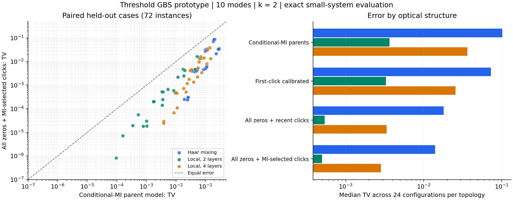
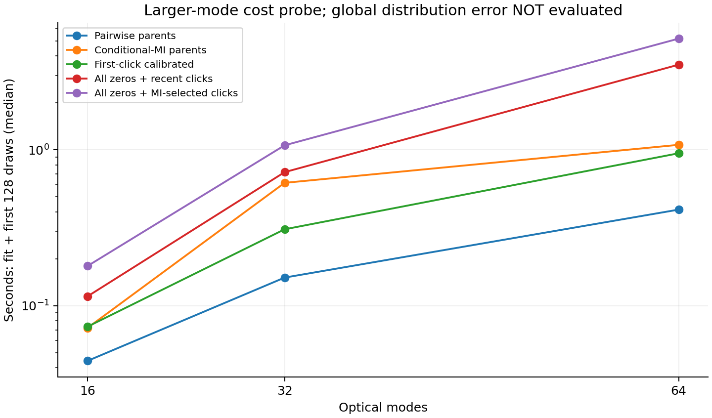

# 经典 GBS 探索：第一轮实验报告

**日期：2026-11-03**  
**项目：GBS Classical Lab v0.1.0**  
**结论状态：发现值得继续检验的原型；尚未证明原创性，尚未战胜先进经典实现或大型量子实验。**

## 1. 这一轮实际完成了什么

研究目标是寻找经典方法可利用的 GBS 结构，并建立可重复、可否证的探索过程。本轮从零均值 Gaussian 态的**阈值检测分布**入手：每个输出模式记录 0（没有探测到光子）或 1（至少探测到一个光子）。这与完整的光子数分辨 PNR 分布不同。

已经实现并运行的工作包括：

1. 以 Gaussian 真空概率和容斥/Möbius 反演为基础的小规模精确参考。
2. 以 Fock 振幅递推和独立光子损耗为基础的另一套验证，实现之间不共享行列式概率公式。
3. 独立模式、最近父变量、pairwise MI 和 greedy conditional MI 四类图模型基线。
4. 第一次点击位置的精确类别校准。
5. 保留全部无点击历史、只保留有限点击约束的原型，包含“最近点击”和“相关性最强点击”两个选择器。
6. 全部输入、参数、种子、源代码快照、数值诊断、失败记录和结果的存档，以及可重建的精确参考缓存。

正式实验完成 **2,124 次模型评估，覆盖 216 个不同的 Gaussian 输入配置**；最大完整分布参考为 12 模式。另完成 **60 次 16/32/64 模式成本探测**。所有正式运行均无记录到的计算失败。**47 项测试通过**。这些数量不包含早期探索目录的重复运行。

216 个配置对应 36 个不同干涉矩阵，每个矩阵改变了压缩和损耗；它们不是 216 个独立抽取的光学网络。测试集用于观察描述性结果，不支持把“胜出次数”解释为某个真实应用总体上的成功概率。

## 2. 最值得跟进的发现

### 2.1 保留无点击信息，比单纯改进低阶父集选择更有价值

在 72 个预留参数配置中，全部无点击历史加上两个 MI 选择的点击约束，相比两个 conditional-MI 父变量的基线，完整分布 TV 在 **72/72** 个配置上更低。最近两个点击的版本在 **71/72** 个配置上更低。

这里的 TV 是

\[
\operatorname{TV}(P,Q)=\tfrac12\sum_x|P(x)-Q(x)|,
\]

由小系统全部位串概率求和得到，不是从有限样本拟合的统计代理。TV 越小，两个分布在任意事件上的最大概率差异越小。

预留实验固定 10 模式，使用种子 2901–2904，压缩参数 r 为 0.4/0.8，透过率 eta 为 0.25/0.6/1.0。每种光学结构有 24 个配置。表中的数字为这些配置的 TV 中位数：

| 方法，预算参数 k=2 | 随机全混合 Haar | 局部 2 层 | 局部 4 层 |
|---|---:|---:|---:|
| Conditional-MI 父变量基线 | 0.101935 | 0.003652 | 0.036491 |
| 基线加第一次点击校准 | 0.073058 | 0.003288 | 0.025708 |
| 全部无点击 + 最近两个点击 | 0.018053 | 0.000535 | 0.003341 |
| 全部无点击 + MI 选择两个点击 | **0.014003** | **0.000497** | **0.002835** |

**相同 k 并不代表相同的信息量或相同计算量。**前两类只保留 k 个父变量的观测，后两类还保留所有已经出现的零；后者的概率计算也更贵。因此，这张表支持选择研究方向，不支持相同资源下的速度优势。

左图每个点对应一个配置，位于对角线下方表示候选方法误差更低。两个坐标轴均为对数。右图为相同数据按结构分组的中位数，不是置信区间。

### 2.2 点击选择需要在条件信息下继续研究

MI 选择器相对“最近点击”规则，在预留配置上有 **54 次改善、18 次退步**。一个明确的退步实例是：10 模式、local2、r=0.8、eta=1、seed=2902，最近点击版本 TV 为 0.013956，MI 选择器为 0.016290。

这说明无条件相关性不是可靠的普适选择规则。已观察到许多零之后，模式间的依赖可能发生变化。下一轮有依据的假设是：利用对无点击观测进行 Gaussian 条件化之后的结构选择点击，并把计算选择分数的成本一起计入。

### 2.3 普通低阶选模不是目前最好的主线

在 108 个初始扫描配置上，k=2 的 greedy CMI 相比 pairwise MI，仅 18 次 TV 改善、14 次退步，其余相同或在 1e-10 内。k=3 时改善更常见，但 TV 改善中位数仅约 0.000172。

这不说明 CMI 没有价值；它说明“仅把相关性排序改成条件互信息排序”不足以成为当前最有力的研究切口。它继续保留为基线和选择组件。

### 2.4 第一次点击校准是有用组件，不能单独当作突破

把位串按第一个点击的位置分组，另设全零类别，可以用嵌套真空概率精确计算这些类别的目标质量。给基线分布每个类别重新分配质量后，前向 KL 恰好减少该类别分布的 KL：

\[
D(P\|Q^*)=D(P\|Q)-D(P_F\|Q_F).
\]

这是标准信息投影与 KL 链式分解的应用，不是本项目的新理论。在本轮预留配置上，校准的 TV 也全部改善；但一般情况下，KL 的保证不能转换为 TV 单调改善。审计文档给出了反例。

## 3. 事件记忆原型为什么值得观察

对模式集合 S，记所有这些模式都没有点击的概率为 q(S)。零均值 Gaussian 态的 q(S) 由其协方差子矩阵的行列式给出。这个性质及无点击 Gaussian 更新属于已有阈值 GBS 方法的基础，参见 Quesada、Arrazola、Killoran (2018) [1]。

设已经生成的零观测集合为 Z，从已点击的模式中保留的集合为 C，|C|≤k。目标的部分事件概率是

\[
w(Z,C)=\sum_{T\subseteq C}(-1)^{|T|}q(Z\cup T).
\]

下一模式 i 的无点击条件概率取为

\[
Q(X_i=0\mid\text{历史})=
\frac{w(Z\cup\{i\},C)}{w(Z,C)}.
\]

这里的部分事件概率本身不做低阶累积量近似；近似发生在遗忘部分旧点击约束时。容斥项数受 k 控制，但行列式维度仍随保留的零位置数量增长。

代码用有限大小 LRU 缓存控制历史缓存。pairwise 选择器另需 O(m²) 的二模式边缘和分数矩阵。直接重算行列式的实现尚未使用增量 Cholesky/Schur 补更新。

### 一个正确但较松的误差界

在所有可达条件事件有定义、采用精确算术的条件下，任何总点击数 C(x)≤k 的位串都没有经历点击遗忘，因此

\[
Q(x)=P(x),\qquad C(x)\le k.
\]

由 P、Q 在其余集合上具有相同总质量可得

\[
\operatorname{TV}(P,Q)\le P(C\ge k+1).
\]

这是通用截断/耦合原则的直接应用，不作为新的复杂性突破。预留数据中，k=2 的 MI 版本在低点击位串上的最大绝对概率差为 1.11e-16，与这个性质一致。其 C≥3 部分条件分布的 TV 中位数约 0.01953、最大约 0.19331；因此其残余误差不能只靠总体中位数来判断。

对于独立压缩真空输入、被动干涉和均匀输出损耗，总探测光子数 N 的生成函数是

\[
G(z)=\prod_j\frac{\operatorname{sech}(r_j)}{
\sqrt{1-\tanh^2(r_j)(1-\eta+\eta z)^2}}.
\]

阈值点击数不超过光子数，于是可用 P(N≥k+1) 上界上述点击尾概率。只计算 0 到 k 的系数即可，代码使用非负递推与截断卷积，算术代价 O(mk²)。这避免了为了得到上界而枚举完整 GBS 分布。

**主要问题恰好在这个界：**64 模式成本探测中，k=2 对应的光子尾界为 **0.9213 或 0.9983**，几乎不能认证样本质量。浮点实现也不是经过区间算术向外舍入的严格数值证书。要进入高计数实验区域，需要更强的误差控制或更好的算法，不能仅靠固定小 k。

pairwise 选择器还可能重新纳入此前遗忘的点击。在具有严格支持限制的某些无损态中，可能遇到无定义保留条件事件；实现明确报错，不凭空选择概率。本轮配置没有触发该情况，这不等于所有态都已覆盖。

## 4. 运行到 64 模式说明了什么

成本探测使用 m=16/32/64、r=0.6、eta=0.25/0.6、Haar/local2、seed=3901，每个方法先拟合，再生成 128 个样本。未枚举完整目标或近似分布，所有 exact marginal 请求限制在至多 3 模式。

64 模式的四个配置中，“拟合加第一批 128 个样本”的耗时中位数如下，单位秒：

| 方法，k=2 | 本次 CPU 测量 |
|---|---:|
| Pairwise 父变量 | 0.413 |
| Conditional-MI 父变量 | 1.076 |
| 校准 Conditional-MI | 0.950 |
| 全零历史 + 最近点击 | 3.517 |
| 全零历史 + MI 点击 | 5.167 |

这些是共享执行环境的单次冷启动批次观测，会受系统负载、缓存和测量波动影响；校准版本与未校准版本的时间差不能据此解释为算法加速。这里没有声称稳定吞吐性能，也没有按相同质量与量子设备比较。

最可靠的结论是：代码在有限缓存下能够直接生成较多模式的样本；主要瓶颈有进一步优化空间。**完整 TV/KL 的证据仍只到实际枚举的 12 模式。**

## 5. 方法正确性与实验公平性

47 项测试覆盖真空、独立热态、有损独立压缩态、双模压缩的解析点击概率、模式置换、均值能量守恒和损耗、完整条件化还原、零概率支持、校准 KL 等式、缓存逐出不变性以及独立 Fock 校验。

Fock 校验明确记录总光子截断遗漏质量。其阈值输出分布的 TV 由该质量控制，依赖损耗和阈值测量对 Fock 数的对角性；不能把这一结论误写成任意截断纯态的迹距离界。

每个方法均从一个新的 covariance oracle 开始。目标完整分布只供评价器使用，不供近似拟合、选择参数或预热采样缓存使用。采样计时发生在完整 Q 枚举之前。参考计算和候选计算分开计时。

最大 12 模式参考中，记录到的最大 L1 数值修正约 1.33e-14；另外两个正式小规模运行没有负概率修正。这是数值诊断，不是所有概率的严格误差证明。容斥相消超限时实现会报错。

正式运行及原始结果目录：

| 目录 | 配置数 | 模型评估数 | 用途 |
|---|---:|---:|---|
| `results/survey_v2` | 108 | 972 | 8/12 模式、三类结构的父集基线扫描 |
| `results/adaptive_v2` | 72 | 648 | 8/10 模式、校准与事件记忆探索 |
| `results/heldout_v1` | 72 | 504 | 四个预留种子、10 模式复核 |
| `results/scaling_v1` | 12 | 60 | 16/32/64 模式成本探测 |

前两套有重合配置，因此三个小规模运行合计 252 次配置访问，对应 216 个不同输入。`survey_v1` 和 `adaptive_v1` 保留早期探索历史，不纳入正式计数和结论。

全部正式运行使用同一份核心源码哈希：

`49933a83f38fef70c7e2335b0873a53c46d5bed4625c74d83fefd58def1b6def`

## 6. 在 GBS 领域中的定位和后续选择

当前原型与已有精确阈值采样、低阶边缘代理、FrugalGBS 的条件采样近似都有联系。[1–3] 有针对性的检索尚未找到完全相同的保留/重选点击规则，但这不足以确认原创性；等价方法可能以不同名称或软件形式存在。

FrugalGBS 已在实验使用的若干统计测试上取得强表现，其结果和成本不能被本项目的低阶贝叶斯网络基线替代。[3] MPS 与噪声分解也已有重要结果。[4] 新近 Gaussian 检测重置的预印本给出不同的高损耗分析；本项目没有复现或推翻那些定理。[5]

因此下一轮优先级是：

1. **条件化之后的点击选择。**利用已知零观测改善选择，保留当前失败实例，按相同总时间比较。
2. **更紧的实例误差界。**从逐步条件误差开始，找能避免完整枚举的可证明控制量。仅凭协方差小或低阶统计吻合不够。
3. **先进经典基线的同条件对赛。**先接入 FrugalGBS，再评估 MPS/相空间路线。输入模型、输出粒度、硬件、样本数、预处理与全部采样成本都要对应。

其他路线没有被排除：Gaussian 重置、位移噪声、非负图 Glauber 混合、低秩 hafnian 和原始探测器输出的相空间近似都已在研究地图中记录。当前结果足以支持先集中于事件信息的保留方式，还不足以全面投入大型 GPU 实现。

## 7. 引用与复现入口

- [1] Quesada, Arrazola, Killoran, *Gaussian Boson Sampling using threshold detectors*, Phys. Rev. A 98, 062322 (2018). <https://arxiv.org/html/1807.01639v2>
- [2] Villalonga 等, *Efficient approximation of experimental Gaussian boson sampling*. <https://arxiv.org/abs/2109.11525>
- [3] Dodd 等, *A fast and frugal Gaussian boson sampling emulator*. <https://arxiv.org/html/2511.14923v1>；官方实现 <https://github.com/tomdodd4598/FrugalGBS>
- [4] Oh 等, *Classical algorithm for simulating experimental Gaussian boson sampling*. <https://doi.org/10.1038/s41567-024-02535-8>
- [5] Lim, *Classical Simulation of Lossy Gaussian Boson Sampling beyond Square-Root Regime*, 2026-10-05 预印本。<https://arxiv.org/html/2610.06526v1>

完整查新记录见 `research/prior_art_and_open_questions.md`；审计见 `research/final_audit.md`；后续任务见 `research/next_experiments.md`；运行命令见 README。

远程 GitHub 仓库尚未创建：当前连接缺少新建仓库操作，备用网页未登录。当前交付为可移植的代码、结果、缓存与本地 Git 归档，不含访问令牌或实验数据服务凭据。
