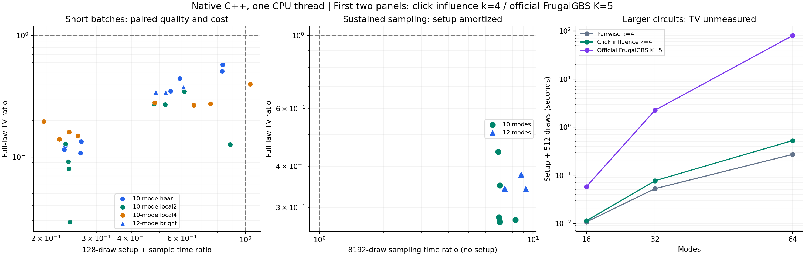

# GBS 经典算法探索：原生 C++ 与统一性能对赛

日期：2026-11-04。前一里程碑：`63736954511ce7b7f8af1be83c458968692b5f9e`。

本轮响应“核心使用 C++，必要时考虑手写汇编”的要求。研究对象仍是零均值 Gaussian 态、阈值探测、给定协方差矩阵的经典近似采样。没有使用量子实验硬件，也没有接入真实实验样本。

## 1. 主要结论

<!-- FORMAL_RESULTS_START -->
**C++ 移植完成，并改变了原型阶段的性能判断：主要候选在小规模短批次上可以同时降低误差与成本，但同一小实例持续抽样时仍明显慢于官方 FrugalGBS。32、64 模式上又出现成本优势，其分布质量尚未核验。**

三个正式阶段共完成 **366 次方法运行，0 次失败**：短批 243 次、持续抽样 81 次、大模式成本 42 次。最终全项目 **106 项测试通过**；普通数值验证、明确拒绝的压力例另行统计，见第 6 节。

### 小规模短批次：完整分布与成本一起比较

以下数值先在同一输入内取三次运行的时间中位数，再按输入配对计算候选/Frugal 比值，最后取该比值在网格上的中位数。TV 使用全部 1024 或 4096 个输出概率。

| 输入组 | 输入数 | 主要候选 TV / Frugal TV 的中位数 | 更低 TV | 预处理加 128 样本耗时比中位数 | 更快 |
|---|---:|---:|---:|---:|---:|
| 10 模式，三类拓扑 | 24 | 0.178562 | 24/24 | 0.372400 | 23/24 |
| 12 模式，较亮 Haar 实例 | 3 | 0.342091 | 3/3 | 0.525918 | 3/3 |

合计 **27/27 更低 TV，26/27 更快**。唯一较慢输入 `b7e6861062dd571a` 的候选短批耗时约高 4.0%。所有 27 个输入合并后的配对速度提升中位数为 **2.081 倍**。首轮旧二进制的 27/27 速度计数仍保留为历史结果，不作为最终复测结论。

修复后 pairwise 对照在 10 模式组有 19/24 的 TV 低于 Frugal，12 模式组为 3/3；短批速度则全部更快。主要候选与较便宜对照的取舍有完整记录，没有删去较差对照例。

### 小规模持续抽样：预处理摊销后落后

每个实例生成 8192 个样本。只比较抽样阶段时间时，主要候选在 6 个较亮 10 模式输入上的耗时比中位数为 **6.97084**，在 3 个 12 模式输入上为 **8.78844**；9/9 都比官方 Frugal 慢。即使计入一次预处理，总时间比中位数仍分别为 **5.77000** 与 **7.17658**。

这说明短批优势主要与预处理负担有关，不能推广成小规模长期吞吐优势。使用本次实测每样本成本拟合线性摊销模型，9 个实例的估算交叉点约为 231–290 个样本；这是模型估算，尚未做逐批量扫描来确认具体阈值。

### 大模式成本：增长趋势有利，质量仍待验证

下表给出每个规模 2 个输入的核心时间中位数，任务为预处理加 512 个样本。16/32 模式每输入重复 3 次；64 模式每输入只测 1 次。

| 模式数 | 主要候选，秒 | 官方 Frugal K=5，秒 | 逐输入候选/Frugal 耗时比中位数 | 完整 TV |
|---:|---:|---:|---:|---|
| 16 | 0.011300 | 0.057871 | 0.195198 | 未评估 |
| 32 | 0.077038 | 2.260205 | 0.0340870 | 未评估 |
| 64 | 0.525523 | 80.232122 | 0.00655253 | 未评估 |

仅比较抽样阶段，候选/Frugal 耗时比中位数在 16、32、64 模式分别为 **1.10803、0.271644、0.0707585**。所以 32/64 模式的成本优势也出现在抽样阶段，不完全由预处理解释。64 模式的每个候选批次约 0.52–0.53 秒，基线约 78.9–81.6 秒，但这些数值**没有匹配分布误差条件，不能当作同质量加速比或战胜量子实验的证据**。



前两图比值的分母均为官方 FrugalGBS K=5，低于 1 表示候选该项更好。右图只画成本；大系统完整 TV 未测。完整表、原始记录与机器可读摘要见 `results/cpp_analysis/` 以及对应三个阶段目录。
<!-- FORMAL_RESULTS_END -->

这些输入已用于上一轮探索；本轮完成统一实现条件下的测量，不构成新的独立留出研究。24 个 10 模式配置共享 6 个干涉矩阵，3 个 12 模式实例使用另 3 个矩阵。`k=4` 是看到上一轮基线结果后加入的探索参数。赢的配置数量与网格中位数不提供总体统计显著性，也不说明击败了全部经典竞争者。

## 2. 真正迁移到了 C++ 的部分

`experiments/click_sampler.cpp` 是可独立运行的 C++20 程序。它接收协方差矩阵，完成选择器预处理、状态更新、条件概率、随机抽样和样本存储；运行时不调用 Python，不接收完整目标概率向量。Python 包装层负责输入检查、启动程序、组织实验和结果核验。

核心行为如下：

- 每个历史无点击事件，通过 Gaussian 条件化的秩二更新进入当前协方差。
- 所有历史点击模式继续留在状态中。某一步未选中的点击约束，后续仍可以重新选入，不能直接删除其模式。
- 主要候选 `click_influence` 逐步选择使当前点击概率变化最大的已观测点击，最多保留 `k` 个。
- 对照 `pairwise` 根据当前模式与历史点击模式的无条件二元互信息排序，最多保留 `k` 个。
- 事件概率通过真空边缘的容斥求和计算；固定大小矩阵核使用 Eigen，行列式使用 double，容斥累加使用 long double。
- 同一步选择过程中，重复请求的真空子集概率被复用。键保留模式排列，因此不会以改变矩阵排列和舍入路径为代价换取缓存命中。
- 样本存储、随机数发生器初始化计入抽样计时。计数汇总与完整分布枚举在核心抽样计时之外分别记录；JSON 序列化没有独立的原生计时，其开销包含在包装层及统一外层调用计时中。

程序支持 `k=0..8`、不同测量顺序和注入均匀数。全分布枚举限制在不超过 14 模式；大模式采样不分配 `2^m` 个桶。协方差约定为 `hbar=2`、真空 `V=I`、`xxpp` 顺序，输出 bit 的编号对应物理模式。

近似来自放松未保留的点击约束。固定 `k` 不保证任意输入上的总变差距离很小；上一轮已给出一个可以解析计算的失败家族。完整历史也没有被压缩为只有 `k` 个变量，因为无点击集合和测量前缀仍携带历史信息。

## 3. 两边相同的性能条件

候选与官方 FrugalGBS 使用同一个 GCC 可执行文件、`-O3 -march=native -ffp-contract=off`、同一台 AMD EPYC 9V74 主机和一个 CPU 线程。没有使用 `-ffast-math`。Frugal 使用上游采样实现及 xsimd，本机版本报告每个 SIMD 批次容纳 8 个 double。Eigen/xsimd 的显式 FMA 指令仍可能存在，因此编译选项不等于跨实现逐位相同的承诺。

官方源代码固定于 `fa8b796f2afebd4845a2e335e457735952617ef8`，未改写其采样规则。新适配器使 16、32、64 模式运行只输出每模式点击和总点击数等统计，避免无关的指数大小直方图。新二进制经过单独验证，不能直接套用前一轮 SSE 二进制的验证。

配置在查看原生候选计时前固定于 `configs/cpp_matched_benchmark.json`：

| 阶段 | 输入 | 每次样本数 | 重复次数 | 能回答的问题 |
|---|---:|---:|---:|---|
| 短批次 | 24 个 10 模式 + 3 个 12 模式 | 128 | 每个输入 3 次 | 预处理加首批抽样的成本；完整分布误差 |
| 持续抽样 | 6 个较亮 10 模式 + 3 个 12 模式 | 8192 | 每个输入 3 次 | 预处理可摊销时的抽样吞吐 |
| 大模式成本 | 16、32、64 模式各 2 个输入 | 512 | 16/32 模式 3 次，64 模式 1 次 | 这些输入上的实际运行成本；不提供完整分布质量 |

每次运行启动新进程和新模型，轮换方法顺序。输入矩阵及二进制哈希绑定到结果。第一阶段的完整 Q 在计时抽样之后计算，不给抽样热身。对每个输入先取重复中位数，再计算方法间比值，最后总结输入网格；比值的中位数不等于两个总体中位数的比值。

主要速度指标是 C++ 的 `setup + sampling` 或 `sampling`。完整包装调用另有统一的外层计时器，但两种接口的校验开销不同；该时间仅记录实验接口成本。短批第 0 次重复的完整包装时间包含后续 Q 枚举，不能混入仅抽样的端到端延迟。分析脚本只使用未枚举重复的包装时间。

`k` 是保留的点击约束数，`K` 是 Frugal 的累积量阶数，两者不是相等的计算资源预算。这里测试的是指定 `k=4` 对指定 Frugal `K=5`；没有穷尽 Frugal 的所有参数、硬件、并行方式及其他经典算法。

## 4. 移植暴露并修复的数值问题

最初原生短批次试验保留在 `results/cpp_cold/`。主要候选的 27 个完整分布都与原 Python 规则一致，最大 TV 差约 `9.46e-14`。辅助 pairwise 对照有 13 个实例未通过 `2e-8` 的完整分布一致性门槛，最坏差约 `0.00437765`。

独立定位结果显示，差异完全来自互信息分数排序。把 Python 选择器的分数矩阵替换为原生分数后，所有 27 个原生 Q 都可以在约 `9.65e-14` 的 TV 以内复现。状态更新、概率内核、缓存和并列时按物理模式编号排序的逻辑不是该差异的来源。

旧公式对理论上为零或非常小的互信息存在浮点相消。一个无条件协方差交叉块完全为零的模式对，其二模 Gaussian 约化态为乘积态，互信息应精确取零。旧计算产生的约 `1e-17` 伪分数却改变了保留集合。无条件独立不意味着在其他观测条件下仍无作用，所以这种排序变化可能显著改变最终 Q。

仅把结构上严格为零的交叉块设为零还不够。一个 local4 实例存在真正非零的弱相关，独立 80 位计算得到互信息约 `3.3451e-17`；旧 Python 公式把它舍入为零。修复因此采用数学等价的稳定公式，不引入“低于某个阈值就当作零”的分数地板。

设 `A=V_aa+I₂`、`B=V_bb+I₂`，交叉块 `C=V_ab`；这些均为 2×2 块，`q_a=2/sqrt(det A)`、`q_b=2/sqrt(det B)`。用 long double 的 Cholesky 因子白化：

\[
T=L_A^{-1} C L_B^{-T},\qquad
s=\|T\|_F^2-\det(T)^2.
\]

二模无点击概率与独立边缘乘积之差，可稳定写成

\[
\delta=q_aq_b\,\operatorname{expm1}\!\left[-\tfrac12\operatorname{log1p}(-s)\right].
\]

二元联合表的四格相对于乘积表 r 的变化分别是 `+delta,-delta,-delta,+delta`。令每格 `x=(p-r)/r`，利用四格偏差和为零，互信息可写成

\[
I=\sum r\,h(x),\qquad h(x)=(1+x)\log(1+x)-x.
\]

小 x 采用同一多项式展开，大 x 使用 `log1p`，零概率边界用连续延拓处理。原有物理概率检查及其容许的舍入修正保留；没有放宽条件概率保护或完整分布门槛。Python 与 C++ 使用同一新公式。该改变仅涉及 retained-click pairwise 对照，主要候选的公式未改动。

新参考分布、旧新差异、分数矩阵、来源哈希与原生 Q 保存在 `results/cpp_pairwise_reference/`；独立高精度计算保存在 `results/cpp_numerics_audit/`。原始第二轮数据和最初失败试验不覆盖。第二轮“优于 pairwise”的比较需要按当时旧数值实现理解；新的结论使用修复后的对照。主要候选与官方 Frugal 的分布比较不依赖这次修复。

更准确地计算选择分数，并不保证这个启发式更接近物理目标。例如 `a71ab6f032848177` 的 pairwise TV 从旧实现约 0.00121334 变为修复后约 0.00520616。这次修复确立了可复现的规则，不能当作一次普遍改善近似质量的优化。27 个新 Python 参考与原生 Q 的最大 TV 差为 `9.621014338669397e-14`，仍使用原定 `2e-8` 门槛。

## 5. 为什么先消除重复计算

在已归档的 12 模式、1024 样本剖析实例上，同一缓存版二进制开启与关闭步内复用：

| 指标 | 关闭复用 | 开启复用 |
|---|---:|---:|
| 小行列式总次数，选择与抽样合计 | 388680 | 188498 |
| 带剖析计时器的抽样时间 | 0.071024964 秒 | 0.049991965 秒 |

该实例的行列式次数减少约 51.5%，测得抽样时间下降约 29.6%。另外两个输入的完整 Q 和注入随机数样本在开关复用之间逐位一致；缓存前后版本的验证也留有完整记录。这只是一个明确的优化证据，带剖析计时器的单次时间不能替代正式重复对赛。

本轮没有手写汇编。计算量最大的事件内核值得继续优化，但现有证据首先支持消除重复工作。后续可以在剖析支持下比较小矩阵的批处理 SIMD、内存布局和专用核；只有同时带来实测收益并通过概率与分布核验的版本才应采用。汇编不会自动改善近似误差，也不会解决容斥相消。

冻结原生程序的反汇编已确认：6×6、8×8 的 Eigen LLT 包含 YMM packed-double 运算，10×10 LLT 中有 ZMM `vdivpd`，事件容斥核保留 long-double 运算。该结果证明 SIMD 指令已进入生成代码；它本身不证明某条指令占多少运行时间。版本绑定的剖析与静态指令证据位于 `results/cpp_optimization/`。

## 6. 验证与解释边界

完整 Q 比较使用同一条件核枚举其在理想连续均匀随机数下的诱导分布，不是枚举有限 PRNG 的全部状态。小规模 TV 对比使用全部输出概率，不只是点击数直方图或二阶相关。

程序保留数值拒绝：无法可靠计算的稀有条件事件会明确报错，不自动重试、删除该事件或放宽阈值。若某个压力例按预期触发保护，这证明了保护行为，不能算作一次成功的完整分布求值。验证的普通成功例与这类受保护压力例分别统计。

本次冻结的原生可执行文件 SHA-256 为 `3e63591bc1f2b133864da1482f75091a1dd816a762c0cd32203550decbc2ca46`。扩展验证包含 37 个普通成功例和 6 个明确触发保护的压力例；另有 4 组严格支持检查有效样本与 2 组弱事件拒绝。官方基线二进制 SHA-256 为 `3131fc80e293eb748032a7e8d7c27b7e4f8a53ecfe78be306e7ffa632170e1a0`，10 个适配验证通过。所有这些是浮点数值核验，不是区间算术证明。

大模式成本测量仍缺完整 TV 或匹配误差保证。16、32、64 模式能够输出样本，只表明该次程序运行完成；不能由此推断它逼近了大型 GBS 实验，也不能由此宣称量子优势已被推翻。下一步的科学问题是：在更高点击数与真实实验参数下，误差能否仍被可信估计或控制，以及为达到相同误差，双方真正需要多少时间。

## 7. 复现入口

构建需要 C++20 编译器和 Eigen；官方基线还需 OpenMP。已归档固定提交的官方 CPU 源码及 xsimd。`--native` 版本应在目标 CPU 上重新构建；通用构建省略该选项。原生 Frugal 验证器会调用旧 SSE 适配器，交叉核验小模式的完整诱导分布，因此还需要构建 `experiments/build_frugal.py`；该参考程序不参与本轮原生性能对赛。

```bash
python experiments/build_click_sampler.py --native --build-dir .cache/click-native
python experiments/build_frugal_sampling.py --native
python experiments/build_frugal.py

OPENBLAS_NUM_THREADS=1 OMP_NUM_THREADS=1 PYTHONPATH=src \
  python -m gbslab.cpp_click --validate \
  --executable .cache/click-native/click_sampler \
  --output results/new_cpp_validation.json

OPENBLAS_NUM_THREADS=1 OMP_NUM_THREADS=1 PYTHONPATH=src \
  python experiments/validate_frugal_native.py \
  --executable .cache/frugal-native/frugal_sampling_adapter \
  --output results/new_frugal_validation

OPENBLAS_NUM_THREADS=1 OMP_NUM_THREADS=1 PYTHONPATH=src \
  python experiments/benchmark_cpp.py --phase cold \
  --cpp-executable .cache/click-native/click_sampler \
  --cpp-validation results/new_cpp_validation.json \
  --frugal-executable .cache/frugal-native/frugal_sampling_adapter \
  --frugal-validation results/new_frugal_validation/validation.json \
  --output results/new_cpp_cold
```

新对赛默认读取本轮修复后的 pairwise 参考文件以及原有 influence 参考。改变输入、公式或编译结果后，应先生成对应参考并重新验证。`steady` 和 `large` 两阶段使用同一个 runner；所有运行采用新输出目录。Frugal 验证器要求输出目录不存在或为空，只向该目录写入结果，不覆盖构建目录里的历史验证；对赛显式读取与所选可执行文件哈希匹配的两份验证 JSON。

独立运行采样核心的形式为：

```bash
.cache/click-native/click_sampler --input covariance.csv --modes 32 \
  --selector click_influence --k 4 --samples 10000 --seed 42
```

这里的文件必须是 64×64 的实协方差矩阵，使用上文约定。要输出每条样本，可加 `--raw-samples`。研究程序会对不能可信计算的情况明确报错。

正式摘要与科学绘图由 `experiments/analyze_cpp.py` 读取三个正式结果目录生成；包含完整数值的入口是 `results/cpp_analysis/summary.json` 与 `summary_tables.md`。独立检查意见见 `research/cpp_independent_audit.md`，验证详情见 `research/cpp_validation.md`。

## 8. 相关一手资料

- Dodd 等，[A fast and frugal Gaussian Boson Sampling emulator](https://arxiv.org/abs/2511.14923)：官方基线及累积量近似、double-elision 采样方法。论文在实验常用基准上的结果不能替代本项目未计算的大系统完整 TV。
- Quesada、Arrazola、Killoran，[Gaussian Boson Sampling using threshold detectors](https://arxiv.org/abs/1807.01639)：阈值 GBS、Torontonian 和基于 Gaussian 条件化的经典采样基础。
- [官方 FrugalGBS 源码](https://github.com/tomdodd4598/FrugalGBS)：本项目固定上游提交，不以重新实现的简化基线代替官方采样器。

尚未确认主要启发式在全部相关文献中的原创性。本轮结果是可继续检验的经典候选与实现进展，不是量子计算复杂性结论。
