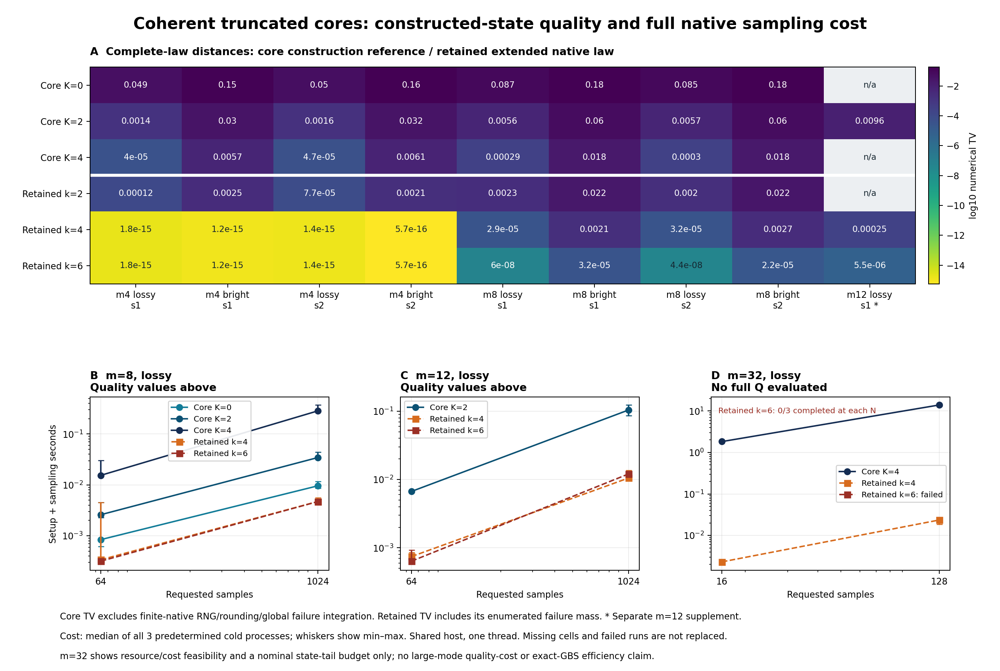

# 第十轮：相干纯态核心与位移阈值测量的有限 Fock 采样器

日期：2026-11-05。项目：量子 / deziroGBS。

**本轮已完成相干纯态核心的原生采样实现与固定实验，但没有获得同时改善质量与速度的结果。** 完整项目门禁 298 项通过，0 失败、0 错误、0 跳过；51/51 个质量分布、76/76 项交叉检查完成。66 次预定计时全部执行，60 次完整、6 次数值失败，20/22 个单元有完整三重复中位数。在双方有完整质量参考且成本可用的 16 个配对单元中，core 构造参考 TV 均更大，完整原生成本也均更高。不能把可控的理想截断构造误写成已实现的速度优势。

6 次失败均来自 m32 retained-k6，是同三个随机种子在两种批长下重现的失败前缀；不是六个独立观测。新核心的 30 次计时批次全部完成，但它的全局有限精度失败质量仍未知。完整证据见 [冻结汇总](results/iteration10_analysis/summary.json) 与 [全部结果表](results/iteration10_analysis/summary_tables.md)。

## 1. 本轮完成什么

第九轮给出了一个可连接到目标完整分布的近似态：对有损 Gaussian 态分离纯态核心与经典相关位移，保留核心总光子数不超过 K 的**相干叠加**，再施加原来的位移通道与阈值测量。它在理想算术下有全局截断界，但当时尚未实现这一构造的完整采样。

本轮实现新的 C++ 有限 Fock 原型。它建立归一化相干核心，对每个样本抽取完整相关位移，然后把每个局部二元阈值 POVM 细分为秩一隐藏通道。单条轨迹只需保存一个条件纯态；隐藏通道最后丢弃，用户得到二元点击模式。这样避免显式保存点击后混合态的所有分量。

这个进展解决的是小截断下的构造与测量实现。测量过程仍需完整总光子预算空间

\[
D_{\rm full}(m,K)=\sum_{n=0}^{K}\binom{m+n-1}{n}
=\binom{m+K}{K}.
\]

在固定非零压缩与损耗、固定误差预算下，所需 K 可随 m 线性增长，稠密表示仍有指数规模。隐藏通道不提供 MPS 压缩，也不把大模式 GBS 的完整模拟转为已解决问题。

本轮必须区分三个证据对象：

| 对象 | 本轮可以检查的内容 | 不能从该检查直接推出的结论 |
|---|---|---|
| 理想相干截断态的完整输出律 | 解析态距离上界；小系统 Gaussian 平均参考完整 Q | 全部浮点和原生失败路径已被同一界覆盖 |
| C++ 测量实现 | 系数核对、固定 alpha 的隐藏通道完整枚举、真实采样轨迹和停止证据 | 有限样本未失败意味着全局失败质量为零 |
| retained-click 对照 | 小系统完整原生扩展律，包含失败符号 | 它继承了新核心构造的截断态定理 |

主结果中，新方法的质量字段统一称为 **`construction_reference_tv`**。这是一个有完整分布的构造级数值参考，但证据范围与 retained 对照的完整扩展原生律不同。

## 2. 模型条件、纯态核心与相关位移

固定 hbar=2、xxpp 顺序、零均值、m 个同相位的相同实压缩输入 r≥0、统一透射率 eta∈[0,1]，以及无源干涉仪 U。令

\[
O=\begin{pmatrix}\Re U&-\Im U\\\Im U&\Re U\end{pmatrix},\qquad
a=1-\eta+\eta e^{-2r},\quad b=1-\eta+\eta e^{2r},\quad
s=-\tfrac12\log a.
\]

目标协方差与核心协方差分别为

\[
V=O\operatorname{diag}(aI,bI)O^T,\qquad
V_p=O\operatorname{diag}(aI,a^{-1}I)O^T.
\]

因为

\[
ab=1+4\eta(1-\eta)\sinh^2r\ge1,
\]

残余协方差 C=V−Vp 半正定，核心为纯 Gaussian 态。记

\[
\delta=b-a^{-1}=\frac{4\eta(1-\eta)\sinh^2r}{a},\qquad
C=O\operatorname{diag}(0,\delta I)O^T.
\]

程序使用右端非负乘积式计算 delta，避免在真空或无损边界相减得到虚假负方差。每个尝试样本一次抽取实标准 Gaussian 向量 z，设置

\[
\boxed{\boldsymbol\alpha=\frac{i\sqrt\delta}{2}\,U z,
\qquad z\sim\mathcal N(0,I_m).}
\]

真实 quadrature 位移为 d=(2Re alpha,2Im alpha)，协方差为 C。这个随机向量通常不是圆对称复 Gaussian：

\[
\mathbb E[\alpha\alpha^\dagger]=\frac\delta4I,
\qquad
\mathbb E[\alpha\alpha^T]=-\frac\delta4UU^T.
\]

后一矩阵包含必须保留的相位与跨模式信息。不能只凭前一矩阵为对角阵，改用互相独立的圆对称复噪声；也不能观察到点击前缀后，无条件重抽尚未测量模式的位移。奇异 C 由实 Gaussian 向量的线性映射定义，不要求全维 Gaussian 密度。

该闭式分解的适用条件见 [第九轮理论审查](research/iteration9_core_budget_theory.md)。已知的单模输入相位可吸收入 U，前提是 B、O 和位移始终采用同一约定。一般非均匀损耗、非相同输入压缩或任意实验协方差须另行建立合法分解，本文没有把当前闭式实现推广到这些情形。

## 3. 相干核心的构造与尾概率

纯态核心的创建算符表示为

\[
|\psi_p\rangle=c_0\exp\!\left(\frac12\hat a^\dagger B\hat a^\dagger\right)|0\rangle,
\qquad B=-\tanh(s)UU^T,\qquad c_0=\operatorname{sech}^{m/2}s.
\]

这里是转置 U^T，不能换成伴随 U†。对非零占据向量 n 选 n_j>0，Fock 系数满足

\[
\sqrt{n_j}\,c(n)=
\sum_{\ell:n_\ell-\delta_{j\ell}>0}
B_{j\ell}\sqrt{n_\ell-\delta_{j\ell}}\,
c(n-e_j-e_\ell).
\]

负占据项不参与求和。程序按总次数递增生成系数，初始奇数总次数系数为零，然后对全部 N≤K 系数**一次相干归一化**。相对真空系数可先置为 1 来构造向量，但该相对尺度不能被当成物理保留概率。

令 Π_K 投影到核心的总光子数 N≤K，

\[
|\psi_K\rangle=\frac{\Pi_K|\psi_p\rangle}{\sqrt{1-\tau_K}},
\qquad \tau_K=\Pr_{\psi_p}(N>K).
\]

对相同核心压缩，J=N/2 遵循失败次数约定的负二项分布：

\[
J\sim\operatorname{NB}\!\left(\frac m2,\operatorname{sech}^2s\right),
\qquad \tau_K=\Pr(J>\lfloor K/2\rfloor).
\]

无源 U 保持总光子数，所以这个尾不依赖特定 Haar 输入。它是**纯态核心的光子尾**，不是最终有损混态的探测光子尾，也不是点击数尾。

不能先随机抽一个总光子数扇区再模拟该扇区。位移会使不同 N 扇区产生可测干涉；去掉跨扇区相干性改变了近似态。初始只有偶数总 N，也不表示后续条件纯态仍只需偶数基底。

## 4. 位移阈值测量的秩一细分

### 4.1 有限输入空间上的准确 POVM

将一个模式的位移后真空投影拉回输入 Fock 空间，定义

\[
u_n(\alpha)=e^{-|\alpha|^2/2}\frac{(-\alpha)^n}{\sqrt{n!}},
\quad 0\le n\le K,
\qquad E_0=uu^\dagger,\quad E_1=I-uu^\dagger.
\]

它精确表示有限**输入**支持上的位移阈值概率，不需要把位移后的输出光子数再截断。实际位移后的态仍可能有任意高光子数。

令

\[
t=\|u\|^2=\Pr[\operatorname{Poisson}(|\alpha|^2)\le K],\quad
q=1-t=\Pr[\operatorname{Poisson}(|\alpha|^2)>K],\quad
w=u/\sqrt t.
\]

有限 alpha、K 下 t>0；alpha≠0 时 q>0。仅 alpha=0 给出解析 q=0。实现分别用正项求和计算 CDF 和 tail，避免用浮点 1−t 消去一个严格正的小尾。

### 4.2 抽取隐藏通道后仍保存纯态

取正交归一基 h_0=w,h_1,…,h_K。在当前联合纯态 Ψ 上计算

\[
b_c=(\langle h_c|\otimes I)\Psi,\qquad \pi_c=\|b_c\|^2.
\]

按 pi_c 抽通道 c，并保存 b_c/sqrt(pi_c)。若 c=0，再以 t/q 分别输出无点击/点击；若 c>0，输出点击。对应 Kraus 行向量为

\[
L_{0,0}=\sqrt t\langle w|,\quad
L_{1,0}=\sqrt q\langle w|,\quad
L_{1,c}=\langle h_c|\ (c>0).
\]

它们分别满足

\[
L_{0,0}^\dagger L_{0,0}=E_0,\qquad
\sum_{c=0}^{K}L_{1,c}^\dagger L_{1,c}=E_1.
\]

把隐藏标签求和后，无点击对应的未归一化剩余态是 t b_0b_0†；点击对应 q b_0b_0†+Σ_{c>0}b_cb_c†。这正是原局部阈值效应并丢弃已测模式后得到的剩余态。递归应用这个恒等式，即得完整二元联合分布。

该结论覆盖每个模式测量一次并丢弃的情形。它没有声称重现一个之后还要与系统重新耦合的、保留已测模式的 QND 测量仪器。

### 4.3 稳定正交补、复共轭与支持

实现利用 w_0 实且非负，令 z=e_0+w，取

\[
H=\frac{zz^\dagger}{1+w_0}-I.
\]

H 是 Hermitian unitary，He_0=w，分母至少为 1。它避免在近真空时构造 e_0−w 所引起的消减。收缩必须使用列向量的共轭 bra：

\[
b_c(r)=\sum_{n=0}^{K-|r|}H_{n,c}^*\Psi(n,r).
\]

每条固定剩余占据 r 的 fiber 补零至 K+1 维，然后计算**全部** K+1 个通道。隐藏 c 不是被测输入光子数，不能把剩余预算改成 K−c，也不能要求 c+|r|≤K。剩余未位移条件态依旧满足总 N≤K，但一般同时有偶数和奇数 N。

完整推导与数学边界见 [相干 POVM 理论审查](research/iteration10_coherent_povm_theory.md)。

## 5. 全局误差预算与本轮参考量的边界

采用 trace distance 为二分之一迹范数，精确纯态投影给出

\[
\tfrac12\bigl\||\psi_p\rangle\langle\psi_p|-|\psi_K\rangle\langle\psi_K|\bigr\|_1
=\sqrt{\tau_K}.
\]

对两态施加同一随机位移通道和同一测量，距离收缩，因此理想构造律 Q_K 满足

\[
\operatorname{TV}(P_V,Q_K)\le\sqrt{\tau_K}.
\]

这个界属于当前具体态构造。旧 retained、product、pair、forest 或 Frugal 分布没有因此获得新的全局保证。

若归一化存储态距精确 ψ_K 的 trace distance 有一个另行证明的上界 delta_state，实际位移与采样相对该存储态的理想通道输出又有 TV 上界 delta_sample，则可合计

\[
\operatorname{TV}(P_V,Q_{\rm implemented})
\le\sqrt{\tau_K}+\delta_{\rm state}+\delta_{\rm sample}.
\]

本轮提供浮点系数一致性、正尾计算、归一化检查和固定夹具核对，**尚未证明**后两个数值误差项的全局严格上界。这里的 compensated sums、长精度、数值容差和独立算法一致性均不是向外舍入区间证书。

正式构造参考以导出的 native 系数向量为输入，按 occupation 与独立系数对齐、检查归一化，并显式定义归一化后的存储态。对这个向量施加**理想**相关 Gaussian 位移与阈值 POVM，得到解析公式的浮点完整 Q，再与完整目标 P 比较。严格说，这个存储态与精确截断态仍有差别；本轮对 `construction_reference_tv <= sqrt(tail) + 1e-8` 的检查只是预声明的数值一致性门禁。

它没有对连续 alpha 上全部 C++ 舍入、离散 PRNG、状态保护失败和隐藏路径作完整积分。因此该字段不能写成“有限精度原生采样器已获全局 TV 证书”。理想构造没有失败符号是数学定义的一部分，不能据此把实际程序的全局失败质量设为零。

## 6. 独立完整分布参考

[独立参考程序](experiments/iteration10_reference.py) 不调用原生测量核，并有自己的系数递推与小规模配对和检查。固定 alpha 下，它先计算各无点击子集 Z 的概率：

\[
q_Z=\sum_{n_{\bar Z}}\left|
\sum_{n_Z}c_{n_Z,n_{\bar Z}}\prod_{j\in Z}u_{n_j}(\alpha_j)^*
\right|^2.
\]

随后用完整 Möbius 反演得到二元模式律。额外的小夹具直接对所有振幅对收缩局部 E_0/E_1 的张量积，独立于隐藏通道和上述反演。

正式 Gaussian 平均使用解析 tilt 与有限 Wick 矩，不用 Monte Carlo 估计完整 Q。对 y=(Re alpha_Z,Im alpha_Z)、Σ=C_Z/4，权重 exp(−y^Ty) 将中心 Gaussian 变为

\[
\gamma_Z=\det(I+2\Sigma)^{-1/2},\qquad
T_Z=(I+2\Sigma)^{-1}\Sigma.
\]

在这个倾斜分布下，所有所需多项式矩的次数不超过 2K。复形式的两个矩阵为

\[
A=T_{qq}-T_{pp}+i(T_{qp}+T_{pq}),\qquad
H=T_{qq}+T_{pp}+i(T_{pq}-T_{qp}),
\]

Wick 递推使用对称矩阵 G=[[A,H],[H^T,A*]]。它不是需要再加复共轭的 Hermitian 协方差规则。这个计算允许奇异 C，并保存反演前后数组、质量残差和转换误差。

参考程序允许一个明确可审查的浮点修正：原始原子须全部有限、最小值不低于 −1e−11、总质量误差不超过 1e−11；容限内负原子设零后归一化，L1 总修正不得超过 1e−9。原始 Q、修正后的 Q、负质量、转换与修正幅度都保留。超限则失败，不能换输入补齐面板。接受这些修正不构成严格积分或区间误差界。

参考资源上限固定为 12 模式、所有非空子集累计 2,500,000 个相容无序振幅对、每子集 100,000 个 Wick 缓存矩。完整参考包含 2^m 个子集，不能将它的耗时当作采样器成本，也不能借此宣称可扩展的完整 Q 算法。

## 7. 原生浮点、失败与似然语义

采样器使用 complex long double 与补偿求和。实现拒绝非有限值、无法表示的所需正权重、实质性归一化残差及资源超限，不通过任意 epsilon clipping 把不可靠分支改成合法概率。它仍是带启发式保护的浮点程序。

每个尝试样本先生成完整相关位移。每个成功完成条件收缩的模式消费两个量子 uniform：一个选择隐藏通道；另一个仅在通道零时决定 t/q 输出，但其他通道也按固定规则消费它。通道按小概率到大概率累加；t/q 比较使用较小侧，避免把正尾消成零。数值收缩在取该模式量子 uniform 前失败时，不消费这两个值。

批次一旦失败即停止，保存已经完整输出的样本及当前部分前缀，不重试、不补样本、不替换失败输入。随机位移发生器、量子 RNG、I/O 与分配都属于实现成本。有限 N 样本的完成率是观测量，不是全局失败概率证书。

固定 alpha 的原生完整隐藏路径枚举把失败路径质量记到显式失败符号。由于同一个二元前缀可能由不同隐藏状态产生，失败记录只代表该隐藏路径贡献；不能要求所有同前缀二元叶子都同时为零。超过完整枚举节点上限或无法可靠记账的情况使该完整律计算失败，不能被算作一个成功归一化分布。

给定 alpha，选中通道权重与适用 t/q 因子的乘积，是隐藏通道和二元输出的联合路径概率。它不是边缘二元 logQ。甚至沿单条隐藏轨迹相乘每步二元概率，也仍条件于隐藏历史。真正的输出概率是

\[
Q_K(x)=\int\sum_{c\ {\rm compatible\ with}\ x}
\Pr(x,c\mid\alpha)\,\mu_C(d\alpha).
\]

本轮原生接口因此不输出冒充二元似然的 `logQ`。样本轨迹的完整性检查与小系统完整 Q 是两个单独的证据渠道。

## 8. 独立验证与明确保留的开发失败

独立验证已归档 [19 项零跳过门禁](results/iteration10_independent_validation/validation.json)，覆盖参考代数与 native 夹具。它不替代最终完整项目门禁。主要辨别力来自以下检查：

| 检查 | 能识别的具体错误 |
|---|---|
| 一般复 U 的递推与直接配对和；二模干涉 | 把 U^T 写成 U†、相位或重复模式系数错误 |
| 单模复相位相干夹具 | bra 未共轭、先选总 N 导致退相干 |
| K=2 的输入 \|0,2〉及全部隐藏通道 | 把通道标签当光子数、错误裁掉剩余支持 |
| 粗粒化后的两个剩余密度矩阵 | 只核对单步点击概率而后续条件态错误 |
| 固定 alpha 的完整二元律 | 隐藏路径求和、失败质量或 bit 顺序错误 |
| 注入实 Gaussian 向量与相同量子 uniforms | 相关位移公式、伪协方差及随机数消费错误 |
| K=0、r=0、eta=0、eta=1 与极小正 Poisson 尾 | 边界混淆、把正尾舍入为确定事件 |
| 停止批次、部分前缀、资源预检 | 失败后偷偷补样本或丢失已完成证据 |

例如，

\[
|\psi\rangle=\frac{2\sqrt2}{3}|0\rangle+\frac i3|2\rangle,
\qquad \alpha=\frac{1+i}{\sqrt2}
\]

的正确无点击概率为 25/(18e)；漏掉 bra 共轭得到 1/(2e)，总 N 退相干得到 17/(18e)。对 |0,2〉测量第一模式、alpha=1，通道零概率为 2/5，其他通道总概率为 3/5，每条非零通道都留下 |2〉；二元无点击概率为 1/e。两类夹具分别约束相干性与支持保留。

独立 Gaussian 平均还用固定二模 Haar 输入、r=.4、eta=.4 的 Gauss–Hermite 张量积分核对。早期 K=4 的阶数 8/14 差为 2.5127122604828855e−11，未过当时 2e−11 门槛。失败已保留；未放宽容差。在正式面板前固定阶数 12/20/28，对 K=2/4 要求 20 与 28 阶、28 阶与解析 Wick 参考的差均≤1e−12，后续通过。有限阶一致性仍不等于严格求积误差界。

随后完成 [正式完整项目门禁](results/iteration10_validation/validation.json)：**298 项通过，0 失败、0 错误、0 跳过**，用时 37.0662 秒。独立 19 项包含在这 298 项内，不能再相加。正式门禁、全部质量和计时使用同一 core 可执行文件，SHA256 为 `f6a9f7c8447a73d07485314c9c1ebd8ea0b1a09383e5dcbfde6d2eb4c794aac2`；retained 为 `a8d5a830e7167aab20f829bee74bc404736f2551ff42e6e48491caf301d0fc3f`。测试与正式运行期间的源码和二进制稳定性均已核对。门禁验证记录的 SHA256 为 `4a05d2d2ea367e8e48a05fb5432524f87e63929c8aa0a285f3905092bb231e6e`。

## 9. 计算成本与资源边界

剩余 r 模式时，向量维数为 D_r=C(r+K,K)。直接计算全部通道的一步算术上界为 O((K+1)D_r)，完整单条轨迹保守上界为

\[
O\!\left(\sum_{r=1}^{m}(K+1)\binom{r+K}{K}\right)
\subseteq O\!\left(m(K+1)D_{\rm full}(m,K)\right).
\]

还要计算 B、构造索引和基底、分配工作区；通常 B 的构造为 O(m^3)，每个样本相关位移矩阵乘法为 O(m^2)。这些工作都必须进入完整计时，不能只报告一个已经准备好状态的局部收缩速度。

保存一条轨迹的状态需要 O(D_r) 复数。一次保留所有通道向量还可需 O((K+1)D_{r−1}) 工作区；它省掉密度矩阵的显式分量增长，但没有压缩稠密 Fock 向量。初始偶数子空间更小，不能据此少分配后续全奇偶空间。

当前硬上限包括 m≤64、K≤8、完整初始基底≤100,000、全部阶段基底和≤1,000,000，以及计划的主要 payload≤256 MiB。payload 不包括所有分配器、进程、解析与输出开销，不能作为实测进程峰值内存。

| 固定请求 | 完整总预算维数 | 本轮角色 |
|---|---:|---|
| m=8,K=4 | C(12,4)=495 | 完整构造参考和计时 |
| m=12,K=2 | C(14,2)=91 | 单独补充完整参考和计时 |
| m=32,K=4 | C(36,4)=58,905 | 资源允许；只计时与名义截断预算 |
| m=64,K=6 | C(70,6)=131,115,985 | 预声明资源拒绝；不分配大表，不换作其他计时输入 |

第九轮所列的 D_even 仅描述初始相干核心的偶数支持。本文实施中需要 D_full；不能把两种维数混写。m32 的资源可运行不表示其完整 Q 已被计算，也不表示大规模误差已被认证。

## 10. 预声明分布面板与计时协议

配置 [iteration10_coherent_core.json](configs/iteration10_coherent_core.json) 在正式概率或计时面板之前冻结；plan 时间为 2026-11-05T02:54:37.640739+00:00，配置 SHA256 为 `4fff4925ccaeea2c618eb8eafa829abad2ae8bdaa201d5d2ccfea9a8afc4c844`。这冻结了输入、方法、容差和报告规则；最终源码与二进制另由正式门禁绑定。冻结配置时实现仍在开发，不能把该时间写成所有实现已预注册。

### 10.1 完整分布

主面板取 m=4/8，两组 Haar seed base 1050801/1050802，实际 seed=base+1000m；每个规模与 seed 分别使用 lossy(r=.6,eta=.35)、bright(r=.9,eta=.65)，共 8 个协方差输入。它们使用 **4 个不同 Haar 干涉仪**，同一个 U 用于两组光学参数。m12 补充新增 1 个 U，因此完整质量面板是 **5 个 U、9 个协方差输入**，不是 9 个独立 Haar 矩阵。m32 计时另用一个新 U。

每个输入计算 core K=0/2/4 的三个构造参考，以及 retained k=2/4/6 的三个完整扩展原生律：共 24 个 core、24 个 retained。单列 m12 lossy、第一 seed base 的补充，计算 core K2、retained k4/k6，合计 **51 个分布**。

core 系数核对的最大绝对容差、归一化比较容差和 native 尾比较容差均为 2e−12；名义状态界检查容差为 1e−8。所有参考修正和资源拒绝必须保存。不能在看到某个输入失败后，调整 K、换 seed 或删除该输入来维持成功率。

retained 对照固定 click_influence 选择、product vacuum kernel、自然物理顺序、prefix cache 关闭。设其普通输出质量为 q(x)、失败质量为 q_fail，目标 P 不失败，则统一扩展空间上的距离为

\[
\operatorname{TV}_{\rm ext}(P,Q)
=\frac12\left(\sum_x|P(x)-q(x)|+q_{\rm fail}\right).
\]

该量与 core 的 construction_reference_tv 在表中分列标明。retained 枚举的是原生代码给出的条件概率链在理想连续 uniforms 下的完整律；它也没有声称逐一枚举有限 PRNG 的所有状态。可以比较两个明确定义的质量对象，但不能把其证据强度写成相同的实际采样器全局保证。

### 10.2 完整采样计时

| 固定 lossy 输入 | 方法 | 两种样本数 | 重复数 | 进程数 |
|---|---|---|---:|---:|
| m8，第一 seed base | core K0/K2/K4；retained k4/k6 | 64、1024 | 3 | 30 |
| m12，第一 seed base | core K2；retained k4/k6 | 64、1024 | 3 | 18 |
| m32，第一 seed base | core K4；retained k4/k6 | 16、128 | 3 | 18 |
| 合计 | | | | **66** |

每个单元取三次预定重复的中位数，每次启动新进程，运行顺序由 seed 1050899 固定打乱。采样 seed 为 1050811+replicate_index；它固定复现样本，不承担同 uniform 流或同分布的主张。单进程超时 600 秒，线程设置为 1，记录实际 host 环境但不宣称独占机器。

主要成本为 native setup+sampling，包括核心基底与系数建立、所有阶段索引、相关位移、条件收缩和归一化、RNG 与样本分配；wrapper、输入输出及总 wall time 分开报告。参考完整 Q 的代价单独归档，不计作这个采样速度指标。速度比只在相同模式数、样本数和统计口径上计算；质量与成本同时讨论时，限于双方已计算完整律的输入，并披露质量不同。

m32 没有完整构造参考 Q；此处只能说明已测样本批次成本、观察到的完成情况和名义核心尾。样本直方图不作为完整 TV 证书。

## 11. 正式结果与未达到的优化目标

### 11.1 完成情况与数值核对

冻结程序完成全部固定矩阵，随后分析器只读取保存的数组、日志、系数和散列，没有重新计算目标、Gaussian 积分或采样轨迹。独立分析核对了 444 个不同证据路径；完整审计见 [独立审查第 9 节](research/iteration10_independent_audit.md#9-completed-formal-evidence-audit)。

| 项目 | 正式结果 |
|---|---:|
| 完整项目门禁 | 298 通过；0 失败、错误、跳过 |
| 质量分布 | 51/51 完成：25 个 core 构造参考、26 个 retained 扩展律 |
| 质量交叉检查 | 76/76 通过 |
| core 系数相对独立参考的最大绝对差 | 1.7564075194265172e−16 |
| 完整参考律最大 L1 修正 | 5.335665940244547e−16 |
| retained 质量枚举的正失败质量行数 | 0/26 |
| 预定计时进程 | 66 全部执行：60 完整、6 数值失败 |
| 完整三重复中位数单元 | 20/22 |
| core TV 不高且更快的可比较单元 | 0/16 |

质量面板耗时 67.2943 秒，计时面板及其记录耗时 49.4440 秒；这两个面板总时长不是单次采样速度。实验使用 AMD EPYC 9V74 共享主机，单线程环境，两个后端均为 GCC 13.3、`-O3 -march=native -ffp-contract=off`，未使用 fast-math。全部结果只代表这组固定输入与运行环境。

所有 25 个 core 构造参考通过名义 sqrt(tail)+1e−8 一致性检查；这没有升级为有限精度全局证明。26 个 retained 完整枚举的失败质量为零，仅属于这些已枚举的小模式律。m32 没有完整枚举，新核心的全局 native 失败质量在汇总中保持 `null`。

### 11.2 全部固定输入的质量

下表 core 列为 **construction-reference TV**，retained 列为 **extended-native TV**；两类证据范围不同。s1/s2 分别表示 seed base 1050801/1050802，实际 Haar seed 按第 10 节规则生成。“—”表示该方法未被配置，而不是零误差。完整浮点记录见 [冻结汇总](results/iteration10_analysis/summary.json)，各项可读数值、名义界与参考诊断见 [结果表](results/iteration10_analysis/summary_tables.md)。

| 输入 | core K0 | core K2 | core K4 | retained k2 | retained k4 | retained k6 |
|---|---:|---:|---:|---:|---:|---:|
| m4 lossy s1 | 0.0485857 | 0.00143885 | 3.97124e−5 | 1.18261e−4 | 1.83474e−15 | 1.83474e−15 |
| m4 bright s1 | 0.151395 | 0.0303969 | 0.00569312 | 0.00248914 | 1.15012e−15 | 1.15012e−15 |
| m4 lossy s2 | 0.0496607 | 0.00163521 | 4.65837e−5 | 7.73940e−5 | 1.40946e−15 | 1.40946e−15 |
| m4 bright s2 | 0.159384 | 0.0316423 | 0.00608030 | 0.00208645 | 5.72459e−16 | 5.72459e−16 |
| m8 lossy s1 | 0.0867947 | 0.00562895 | 2.85452e−4 | 0.00230871 | 2.89980e−5 | 5.99268e−8 |
| m8 bright s1 | 0.180052 | 0.0604269 | 0.0181823 | 0.0221385 | 0.00208676 | 3.18139e−5 |
| m8 lossy s2 | 0.0846988 | 0.00572160 | 2.95180e−4 | 0.00203484 | 3.24503e−5 | 4.42064e−8 |
| m8 bright s2 | 0.178344 | 0.0597487 | 0.0179864 | 0.0223558 | 0.00271974 | 2.20911e−5 |
| m12 lossy s1（补充） | — | 0.00963432 | — | — | 2.46620e−4 | 5.48847e−6 |

在 8 个主输入上，K 从 0 增到 2、再到 4 都降低了 core 构造参考 TV。这是本组输入的观测结果，不是对任意测量 TV 关于 K 单调的定理。较大的 K 在部分输入上优于较弱的 retained-k2，但本轮测过的 core 方法均未胜过同输入的 retained-k4/k6。

m4 的 retained k4/k6 已能保留全部历史点击，表中约 1e−15 的差异属于数值参考尺度，不应作为物理质量优劣排序。m8 的差距则明确可见：lossy s1 的 core K4 为 2.85452e−4，对照 k4 为 2.89980e−5、k6 为 5.99268e−8；bright s1 的 core K4 为 0.0181823，对照 k4 为 0.00208676。m12 补充的 core K2 为 0.00963432，也高于两种对照。

### 11.3 完整原生成本

下表为全部方法/输入的三重复 **native setup+sampling 中位数**，单位秒。m8/m12 的两种批长为 64/1024，m32 为 16/128。分量中位数一般不相加为总量中位数；所有单次结果、最小至最大范围、native input 与 wrapper 耗时另存于完整结果表。

| 输入 | 方法 | 短批长 | 短批中位数（s） | 长批长 | 长批中位数（s） |
|---|---|---:|---:|---:|---:|
| m8 lossy s1 | core K0 | 64 | 0.000841760 | 1024 | 0.00961251 |
| m8 lossy s1 | core K2 | 64 | 0.00259870 | 1024 | 0.0345650 |
| m8 lossy s1 | core K4 | 64 | 0.0154419 | 1024 | 0.285667 |
| m8 lossy s1 | retained k4 | 64 | 0.000338550 | 1024 | 0.00472719 |
| m8 lossy s1 | retained k6 | 64 | 0.000317760 | 1024 | 0.00471783 |
| m12 lossy s1 | core K2 | 64 | 0.00668553 | 1024 | 0.104241 |
| m12 lossy s1 | retained k4 | 64 | 0.000743662 | 1024 | 0.0105247 |
| m12 lossy s1 | retained k6 | 64 | 0.000636490 | 1024 | 0.0120694 |
| m32 lossy s1 | core K4 | 16 | 1.83054 | 128 | 13.9428 |
| m32 lossy s1 | retained k4 | 16 | 0.00230347 | 128 | 0.0235011 |
| m32 lossy s1 | retained k6 | 16 | 不可用：0/3 完成 | 128 | 不可用：0/3 完成 |

m8 的 1024 样本批次，core K2 的耗时为 retained-k4 的 7.31195 倍，K4 为 60.4305 倍；m12 core K2 的耗时为 retained-k4 的 9.90443 倍。m8 即使只保留真空核心 K0，耗时仍为 retained-k4 的 2.03345 倍，且其参考 TV 明显较大。

16 个有双方完整质量和成本的配对单元中，**没有一个**满足“core 构造参考 TV 不高且成本更低”；事实上本轮 16 个配对的 core TV 差与成本差都为正。这个结论是固定面板的描述性结果，没有引入事后相等阈值，也不是所有潜在相干核心实现的性能下界。



图上半部分显示全部 9 个协方差输入的质量值，下半部分为三个计时输入。m32 的质量缺项有明确标记。图的最终修改只处理刻度与失败曲线标注；初版、版式修改记录及不变的 summary hash 均保留，未重跑分析或科学实验。

### 11.4 m32 的数值失败、成功样本与资源限制

m32 retained-k6 的六次请求均因 conditioned-event cancellation indicator 超过固定 1e−6 门槛停止。三种种子在 N=16 和 N=128 下使用相同的随机流前缀，停止位置随之重复：

| replicate | 采样 seed | N=16 已完整样本数 | N=128 已完整样本数 | 触发时 cancellation indicator |
|---:|---:|---:|---:|---:|
| 0 | 1050811 | 0 | 0 | 1.0267700791193593e−6 |
| 1 | 1050812 | 2 | 2 | 1.0058393733406726e−6 |
| 2 | 1050813 | 0 | 0 | 1.7616851361122779e−6 |

原始错误、已完成样本数及前缀上下文留在六份 raw run 记录中。没有放宽保护阈值，没有补样本，没有把部分完成时间当成完整批次速度；两个计时中位数单元均保持不可用。这六次作业不能用于六个独立 Bernoulli 观测的失败率推断，也不能由三个失败前缀计算完整分布失败质量。

新 core 的 30 次计时作业全部完整，包括 m32 K4 的六次请求。这说明固定尝试中没有触发它的数值保护，**不证明其全局失败概率为零**。m32 K4 的名义理想截断预算为 sqrt(tail)=0.0692693770，未计算完整构造 Q，亦没有有限原生总误差证书。不能把成功采样和这个名义尾合并成“实际完整 TV 已证明小于 0.1”。

m32 的状态维数为 58,905。128 样本的 setup 中位数为 0.208013 秒，sampling 中位数为 13.7348 秒，总成本中位数为 13.9428 秒；主要成本已在实际采样阶段，不能只靠摊薄启动开销解释。相对 retained-k4 的成本比分别为 794.688（N16）和 593.285（N128），但双方 m32 完整质量都未求得，这只是一项成本比较。

固定 m64 K6 请求在分配前被资源预检拒绝。其 D_full=131,115,985，全部阶段基底和为 1,329,890,705，计划主要 payload 为 87,072,514,697 字节，超过本原型的基底、索引和 256 MiB payload 上限。没有调用 backend 分配这张大表。这里是资源拒绝，不是数值失败，也不是测得的进程峰值内存。

### 11.5 本轮判定与下一步条件

**正确性实现取得进展，联合优化目标未达到。** 本轮完成了相干有限核心的测量采样链，独立检验了相位、全通道、相关位移和失败语义，并在小系统给出了完整构造参考。但相对本轮实际计时中的较强 retained-k4/k6 基线，当前稠密原型在可比较输入上既没有更准，也没有更快；它仍受完整 Fock 向量规模和逐模式通道收缩成本限制。

下一步应检验保留相干性的压缩表示，而不是把这个稠密原型直接推到更大 m。候选压缩方案需要同时给出压缩态与精确截断态的距离预算、完整位移与测量成本、实际所需的表示维数，以及与较强 retained 基线的同输入比较。泛称“使用 MPS”或只报告一个张量构造速度，均不能完成这些条件。本轮没有实现该压缩步骤，也没有据此宣布多项式复杂度、完整九章模拟或通用优势。

## 12. 先前工作与本轮定位

本轮所用的基础构造都有现有原始文献依据；本报告不提出算法原创性、优先权或经典模拟前沿突破的主张。

| 原始论文 | 本轮直接使用或参考的已有内容 | 本轮保留的范围限制 |
|---|---|---|
| Oh 等，Nature Physics 20,1461–1468(2024)，[作者稿](https://arxiv.org/html/2306.03709v2) | §III 的纯 Gaussian 核心加相关位移，以及 MPS 与局部位移测量路线 | 这里实现的是小规模稠密表示，没有复现该论文全部 MPS 算法或性能 |
| Yao、Miatto、Quesada，SciPost Physics 17,082(2024)，[正式论文](https://scipost.org/SciPostPhys.17.3.082/pdf) | Eq.(48) 的 Fock 递推、Eq.(70) 的创建算符形式、压缩输入的 −U diag(tanh r)U^T | 本文零均值系数递推是该类既有公式的特例 |
| Miatto、Quesada，Quantum 4,366(2020)，[正式论文](https://quantum-journal.org/papers/q-2020-11-30-366/) | Gaussian 光学算符的直接递推矩阵元与截断问题 | 有限输入上的精确效应不能被随意截断的输出位移矩阵替代 |
| Pellonpää，Foundations of Physics 44,71–90(2014)，[作者稿](https://arxiv.org/pdf/1206.2506) | §III 的 POVM 秩一细分与重标记；效应与测量仪器的区分 | 本文明确验证丢弃被测模式后的条件剩余态，不声称任意仪器相同 |
| Liu 等，npj Quantum Information 12,110(2026)，[作者稿](https://arxiv.org/html/2512.10643v2) | 低纠缠 Gaussian 态到 MPS 的构造及显式键维数依赖 | 关于键维数的多项式成本，不自动给出对模式数的多项式保证 |

本轮的项目贡献是把既有数学组合成可审查的小规模原生原型，补齐跨 N 相干性、隐藏通道、相关位移、失败记录与独立完整参考的证据链。它没有把“避免混合态秩增长”误写成“消除全部指数瓶颈”。

## 13. 文件与复现入口

方法与实现：

- [相干 POVM 理论审查](research/iteration10_coherent_povm_theory.md)
- [独立参考与协议审查](research/iteration10_independent_audit.md)
- [原生核心采样器](experiments/coherent_core_sampler.cpp)、[构建程序](experiments/build_coherent_core_sampler.py)、[Python 接口](src/gbslab/coherent_core.py)
- [独立 Gaussian 平均参考](experiments/iteration10_reference.py)
- [固定配置](configs/iteration10_coherent_core.json)、[预声明计划](results/iteration10_plan/plan.json)
- [完整项目验证入口](experiments/verify_iteration10.py)、[独立门禁](results/iteration10_independent_validation/validation.json)

正式证据目录：

- [完整项目门禁](results/iteration10_validation/validation.json)：测试日志、实际二进制和源码绑定。
- [质量元数据](results/iteration10_quality/metadata.json)：9 个物理输入、全部 51 行、25 组系数、原始与修正参考 Q、retained 输出及 76 项检查。
- [计时元数据](results/iteration10_timing/metadata.json)：预先保存的 66 项顺序、全部原始请求结果、6 次失败、原始样本与资源拒绝。
- [最终汇总](results/iteration10_analysis/summary.json)、[完整表格](results/iteration10_analysis/summary_tables.md)：重新读取冻结证据后的 TV、中位数、差值与绑定清单。

关键档案 SHA256：

| 文件 | SHA256 |
|---|---|
| analysis/summary.json | `c35a9cb7f88f4c04e795bc73ede83079ed53c281968f4ba31a1250053123f9c0` |
| quality/metadata.json | `2305d288bf2a0e7359e20db08919528c50696b103da8d168c1ed617fe98ca8bd` |
| timing/metadata.json | `929f7db3e45e6a9c47466384017d44eb9e1166e2c220dc200bc33f1ccf36001f` |
| experiments/iteration10_experiment.py | `c81368225ba17ff578df563ad61b8cc0eff0df0cf6eced8ffc1dba1a4bb71f44` |
| experiments/iteration10_analyze.py | `ce633b718646063d3dd06975d5c8dbc6edf5f1e0916bc2094f4eb93ca0b1d566` |

以下示例使用新的输出目录，保留原始成功与失败档案。完整门禁还要求历轮原生集成依赖可用，包括第八轮 library/forest、retained、旧缓存与 Frugal 适配器；须先按对应历史构建说明恢复。依赖缺失时不能把跳过测试的运行称为归档的零跳过门禁。测试和正式 runner 都不会隐式编译。

```bash
export OPENBLAS_NUM_THREADS=1 OMP_NUM_THREADS=1 MKL_NUM_THREADS=1 PYTHONPATH=src

python experiments/build_coherent_core_sampler.py --native --build-dir .cache/repro10-core
python experiments/verify_iteration10.py \
  --core .cache/repro10-core/coherent_core_sampler \
  --retained .cache/iteration8-retained-native/click_sampler \
  --library .cache/iteration8-batched-native/libbatched_forest.so \
  --forest .cache/iteration8-forest-native/batched_forest_sampler \
  --output results/repro10_validation

python experiments/iteration10_experiment.py quality \
  --core .cache/repro10-core/coherent_core_sampler \
  --gate results/repro10_validation/validation.json \
  --output results/repro10_quality
python experiments/iteration10_experiment.py timing \
  --core .cache/repro10-core/coherent_core_sampler \
  --gate results/repro10_validation/validation.json \
  --quality results/repro10_quality --output results/repro10_timing
python experiments/iteration10_analyze.py \
  --quality results/repro10_quality --timing results/repro10_timing \
  --output results/repro10_analysis
```

新编译产生的二进制必须由新的门禁绑定，不能修改旧门禁 hash 来使它通过。上述复跑命令不是本次新增运行记录；本报告只读取并解释已经归档的正式实验。
