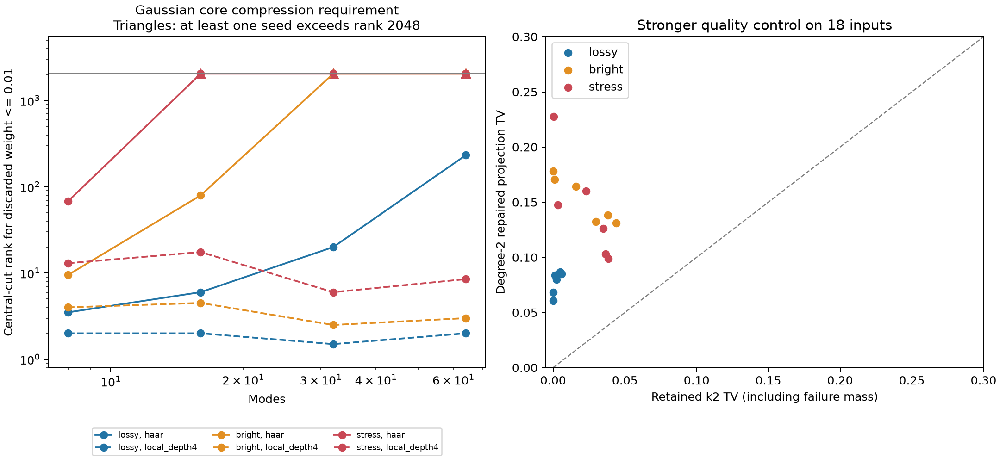

# 第十一轮 GBS 压缩表示与低阶展开探索

2026-11-08。基于公开研究头 `369b2023da4c342fd3473b03668e48dbd4b0a90c`，在 Windows 本地继续第十轮。完成相干 MPS 小系统原型、Gaussian 核心切口谱面板，以及新文献启发的二阶 Meixner 阈值投影。**局域网络显示出较低的压缩维数需求；高亮度 Haar 网络仍受键维数限制。二阶投影没有超过项目已有 retained 基线。**

全部实验是探索性结果。不同方法、亮度、切口共享物理输入，不能把每一行视为独立随机实例。没有建立固定全局 TV 的通用快速采样器，也没有新的完整原生性能对赛。

## 1 实际完成的工作

| 方向 | 实际证据 | 范围 |
|---|---|---|
| Gaussian 核心压缩需求 | 672 行切口谱；48 个协方差、16 个干涉仪、两种模式排序 | 8/16 模式检查全部切口；32/64 模式只检查三个预定切口 |
| 相干 MPS 构造及测量 | 48 个方法单元，每单元 512 个样本，共 24,576 个样本 | 4/6 模式、K=2/4、键维数上限2/4/8；8个协方差、4个Haar干涉仪 |
| 压缩误差 | 48 个固定相关位移完整分布、12 个解析位移平均完整分布 | 后者只覆盖4模式K2；属于理想构造参考 |
| 低阶展开 | 18 个协方差上54个0/1/2阶完整阈值投影；30行解析资源预算 | 6个Haar干涉仪、4/8/12模式 |
| 较强基线 | 同18个协方差上retained-k2/k4的36个完整扩展分布 | Python click_influence选择器；失败质量显式保留，本批为零 |
| 验证 | 新增20项测试通过；900项保存产物数值复核通过 | 整库Windows门禁未通过，详见第6节 |

配置在 [iteration11_mps_probe.json](configs/iteration11_mps_probe.json)。各输出目录中的 `plan.json` 在计算前保存。retained 对照是看到低阶结果后追加的强基线，明确属于事后对照；没有独立确认集。

## 2 相干压缩的瓶颈在哪里

设纯 Gaussian 核心协方差为 W，约定 hbar=2、真空协方差I、xxpp。取一个切口的约化协方差，辛本征值为νᵢ。该切口的平方Schmidt系数为乘积几何谱：

`λ(n)=∏ᵢ(1-qᵢ)qᵢ^nᵢ，qᵢ=(νᵢ-1)/(νᵢ+1)`。

实现使用Hermitian矩阵 `i sqrt(V) Ω sqrt(V)` 求谱，并用唯一父节点堆枚举最大的2048个权重。另以 `i Ω V` 的非Hermitian本征值复核全部672行。

任意该切口秩不超过χ的纯态与原核心的保真度最多为前χ项权重之和。因此，若想让**纯态迹距离**不超过0.1，单切口丢弃权重≤0.01是必要条件。这个必要条件不是输出TV下界；后续相关位移和测量可以进一步缩小距离，也不限制其他经典模拟算法。

64模式自然排序中心切口的结果如下，两列分别为两个预定种子：

| 网络与亮度 | 尾权重≤0.01所需键维数 | 2048维后的尾权重 |
|---|---|---|
| Haar，lossy | 227 / 238 | 0.001064 / 0.001171 |
| Haar，bright | >2048 / >2048 | 0.303973 / 0.315967 |
| Haar，stress | >2048 / >2048 | 0.989627 / 0.990770 |
| 深度4局域，lossy | 2 / 2 | 浮点舍入量级 |
| 深度4局域，bright | 4 / 2 | 浮点舍入量级 |
| 深度4局域，stress | 12 / 5 | 浮点舍入量级 |

这里的配置为lossy `(r=.6, eta=.35)`、bright `(.9,.65)`、stress `(1.2,.85)`，eta表示透过率。三种配置和第九轮保持一致。

另试了按 `|UUᵀ|²` 图Laplacian的Fiedler向量排序。以已测切口中2048维最大尾权重比较、用1e−12作纯描述性差异阈值，48个协方差中22个改善、26个相当、0个恶化。32/64模式并未扫描全部切口，不能据此宣称全链最坏误差降低或该排序普适有效。

## 3 MPS原型完成了什么

[mps_probe.py](src/gbslab/mps_probe.py) 对归一化有限核心做逐次SVD、右正交化，并执行局部位移后的秩一细分阈值测量。每个样本使用独立抽取的**相关**Gaussian位移；隐藏点击通道只在内部抽取，不当作二值输出的边缘logQ。

有限输入Fock空间上的无点击效应为 `E0=|v><v|`，其中 `v_n=exp(-|alpha|²/2)(-alpha)^n/sqrt(n!)`。点击效应为 `I-E0`，由其平方根的各行细分。因此没有额外截断位移后的输出光子数。逐模式收缩保留不同总光子扇区之间的相干性。

**构造仍依赖 `(K+1)^m` 的矩形稠密张量。** 这一步只能用来验证小系统，不是可扩展Gaussian-to-MPS实现。压缩后的存储量也必须与原项目的总光子数基底比较：例如6模式K4、χ4的MPS存360个复数，少于矩形张量的15,625个，却多于总光子预算基底的210个。本轮只有8/48行的MPS系数数少于总预算基底；这些数字不包含索引、SVD工作区或进程峰值内存。

普通TT-SVD还可能重新引入总光子数>K的振幅。本批最大额外质量为0.0170307（m6 bright、种子110802、K2、χ2）。参考计算保留了这些振幅，没有再次投影或静默删除；测得的压缩迹距离包含这部分变化。奇数总光子质量在本批仅为舍入量级，但一般退化SVD下不据此承诺精确保奇偶。

所有48个固定相关位移分布均通过测量收缩性检查（容差1e−10）。12个解析位移平均参考全部完成。4模式K2时χ4/χ8均在舍入精度内重建原截断态；χ2会增加目标TV，例如：

| 输入 | 未压缩核心TV | χ2 TV | 压缩态迹距离 |
|---|---:|---:|---:|
| lossy，110801 | 0.001217765 | 0.002283880 | 0.020490960 |
| bright，110801 | 0.025716192 | 0.029773438 | 0.100506453 |
| lossy，110802 | 0.000853352 | 0.001055378 | 0.018761267 |
| bright，110802 | 0.024246422 | 0.024655824 | 0.108871714 |

误差分层仍为 `TV ≤ sqrt(core_tail) + δcompression + δsampling`，超过1时取1。前两项描述相同理想相关位移及测量通道下的构造；有限精度条件采样、随机数及失败概率的全局误差没有证书。普通样本直方图测试不替代这个缺口。

单切口Schmidt尾权重既不是整链波函数距离，也不是完整采样器TV。逐次TT-SVD可记录各步丢弃的未归一化平方范数；本原型还通过完整重建直接测量最终纯态距离，避免把局部尾权重直接转写为全局质量。

归档的 `total_prepare_and_sampling_seconds` 字段遗漏了预先生成相关位移数组的时间，不能解释为端到端成本；它还不含验证用完整分布枚举。本轮不据这些单次Python计时宣布速度优势。该计时边界在后续正式对赛前必须修正。

## 4 新论文路线与二阶投影结果

11月5日的 [Angrisani与Mhiri预印本](https://arxiv.org/html/2611.08444v1) 给出固定均匀压缩、均匀热损耗下的低阶展开与随机采样理论：对Haar干涉仪以高概率获得多项式采样保证，要求固定透过率小于1。论文也指出有限规模成本可随逆损耗率迅速增长。本轮核查了Theorem III.1、G.28和G.40的适用条件，尚未逐行审计83页证明，也未实现其随机重叠估计及拒绝采样器。

本项目从其Meixner展开取0/1/2阶，利用Gaussian Wick矩直接计算系数，再**解析求和所有PNR事件到阈值事件**。因为阈值映射是经典粗粒化，L1距离不增加；但有限阶展开可能是有符号分布。实现保存原始负质量，并另存截负后归一化的分布及修正L1，不把有符号权重直接抽样。

二阶修正分布在18/18输入上优于匹配均值的独立热态，但在18/18输入上均落后于retained-k2，亦均落后于retained-k4。二阶TV中位数为0.128798；6/18输入出现负质量。结论是这一低阶近似有解释性价值，但当前二阶版本不构成较好的候选采样律。

G.40的有符号L1充分阶数预算也不等于最终采样TV预算。取L1=0.1、Haar失败概率0.05，64模式三种配置的充分阶数分别14、55、263；1024模式为17、66、312。直接列举所有系数会有 `binom(m+D,D)` 项，例如1024模式lossy配置约10^36.69项。因此应研究论文的隐式重叠求值，不能把朴素系数表当作可行实现。这也不是对论文随机算法的运行时间下界。

## 5 文献位置与下一步方向

[Liu等的Gaussian-to-MPS工作](https://arxiv.org/html/2512.10643v2)提供GSVD和投影创建算符构造，成本显式依赖键维数；其数值部分主要计量MPS构造。该文的最大单键丢弃权重与本项目所要求的全局输出TV不同。本轮没有复现该构造算法。

[Kalra与Kocharovsky的核心协方差工作](https://arxiv.org/abs/2606.29739)分析最小迹量子核心的半定规划结构，可供后续非均匀损耗研究参考。本轮只核查其摘要与适用方向，没有新增SDP实现或把最小光子数直接等同于最小MPS键维数。

下一轮按以下顺序推进：

1. **压缩构造**：先对深度4局域网络实现不经过全局稠密张量的构造；记录物理维数、键维数、态误差和实际准备/采样成本。另研究带总光子预算结构的压缩，避免不受控地扩展截断支持。
2. **全局误差**：把每步截断、浮点条件收缩与失败符号纳入统一预算；不能仅报告最大单切口尾或成功样本。
3. **低阶展开**：先审计G.3–G.5的隐式角向/径向重叠与方差预算，再决定是否扩展到更高阶；以retained-k4和同输入完整质量为对照。
4. **数值移植**：恢复具备扩展精度的原生环境，并处理Windows资源统计依赖；保留本轮原始失败，建立新的源代码/二进制门禁。
5. **非均匀损耗与真实数据**：待前述小系统验证成立后再接入，独立检查核心分解与探测协议。新的确认实验使用未运行种子，现有110801/110802继续标为探索集。

## 6 测试与平台限制

[本轮验证记录](results/iteration11_validation/validation.json)包含完整错误和跳过原因。`unittest`实际计数264项：230通过、4失败、1导入错误、29个单项跳过；另有7个整类跳过，不在264的分母内。日志显示的36个skip entries是29单项加7整类。新增两个模块共20项测试全部通过。

失败所在原有代码没有改动，验证时tracked source diff为空。本环境 `np.longdouble` 与float64同为64位：历史极小正数测试中的exp(-800)已在输入构造时下溢，另一个枚举保护更早触发，森林log域测试有约5.6e−14的误差。导入错误为Windows缺失Unix `resource` 模块。缺少此前Linux原生程序导致一批集成测试跳过。因此本轮不能继承第十轮“298项零跳过”的门禁声明，也没有通过放宽容差消除失败。

900项产物复核包括保存MPS的重建距离和范数、Gaussian切口的另一种谱计算、解析位移平均TV及低阶投影归一化；是同一研究者对保存产物的数值复算，不是900个独立随机实验或另一个审稿者的审计。

## 7 结果和复现

完整表与图见 [结果表](results/iteration11_analysis_release/summary_tables.md)、[汇总JSON](results/iteration11_analysis_release/summary.json)。



图中实线为Haar、虚线为深度4局域网络；两个种子的中位数只作描述性展示，超过2048的值画在上限并标三角，不表示恰好2048。右图每点对应一个协方差，全部位于对角线上方，表示二阶投影误差较大。

原始输出：`results/iteration11_mps_probe/`、`iteration11_meixner/`、`iteration11_retained_control/`、`iteration11_validation/`。配置、源代码快照、输入矩阵、MPS张量、样本、完整分布与失败信息分别保存。复现需要原研究仓库及锁定提交作为基础；新模块只依赖现有NumPy/SciPy/Matplotlib。

PowerShell示例，所有输出使用新目录：

```powershell
$env:PYTHONPATH='src'
$env:OPENBLAS_NUM_THREADS='1'
$env:OMP_NUM_THREADS='1'
$env:MKL_NUM_THREADS='1'
python experiments/verify_iteration11.py --output results/repro11_validation
python experiments/iteration11_probe.py --output results/repro11_mps
python experiments/iteration11_meixner.py --output results/repro11_meixner
python experiments/iteration11_retained_control.py --input results/repro11_meixner --output results/repro11_retained
```

验证程序在当前平台返回非零，原因见上节；研究runner没有把这一状态冒充正式通过的门禁。分析脚本默认读取本轮冻结目录，输出必须选新目录。`iteration11_analysis/`保存初版图，后续版本修正图例重叠并补入支持泄漏诊断；原始实验数据未改写。
