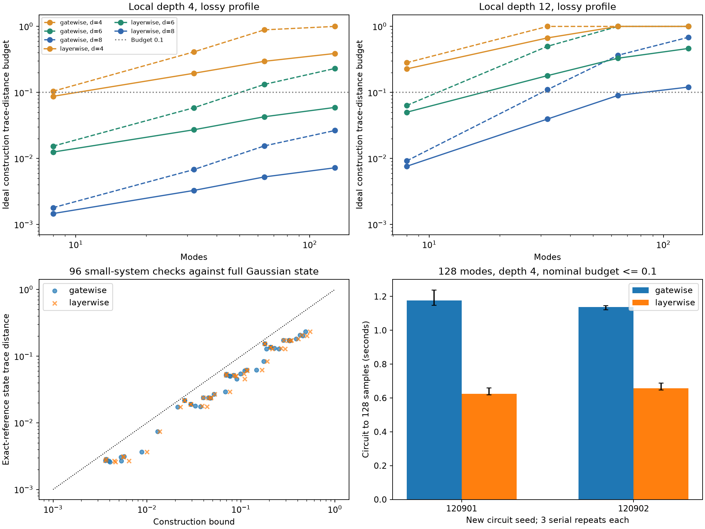

# 第十二轮局域电路的直接 MPS 构造与误差预算

2026-11-08。基于第十一轮提交 `64f5fd7` 继续研究，**已实现不经过全局Fock张量的相干MPS构造，并完成128模式局域网络采样**。逐门和整层两种截断方式都保留相关Gaussian位移；每次投影、键压缩的损失有明确记录。主要进展是去掉上一轮的稠密初始化瓶颈，并得到可检验的构造态误差预算。

整层方案在相同0.1理想构造预算下，使用较小表示，在两个新128模式浅层低亮度输入上达到1.73–1.88倍端到端计算加速；这只是两种本轮Python实现的受限比较，**不是固定完整采样TV的优势，也不是对retained或Frugal的速度胜利**。

## 1 已完成的证据

| 面板 | 逐门方案 | 整层方案 | 证据范围 |
|---|---:|---:|---|
| 小系统构造与采样 | 48行 | 48行 | 2/4模式，两个种子、两档亮度、d=4/6、χ=2/4/8 |
| 解析位移平均完整分布 | 28行 | 28行 | 全部2模式单元，以及4模式d4 χ4单元 |
| 扩展规模构造与采样 | 96行 | 96行 | 8/32/64/128模式，深度4/12，三档表示 |
| 串行重复计时 | 6次 | 6次 | 两个新128模式输入，每方案各3次重复 |

总计300个方法运行全部完成，共保存38,400个样本。计时重复使用相同随机流，其他配对方法也共享输入和随机种子，这个数量不是独立质量样本数。96个小系统真实纯态距离核对、56个完整位移平均分布都完成；所有构造距离上界和测量收缩性检查均通过。保存产物另通过16,923项数值/形状/源代码绑定检查，不能把这些相关检查当成独立随机实验。

探索种子120801/120802，不与上一轮110801/110802复用。每个模式数、深度、种子定义一个电路，亮度和表示共享该电路。整层方案在看到逐门面板后加入，是探索性改进；12次串行计时使用事先冻结的新电路种子120901/120902。

本轮未重跑低阶Meixner研究或原生retained对赛，其结论继续沿用第十一轮。目标保持多方向推进，但每条路线的证据范围独立。

## 2 实现与误差含义

[local_mps.py](src/gbslab/local_mps.py)从截断的单模压缩真空乘积出发，逐层作用单模相位和相邻被动双模门，维护MPS正交中心。双模门先在完整固定总光子数扇区求值，再记录超出局部维数d的输出质量。其后进行SVD压缩。构造不调用上一轮的稠密 `dense_to_mps`。

独立双模校验通过二次量子化生成元的矩阵指数完成；Hong–Ou–Mandel边界例验证了截断空间外的真实损失。采样失败会携带已完成样本和失败二值前缀，而不是补样或丢弃失败再统计。本轮未触发采样失败，这不证明全局失败概率为零。

两种构造的预算与完整推导见[截断预算说明](research/iteration12_truncation_budget.md)：

- **逐门**：输入投影距离，加上每个门的联合局部投影/键截断距离。
- **整层**：同层互不重叠的局部投影先合并计算成功率，层末再做保留空间嵌套的Schmidt扫描，跨层按距离三角不等式累计。

这些是精确算术中的态误差界，代码中的值由float64求得。实际有限精度采样器仍需要 `δnumerical_state + δsampling` 的额外预算。不能把“构造预算≤0.1”和“输出样本生成成功”合并成“已认证实际TV≤0.1”。

该局部门MPS路线属于既有方法族，[Vidal](https://arxiv.org/abs/quant-ph/0301063)及[Oh等](https://arxiv.org/abs/2306.03709)提供相应背景；本轮不主张原创、量子优势推翻或一般低复杂度保证。

## 3 扩展规模结果与边界

lossy配置为 `(r=.6, eta=.35)`，bright为 `(.9,.65)`。eta是透过率。128模式d8 χ16的代表结果：

| 深度与配置 | 种子 | 逐门构造预算 | 整层构造预算 |
|---|---:|---:|---:|
| 深度4，lossy | 120801 | 0.0277708 | 0.00762498 |
| 深度4，lossy | 120802 | 0.0253067 | 0.00684127 |
| 深度4，bright | 120801 | 1（截顶） | 0.338584 |
| 深度4，bright | 120802 | 1（截顶） | 0.337658 |
| 深度12，lossy | 120801 | 0.654678 | 0.108558 |
| 深度12，lossy | 120802 | 0.715349 | 0.132686 |
| 深度12，bright | 两个种子 | 1（截顶） | 1（截顶） |

完整96行规模面板中，满足名义构造预算≤0.1的单元由逐门方案18个增加到整层方案27个。预算接近1表示当前误差账本没有实用精度保证，不表示实测TV恰好为1。高亮度或深电路仍需要更大局部维数、键维数或更好的构造。

当前仍显式保存m×m光学矩阵U。最终MPS系数数、暂存的MPS大小、双模分支数组大小分别记录，但没有测量包含SVD工作区的进程峰值内存。

## 4 更紧预算不意味着实际态一定更准

小系统参考直接计算完整未截断纯Gaussian态在局部Fock盒中的振幅，不对该参考盒重新归一化。它与归一化MPS的内积因此就是与原无限维纯态的内积，能够测得真实构造态迹距离。

逐门48行的该距离范围约0.002579–0.233040。整层方案在48个配对单元中6个改善、2个变差、40个在1e−10阈值内相当。这里的阈值只用于描述比较，不参与采样或误差预算。

56个解析Gaussian位移平均参考均完整完成，未使用抽样频率冒充完整分布。两种方案的28个配对输出TV在1e−10内一致；这部分面板没有提供“整层方案更准”的证据。4模式d4 χ4示例：

| 配置 | 种子 | 相对目标的完整TV | 真实构造态迹距离 |
|---|---:|---:|---:|
| lossy | 120801 | 0.000817811 | 0.0235431 |
| bright | 120801 | 0.0203175 | 0.171872 |
| lossy | 120802 | 0.000940433 | 0.0237996 |
| bright | 120802 | 0.0188456 | 0.1736243 |

这些是理想相关位移与阈值测量通道下的构造参考。小TV与较大的纯态距离可以同时出现，因为测量会丢失部分态差异信息。

## 5 新种子串行成本比较

根据探索面板，预先选择两种满足0.1名义构造预算的表示：逐门d8 χ16与整层d6 χ8。对两个新128模式、深度4、lossy输入，按冻结随机顺序串行运行，各3次重复，每次128个样本。12次均完整并符合该名义预算，没有删除较慢或失败单元。

| 新种子 | 逐门秒中位数 | 整层秒中位数 | 逐门/整层 | 逐门预算 | 整层预算 |
|---|---:|---:|---:|---:|---:|
| 120901 | 1.176283 | 0.624126 | 1.88469 | 0.0338880 | 0.0710521 |
| 120902 | 1.138460 | 0.657816 | 1.73067 | 0.0292162 | 0.0619854 |

计时包括电路生成、核心参数、输入态、全部门/QR/SVD、相关位移生成、规范检查、条件采样和输出数组建立；不含文件写入和独立质量参考。上一轮遗漏的位移生成时间已纳入。本轮规模/质量面板的原始单次计时曾与其他本轮作业并发，正式成本结论只采用这一独立串行批次。

两种表示的最终MPS分别存256,128与48,264个复数，相差5.3068倍；整层方案还有较大的层内临时键，不能把最终存储比解释为进程峰值内存比。比较满足的是同一名义构造预算，而不是相同实际TV；整层方案本表的预算还比逐门方案更大。因此这是预算约束下的可行成本取舍，不是单方面精度与速度同时支配。

## 6 验证与归档

[测试记录](results/iteration12_validation/validation.json)：281项计数中247通过、4失败、1导入错误、29单项跳过；另有7个整类跳过。新增17项局域MPS测试全部通过。失败/错误的测试身份与第十一轮完全相同：Windows长浮点位宽与Unix资源模块依赖仍未解决，不能宣布整库门禁通过。原始失败日志继续保存。

[产物汇总](results/iteration12_analysis/summary.json)及[完整结果表](results/iteration12_analysis/summary_tables.md)绑定各原始结果文件。源代码在每批运行前冻结：逐门首批对应13项新增测试版本，整层和最终验证对应17项版本；首批结果没有用新代码覆盖。



所有大规模输出都没有重建全局Fock张量。完整重建只在2/4模式的独立质量验证进行。固定128样本的单批成功记录不是数值失败概率的统计上界。

复现示例，先设 `PYTHONPATH=src`、`OPENBLAS_NUM_THREADS=1`、`OMP_NUM_THREADS=1`、`MKL_NUM_THREADS=1`，并使用新目录：

```powershell
python experiments/verify_iteration12.py --output results/repro12_validation
python experiments/iteration12_run.py quality --builder gatewise --output results/repro12_quality
python experiments/iteration12_run.py scaling --builder gatewise --output results/repro12_scaling
python experiments/iteration12_run.py quality --builder layerwise --output results/repro12_layer_quality
python experiments/iteration12_run.py scaling --builder layerwise --output results/repro12_layer_scaling
python experiments/iteration12_timing.py --output results/repro12_serial_timing
```

正式串行计时应等待其他研究进程结束后执行。分析脚本默认读取本轮冻结目录；它的输出也要求新目录。

## 7 后续方向

1. 给构造中有限精度门、QR/SVD及测量通道建立可执行的额外误差预算，补上“构造可行”到“实际输出质量可认证”的缺口。
2. 对高亮度/深网络研究逐层局部维数与键维数分配；固定新输入后比较预算及真实小系统距离，避免只优化较松的上界。
3. 位移抽取可直接沿局域电路作用实Gaussian向量，以避免显式m×m U的生成和乘法；实现后与当前相关位移矩阵方案逐样本校验。
4. 回到Meixner高阶隐式重叠与非均匀损耗核心分解；局域浅电路的结果不替代这些面向一般干涉仪的方向。
5. 恢复扩展精度原生环境，再进行与retained/Frugal的同输入、同质量预算完整成本比较。当前仍没有这样的优势证据。
