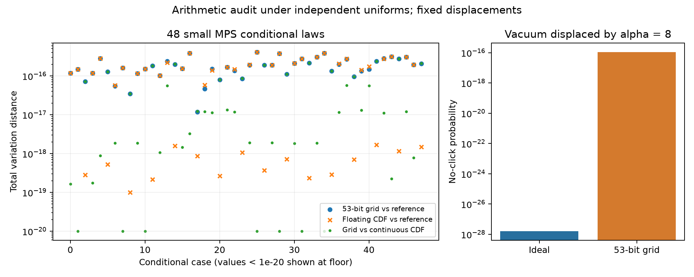

# 第十三轮：固定输入条件采样律的有限算术审计

日期：2026-11-08。基础提交：99b82a4。继续推进GBS经典模拟研究；本轮重点补充第十二轮明确缺失的实际采样算术证据。

## 结论与范围

完成49项完整条件采样律审计，遍历34,567个隐藏树节点；全部完成，无枚举到的失败概率质量。48项常规案例中，53位独立均匀网格模型下的输出与120位参考的最大TV为4.130541×10^−16。这个结果支持当前小系统条件采样实现的数值一致性，没有提供128模式或完整位移平均采样器的全局TV保证。

同时构造了可解析的极小概率反例：真空态位移α=8的理想无点击概率约1.603811×10^−28，网格模型给出2^−53≈1.110223×10^−16，相对误差约6.92×10^11，但TV仍只有约1.11×10^−16。小绝对误差与巨大相对误差可以同时成立。

## 实验设计

从第十二轮整层构造质量面板固定读取16个MPS：m=2/4，lossy/bright两配置，种子120801/120802，(d,χ)=(4,4)/(6,8)。每个态测试零位移、原归档第一条位移、α_j=(2.5+1.5i)exp(2πij/m)三类固定输入，另加一项解析真空测试。不是16或48个独立随机电路种子，也不是对位移分布的抽样积分。

所有实际输入张量和位移再次保存；源代码、原归档哈希、NumPy2.4.6与mpmath1.3.0版本均冻结。浮点分支与原采样器共享函数，隐藏路径质量用有理数及整数精确累积。独立参考通过完整Fock盒收缩与无点击子集反演取得，80/120位参考最大差3.687606×10^−80；这属于高精度收敛检查，没有向外舍入认证。

## 结果

| 位移面板 | 条件数 | 最大网格/参考TV | 最大连续CDF/参考TV | 最大网格/连续CDF TV |
|---|---:|---:|---:|---:|
| 零位移 | 16 | 3.096622e−16 | 3.069677e−16 | 1.335374e−17 |
| 归档位移 | 16 | 4.130541e−16 | 4.130541e−16 | 5.667463e−17 |
| 大幅复位移 | 16 | 2.737764e−16 | 1.672515e−18 | 2.746892e−16 |

最大分支归一化残差1.554312×10^−15；导出张量高精度范数最大偏差1.742682×10^−15，参考对其归一化。大位移面板中网格效应超过浮点通道效应；不能据此推断所有输入均以某一误差项为主。



精确累计区间端点还给出一个可迁移的结论：对局部维数d_i，独立均匀网格离散化误差TV≤Σ_i d_i/2^53。此界包含失败符号，但只比较同一浮点程序的两种随机驱动，不控制理想POVM与浮点收缩间误差。推导见[算术说明](research/iteration13_sampling_arithmetic.md)。

## 实现与验证

新增`sampling_audit.py`负责完整树枚举、精确网格计数与高精度参考。`local_mps.py`仅提取共同的单步函数，操作顺序保持一致；100条相同随机流样本及诊断与第十二轮冻结采样器逐项相同。

新增10项测试全部通过，覆盖CDF网格端点、与NumPy相同随机流、二维模式全网格逐路径采样、失败质量守恒、资源上限、解析真空与极小事件、高精度收敛和旧实现回归。另有561项产物核验全部通过，包括49项有理数完整分布重枚举和输入哈希核验。

当前Windows全库291项执行，257通过，4失败、1错误、29单项跳过，另7整类跳过。失败/错误身份与第十二轮完全相同：Windows longdouble范围/精度导致4项数值或错误消息不匹配，Unix resource导入导致1错误；原生依赖未恢复。完整门禁没有通过，未放宽既有断言。

本轮无性能胜出结论：49项审计合计16.33秒为当前机器诊断性计算时间，不是与其他采样器的同质量速度对照。新增mpmath为可选audit依赖。

## 复现与证据入口

运行环境需安装本项目audit依赖，并将BLAS/OMP/MKL线程数设为1。所有输出目录必须不存在。

```powershell
$env:PYTHONPATH='src'
$env:OPENBLAS_NUM_THREADS='1'
$env:OMP_NUM_THREADS='1'
$env:MKL_NUM_THREADS='1'
python experiments/iteration13_audit.py --output results/iteration13_conditional_audit
python experiments/verify_iteration13.py --output results/iteration13_validation
python experiments/iteration13_analyze.py --output results/iteration13_analysis_release
```

验证脚本因上述既有全库失败返回非零；产物核验单独列示。首次分析图没有注明显示下限，保留在`iteration13_analysis`；发布图在`iteration13_analysis_release`补充图注，数值不变。审计冻结测试快照为首批9项；随后增加全网格交叉测试，验证快照包含最终10项；采样和审计数值核心未变。

- [预定输入](results/iteration13_conditional_audit/plan.json)、[运行与输入元数据](results/iteration13_conditional_audit/metadata.json)
- [全部案例](results/iteration13_analysis_release/summary_tables.md)、[汇总](results/iteration13_analysis_release/summary.json)
- [全库验证](results/iteration13_validation/validation.json)、[561项证据检查](results/iteration13_validation/artifact_checks.json)

## 持续探索的下一步

1. 扩展性：相关位移仍依赖稠密U。改为直接沿局域门传播实正态向量，验证与U作用等价，并测峰值内存及整体成本。
2. 构造质量：高亮度和深电路预算仍是主要障碍。研究局部维数、键维数的自适应配置，先记录资源拒绝与全部失败，再做同质量对照。
3. 数值保证：把本轮完整前缀审计作为小系统金标准，研究可扩展的逐步误差包络；另审计Gaussian位移生成。不能用观测最大值替代全局上界。
4. 方法比较：在共同可验证质量范围恢复retained/Frugal基线；Meixner高阶和Haar网络仍保留，但现有结果没有证明其超越强基线或具备低纠缠优势。

整体目标继续进行，没有声称通用低复杂度、完整九章模拟或量子优势结论的逆转。
