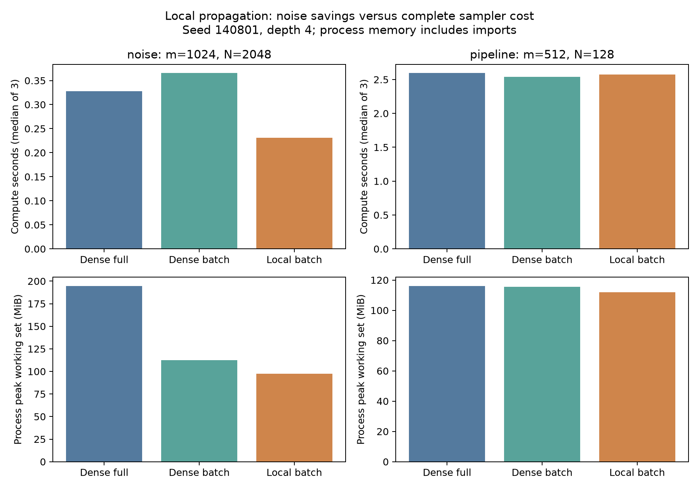

# 第十四轮：局域门直接传播相关位移与真实峰值内存

日期：2026-11-08。基础提交：6e9fa02。完成局域相关位移的无全局矩阵实现，分别检验其物理一致性、位移环节成本和完整GBS采样成本。

## 主要结论

1024模式、深度4、2048条位移时，直接局域传播相对稠密全批处理，在两个预定种子下速度比分别为1.420和1.348，进程峰值工作集从约194.7–194.8 MiB降到97.3 MiB。先做稠密分批处理已降到112.7 MiB；移除稠密U带来的是随后约13.6%的进一步下降，不能把总降幅全部归于无矩阵算法。

这一收益有明显适用范围。1024模式、深度12、2048条位移时，局域实现用时0.597–0.642秒，稠密全批仅0.377–0.397秒，局域更慢但峰值内存仍约减半。128模式的全部位移面板中局域实现都更慢。这里1024模式只测试位移生成，没有完成1024模式GBS采样。

完整采样完成到512模式，但端到端成本变化小：四组输入的稠密全批/局域分批时间比介于0.978–1.061，没有建立稳定整体速度优势。512模式的构造预算为0.123和0.128，仍高于预设0.1。这轮解决了一项存储扩展问题，没有降低构造误差或证明量子优势结论的逆转。

## 实现与物理检查

新增`LocalPropagator`与分批位移迭代器，直接执行相位和不重叠的双模门。`local_circuit`增加可选开关，在保持相同随机调用和门序列时不分配全局U，默认行为保持兼容。

输入仍为实正态z，α=(i√Δ/2)Uz，保留非圆对称的相关Gaussian噪声；没有换成各模式独立复正态。噪声生成与阈值测量使用不同RNG，三种方法使用相同种子约定，以免分批改变两个步骤的随机调用交织。推导、数组复杂度及接口见[局域位移说明](research/iteration14_local_displacement.md)。

20项传播质量检查涵盖m=2/4/128/512/1024、深度4/12、两个种子。全部完成，门序列逐项一致，最大位移坐标差8.159620×10^−16，相对L2差4.834383×10^−16，范数相对偏差1.311089×10^−15。8项小系统中，普通协方差和异常协方差均吻合；两种浮点位移对应的完整理想阈值分布以80位计算，最大TV为9.938714×10^−17。高精度比较没有向外舍入认证。

## 预定成本面板

每项在独立新Python进程执行，串行运行，预先随机化顺序，每方法/输入3次重复：

- 位移面板144次：m=128/1024，L=4/12，N=128/2048，种子140801/140802。
- 完整采样36次：m=128/512，L=4，N=128，相同两个种子，lossy配置r=0.6、η=0.35，整层构造d=6、χ=8。
- 三种方法为稠密U全批、稠密U分批、局域门分批；分批大小统一64。

180/180次完成，无工作进程或采样失败。36次完整采样保存4,608条输出；重复计时复用同一随机流，不能将其作为4,608条独立质量观测。每组输入跨三种方法和重复次数的样本哈希完全相同；这属于观察到的输出一致性，不能证明完整有限精度分布相同。

计时包含电路生成/编译、核心构造（完整采样面板）、正态数生成、位移传播、采样、公共数值摘要及输出数组生成；不包含导入与磁盘IO。峰值内存使用Windows进程生命周期的`PeakWorkingSetSize`，包含导入，使用psutil7.1.1读取，避免短时RSS轮询漏峰。工作集指标依据[Microsoft定义](https://learn.microsoft.com/en-us/windows/win32/api/psapi/ns-psapi-process_memory_counters)；它不是Python数组大小之和，也不是仅算法新增内存。

## 结果表

以下为3次重复中位数，完整面板与最小/最大值保存在[结果汇总](results/iteration14_analysis/summary.json)。

| 面板、规模 | 种子 | 稠密全批秒 | 稠密分批秒 | 局域分批秒 | 全批/局域峰值MiB | 构造预算 |
|---|---:|---:|---:|---:|---:|---:|
| 位移1024，L4，N2048 | 140801 | 0.327901 | 0.365536 | 0.230916 | 194.72 / 97.34 | 不适用 |
| 位移1024，L4，N2048 | 140802 | 0.323540 | 0.356704 | 0.239939 | 194.82 / 97.32 | 不适用 |
| 位移1024，L12，N2048 | 140801 | 0.396755 | 0.438214 | 0.641660 | 195.88 / 99.45 | 不适用 |
| 位移1024，L12，N2048 | 140802 | 0.377312 | 0.483297 | 0.596839 | 196.15 / 99.66 | 不适用 |
| 完整采样128，L4，N128 | 140801 | 0.639585 | 0.631420 | 0.653947 | 96.93 / 96.89 | 0.058801 |
| 完整采样128，L4，N128 | 140802 | 0.677294 | 0.635947 | 0.651020 | 97.17 / 96.87 | 0.068013 |
| 完整采样512，L4，N128 | 140801 | 2.595401 | 2.540314 | 2.576539 | 116.14 / 112.05 | 0.122723 |
| 完整采样512，L4，N128 | 140802 | 2.705525 | 2.682151 | 2.549390 | 115.67 / 112.09 | 0.128251 |



理论上局域传播由O(Nm²)降为O(NLm)，主要数组不再需要O(m²)的U；但在本轮有限规模，数组索引、临时值、门编译/验证与BLAS常数可能抵消这一优势。这里只给出机制解释，尚未通过逐函数性能剖析确定各项占比。完整采样仍由核心构造和测量主导，不能用位移环节比值替代端到端比值。

## 验证与复现

新增7项测试全部通过，覆盖无稠密单位阵分配、相同门流、复数传播、奇偶边界、零深度、两个二阶矩、分批随机流、完整样本一致性及非法输入。1,165项产物复核全部通过，覆盖预定运行完整性、存储方式、批长、样本哈希和小系统质量结果。

当前Windows全库298项执行，264通过，4失败、1错误、29单项跳过，另7整类跳过；失败/错误身份与第十三轮相同。这里的“298项执行”不等同于第十轮Linux上“298项全部通过”的历史门禁。Windows longdouble与Unix resource/原生依赖问题未修复，完整门禁仍未通过。

复现需安装项目的audit与benchmark可选依赖。本轮成本脚本使用Windows峰值内存字段。先完成串行成本运行，再运行质量与回归检查，避免本项目的重计算并发干扰计时。输出目录必须不存在。

```powershell
$env:PYTHONPATH='src'
$env:OPENBLAS_NUM_THREADS='1'
$env:OMP_NUM_THREADS='1'
$env:MKL_NUM_THREADS='1'
python experiments/iteration14_run.py --output results/iteration14_cost
python experiments/iteration14_quality.py --output results/iteration14_quality
python experiments/iteration14_analyze.py --output results/iteration14_analysis
python experiments/verify_iteration14.py --output results/iteration14_validation
```

验证脚本因既有全库失败返回非零，产物检查单独报告。

- [预定180次运行](results/iteration14_cost/plan.json)、[版本及源代码哈希](results/iteration14_cost/metadata.json)
- [全部成本表](results/iteration14_analysis/summary_tables.md)、[20项质量结果](results/iteration14_quality/rows.json)
- [验证记录](results/iteration14_validation/validation.json)、[1,165项检查](results/iteration14_validation/artifact_checks.json)

## 下一步

优先研究高亮度/深电路及更大模式数的自适应局部维数和键维数，记录达到同一名义预算所需的真实成本与所有资源拒绝。位移方向保留当前两种实现，进一步研究数据布局和编译缓存，不能按当前结果一律用局域版本替换稠密版本。随后在可验证范围重新接入retained/Frugal强基线，并单独处理完整有限精度误差；Haar和Meixner方向仍保留此前的困难与负结果。

整体持续探索目标仍在进行。
