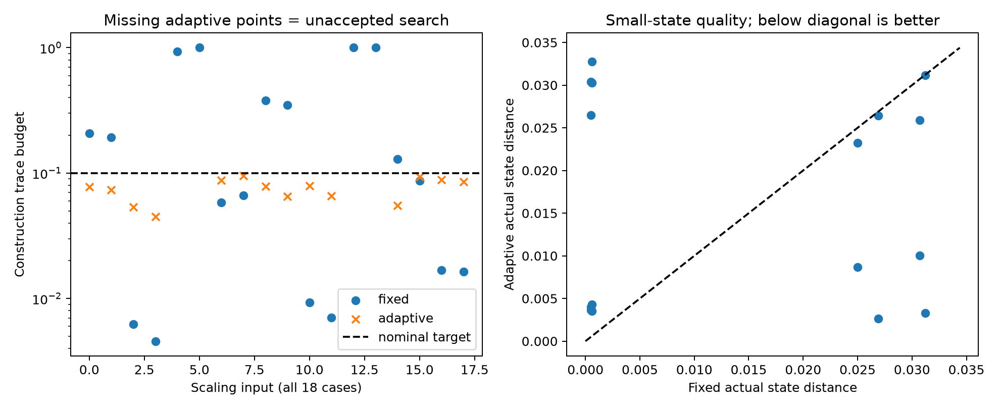

# 第十五轮：按构造预算选择Fock维数和逐切口键维数

日期：2026-11-08。基础提交：56251ca。完成一套预算驱动的局域GBS纯核心MPS构造搜索，保留所有未达标与资源中止尝试，并与固定d8 χ16构造比较。

## 本轮结论

34个预定目标配置中，自适应搜索接受30个，固定d8 χ16接受21个；有9个仅自适应达到名义构造预算，没有仅固定方案达标的配置。较大系统全部目标为0.1，小系统同时检查0.1和0.03。

128模式、浅层高亮度输入选择d12、cap32后，两种子预算为0.078640和0.065246，固定d8 χ16为0.379181和0.348537。达标需要增加资源：含全部重建与账本写入的单次搜索分别9.55和7.90秒，固定方案约1.39和1.30秒；没有把质量改善描述为同时加速。

512模式、浅层低亮度输入选择d6、cap16，逐切口实际秩可更小，预算0.088558和0.085436。固定d8 χ16也达标，且其预算更小（0.016791、0.016316）。自适应在这两个输入上用较宽松但合格的名义预算换取较低存储与成本，不代表相同实际误差下胜出。

4个深层高亮度配置未解决：32模式两输入在搜索梯末仍为0.360192和0.428465，128模式两输入在d12、cap32尝试触及20秒软限。资源中止没有给出完整预算，更没有证明增大资源也不可能成功。

## 方法

本轮所有模式仍共享同一个Fock维数d；自适应的是统一d的搜索以及各切口的键维数，不是各模式不同d的非均匀Fock截断。

先计算输入截断距离。可构造时，把剩余预算的一半均分给各光学层的键截断；每层进一步转换为逐切口条件尾权重额度，用直接谱尾累加选择满足额度的最小秩。若受cap限制，保留实际损失并记录不足，最终始终检查实际构造账本：

    输入截断距离 + 各层局部投影距离之和 + 各层键截断距离之和 ≤ 目标。

d梯为4、6、8、10、12，cap梯为8、16、32。输入与局部投影已耗尽目标时增加d，否则优先提高cap；cap跨d不回退。首次达标返回，没有假设所有预算对参数单调，也没有保证找到最小成本解。理论与边界见[自适应预算说明](research/iteration15_adaptive_budget.md)。

构造预算是理想算术纯态距离上界的float64估计，没有向外舍入，不包含测量、Gaussian随机生成或其他有限精度误差。因此“接受”不是完整输出TV已认证。

## 实验与完整失败记录

预定68次方法运行：34个目标配置×两种方法。质量面板16个目标配置来自m4、深度4/12、lossy/bright、两个种子、两个目标；扩展面板18个配置涵盖m32/128的深度4/12与两种亮度，以及m512深度4低亮度。种子150801/150802。相同物理输入下的两个目标不是独立电路；实际共26个物理输入配置。

全部68次均得到明确终态，没有工作进程硬超时、数值失败或测量失败。167份尝试账本（含34份固定方案账本）完整保留：51接受、76次完整预算超标、38次输入预算预检拒绝、2次资源中止。最终状态为51接受、13份固定方案预算超标、4个自适应搜索未接受。

64个完成构造的运行各生成32条诊断样本，共2,048条，其中接受构造输出1,632条。复用电路种子与随机流，不能当作独立质量统计量；本轮没有以样本频率估计完整输出TV。

统一门分支数组上限500,000元素；自适应每尝试20秒软限只在门之间检查，固定方案没有该软限；两者外部任务限时均180秒。本轮只是单次探索，不是相同时间限制下的理论可行性排名或多次串行性能基准。所有自适应失败搜索耗时也保留：32模式约28.90、29.62秒，128模式约45.86、46.95秒。

## 质量与成本

| 配置（均L4） | 种子 | 自适应d/cap | 自适应预算 | 固定预算 | 自适应搜索秒 | 固定构造秒 |
|---|---:|---:|---:|---:|---:|---:|
| 128 bright | 150801 | 12/32 | 0.078640 | 0.379181 | 9.5543 | 1.3887 |
| 128 bright | 150802 | 12/32 | 0.065246 | 0.348537 | 7.9028 | 1.2996 |
| 512 lossy | 150801 | 6/16 | 0.088558 | 0.016791 | 1.8934 | 5.2925 |
| 512 lossy | 150802 | 6/16 | 0.085436 | 0.016316 | 1.8676 | 5.3097 |

搜索耗时包含所有丢弃尝试和尝试账本写入，不只是最后成功的构造；不包含随后小系统参考和诊断采样。512模式最终复系数从固定的1,042,560个减为373,350和350,796个；构造阶段进程生命周期峰值工作集（包含导入与之前尝试）约232–233 MiB降至123–126 MiB。这些是单次观察，没有给出稳定速度比或置信区间。

两方案均接受的21个配置中，自适应在16项单次搜索更快，18项最终系数更少；但两者均接受的12个小系统比较中，只有4项自适应实际态距离不更差，另8项更差。固定方案在许多低亮度小系统上远超目标质量，自适应主动使用了可用误差额度。因此不能把这组成本数字称为严格同质量优势。

32项小系统完整原Gaussian态重叠检查全部满足各自构造预算。参考使用无限Gaussian态在Fock盒内的未归一化系数，保留盒外损失；没有通过归一化参考消除截断误差。



图中缺少的自适应点是4项未接受搜索，不将其按0误差或成功子集处理。右图包含16对小系统目标配置，部分配置复用同一固定态。

## 测试与证据

新增8项测试全部通过：最小秩、cap不足、微小谱尾、联合扫描保真度、实际Gaussian态距离、输入拒绝、资源中止与非法策略。2,925项产物复核全部通过，覆盖完整预定运行、逐层损失、总预算与接受条件、源代码哈希、保存态的正则性、实际重叠和样本记录。

Windows全库306项执行，272通过，4失败、1错误、29单项跳过，另7整类跳过。失败/错误身份与第十四轮相同，仍涉及Windows longdouble精度/范围、Unix resource导入及原生依赖；未放宽历史测试，完整门禁未通过。

- [68次预定运行](results/iteration15_pilot/plan.json)、[代码与环境元数据](results/iteration15_pilot/metadata.json)
- [全部配置与失败耗时](results/iteration15_analysis_release/summary_tables.md)、[汇总及配对数据](results/iteration15_analysis_release/summary.json)
- [2,925项复核](results/iteration15_validation/artifact_checks.json)、[全库验证](results/iteration15_validation/validation.json)

首次分析表未展示未接受搜索的耗时，保留在`iteration15_analysis`；发布表`iteration15_analysis_release`补全了这些耗时，其他数值不变。原始运行、所有账本、源代码快照及失败未覆盖重跑。

## 复现与后续

需要项目audit和benchmark可选依赖；本轮峰值内存读取依赖Windows。所有输出目录必须不存在。

```powershell
$env:PYTHONPATH='src'
$env:OPENBLAS_NUM_THREADS='1'
$env:OMP_NUM_THREADS='1'
$env:MKL_NUM_THREADS='1'
python experiments/iteration15_run.py --output results/iteration15_pilot
python experiments/iteration15_analyze.py --output results/iteration15_analysis_release
python experiments/verify_iteration15.py --output results/iteration15_validation
```

下一步优先研究深层高亮度的键截断瓶颈、非均匀预算分配和可扩展构造，避免只增加Fock维数而让键截断仍占主导。同时需要在新输入上做预先固定策略的重复成本对照，并回到可验证的小系统与retained/Frugal比较。Haar和高阶Meixner方向仍保留此前负结果；本轮不改变其结论，也不声称完整GBS量子优势被推翻。

持续探索目标仍在进行。
