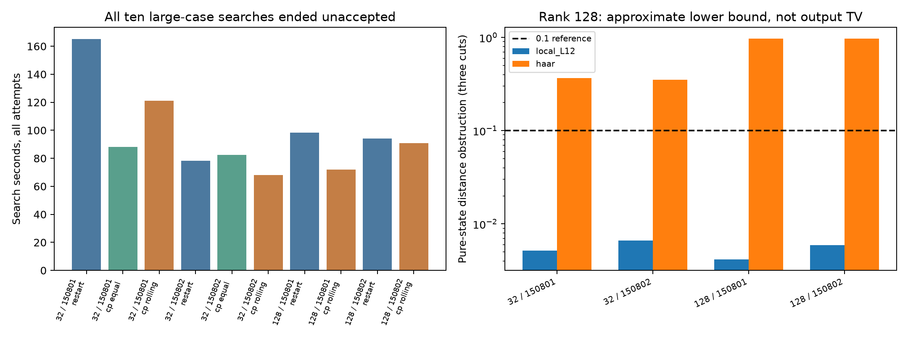

# 第十六轮：逐层检查点、滚动额度与独立纠缠谱诊断

日期：2026-11-08。基础提交：3e5c9be。本轮重访第十五轮未解决的四个深层bright输入，加入逐层截断重试和滚动预算，并用匹配的局域/Haar纯核心谱检查区分构造困难与表示障碍。

## 结论

本轮没有解决四个较大规模深层输入。18次方法运行全部获得明确终态：8个小系统运行接受，10个较大系统搜索均未接受。较大系统包括四个输入的重建/滚动检查点对照，以及两个32模式静态均分检查点消融；不能把10次未接受说成10个独立失败输入。

检查点方法在四对小系统比较中，实际纯态距离都稍低或明显更低，最终系数都更少，单次搜索3/4更快。但它没有在较大系统建立成功成本优势，并明显增加了一些失败搜索的峰值内存。单次、复用电路种子的结果不能当作稳定性能分布。

独立谱诊断给出不同于资源失败的证据：局域L12输入在键维数128、三个已检查切口的最大纯态距离下界估计为0.00416–0.00660，未排除0.1目标；128模式Haar对照则为0.9742–0.9750，即使键维数512仍为0.9541–0.9557。这表明局域构造失败不能由这三个切口的必要条件直接解释，而相同低秩纯核心表示在Haar对照中有很强的限制。低下界不证明全局MPS存在，高下界也不是阈值输出TV下界。

## 方法与资源范围

新方法在每层光学门后、键截断前保留正则化检查点。提升cap时从该未截断检查点复制，重新扫描；不会对已丢失信息的张量补零后假装恢复。最终构造账本只累计被接受扫描的损失，成本则包含所有候选。

滚动额度用已消费的log保留率，动态分配剩余切口的尾重额度。某些切口未用满分配额时，后续切口可使用余额。另有静态均分检查点对照。输入与层间预算仍沿用第十五轮的分配，未证明该分配最优。

若已发生的非负账本之和超过目标，当前Fock维数不可能通过该可加预算，可提前停止。这里提前停止只针对预算，不是实际态误差的下界。推导及限制见[检查点与滚动额度说明](research/iteration16_checkpoint_budget.md)。

比较使用相同维数梯d=10/12、cap=8/16/32/64/128、门分支上限8,000,000元素。检查点另有150,000,000复系数的复制前上限。相较第十五轮，资源上限已扩大，因此重新运行旧重建方法作对照，没有直接拿旧资源限制下的失败作为优势证据。

每个进程外部限时600秒，内部60秒软检查只能在操作间执行，可因长操作而超出60秒。两方法的“尝试”粒度不同：旧方法一次是d/cap组合，检查点一次是固定d下整个电路与所有层内重试。因此相同软限参数不等于相同总计算预算，不据此排名理论可行性。

## 所有较大输入仍未接受

这些输入均为bright（r=0.9、η=0.65）、深度12、目标0.1。时间含所有搜索尝试和账本写入；内存为进程峰值工作集，包含导入。它们是失败搜索成本，不能解释成成功采样速度。

| m | 种子 | 重建搜索秒 | 静态检查点秒 | 滚动检查点秒 | 重建峰值MiB | 滚动检查点峰值MiB |
|---|---:|---:|---:|---:|---:|---:|
| 32 | 150801 | 165.15 | 88.02 | 121.25 | 678.3 | 761.2 |
| 32 | 150802 | 78.35 | 82.53 | 68.17 | 325.6 | 655.0 |
| 128 | 150801 | 98.39 | 未计划 | 72.08 | 397.0 | 1104.7 |
| 128 | 150802 | 94.18 | 未计划 | 90.75 | 402.2 | 952.9 |

48份维数/cap尝试账本完整保存：8接受、24次完整预算超标、10次资源中止、3次投影预算提前耗尽、3次层内cap梯不能满足额度。全部较大搜索最终因软时限未获得完整接受态；没有工作进程硬超时或数值异常。中间未完成态没有最终构造预算。

检查点候选扫描共358次，其中119次接受、239次丢弃，计数包含每层首次候选。较大检查点案例中，候选复制、正则性检查与扫描合计占完整维数尝试时间约20%–53%；其余时间还包含光学门、其他正则化与管理开销。该测量不能细分为纯SVD时间，也表明仅减少从头重建还不够。

例如32模式种子150801的旧方法，在d10/cap64完成时预算仍为0.19806；继续cap128又在完成前超时。不能把该中止后的局部账本当成一个达到0.1的完整态。

## 小系统检查

小系统为m4、L12、两个相同种子，目标分别0.03和0.1，共四对比较。八个完整原Gaussian态距离均符合对应构造预算；每个接受态生成32条诊断样本，共256条，没有测量失败。相同种子与不同目标复用物理输入，不构成八个独立电路。

| 种子 | 目标 | 重建实际态距离 | 滚动检查点实际态距离 | 重建搜索秒 | 滚动检查点秒 |
|---|---:|---:|---:|---:|---:|
| 150801 | 0.03 | 0.00264531 | 0.00257595 | 0.68759 | 0.26042 |
| 150801 | 0.1 | 0.01911119 | 0.00844632 | 0.07510 | 0.08344 |
| 150802 | 0.03 | 0.00328482 | 0.00322993 | 0.76859 | 0.32829 |
| 150802 | 0.1 | 0.01114170 | 0.00972415 | 0.17082 | 0.10559 |

这些仍是构造态误差，不包含Gaussian随机生成、有限精度测量采样误差；也没有与retained/Frugal作本轮同质量速度比较。

## 独立局域/Haar对照

对选定纯核心的平方Schmidt权重λ，任意切口秩≤χ的纯态距离至少为sqrt(1−Σ_{j≤χ}λ_j)。使用Gaussian辛谱与最大乘积几何权重枚举，在每个输入自然排序的1/4、1/2、3/4处检查，取三个下界中的最大值。共8个输入、24个切口谱、168条秩诊断记录。

| m | 种子 | 集合 | χ32下界估计 | χ128下界估计 | χ512下界估计 |
|---|---:|---|---:|---:|---:|
| 32 | 150801 | local L12 | 0.038094 | 0.005171 | 0.000366 |
| 32 | 150802 | local L12 | 0.045889 | 0.006601 | 0.000481 |
| 32 | 150801 | Haar | 0.530409 | 0.366856 | 0.230199 |
| 32 | 150802 | Haar | 0.515244 | 0.353012 | 0.217902 |
| 128 | 150801 | local L12 | 0.033798 | 0.004163 | 0.000271 |
| 128 | 150802 | local L12 | 0.041846 | 0.005927 | 0.000464 |
| 128 | 150801 | Haar | 0.983403 | 0.974994 | 0.955731 |
| 128 | 150802 | Haar | 0.982805 | 0.974208 | 0.954145 |

数值为float64理论下界的近似评估，没有向外舍入；仅覆盖三个所选切口。它们约束当前纯核心、自然模式排序下的相干MPS表示，不排除其他排序、其他混合态分解或直接输出采样方法。



## 验证与证据

新增9项测试全部通过，覆盖滚动额度递推、联合扫描保真度、从检查点重试、静态分配对照、提前停止与资源失败语义。2,259项产物复核全部通过，包括每层候选、接受条件、最终保存态、实际重叠、Schmidt权重与源代码哈希。

Windows全库315项执行，281通过，4失败、1错误、29单项跳过，另7整类跳过；失败/错误身份与第十五轮相同。完整门禁仍未通过，未放宽历史断言。

- [18次预定运行](results/iteration16_pilot/plan.json)、[全部运行及源代码元数据](results/iteration16_pilot/metadata.json)
- [所有搜索和中止位置](results/iteration16_analysis_release/summary_tables.md)、[完整汇总](results/iteration16_analysis_release/summary.json)
- [局域/Haar秩对照](results/iteration16_schmidt/summary_tables.md)、[168条原始数值](results/iteration16_schmidt/rows.json)
- [产物检查](results/iteration16_validation/artifact_checks.json)、[全库验证](results/iteration16_validation/validation.json)

初次分析图的完整预算面板为空，因为较大搜索全未接受；保留在`iteration16_analysis`。发布版`iteration16_analysis_release`明确显示失败搜索耗时，并加入独立谱对照，同时补全失败进程内存和候选扫描耗时。原始实验不变，失败未覆盖重跑。

## 复现与下一步

使用本项目audit、benchmark依赖和Windows峰值内存字段；输出目录必须不存在。先串行完成成本实验，再运行谱诊断与验证。

```powershell
$env:PYTHONPATH='src'
$env:OPENBLAS_NUM_THREADS='1'
$env:OMP_NUM_THREADS='1'
$env:MKL_NUM_THREADS='1'
python experiments/iteration16_run.py --output results/iteration16_pilot
python experiments/iteration16_schmidt.py --output results/iteration16_schmidt
python experiments/iteration16_analyze.py --output results/iteration16_analysis_release
python experiments/verify_iteration16.py --output results/iteration16_validation
```

后续首先测试用上一层已接受cap作为下一层候选起点，减少重复的低cap扫描；同时研究层间预算与直接Gaussian核心构造，避免只扩大重试资源。局域问题的现有必要条件没有解释算法失败，需要继续检查构造策略和预算保守性。Haar方向保留明确的低秩纯核心障碍，另回到retained/Meixner等直接分布近似路线做同质量比较。

持续探索目标仍在进行；本轮没有获得大规模完整GBS采样突破或完整输出TV证书。
