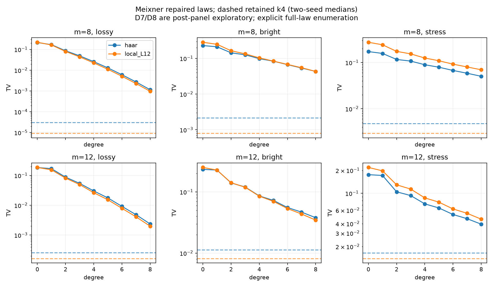

# GBS 第十七轮：Meixner 升至八阶与 retained 强基线

日期：2026-11-08。起点：3e5dfa5。本轮推进多项式近似方向，保留此前 MPS、相关位移和采样算术成果。

## 结论

八阶正修复 Meixner 分布在36个输入上均优于六阶及二阶，12个输入优于 retained-k2，**0个优于 retained-k4**。升阶有效，但仍未建立对强基线的质量或成本优势。4模式的 k4 是精确全记忆基线；单独看非平凡的24个8/12模式对照，八阶同样全部落后于 k4。

本轮加入平移 Wick 系数恒等式与按支持集归并的阈值变换，把可核对范围从二阶推进至八阶。实现仍枚举 binom(m+D,D) 个系数和2^m个输出，不是论文的隐式多项式时间采样器。

## 固定实验与追加范围

初始计划36个输入：m=4/8/12，Haar与深度12局域电路，种子170801/170802，三组 (r,eta)：lossy=(.6,.35)、bright=(.9,.65)、stress=(1.2,.85)。4模式预设八阶，8/12模式预设六阶，共276条投影分布；同输入 retained k2/k4 共72条完整扩展分布，保留失败符号，不按成功条件归一化。

看到六阶落后后，对**全部24个8/12模式输入**追加八阶，保存216条D0…D8分布；它们属于事后探索，不是新确认集。低阶前缀与主实验逐元素完全相同。合并去重后为324条分布，所有计划输入、投影与对照均完成；没有丢弃失败实例，retained 枚举到的失败质量均为0。

各组包含两个电路集合和两个种子，以下为4项的TV中位数；这些是有限面板描述，不是独立重复的总体置信结论。

|模式|配置|二阶|六阶|八阶|retained k2|retained k4|
|---|---|---:|---:|---:|---:|---:|
|4|lossy|0.07219|0.002281|0.000310|0.0000617|约4.1e−17|
|4|bright|0.1820|0.07337|0.04440|0.002529|约4.3e−17|
|4|stress|0.1261|0.1020|0.08732|0.006571|约6.8e−17|
|8|lossy|0.08296|0.005546|0.001050|0.001549|0.0000194|
|8|bright|0.1570|0.06783|0.04321|0.01836|0.001339|
|8|stress|0.1505|0.08122|0.06035|0.02452|0.003864|
|12|lossy|0.08486|0.008735|0.002235|0.004861|0.000220|
|12|bright|0.1411|0.05455|0.03590|0.04227|0.01015|
|12|stress|0.1141|0.05630|0.04149|0.03879|0.01574|

初始六阶在36项上均未超过k2；八阶超过k2的12项分别为8模式lossy的4项、12模式lossy的4项、12模式bright的3项及12模式stress的1项。D2、D6、D8各自在全部输入上优于物理均值匹配的独立热基线。用于Meixner的参考几何均值b大于物理均值n，D0与该热基线不是同一分布。

## 非单调、负权重和成本

36条逐阶序列中，2条出现合计3个误差增大的相邻阶数步骤（判断容差1e−12）。324条唯一分布中68条负质量大于1e−12，最大约0.001414。保存原始有符号权重、负质量、修复L1和正修复分布，表格仅报告后者TV；负权重不能直接抽样。

12模式八阶已需要125,970个显式系数和2,059,720个 Wick 中间状态。记录的耗时是Python完整分布构造/枚举的单次描述，非等质量采样吞吐量比较，也未测该轮独立进程峰值内存。随着阶数增加，组合数与缓存增长仍是实质瓶颈。

## 独立参考与验证

12个四模式输入全部经过80/120位参考检查：参考使用未平移物理 Wick 矩加显式二项式展开，并直接逐支持集求和；生产路径用平移矩与快速二元变换。另用高精度真空行列式及包含排除核对目标。

最大系数缩放误差5.12e−16（绝对误差1.99e−13），原始分布最大逐点差1.52e−16，目标最大逐点差2.92e−16。80/120位系数最大差5.91e−76、原始分布最大差6.72e−81。它们核对已保存浮点输入下的计算，不是外向舍入证书；8/12模式未做相同高精度完整参考。

新增10项测试全部通过，5,363项产物复核全部通过。全库325项运行、291通过、4失败、1错误、29个案例跳过，另有7个类级跳过；失败标识与第十六轮一致。遗留问题涉及Windows长双精度范围/容差、Unix resource导入和缺失原生依赖，未隐藏或放宽测试。

## 后续推进

1. 区分基底参考均值造成的低阶误差与必须增加阶数的相关性误差；任何改b实验单列探索与确认集，不能直接沿用论文参数保证。
2. 研究阈值支持集或隐式系数计算，避免把2^m全分布枚举当作大规模算法；仍与retained-k4比较完整质量和总成本。
3. MPS方向继续研究直接Gaussian构造和减少检查点重复扫描；当前深层bright失败仍未解决。采样算术方向继续保留浮点误差与离散随机数误差的区分。

方法：[平移Wick推导](research/iteration17_shifted_wick.md)。数据：[固定阶数完整表](results/iteration17_analysis/summary_tables.md)、[汇总JSON](results/iteration17_analysis/summary.json)、[验证](results/iteration17_validation/validation.json)。外部依据：[Angrisani/Mhiri附录G](https://arxiv.org/html/2611.08444v1)；本轮并未实现其隐式算法。
