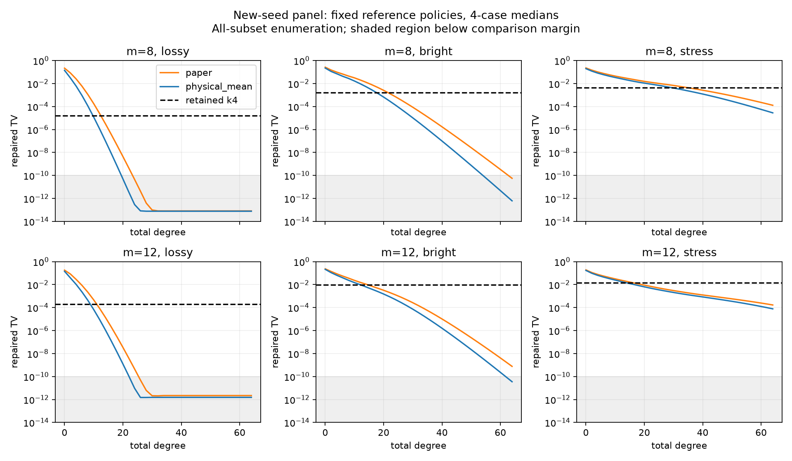

# GBS 第十八轮：真空级数重写与参考均值优化

日期：2026-11-08。起点：172dcda。上一轮八阶结果尚未超过retained-k4，本轮区分参考均值影响与阶数不足，并推导避免显式光子多重指标的新计算路径。

## 主要结果

推导并实现：总阶D的Meixner阈值投影，等于全部子系统真空概率的D阶展开再做包含排除。参考均值取物理平均光子数n时，展开矩阵的最大特征值绝对值在均匀标量参考族中最小，且真空级数只含非负偶次项。这使固定小模式数下可直接推进到64阶，无需枚举binom(m+D,D)个光子指标。

24个新种子输入中，均值参考的固定32阶正修复分布全部比retained-k4更接近目标，64阶最大TV为9.11e−5。然而**算法仍枚举2^m个模式子集，且完整分布构造比直接精确枚举更慢**。这是近似收敛和质量证据，尚非大规模采样或同质量计算优势。

## 实验设计

完整保留旧36输入作为探索面板；另预设24个确认输入：m=8/12，Haar和深度12局域电路，种子180801/180802，lossy=(r=.6,eta=.35)、bright=(.9,.65)、stress=(1.2,.85)。每组四项是两个集合与两个种子的描述性汇总，不是总体置信区间。

运行前固定两种参考策略：沿用前轮论文参数的paper，以及物理均值physical_mean；固定D0…D64，主要比较D8/16/32/64。没有用确认集挑选参考策略或最优阶数。共60个输入、120次方法运行、7,800条阶数记录、120个retained k2/k4对照，全部完成。旧对照直接复用已保存完整分布，新对照重新枚举；失败符号均保留，本轮枚举到的失败质量为0。

比较使用绝对1e−10余量，防止把浮点误差量级的差别计为胜出。正文TV均指对有符号分布显式正修复之后的TV；原始有符号半L1、负质量与修复变化另行保存。

## 新种子固定阶数结果

|参考策略|总阶|超过k2|超过k4|24项最大TV|
|---|---:|---:|---:|---:|
|paper|8|13/24|0/24|0.07076|
|物理均值|8|15/24|0/24|0.05482|
|paper|16|23/24|12/24|0.02855|
|物理均值|16|23/24|15/24|0.02010|
|paper|32|24/24|21/24|0.005899|
|物理均值|32|24/24|24/24|0.003523|
|paper|64|24/24|24/24|0.0001991|
|物理均值|64|24/24|24/24|0.0000911|

两种参考在足够高阶都能超过有限记忆基线，不能把全部改善归因于参考选择。参考选择在固定D8与D16的全部24个新输入上降低TV；D32、D64部分lossy/bright结果已接近数值误差范围，按余量计的明确改善分别为16项、12项。

|模式|配置|物理均值D8|D16|D32|D64|retained-k4|
|---|---|---:|---:|---:|---:|---:|
|8|lossy|1.12e−4|8.44e−9|7.74e−14|7.74e−14|1.59e−5|
|8|bright|0.02800|0.002790|4.20e−6|6.20e−13|0.001671|
|8|stress|0.04421|0.01640|0.003275|2.83e−5|0.004238|
|12|lossy|4.24e−4|1.26e−7|1.53e−12|1.53e−12|2.00e−4|
|12|bright|0.02378|0.003980|3.57e−5|3.53e−11|0.009226|
|12|stress|0.03333|0.01085|0.001714|7.80e−5|0.01452|

表为每组四项中位数。低于比较余量的值如实记录，不用于宣称更精确的真实误差。

旧探索面板上，物理均值D32超过23/24个非平凡8/12模式k4对照，仍有1个未超过；D64超过全部24项。旧4模式k4是精确全记忆，未计为可击败的近似基线。因此新面板24/24不代表所有电路或所有参数的保证。

## 尾项、负权重与未解决边界

推导了按子集真空尾项求和的理想算术误差界，并记录浮点诊断估计。以0.01为预定目标，旧面板32/36项、新面板20/24项在64阶以内满足估计；两面板各4个12模式stress输入都未满足，尽管实际枚举TV已远低于0.01。该界抛弃包含排除中的抵消，明显偏松，且当前浮点实现不是区间证书。

7,800条阶数记录中639条负质量超过1e−10，最大0.001504；完整原始分布及正修复结果均保留。均值参考的60条偶阶序列中没有观察到大于1e−10的TV上升，但谱半径最优只控制展开矩阵，不能据此声称有限阶阈值TV最优或单调性定理。

当前粗略成本为O(2^m(m³+D²+mD))，保存完整系数需O(D2^m)。单次计时中位数如下，包含全部D0…D64构造；精确参考单独计时，未测样本吞吐量或独立峰值内存：

|模式|精确完整分布|paper级数|均值级数|
|---|---:|---:|---:|
|4|0.00047 s|0.00300 s|0.00196 s|
|8|0.00324 s|0.04477 s|0.02079 s|
|12|0.05476 s|0.81388 s|0.35616 s|

均值级数在本面板约为精确枚举的4.2–6.5倍耗时。更高阶能在小系统上降低近似误差，但不能据此推得更快经典采样。所有子集的真空概率已经足以构造精确分布，此处主要价值是解析重写、尾项结构和验证工具。

## 验证与冻结

旧36输入D0…D8对照前轮显式Wick路径，最大逐点差8.16e−14。12个四模式输入、两策略、全部D0…D64以80/120位独立参考核对：参考从实协方差子块的矩阵幂迹生成特征多项式，再求逆平方根级数，最后显式包含排除，不使用生产路径的SVD。最大原始分布逐点差2.56e−15，80/120位最大差1.75e−80；高精度目标与保存浮点目标最大差3.46e−16。

高精度核对以binary64物理矩为输入，未覆盖输入生成误差的区间传播；8/12模式没有同规模高精度完整分布参考。以生产系数重建全阶结果、质量/负权重/TV/尾项、旧输入哈希、独立参考和源快照等共28,165项产物检查全部通过。

新增8项测试通过。全库333项运行、299通过、4失败、1错误、29个案例跳过，另有7个类级跳过；失败标识与第十七轮一致。遗留Windows长双精度范围/容差、Unix resource导入和原生依赖缺失问题继续记录，未放宽检查。

## 下一阶段

多项式方向优先研究能否利用低阶子集或条件结构避免2^m枚举，而不继续把小系统升阶当作可扩展采样进展。保留固定参考、阶数和强基线的同输入对照。

MPS方向回到尚未解决的深层bright构造，研究直接Gaussian结构及减少重复截断扫描；有限精度采样方向继续补齐大模式收缩误差控制。当前各方向仍有明确未完成问题，持续探索目标保持进行。

详见[方法推导](research/iteration18_vacuum_series.md)、[全组对照表](results/iteration18_analysis/summary_tables.md)、[汇总数据](results/iteration18_analysis/summary.json)、[验证记录](results/iteration18_validation/validation.json)。
