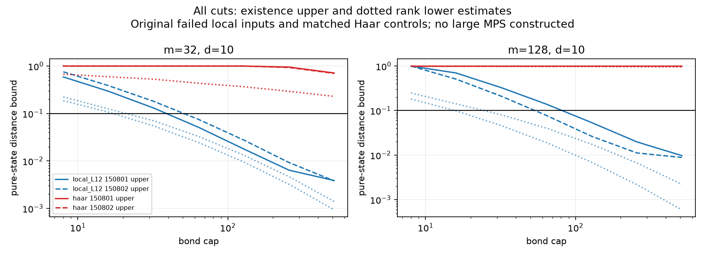

# GBS 第十九轮：深层 MPS 的表示空间与构造障碍

日期：2026-11-08。起点：8cb223a。本轮回到第十五、十六轮尚未解决的32/128模式、深度12、bright输入，区分“该精度的有限维MPS不存在”和“当前逐层构造未能找到”。

## 主要结论

原4个局域失败输入，在d=10、χ=128下，最终态的全切口存在性误差上界估计分别为0.01788、0.02756、0.05386、0.02652，均低于目标0.1。另4个新局域输入也达标。这比仅检查少数切口的必要条件更强，支持继续研究直接Gaussian构造。

**本轮没有构造出这些大模式MPS，也没有把旧失败改为成功。** 存在性证明通过最终Fock盒的一次TT-SVD得到，而显式盒在大模式数下不可行。新结果说明当前d/χ表示容量在理想数学模型中可能足够，尚未解决寻找该表示的资源成本。所有界均以浮点评估，未作区间认证。

Haar对照则仍有秩障碍：32模式χ512的纯核心距离下界估计约0.229–0.230，128模式约0.954–0.957。这排除所选纯核心、自然排序、该键秩下的0.1纯态近似，不是输出TV下界，也不排除其他经典方法。

## 新方法与范围

对于原始Gaussian纯态ψ，按每模n_i<d投影到有限盒，再做一次TT-SVD。若第j切口原始平方Schmidt尾为t_j，盒外概率上界为Q，则构造出的归一化MPS满足理想算术界

D_tr²≤Q+Σ_j t_j。

该界结合TT-SVD的正交误差性质与Fock盒在每个切口两侧的收缩性质，推导见[方法说明](research/iteration19_final_state_mps_bound.md)。基础TT-SVD误差定理来自[Oseledets，定理2.2](https://users.math.msu.edu/users/iwenmark/Teaching/CMSE890/TENSOR_oseledets2011.pdf)，本轮不声称新的基础分解定理。

同时审查了一个容易误用的捷径：把旧逐层条件损失直接平方和开根号。顺序测量界要求在同一个原始参考态上评估每个投影的拒绝概率，旧账本没有这些量。100个缓慢旋转的一维投影给出反例：条件损失平方根约0.157，但最终态距离为1。相关定理设定见[O’Donnell–Venkateswaran](https://www.cs.cmu.edu/~odonnell/papers/quantum-union-bound.pdf)。因此旧逐层预算保持原定义。

## 完整面板

20个输入：原4个局域失败输入及4个匹配Haar对照；4个新局域输入（种子190801/190802，m=32/128）；8个小系统输入（m=4/6、局域/Haar、两个新种子）。物理参数沿用r=.9、eta=.65的纯核心分解。

对全部980条切口计算Schmidt谱；d=6/8/10/12/16和χ=8/16/32/64/128/256/512组合共700条记录。每个模式的Fock边缘尾都独立计算，而非用最坏模式替代全部模式。

|模式|种子|集合|d10、χ128存在性上界|χ128必要下界|d10首次达标的已测χ|
|---|---|---|---:|---:|---:|
|32|150801|局域|0.01788|0.009525|64|
|32|150802|局域|0.02756|0.01325|64|
|128|150801|局域|0.05386|0.01760|128|
|128|150802|局域|0.02652|0.006910|64|
|32|190801|局域|0.02911|0.01431|64|
|32|190802|局域|0.01650|0.01091|64|
|128|190801|局域|0.04632|0.02214|128|
|128|190802|局域|0.03191|0.01143|64|

“首次达标”只是在预设秩梯上的充分界结果，既不是最小可行秩，也不代表实际构造完成。全部Haar对照在本轮最高χ512仍未满足0.1上界，且其相应下界也超标。

全切口检查也修正了只看三个切口的直觉：原128模式局域种子150801的χ128最大切口下界约0.0176，比前轮抽查得到的量级更大，仍远低于0.1。仅抽查切口不能代替全链充分界。

## 实际小系统构造

在4/6模式、d6/8、χ8/16/32上完成48个直接盒TT-SVD状态；有局域门序列的输入另完成24个逐层对照。全部72个实际状态到原始无限Gaussian态的距离均符合各自适用预算。

24对同d/χ的局域比较中，直接法的实际距离全部更小；例如m6、种子190801、d8、χ32，直接法距离约0.00600，逐层约0.02987。直接法计入生成盒成本后仅14/24次单次运行更快，不能声称稳定速度优势；其盒尺寸按d^m增长，本轮最大262,144个复系数，不能推广成128模式构造成本。

这支持“反复截断会损失本可保留的结构”的工作假设，但没有证明直接TT-SVD全局最优，也不能把小系统优势外推为大系统算法已完成。

## 数值核对与保留问题

全部1000个单模边缘、5个截断维数，用80/120位因式分解幂级数参考核对：最大尾概率绝对差4.73e−19、相对差1.45e−14；两种高精度最大差1.28e−81。生产递推的Chernoff余项最大7.74e−37，浮点舍入误差比该余项更大，所以不能把加入余项的float64值称为严格数值上界。

交叉异常矩奇异值给出的Schmidt参数，与独立约化协方差辛谱最大差2.78e−15。72个保存的MPS全部重新收缩，核对归一性、键秩、完整态重叠、TT正交投影恒等式及预算。

新增8项测试、24,233项产物检查全部通过。全库341项运行、307通过、4失败、1错误、29个案例跳过，另有7个类级跳过；遗留失败标识与第十八轮相同，没有放宽旧测试。

## 下一步

把“低秩表示存在”的证据转化为真正可扩展的Gaussian到MPS构造：优先研究如何直接访问截断Schmidt子空间或局域Gaussian结构，避免完整Fock盒，也避免逐层过紧预算和重复扫描。原4个大系统构造失败继续保留为未解决案例。

多项式方向仍需避免全子集枚举；有限精度采样方向仍需补齐大模式收缩误差。当前报告只推进了MPS可行性定位与小系统构造证据，不把持续探索目标标为完成。

完整资料：[方法与证明](research/iteration19_final_state_mps_bound.md)、[全组对照表](results/iteration19_analysis/summary_tables.md)、[汇总](results/iteration19_analysis/summary.json)、[验证](results/iteration19_validation/validation.json)。
