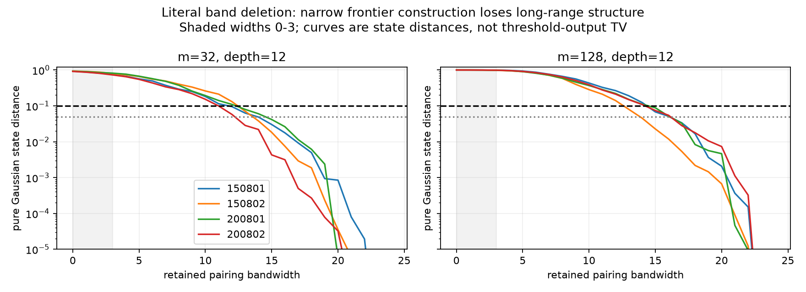

# 第二十轮：直接带状Gaussian MPS构造与窄带失败诊断

日期：2026-11-09。实验从2026-11-08开始，基于公开提交5787da7。第十九轮指出最终态存在低秩近似，本轮进一步尝试实际构造，未解决原4个深层大模式输入。

## 结果

实现从带状配对矩阵直接生成精确有限Fock盒MPS，再做一次嵌套Schmidt压缩。全局盒无需展开，但前沿标签仍随带宽指数增长。60个预先列明的工作全部结束，56个状态及所有失败记录保留。

|面板|构造次数|达到0.1态误差预算|未达到|资源守卫拒绝|
|---|---:|---:|---:|---:|
|原4个深层未解决输入，d4/6、w1/2/3|24|0|24|0|
|32模式、深度2浅层对照|12|1|11|0|
|4/6模式独立质量核对|20|9|11|0|
|原4输入，d6、w4预分配探针|4|0|0|4|
|合计|60|10|46|4|

浅层seed200801的d6、w3、χ128误差预算0.0967528，包含构造、保存和32条采样的单次耗时0.677秒；另一浅层seed200802相同参数为0.103762，仍未达到目标。两个输入w3都保留完整配对矩阵，因此后者的误差来自盒/压缩，而不是删边。

原4个深层输入的24个窄带候选，反三角下界范围0.586817–0.936989，全部排除纯态距离0.1目标。这比仅仅报告上界超标更强，但不是阈值输出TV下界，也不排除更好的近似方法。

## 带宽扫描和构造障碍

10个输入、宽度0…24合计250条扫描全部完成。8个深度12输入中，字面删边规则首次使Gaussian态距离≤0.1的宽度为11–15；≤0.05则为13–17。原4个输入的0.1门槛分别为12、13、15、13。此处只是规定候选族和网格中的首次达标，不是最优带状近似。



当前直接稠密前沿构造可运行的w≤3偏离深层原态很大。d6、w4的保守系数数为32模式273,833,172、128模式1,241,291,988，均超过4,000万预分配守卫。达到扫描所需宽度时，保守公式更加巨大。已有第十九轮低秩存在性结果与本轮失败并不矛盾：物理态可压缩不代表当前光子前沿表示已压缩。

最大单次工作耗时24.316秒，最大观测进程工作集1,212,583,936字节（约1.13GiB）。这里没有同质量强基线和重复计时，不能主张速度优势。资源守卫也不是一般内存下界。

## 验证

20个小系统独立原Gaussian盒参考的实际态距离全部位于相应上下界内；另用产生算符递推核对原/带Gaussian盒以及嵌套重叠恒等式。80条指定扫描记录通过独立协方差保真度和辛纯度复核，保真度最大差约2.02×10⁻¹⁴。56个保存状态的规范条件、范数、键秩和系数存储均核对。

新增7项测试全部通过，4,324项产物检查全部通过。全库348项运行、314通过、4失败、1错误、29个案例跳过，另有7个类级跳过；失败标识与第十九轮相同。原Windows扩展精度/容差、Unix resource导入和原生库缺失问题继续公开，没有放宽既有测试。

1,792条观测样本均完成，使用原模型相关Gaussian位移。样本运行成功不代表完整有限精度采样器TV已获证。

## 复现和证据

公开副本中的run_29.npz和run_39.npz以40MiB分卷保存，原始SHA-256不变。首次读取状态前运行`python publication_support/iteration20_large_artifacts.py restore`，还原时逐分卷和整文件核验，不覆盖不同内容。其余产物可直接读取。分卷不改变科学记录；原冻结清单仍按还原后的292个产物计数。

设置PYTHONPATH=src及OPENBLAS_NUM_THREADS=OMP_NUM_THREADS=MKL_NUM_THREADS=1。以下输出目录必须是新目录；冻结目录不能覆盖。

```powershell
python experiments/iteration20_band_scan.py --output results/iteration20_band_scan
python experiments/iteration20_run.py --output results/iteration20_panel
python experiments/iteration20_analyze.py
python experiments/verify_iteration20.py --output results/iteration20_validation
python experiments/iteration20_seal.py create
```

分析器使用固定的iteration20路径；另行复现应使用独立工作副本或调整新分析输出位置。

- [数学推导与已有研究](research/iteration20_banded_frontier.md)
- [预声明工作清单](results/iteration20_panel/plan.json)、[带宽清单](results/iteration20_band_scan/plan.json)
- [全部结果表](results/iteration20_analysis/summary_tables.md)、[汇总](results/iteration20_analysis/summary.json)
- [全库验证](results/iteration20_validation/validation.json)、[产物核验](results/iteration20_validation/artifact_checks.json)
- [精确字节冻结清单](results/iteration20_manifest.json)

## 后续方向

优先研究Gaussian Schmidt基或前沿低秩分解，使内部表示与最终态低纠缠结构一致，保留完整长程配对后再压缩；不能继续依赖窄带字面删边解决原深层输入。同时保留高阶真空级数的隐式求值/采样、同质量强基线成本比较，以及有限精度条件律审计三个方向。没有把局部构造成功表述为全面超越现有经典GBS算法。
