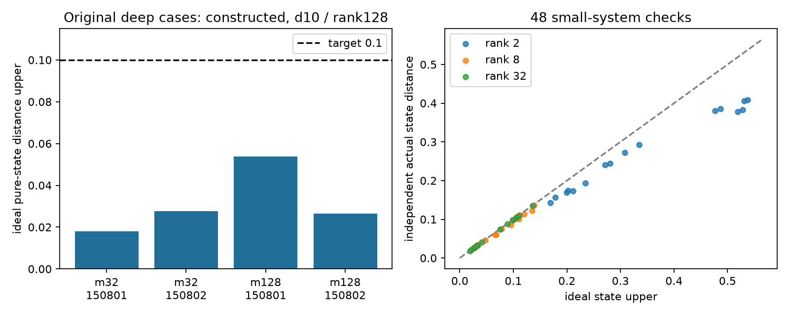

# 第二十一轮：Gaussian基直接构造解决原4个纯核心预算难例

日期：2026-11-09。基于公开提交0a993b3。方法源于[Liu等的GSVD/PCO路线](https://arxiv.org/html/2512.10643v2)，本轮实现保留全部前缀虚拟模式的Gaussian酉分解，并建立原态固定投影的误差账本。没有主张该构造思路为新算法。

## 从存在性推进到实际状态

原先32/128模式、深度12、r=0.9、η=0.65的4个局域输入，现在均已用d10、χ128实际构造MPS并完成观测采样，理想纯核心态距离上界低于0.1。第十九轮只有存在性诊断，第二十轮字面窄带候选失败；本轮保留完整配对结构，以Gaussian Schmidt基生成局部张量。

|模式数|种子|纯核心态距离上界估计|单次工作秒数|观测峰值MiB|
|---:|---:|---:|---:|---:|
|32|150801|0.0178755|33.965|184.6|
|32|150802|0.0275555|35.950|184.1|
|128|150801|0.0538578|149.734|499.8|
|128|150802|0.0265238|144.230|497.9|

每个正式构造保留16条样本。工作耗时包含构造、状态/映射保存、独立切口谱计算与采样，排除进程导入和最终JSON写入。实验只做单次工作观测，不是隔离硬件干扰的重复性能比较；独立复算准备工作可与面板运行重叠。没有据此建立同质量速度优势。

## 为什么这次上界适用于构造

Gaussian基分解全程不施加物理盒或秩截断，保存的切口谱来自同一个原始Gaussian态。随后选择各切口的前χ个虚拟占据向量，形成原态前缀Schmidt投影。局部张量的收缩对应这些固定投影按逆前缀顺序作用，最后施加全局物理Fock盒。

Gentle Sequential Measurement因此给出理想距离上界sqrt(原态切口尾之和+原态物理边际尾之和)。这是对实际投影乘积的识别，不能套用到旧逐层条件损失，也不要求结果等同于最终盒TT-SVD。完整推导与矩阵约定见[本轮方法说明](research/iteration21_gaussian_projectors.md)。

最终QR的范数平方是投影成功质量，一般不等于与原态的保真度；不使用sqrt(1−成功质量)冒充实际距离。全部模式保留，不把接近真空的虚拟模式按人为阈值冻结。浮点略低于1的辛值按物理下限处理并记录，所有上界仍为float64估计，非区间严格证书。

## 完整面板与独立验证入口

正式58项工作全部完成：30项接受、27项预算超标、1项超时。原4输入及4个局域确认输入均接受；48个小系统中22项接受、26项预算超标。32模式Haar候选完成但预算为1，128模式Haar候选在485.766秒触及预设软限，未输出最终状态。后者χ128的独立最大切口纯态距离下界约0.97564，不能把超时解释为只差优化实现就能达到0.1纯态目标；这也不是输出TV下界。

保存57个正式状态、1个试运行状态及928条观测样本。48项小系统实际距离全部符合上界；全部886条已构造切口的独立权重检查最大差约9.13×10⁻¹⁴。另一条湮灭递推路径复算的大系统选定幅度及小系统完整张量，最大差分别约1.17×10⁻¹⁵、7.78×10⁻¹⁶。用成功质量直接代替保真度会使小系统距离最多偏差约0.00557，说明二者确实不能混用。

新增8项测试全部通过，6,629项产物检查全部通过。全库356运行、322通过、4失败、1错误、29个案例跳过及7个类级跳过，失败标识与第二十轮相同。最高观测工作集528,388,096字节，约504MiB。首次验证与汇总的版本衔接问题及修正过程单独保留，见[审计说明](research/iteration21_audit_note.md)；发布结论仅使用固定源码的重新核验结果。



正式面板预设58项工作：原4输入、4个局域确认输入、2个Haar对照，以及48个4/6模式质量案例。另有1项32模式试运行，单独保存。全部正式状态、失败记录和实际耗时见[完整结果表](results/iteration21_analysis_release/summary_tables.md)，统计见[冻结汇总](results/iteration21_analysis_release/summary.json)。

核验同时使用原反常关联矩阵跨块奇异值、独立产生/湮灭递推、稠密原态投影乘积和保存MPS的规范条件。小系统复算整个有限盒张量；大系统复算三个选定物理占据的全部局部虚拟系数并收缩，不把有限个幅度或16条样本当作全分布质量证明。完整检查见[产物审计](results/iteration21_validation_release/artifact_checks.json)、[全库验证](results/iteration21_validation_release/validation.json)、[验证环境](results/iteration21_validation_release/environment.json)。

## 复现

超过普通GitHub文件限制的4个原始NPZ以分卷保存，原始SHA-256不变。首次读取冻结状态前运行`python publication_support/iteration21_large_artifacts.py restore`，逐分卷及整文件核验后还原，不覆盖不同内容。

在独立工作副本中设置PYTHONPATH=src、OPENBLAS_NUM_THREADS=OMP_NUM_THREADS=MKL_NUM_THREADS=1，输出目录必须不存在，不能覆盖冻结结果。

```powershell
python experiments/iteration21_run.py --phase pilot --output results/iteration21_pilot
python experiments/iteration21_run.py --phase panel --output results/iteration21_panel
python experiments/iteration21_reference.py --panel results/iteration21_pilot --output results/iteration21_pilot_reference
python experiments/iteration21_reference.py --panel results/iteration21_panel --output results/iteration21_panel_reference
python experiments/verify_iteration21.py --output results/iteration21_validation_release
python experiments/iteration21_analyze.py --output results/iteration21_analysis_release --validation results/iteration21_validation_release
```

验证器和分析器使用上述固定路径，重新运行应采用独立工作副本或明确改用新的分析输出。正式大系统480秒软限制在Gaussian分解和局部张量站点边界检查，不包含最终QR和采样；隔离进程另有900秒总限制。每站4百万复系数限制不是全进程内存上限。

## 仍未完成的目标

本轮达到原4输入的纯核心构造预算目标，不等于完整有限精度GBS采样器已经得到TV证书，也不等于超过现有经典算法。高纠缠Haar输入、同质量强基线成本比较、高阶真空级数的隐式采样，以及有限精度误差和失败质量仍需继续研究。
