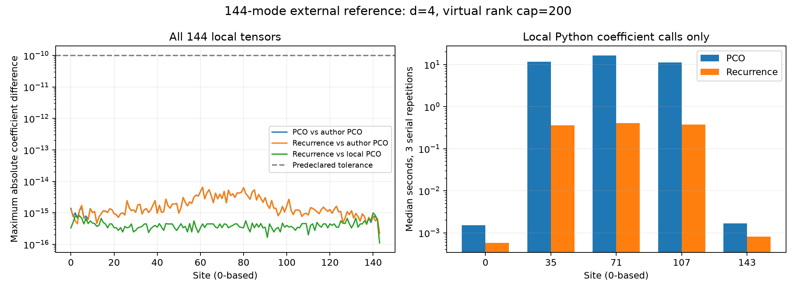

# 第二十二轮：144模式外部参考全链复现与局部递推成本

2026-11-09。本轮把上一轮的三个站点试算扩展到全部144个站点：本地PCO与独立湮灭递推均复现作者PCO参考，最大局部系数差约6.55×10⁻¹⁵；完整态的归一化纯态距离约2.20×10⁻¹⁴。固定三个内部站点的串行中位计时，递推比本地PCO实现快29.7–40.2倍。后者仅为局部张量计算结果，尚未证明完整GBS流程加速。

## 来源、预先计划与范围

数据来自[Liu等的Zenodo记录18045305](https://zenodo.org/records/18045305)，关联[arXiv:2512.10643v2](https://arxiv.org/html/2512.10643v2)的GSVD/PCO路线。压缩包319,629,076字节，MD5 `ef160d38704430ac86436d969ae4ca98`，SHA-256 `bd9422c2a194f8f0109a7463291089288d2b0156db771386633824fb6bb8f8a9`。源数据不执行代码，不重新发布第三方程序或压缩包；逐项来源与哈希保留。

[冻结计划](results/iteration22_external/frozen_plan.md)在正式复算前固定全部站点0–143、d=4、虚拟占据上限200、三种局部对照及1e-10绝对最大差阈值。保存Q的对角项乘2后与本项目生成函数约定相符；不拟合局部相位或尺度。全部本地输出保存，未筛除失败或边界站点。

本轮检查已给局部Gaussian核到有限MPS的转换。尚未核对实验原协方差到这些核的整个处理过程，也没有原Gaussian态的全误差预算。论文PCO方法与标准Gaussian递推恒等式均不作为本项目新颖性主张。

## 全部局部张量

| 比较 | 144站点中的最大系数差 |
|---|---:|
| 本地PCO / 作者PCO | 6.53467363135×10⁻¹⁵ |
| 本地递推 / 作者PCO | 6.54414217172×10⁻¹⁵ |
| 本地递推 / 本地PCO | 1.00074151062×10⁻¹⁵ |

144/144通过。4进程、各1个BLAS线程的质量面板用时438.04秒；该并发时间不作为隔离性能基准。最高单个工作进程历史峰值工作集约203.9 MiB，不是整组进程同时占用量。144个NPZ共346,674,001字节，包含两套完整本地复算张量。中央站点每套160,000个系数，递推缓存80,000个偶占据状态。

递推预计算向下封闭占据基的前驱和平方根，使用湮灭恒等式逐项计算，避免PCO实现的多次配对算子作用。算法说明及范围见[递推与距离推导](research/iteration22_recurrence_overlap.md)。

## 完整144模式态的交叉比较

| 比较 | 直接差态得到的纯态距离 |
|---|---:|
| 本地PCO / 本地递推 | 8.81552671354×10⁻¹⁵ |
| 本地递推 / 作者PCO | 2.19681599934×10⁻¹⁴ |
| 本地递推 / 作者hafnian | 2.10458634087×10⁻⁵ |
| 作者PCO / 作者hafnian | 2.10458634087×10⁻⁵ |

PCO与hafnian参考的保真度约0.999999999557。两套原始链并未归一化，log范数平方分别约1.82155和−0.55824，故比较前必须按完整链范数归一化。带缩放的环境收缩与不截断QR给出的log范数平方，最大差约1.89×10⁻¹⁴。

直接计算sqrt(1−F)会在高度重合时失去有效位：本地两构造的重叠给出F=0.9999999999999998，直接相减得到约1.49×10⁻⁸；流式QR计算归一化差态则得到约8.82×10⁻¹⁵。本轮保留两种原始结果，以后者作为近重合态距离的数值诊断。它仍是complex128运算，不能解释为严格零或区间算术证书。

作者hafnian Gamma文件为complex64，Lambda为float32。这里先提升为双精度再换轴、乘Lambda，首末边界取索引0；这解释了本轮读取与计算的具体规则，不表示恢复了保存前的精度。PCO/hafnian之间的约2.10×10⁻⁵差异尚未隔离来源，不能仅凭存储类型归因于舍入，也不能视为原实验输出TV。

## 串行计时复核

全部并发任务和全链比较结束后，单进程、单BLAS线程按种子220902随机顺序运行30次。每站每算法3次，无丢弃预热或挑选最快值，计时仅覆盖完整系数函数；每次均与作者参考核对全部系数。

| 站点 | 本地PCO中位秒 | 递推中位秒 | 比值PCO/递推 |
|---|---:|---:|---:|
| 0 | 0.00150670 | 0.00057620 | 2.61 |
| 35 | 11.75846 | 0.36037 | 32.63 |
| 71 | 16.51741 | 0.41070 | 40.22 |
| 107 | 11.19443 | 0.37689 | 29.70 |
| 143 | 0.00166300 | 0.00080610 | 2.06 |

30/30质量检查通过。边界站点毫秒级测量容易受计时噪声影响。这里只比较同机的两个本地Python实现；未与作者Julia实现或其他硬件计时比较，也未测量GSVD、QR、位移和采样在内的完整流程。



## 核验与复现

- [产物审计](results/iteration22_validation/validation.json)：2,590/2,590通过，复核718个不同外部数组、144个重建文件、四组全链结果、30次计时及源码快照。
- [完整测试](results/iteration22_tests/validation.json)：367运行、333通过，新增11项全部通过；既有4失败、1错误、29案例跳过与7类跳过保留，失败ID不变。全库门禁仍未通过。
- [完整结果表](results/iteration22_analysis/summary_tables.md)、[逐站结果](results/iteration22_external/rows.json)、[全链结果](results/iteration22_global/rows.json)、[全部计时](results/iteration22_benchmark/rows.json)。

源码均在启动前快照并哈希，结束确认未变；冻结产物不覆盖。下载对应压缩包后可在新目录重新复算：

```text
python experiments/iteration22_external.py --archive PATH/PCO_mapping.zip --output results/iteration22_external_reproduction --workers 4
python experiments/iteration22_global.py --archive PATH/PCO_mapping.zip --panel results/iteration22_external_reproduction --output results/iteration22_global_reproduction
python experiments/iteration22_benchmark.py --archive PATH/PCO_mapping.zip --panel results/iteration22_external_reproduction --output results/iteration22_benchmark_reproduction
```

复现输出路径必须未存在；基准应在其他计算任务结束后运行。Windows/Python/NumPy/SciPy版本见[环境记录](results/iteration22_validation/environment.json)。

下一步把递推接入实际Gaussian基MPS构造，在相同输入、预算、采样数下测量端到端成本；并做受控量化实验，区分参考张量精度与其他构造差异。有限精度采样、原始Gaussian输入链与既有平台问题继续单独推进，见[下一轮计划](research/iteration23_plan.md)。
