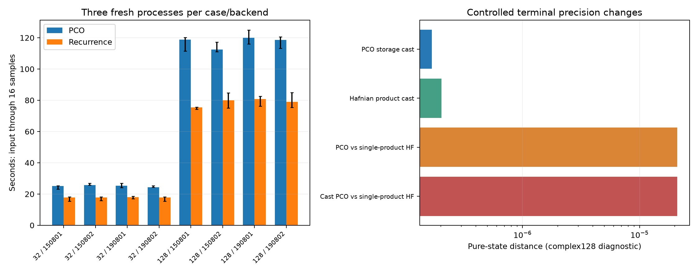

# 第二十三轮：递推完整流程成本与外部参考精度

2026-11-09。本轮将局部湮灭递推接入 Gaussian 基 MPS 构造，在固定输入、截断、秩及采样数下与原 PCO 后端比较；同时对外部 144 模式参考做受控末端精度变化。

48/48次性能运行全部达到0.1构造预算；8个输入的完整流程中位加速为1.37–1.58倍。两后端大系统完整归一化纯态最大距离9.72×10⁻¹⁵。3,278项产物检查和5项新增测试通过，原有全库失败及未闭合的有限精度TV问题保留。

## 预先冻结的比较

[计划](results/iteration23_performance/frozen_plan.md)在性能运行开始前保存。8 个局域输入为 m=32/128、seed=150801/150802/190801/190802，深度12、r=.9、η=.65、d=10、χ=128。两后端各3次，共48次新进程，按种子230999随机排序，BLAS单线程；计时期间没有其他数值实验。每次实际构造并生成16条阈值样本；各重复采用固定的位移与采样种子，故不是独立样本统计实验。

流程计时包括输入、Gaussian分解、占据选择、局部张量、QR、原态预算、位移与采样；不含进程启动、归档和后置独立验证。另存工作进程耗时、外部墙钟和峰值工作集。每输入每后端3次全部纳入中位数和范围，不筛选最快运行，不声称3次重复构成充分统计置信区间。

PCO仍为默认后端。新选项只改变同一有限生成函数的系数求法；原态投影和物理截断规则不变。详见[等价范围与计时口径](research/iteration23_backends_and_precision.md)。与第二十二轮外部给定核的局部29.7–40.2倍比较有不同输入和计时边界，不能混用。

## 完整流程结果

| 模式 | 种子 | PCO中位秒 | 递推中位秒 | PCO/递推 | 原态预算 |
|---:|---:|---:|---:|---:|---:|
| 32 | 150801 | 25.09393 | 17.74872 | 1.41384 | 0.01787550 |
| 32 | 150802 | 25.70203 | 17.88879 | 1.43677 | 0.02755555 |
| 32 | 190801 | 25.41204 | 18.00083 | 1.41172 | 0.02911495 |
| 32 | 190802 | 24.34289 | 17.77327 | 1.36963 | 0.01649920 |
| 128 | 150801 | 118.84078 | 75.37927 | 1.57657 | 0.05385783 |
| 128 | 150802 | 112.50948 | 80.02516 | 1.40593 | 0.02652382 |
| 128 | 190801 | 120.02999 | 80.74278 | 1.48657 | 0.04631811 |
| 128 | 190802 | 118.54799 | 79.00139 | 1.50058 | 0.03190850 |

全部重复的最小/最大值、局部系数比值和分阶段时间见[完整表](results/iteration23_analysis/summary_tables.md)及[机器可读汇总](results/iteration23_analysis/summary.json)。



这里的比较针对两个本地实现。未完成与作者Julia实现、Frugal或其他直接输出算法的同质量成本对赛；构造预算仍是理想算术推导下的浮点估计，不能直接当成完整有限精度采样器TV证书。

## 小系统与完整态核验

48项小系统质量工作覆盖m4/6、local/haar、d4/6、χ2/8/32，两后端各一次。18项达到0.1预算，30项超标，全部保留。每项都用原Gaussian盒系数核对实际距离；24对完整后端态最大差约1.664×10⁻¹⁵。这个面板只验证质量，不用于隔离计时结论。

大系统同时核对原始输入再生成、独立原态切口谱、物理边缘尾概率、预算及完整MPS距离。归档仅按逐数组指纹精确去重：本次PCO结果若与第二十一轮文件完全一致则引用原文件；新递推状态保存一次，各次计时和生成样本单独保留。复用不是跳过构造，验证也覆盖旧文件的冻结哈希。

[独立审计](results/iteration23_validation/validation.json)3,278/3,278通过，包括48组配对比较（32组不同状态对）、64个唯一状态、1,536条生成输出及860个不同外部数组哈希。全部配对预算相同，固定种子配对样本完全一致；大系统最大纯态距离9.72028336874×10⁻¹⁵。56个新状态文件与8个历史状态引用全部核验。

[完整测试](results/iteration23_tests/validation.json)372项运行、338通过、4失败、1错误、29案例跳过，另7类跳过；5项新增测试全部通过，既有失败ID不变。全库门禁仍未通过，不将新增测试成功表述为整库全绿。

## 四组受控精度对照

| 固定变换比较 | 完整归一化纯态距离 |
|---|---:|
| PCO complex128 / 同一PCO量化complex64后提升 | 1.68103041236×10⁻⁷ |
| hafnian先提升再乘 / complex64×float32后提升 | 2.02405668620×10⁻⁷ |
| 原PCO / 单精度乘积hafnian | 2.10463658413×10⁻⁵ |
| 量化PCO / 单精度乘积hafnian | 2.10470092061×10⁻⁵ |

这些是同一保存规范下的两个末端变化，没有重现约2.10×10⁻⁵的全部参考差异。不能据此排除早期低精度计算、条件数、占据截断或配置差异，更不能认定哪套参考更接近原实验态。距离采用第二十二轮稳定差态QR方法，仍为complex128数值诊断。

额外保存429个S/res/num数组的元数据与哈希。只读检查说明文件链接的[Zenodo 7992736](https://zenodo.org/records/7992736)旧源码快照，发现float16谱权重、complex64 Gaussian核/hafnian及Gamma、float32 Lambda路径。但Gamma中的除Lambda与随后乘Lambda在理想算术下会抵消，不能直接以权重存储精度解释全态误差；该版本也未证实就是2025年参考数组的生成版本。详见[来源审计](research/iteration23_source_audit.md)。第三方源码未执行，压缩包及其中程序未重新发布。

## 文献复核与未闭合方向

在第十一、十七、十八轮工作基础上，重新核对直接输出分布算法的适用条件，补充[文献记录](research/iteration23_literature_update.md)。纯核心MPS困难不是有损输出的经典采样下界；Haar保证也不能自动套用固定深度局域线路。

[事后公式代入](results/iteration23_literature_budget/summary.md)有19/19项检查通过：r=.9、η=.65、ε_L1=.1、δ=.05时，m32/128的粗充分截断阶数分别53/58，与第十一轮重合参数一致。m128对应显式系数数目约10^48.927，随机点估计的粗方差上界约10^73.370。它们分别是某实现的系数计数与充分上界，不是实际运行时间下界，也不是完整采样器性能结论。

下一轮优先推进隐式点估计到合法采样的转换，同时保留Gaussian核链重建、原实验输入来源、递推计算优化与Windows门禁修复，见[后续计划](research/iteration24_plan.md)。这些方向尚未完成，不把有限构造成功写成GBS通用问题已解决。

## 复现与发布

源码在运行开始前快照并哈希，结束检查未改动。所有正式产物保持原字节，新增分析与事后文献检查分目录记录。用未存在的目录重新运行：

```text
python experiments/iteration23_run.py --phase quality --output results/iteration23_quality_reproduction
python experiments/iteration23_run.py --phase performance --output results/iteration23_performance_reproduction
python experiments/iteration23_precision.py --archive PATH/PCO_mapping.zip --output results/iteration23_precision_reproduction
python experiments/iteration23_literature_budget.py --output results/iteration23_literature_budget_reproduction
```

性能复现需先还原第二十一轮状态文件；正式审计与分析入口读取本轮规范目录。四个超过GitHub单文件限制的新状态按40MiB分卷公开，使用`python publication_support/iteration23_large_artifacts.py restore`还原；可选`--destination-root PATH`用于隔离还原检查。旧状态继续引用第二十一轮分卷，不重复发布。

[冻结清单](results/iteration23_manifest.json)含954个新产物，共1,608,885,279字节，另引用8个历史状态共1,576,348,544字节。发布工具核对暂存Git字节及分卷重组哈希；研究分支分批上传，完整文件树核对后才普通快进更新主分支。发布完成后的交叉核验另存回执。
