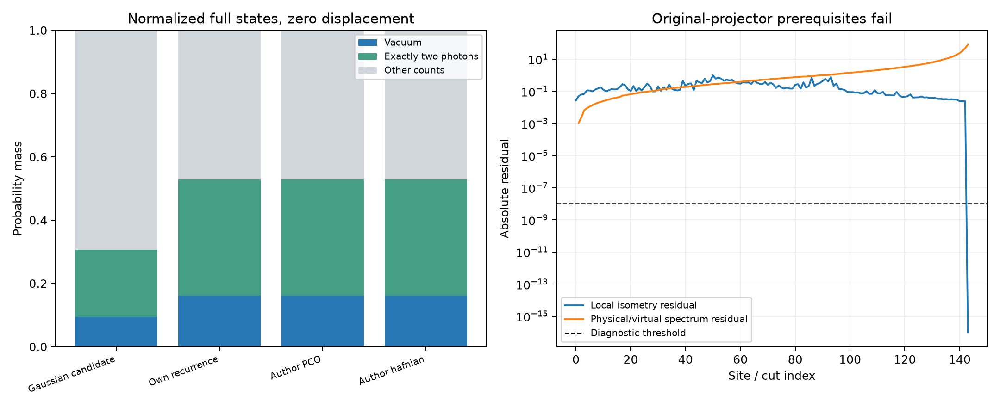

# 第二十四轮：核链Gaussian候选态与有限参考的质量差距

2026-11-09。完成57项Gaussian核链重建，并从外部144个局部Q得到可归一化的Gaussian候选态。有限PCO与hafnian参考虽然彼此接近，但到这个候选态的**纯态距离下界约0.2304，PNR粗粒化TV下界约0.2220**。候选态未被识别为实验原态；这些下界不能直接解释为实验混合输出的误差。

## 重建与独立核对

[正式冻结计划](results/iteration24_chain/frozen_plan.md)包含48个新已知输入：m4/8/16/32、local深度12或Haar、两个种子、纯态压缩r=.2/.6/1.2；另复核第二十一轮8个m32/128历史映射，最后读取外部全部144个Q及143个占据表。57/57全部通过。

56个已知或历史输入中，配对矩阵最大恢复误差2.62×10⁻¹⁵，log归一化幅度最大误差1.71×10⁻¹¹。外部正反向最大矩阵差5.44×10⁻¹⁶。把10,368个虚拟变量副本一次组装并稀疏消元，独立Schur补最大差8.90×10⁻¹⁶；LU行列式的log模和相位误差分别约3.73×10⁻¹³、1.75×10⁻¹⁴。

每一步检查内部自配对块范数、线性求解残差和行列式连续分支。这里的“候选态”指按指定Gaussian收缩得到的正常可归一化态；没有证明所有无限虚拟截断极限可随意换序，也没有闭合原实验协方差到这些局部核的来源链。方法及范围见[推导说明](research/iteration24_kernel_contraction.md)。

外部候选态的最大配对奇异值约0.36193046、平均总光子数约4.96441422、真空概率约0.09450411。协方差最小本征值约0.46850376，纯度恒等式残差约2.66×10⁻¹⁵。它不等于已经确认的原实验输入模型。

## 有限链到候选态的下界

这是看到重建范数之后按[事后计划](results/iteration24_posthoc/frozen_plan.md)追加的诊断。对每条完整144模式MPS先做不截断QR归一化，提取真空及全部10,440个二光子占据振幅；再比较候选Gaussian态在同一正交子空间上的振幅，不使用样本直方图。

| 有限链 | 纯态距离下界估计 | PNR粗粒化TV下界估计 | 真空概率差 |
|---|---:|---:|---:|
| 本地递推 | 0.230414433522 | 约0.22195215 | 0.0669729833393 |
| 作者PCO | 0.230414433522 | 0.221952151283 | 0.0669729833393 |
| 作者hafnian | 0.230414493885 | 约0.22195221 | 0.0669730294924 |

PCO有限链的真空概率约0.16147709，真空加二光子质量约0.52823955；候选Gaussian态对应约0.09450411和0.30660944。有限参考彼此约2.1×10⁻⁵的距离，不能当作它们到这个候选态的质量指标。

设选定子空间内的两向量为a,b，完整态的重叠绝对值至多为`|a†b|+sqrt((1−||a||²)(1−||b||²))`，从而得到纯态距离下界。把其他PNR结果合并为一个事件得到表中的PNR下界。真空差也下界同一零位移纯态的阈值TV；**其余PNR下界不能自动转给阈值输出，三类下界均不能自动转给相关位移混合或原实验输出。**

这些是complex128评估的理论下界公式，不是区间算术证书。另用114个原始逐站振幅收缩检查低阶提取；新增测试包含完整小张量与Gaussian全重叠对照。全部数值见[结果表](results/iteration24_analysis/summary_tables.md)。



## 原态投影上界为何不能套用

进一步检查局部核能否经标量归一化成为等距映射，以及保留虚拟占据是否为同一物理候选态的原Schmidt基。几何检查共301项，其中包括12项已知输入校准和1项源码检查；总计156通过、145失败。288项外部前提中143项通过、145项失败。

失败包括局部等距条件、局部归一化标量乘积与整体范数的一致性，以及全部143个切口的虚拟热谱与独立物理前缀辛谱对照。局部Gram核最大残差约0.9907，物理/虚拟谱最大差约80.39。全部虚拟余态仍近似对角热态，最大协方差残差6.81×10⁻¹⁰；“是热态”不足以证明它就是原物理态Schmidt谱。

因此第21轮原态投影预算在这个参数化上不适用，报告中的候选上界明确为`null`。虚拟权重尾和及原始范数之比不称为原态误差或保真度。这不排除其他规范、过滤解释或不同误差证明。当前有限参考质量、核链候选态以及实验目标必须继续区分。

## 核验、复现与下一步

- [产物审计](results/iteration24_validation/validation.json)：2,073/2,073通过，核对718个外部数组、114个直接振幅及全部正面和失败记录。它不表示301项几何前提全部通过。
- [完整测试](results/iteration24_tests/validation.json)：380运行、346通过，新增8项全部通过；既有4失败、1错误、29案例跳过及7类跳过保留。全库门禁仍未通过。
- 源码启动前快照，结束检查未变；全部输出保留，不覆盖失败。外部程序未执行，压缩包和其中程序未重新发布。

```text
python experiments/iteration24_chain.py --archive PATH/PCO_mapping.zip --output results/iteration24_chain_reproduction
python experiments/iteration24_posthoc.py --archive PATH/PCO_mapping.zip --output results/iteration24_posthoc_reproduction
python experiments/iteration24_geometry.py --archive PATH/PCO_mapping.zip --output results/iteration24_geometry_reproduction
```

输出目录须不存在。后两项及正式验证入口读取本轮规范路径的已保存上游结果；原依赖文件需从此前公开归档恢复。该轮不作隔离速度结论。

下一步核对局部核中的过滤和规范因素，尝试对候选Gaussian态重新构造真正的Schmidt基，再按相同质量比较有限MPS；同时继续递推计算成本、隐式直接输出采样和有限精度误差控制。仍未建立完整实验输出TV证书或通用GBS性能优势。
