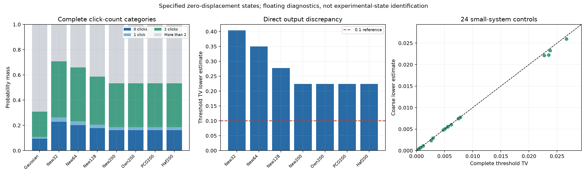

# 第26轮：直接阈值输出下界与数值门禁修复

日期：2026-11-09。研究对象仍是第24轮144模式核链Gaussian候选态和已保存的有限MPS，未将候选态识别为原实验输入。

## 从纯态距离推进到直接输出差异

本轮直接计算恰好0、1、2次点击的全部10441个模式概率，把其他所有输出合并成一个余项。Gaussian侧使用配对矩阵的主子矩阵公式；有限MPS侧对每个点击位置全部占据1…d−1求概率和。保留事件没有重新归一化，也没有把二光子振幅当作二点击概率。

得到指定零位移阈值输出分布之间的粗粒化TV下界估计：

| 有限态 | 阈值TV下界估计 |
|---|---:|
| 新χ32 | 0.403698461146 |
| 新χ64 | 0.349832363794 |
| 新χ128 | 0.277038688208 |
| 新χ200 | 0.223711807588 |
| 旧本项目递推χ200 | 0.223711807589 |
| 作者PCO χ200 | 0.223711807589 |
| 作者hafnian χ200 | 0.223711871331 |

这项结论直接针对阈值输出，比第25轮只凭纯态秩下界能说明的范围更进一步；并非把纯态下界转换成测量下界。Gaussian候选态的0/1/2点击总质量约0.3093826，PCO有限态约0.5327950，差异已在低点击区域显现。

这些是指定状态之间的浮点下界诊断，不是原实验输出误差或严格区间证书。尚未对齐原实验协方差、损耗及位移混合，不能把此0.2237结论转移给未知实验分布；也未主张直接输出采样的复杂度下界。



## 31项正式工作和独立核验

24项小系统固定m2/4/6、两个种子、d4/6、χ4/16，全部与完整Gaussian阈值容斥和完整有限Fock输出求和比较。所有粗粒化下界均在浮点容差内不超过完整TV；最小差约−4.53×10⁻¹⁶，记录为舍入规模，不包装为严格区间结论。再对上述7个144模有限态计算直接事件，共31项全部通过。

新增11项单元测试通过。正式审核的1347项检查通过，其中对全部10441个Gaussian事件用独立75位局部行列式容斥重算，真空因子另用B的奇异值计算，最大绝对差约4.30×10⁻¹⁶；对182个MPS事件直接收缩1372个原始占据振幅，并用独立全链范数归一化。431个外部数组来源哈希核对一致。高精度局部检查不等于高精度计算了整个144维行列式。

另有118项旧新森林回归产物核对通过。全部概率、张量引用、完整小系统分布、源码快照、计时与失败记录均保存。计时只作本次诊断，未作性能优势比较。

## 历史失败具体如何处理

本轮不是把原有失败统一跳过，而是逐项处理：

- 两项端点测试的输入在Windows上已经下溢成零。改为所有实际查询边际均可表示为正数、最终赔率才到exp(±800)的条件独立夹具，保留生产端点拒绝和解析真空控制。
- 一项森林精度失败来自两个大负log score相减。改用配对事件的对数比求赔率，原有误差守卫保留，增加赔率累计守卫，没有放宽原13位断言。
- 一项枚举异常消息在不同longdouble范围下不一致。统一诊断文字，正分支下溢仍立即中止，不丢弃或重归一化质量。
- Unix专用resource导入阻止一个测试模块加载。改为不支持时明确报告子进程峰值内存不可用（null），保留Linux高水位口径；原模块13项测试实际运行通过。
- 第25轮相对输出路径和JSON读取编码修复后，实际worker相对路径调用成功，旧17项失败及其源码快照原样保留。

全库现为408项运行、379通过、0失败、0错误；29个案例和7个测试类仍因依赖跳过。原4个失败测试均实际通过，不再有导入错误，但这仍不是完整依赖门禁通过。

森林修复额外从第25轮源码快照加载旧版本，与新版本比较16个固定输入：完整代理分布最大TV差1.52×10⁻¹⁶，512条同种子样本逐项一致，12项正端点拒绝与解析真空控制通过。这验证固定面板上的模型一致性，不主张所有输入逐位相同或对真实GBS的精度改善。

## 本机构建成功与接口拒绝同时保留

历史构建入口寻找libquadmath.so，在Windows布局下失败，日志保留。随后显式动态构建成功，编译器与quadmath路径、版本、哈希和命令均记录；没有执行第三方论文压缩包中的程序。

格式检查显示C++ long double存储16字节、有效精度64位，ctypes/NumPy则为8字节、53位。适配器在创建内核前正确拒绝。没有强行缩短C++格式或绕过指针布局检查；这些本机测试尚不能启用。后续需要可移植接口与数值边界回归，而不是仅修改文件后缀。

## 复现与公开范围

检出本轮科学提交，设置`PYTHONPATH`指向仓库`src`。历史大状态仍用第25轮分卷还原，不重复生成或复制：

```powershell
$env:PYTHONPATH = Join-Path (Get-Location) 'src'
python publication_support/iteration25_large_artifacts.py restore
python experiments/verify_iteration26.py --archive ..\external_sources\zenodo18045305\PCO_mapping.zip --output results/iteration26_validation_reproduction
```

原来源压缩包SHA-256须为`bd9422c2a194f8f0109a7463291089288d2b0156db771386633824fb6bb8f8a9`。它不随本项目重新发布。完整本机审核另核对记录中的编译器和依赖文件，因此在其他环境应重做独立本机探测，不能把当前Windows记录当作其他平台已通过。

正式运行前固定配置与源码，结束核对字节；发布前核对全部新产物和历史状态引用的Git内容。旧轮次验证依赖其对应科学提交，不能用已修订的当前源码冒充旧轮次运行环境。

详见[推导及数值说明](research/iteration26_low_clicks_and_numerics.md)、[正式冻结计划](research/iteration26_panel_plan.md)、[配对回归计划](research/iteration26_regression_plan.md)、[完整表格](results/iteration26_analysis/summary_tables.md)、[审核记录](results/iteration26_validation/validation.json)。
