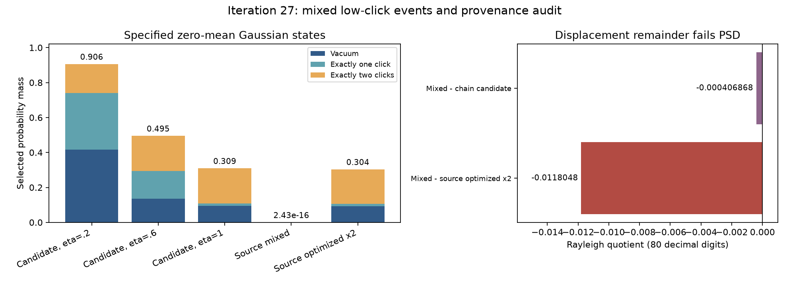

# 第27轮：混合低点击公式与外部协方差审计

日期：2026-11-09。本轮推进混合Gaussian概率、来源身份与分解可行性，并形成可移植本机接口的下一步设计。44项正式工作、369项产物核验及8项新增测试全部通过。这里的“通过”包含成功检出不合法分解，不表示作者给出的差矩阵满足PSD。

## 混合态的直接低点击事件

新增`mixed_gaussian_low_clicks`，输入零均值、hbar=2、xxpp协方差，输出真空、全部恰好1点击和恰好2点击事件。由Q=(V+I)/2、K=Q⁻¹及Jacobi主子式恒等式得到条件真空概率，再用2×2 Schur块将双点击写成两个非负贡献。一次全局逆矩阵后逐对计算，避免直接相减四个近似相等的真空概率。

36项小系统固定m=2/4/6、两个种子、三档透过率、两档额外协方差噪声。binary64、高精度块公式、独立90位大补集容斥和完整阈值分布一致：与完整阈值分布最大绝对差4.1807e−16，与高精度块结果最大绝对差3.3307e−16。高精度独立核对覆盖这些小系统全部444个所选事件。

另有6个144模式候选态损耗/噪声变体，以及2个新取得的作者协方差，每项计算10441个事件。每项49个事件另用原Q的大补集行列式容斥验证，共392个；误差除以各自真空概率后的最大值1.1068e−13。这不是全144模高精度行列式或严格区间认证。所有正式行的概率未作负值修正；剩余质量的浮点舍入标记仍由结果显式记录。

近零条件行列式会被binary64路径拒绝，需要显式切换任意精度；正质量转换下溢仍报错。没有为了通过而添加概率下限或修复协方差。该函数只给出低点击事件，不是完整输出采样器。

## 找到作者混合协方差，但分解仍有缺口

在[作者Zenodo数据包](https://zenodo.org/records/18045305)中找到九章二号混合协方差、优化纯协方差及优化源码/日志。按HTTP Range读取5个小成员，仅传输1,296,949字节，核对成员CRC、SHA-256与每段长度。未下载完整1.95GB文件，未声称验证整包MD5。第三方代码只读，未运行或重新发布。

依源码的单位转换，将作者保存纯协方差乘2记为P，混合协方差为M，旧核链候选为C。P与C逐元素最大差0.00477875、Frobenius差0.061719，明确不是同一协方差。平均光子数分别为P的5.02341、C的4.96441；M为140.37895。

更关键的是，合法经典随机位移必须具有半正定协方差，但实际文件给出：

| 残差 | 最小特征值 |
|---|---:|
| 作者混合 − 作者纯态（单位转换后） | −0.011804751419 |
| 作者混合 − 核链候选 | −0.000406867861 |

两套独立特征值驱动与80位原输入二次型一致，见证向量和残差均保存。不能将这些负残差视作合法噪声，也没有将其投影成PSD。源码中收敛检查使用更新前的最小特征值，却保存更新后的纯协方差；这是需进一步验证的解释，不等于已重放原执行过程或否定所有其他版本。



新M的0/1/2点击总质量仅2.426716e−16，作者P约0.303507，候选C约0.309383。这些是各自指定协方差的事件概率，不是有限MPS经过同一噪声后的比较。因此第26轮约0.2237的纯态阈值差仍不能当作实验混合输出误差。

## 回归与其他方向

全库416项运行、387通过、0失败、0错误，29个案例和7个测试类因依赖跳过；执行门禁通过，完整依赖门禁未通过。开发期两次夹具/检查次序修正已在冻结计划中披露；正式面板在修正后运行，源码快照与运行后哈希一致。

本机接口完成了24字节显式整数尾数/指数布局的迁移设计，保留内部扩展精度、正分支端点、解析零和AUTO精度重算语义。**尚未实现或启用**，不声称已解决原生依赖跳过。模式排序、隐式Meixner输出及合法位移后的有限MPS误差继续保留为开放方向，未以表示成本冒充实际采样能力。

## 复现与公开

459个新冻结产物共4,209,959字节，引用2个历史文件共1,219,941字节；无新增大文件分卷。源码、配置、每项概率、校准分布、来源目录/哈希、负见证、测试记录和图形均公开。外部原文件不随仓库重发，可用本轮有界读取脚本重新取得。

检出本轮科学提交，在仓库目录执行（输出和缓存目录需尚不存在）：

```powershell
python experiments/iteration27_source.py --output results/iteration27_source_reproduction --cache ../external_sources/filtration_reproduction
python experiments/verify_iteration27.py --output results/iteration27_validation_reproduction --external ../external_sources/filtration_reproduction
python experiments/iteration27_run.py --output results/iteration27_panel_reproduction --external ../external_sources/filtration_reproduction
```

获取脚本会核对Range及CRC；核验器还将实际文件对照本次冻结成员SHA-256。重跑面板引用已提交的固定来源清单与旧候选文件。以后源文件改变时应检出对应科学提交，而非修改历史快照以通过哈希校验。

进一步内容：[公式推导](research/iteration27_mixed_low_clicks.md)、[来源审计](research/iteration27_source_audit.md)、[接口设计](research/iteration27_portable_abi_design.md)、[完整核验](results/iteration27_validation/validation.json)、[下一轮计划](research/iteration28_plan.md)。
