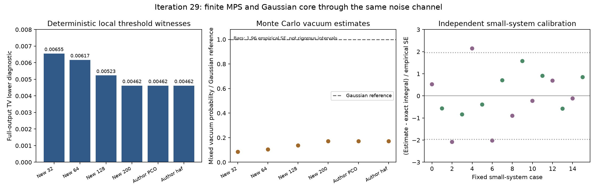

# 第29轮：相同高斯噪声下的有限MPS输出

日期：2026-11-09。本轮把实际有限MPS与第28轮纯Gaussian核心送入**同一个位移噪声通道**，直接比较混合后的阈值输出。22项正式工作完成，4,153项独立核验通过。秩200有限态的局部统计给出约0.00462045的完整输出TV下界诊断；它不是完整TV的估计或上界，也不是原实验身份确认。

## 指定模型与确定性局部见证

Gaussian目标明确取第28轮主配置 `case_14.npz` 中的B及实噪声因子F，以V(B)+FFᵀ定义邻近输入；其与原协方差的相对算子误差约7.22e−14。四个新MPS沿用第25轮保存的d=4、秩32/64/128/200张量，另外读取作者PCO和hafnian有限参考。每个输入整体归一化一次，全部使用同一个F。d=4只限制输入有限态，计算中没有在位移后再次截断输出光子数。

对144个单模式及预先固定的24个相邻模式对，先收缩有限态局部密度矩阵，再用高斯矩精确公式积分真空测量算符，得到单/双模式完整阈值边缘分布。任意边缘分布TV均不超过完整输出TV。这里“确定性”表示无Monte Carlo抽样误差；浮点结果尚非严格区间下界证书。

| 有限输入 | 最大局部TV诊断 | 混合真空概率估计 | 真空估计相对经验标准误差 |
|---|---:|---:|---:|
| 新秩32 | 0.00655365218 | 1.26496287e−19 | 1.478% |
| 新秩64 | 0.00617201267 | 1.56875026e−19 | 1.367% |
| 新秩128 | 0.00523181193 | 2.04751839e−19 | 1.205% |
| 新秩200 | 0.00462045121 | 2.53381436e−19 | 1.092% |
| 作者PCO | 0.00462045121 | 2.53381436e−19 | 1.092% |
| 作者hafnian | 0.00462045351 | 2.53381420e−19 | 1.092% |

秩200与两个作者有限参考的最强已检查模式对为零基编号(18,19)，即通常编号的第19、20模式。增加秩后这些已检查见证减小；这不证明完整输出TV单调减小。此前约0.2237针对未混合纯态的另一种粗粒化；不能把两轮下界之差称为误差下降幅度。

## 稀有真空事件的独立路线

Gaussian混合参考的完整144模式真空概率约1.48463310e−18。以Gaussian真空条件下的位移后验作为重要性分布，有限MPS的混合真空概率等于该参考概率乘以相干重叠似然比的后验均值。它避免直接等待如此稀有的输出事件。

先用256点试验判断运行成本，再冻结六种大系统共同的4,096个标准正态点；未根据最终误差自适应增加样本。秩200真空概率约为Gaussian参考的0.1706694倍，有效样本量约2,751。该相对偏差对应的绝对概率差仅约1.23e−18，作为TV见证很弱；上面的局部见证更有用。经验标准误差及均值±1.96标准误差仅是统计诊断，没有严格置信保证。保存的样本是位移积分样本，不是GBS输出样本，尚未实现完整混合输出采样器。



## 校准、复核与数值边界

16个小系统覆盖2/3模式、d=3/4、随机有限态与截断Gaussian态。全局真空积分分别由独立Fock/Wick求和及Gauss–Hermite积分核对，Monte Carlo最大绝对标准化误差为2.146；是否落入1.96区间未作为通过条件。

独立核验器完成4,153项检查，包括1,072项局部Gauss–Hermite积分，与主路线的最大绝对差4.44e−16；另以原始张量的双侧环境复算六个大系统见证密度矩阵，并核查24个相干重叠点，最大对数概率差2.14e−14。作者431个原始数组成员的哈希和解析元数据均重新核对。

没有把负概率裁剪成零，也没有做PSD投影。无法解释的相干抵消、正质量下溢或非有限运算显式失败；只有结构上无可达贡献的情况才返回解析零。浮点互证加强可信度，但不是任意精度或区间证明。

新增11项测试通过；全库435项运行、406通过、0失败、0错误，另保留29案例及7类原生依赖跳过。旧原生ABI尚未迁移，不能写成所有依赖门禁通过。

## 归档与复现

公开465个新冻结产物，共28,505,010字节，引用6个历史文件，共511,999,265字节。秩128/200原始大文件沿用第25轮分卷，发布前从Git暂存分卷重组并核对原哈希。第三方压缩包只读取数组，未执行或重发作者程序。

在本轮科学提交、既有第25轮张量已恢复及原作者压缩包可用的环境运行；新输出目录须尚不存在：

```powershell
python publication_support/iteration25_large_artifacts.py restore
python experiments/iteration29_run.py --output results/iteration29_panel_reproduction --archive <作者PCO压缩包完整路径>
python experiments/verify_iteration29.py --output results/iteration29_validation_reproduction --archive <作者PCO压缩包完整路径>
```

核验器核对仓库已冻结结果，不自动改为审核新目录。跨平台复算允许浮点差异，不要求结果逐字节相同；固定输入、来源和本轮源码快照则有哈希记录。

详见[方法推导](research/iteration29_same_channel.md)、[冻结计划](research/iteration29_panel_plan.md)、[独立核验](results/iteration29_validation/validation.json)、[下一轮计划](research/iteration30_plan.md)。
