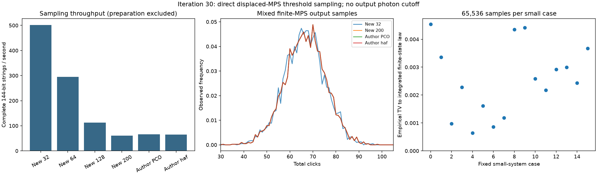

# 第30轮：有限MPS混合态的完整阈值输出采样

日期：2026-11-09。本轮从单事件积分推进到实际生成完整点击字符串：实现有限MPS经经典Gaussian位移后的直接阈值采样，**无需位移后输出光子数截断**。22项正式工作生成1,073,152条字符串，包括六种144模式有限态的24,576条输出。指定有限态的测量构造已验证，有限态到Gaussian目标的模型误差仍未解决。

## 从二元测量到正的有限分支

每个模式无点击效应为vv†，点击效应为I−vv†，v是相干态在有限输入Fock基中的分量。把v归一化为c，点击效应可拆成沿c方向的Poisson尾质量，以及c的正交补。抽样这些正的秩一分支后，将除无点击外的标签合并，即得原二元阈值测量律。

这允许每条轨迹始终保存一个纯的虚拟向量，沿右正交MPS逐站抽样。Gaussian位移来自先验标准正态，不使用上一轮的真空条件重要性后验。输入d=4仍是既有有限态近似，但测量公式包含所有非零输出光子数；隐标签既不是输出光子数，其联合概率也不是最终点击字符串概率。

在精确算术中，这给出指定有限MPS混合输出的完整概率律。实际实现是带数值拒绝守卫的binary64计算，不宣称严格随机实数或区间精度保证。MPS直接抽样和测量细化属于既有思想；[推导及文献](research/iteration30_positive_threshold_trajectories.md)说明本项目具体实现，不主张算法首创。

## 小系统完整分布核验

16个案例沿用第29轮2/3模式、d3/d4、随机及Gaussian截断态。固定非零位移后，穷举全部隐分支并合并为完整点击律，与独立二元POVM收缩最大绝对差4.44e−16。

混合分布由所有真空子集的Gaussian矩积分与容斥得到，并用独立Gauss–Hermite积分再次核对，完整分布最大绝对差1.11e−15。每个案例固定65,536个输出样本，经验完整TV为0.00063863至0.00454213，最大事件标准化偏差2.406。这里的经验TV反映有限抽样频率对该有限态参考律的偏差，不能解释为有限态与Gaussian目标的距离。

## 六种144模式有限态的实际输出

固定同一噪声因子和4,096组先验位移/均匀数，比较第25轮新构造秩32/64/128/200及作者PCO/hafnian有限参考。保存完整144位输出、细化标签、审计轨迹概率和原始随机输入；每条输出包含全部模式。

| 输入 | 准备秒 | 4,096条采样秒 | 观测平均点击数 | 确定性积分平均点击数 |
|---|---:|---:|---:|---:|
| 新秩32 | 0.239 | 8.164 | 66.367188 | 66.169439 |
| 新秩64 | 0.847 | 13.889 | 66.522461 | 66.225199 |
| 新秩128 | 4.312 | 36.250 | 66.603516 | 66.303917 |
| 新秩200 | 10.663 | 67.747 | 66.616943 | 66.366915 |
| 作者PCO | 11.698 | 62.387 | 66.616943 | 66.366915 |
| 作者hafnian | 10.163 | 63.465 | 66.616943 | 66.366915 |

这些是实际墙钟记录；部分后期大系统任务与回归测试重叠，不能作为隔离条件下的性能排名。批大小128，NumPy 2.4.6、SciPy 1.16.2，相关BLAS线程配置为1。六组使用共同随机数，彼此不是独立实验，近似重合的直方图不提供目标分布距离上界。

144个单模式及24个预选模式对的样本频率，与第29轮确定性积分对照，最大标准化偏差2.966。未以±1.96区间作为逐项通过门槛。该样本预算不足以据此辨别第29轮约0.00462的局部TV差；那个确定性下界诊断继续有效，也没有因完成采样而变成上界。



## 独立核验、回归与限制

1,471项独立检查全部通过，包括80个真空子集的独立积分、全部输出位与标签范围及计数核对。六个大系统各选4条完整隐轨迹，用原始张量直接收缩，测量行的Poisson尾另由正项级数计算；联合对数概率与采样器记录的最大差为1.42e−13。

新增12项测试覆盖完整分支求和、混合热态解析律、混合纠缠态完整分布、极小正点击质量、零位移Fock态、批次一致性、输入检查与数值拒绝。全库447项运行、418通过、0失败、0错误；29案例及7类依赖跳过保留。旧原生森林ABI仍未迁移。

未新增输出截断，不等于没有输入误差或浮点误差。当前测试也不是对任意极端参数、全部下溢位置和任意抵消的证明；高精度回退与更广覆盖继续开放。原实验输入身份未确认，Gaussian目标输出的全局TV上界未得到，模式排序及非均匀截断预算仍有工作。

## 公开与复现

公开457个新冻结产物，共26,317,717字节，引用29个历史文件，共516,585,249字节；大MPS沿用第25轮分卷，发布时重组暂存内容核对哈希。源码在运行前冻结、结束后检查不变。开发12项测试及两例成本试验成功，正式运行无失败案例；第三方程序未执行或重发。

检出本轮科学提交，恢复已有第25轮张量并准备哈希匹配的作者压缩包；新输出目录必须不存在：

```powershell
python publication_support/iteration25_large_artifacts.py restore
python experiments/iteration30_run.py --output results/iteration30_panel_reproduction --archive <作者PCO压缩包完整路径>
python experiments/verify_iteration30.py --output results/iteration30_validation_reproduction --archive <作者PCO压缩包完整路径>
```

核验器针对仓库冻结结果，不自动审核新复算目录；跨平台浮点结果不要求逐字节相同。详见[冻结计划](research/iteration30_panel_plan.md)、[方法推导](research/iteration30_positive_threshold_trajectories.md)、[独立核验](results/iteration30_validation/validation.json)、[后续方向](research/iteration31_plan.md)。
