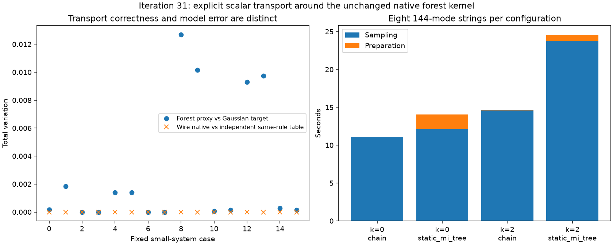

# 第31轮：实际原生森林核的无损标量接口

日期：2026-11-09。本轮把第28轮标量编码和宿主精度守卫接入**真实森林事件、评分、精度重算及完整采样流程**。新 `WireForestKernel` / `WireForestSampler` 在本机Windows上可显式使用；旧ABI不兼容拒绝继续保留。接口正确不等于森林代理没有模型误差，本轮分别量化两者。

## 接通真实计算，保留原规则

本机Python long double仅53位尾数，C++为64位，直接交换内存布局不兼容；Python宿主x87也默认只用53位算术。新入口以24字节规范dyadic编码传递事件值、误差指标和评分诊断，Python用Fraction精确解码；整个原生计算期间设置x87扩展精度、最近舍入及SSE正常非冲零运算，返回时恢复控制字段。

科学核、旧头文件和旧适配器未修改。AUTO仍最多一次LD计算及一次独立quad精炼；只在数值错误时精炼，不改保留集合、森林边、阈值或随机数。quad结果转native long double及相应误差指标沿用旧核，评分没有升级为全程113位。最终Bernoulli概率仍由核内端点守卫验证后输出binary64。原始Fraction字段保留全精度，部分继承的展示字段仍是普通float，详见[接口范围](research/iteration31_wire_native_interface.md)。

## 逐位检查包含不利宿主环境和失败路径

12个固定调用分别在独立程序中直接调用旧科学核，并用十六进制输出作为参考；新wire路径在默认、53位最近舍入、53位向上舍入且FTZ/DAZ开启三种宿主设置下对照。另核对实际Python宿主调用。

481项检查全部通过：成功事件、误差指标、评分诊断逐位一致，最终概率位及状态机计数匹配，控制字段正确恢复。8项调用成功、4项按预定规则拒绝：

| 固定情形 | 结果 |
|---|---|
| 温和热态、相关Gaussian及原始quad事件批 | 成功，逐位匹配 |
| 原始孤立真空 | 保留解析零标记 |
| 8模式、V=(1+2⁻⁸)I、AUTO | LD失败后一次quad精炼成功 |
| 同一困难输入只允许LD | 数值拒绝，未改阈值 |
| V=(1+2⁻⁴⁰)I的高阶稀有事件 | quad预算耗尽，未把数值零称作解析零 |
| 两正分支的最终概率舍入到端点 | 继续拒绝 |
| 事件集合重叠的非法查询 | 参数错误，不触发精炼 |
| 100模式、公共P(Z)低于binary64范围 | 公共缩放消去后条件计算成功 |

这些拒绝是正确错误语义的对照，不是成功产生了样本。算术指标仍为启发式跟踪，未获得严格区间保证；平台验证目前限Windows x86-64/GCC。

## 小系统完整森林法则与模型误差

16项正式小系统覆盖4/6模式、两个固定种子、保留预算0/2、链/静态MI树，以及最近点击/影响度选择。独立完整Gaussian事件表与native路径使用相同森林规则和选择器，对所有前缀及含失败符号的完整输出律核对：

- 最大条件概率差8.42e−14。
- 最大完整森林分布TV差4.19e−15。
- 2,048条同随机数样本全部一致，并由核验器从保存的条件表另行重放。
- 独立行列式路线重算Gaussian目标分布，最大绝对差9.99e−16。

与此同时，冻结森林代理相对Gaussian目标的TV最高约**0.0126969**。这是模型近似误差，与约4.19e−15的接口/事件表互差不同，不能因传输正确而省略。不同预算的代理输出也不能与第30轮有限MPS输出直接混同。

## 144模式运行

输入明确取第28轮主配置V(B)+FFᵀ，显式对称化改变量为0。四种配置各运行8条完整144位输出，均完成，无补抽或重试：

| 保留预算 | 森林 | 准备秒 | 8条采样秒 |
|---:|---|---:|---:|
| 0 | 链 | 0.011 | 11.101 |
| 0 | 静态MI树 | 1.906 | 12.131 |
| 2 | 链 | 0.024 | 14.596 |
| 2 | 静态MI树 | 0.769 | 23.792 |

这里记录实际运行成本和流程，不以32条输出推断144模式质量，也不认定构造输入就是原实验输入。回归测试在正式采样结束后才启动；该墙钟数据仍不构成与不同模型/不同质量预算的速度排名。



## 回归、审核和公开

19项新模块测试全部通过，其中10项继承了原生数值语义测试，覆盖真实精炼、精度耗尽、失败概率保留、端点拒绝、缓存历史及随机数不额外消耗。另完成653项独立审核。全库466项运行、437通过、0失败、0错误，29案例和7类原生依赖跳过保留；新wire路径显式启用，不能据此称其它原生构建依赖全部解决。

公开572个新冻结产物，共8,008,271字节，引用3个历史文件，共1,237,603字节。包含自有DLL/独立参考程序、构建日志、源码快照、全部原始结果与拒绝记录；外部编译器/运行库只记录来源和哈希，不重复分发。正式计算、构建及测试源码检查均未改变。

## 复现入口

在本轮科学提交下，用同平台GCC显式重建；下面输出目录须尚不存在，`<新库>`指第一次构建生成的DLL，`<参考程序>`指第二次构建生成的exe：

```powershell
python experiments/build_wire_forest.py --compiler <g++.exe路径> --output results/iteration31_build_reproduction
python experiments/iteration31_reference_build.py --compiler <g++.exe路径> --output results/iteration31_reference_build_reproduction
python experiments/iteration31_native_tests.py --output results/iteration31_native_tests_reproduction --library <新库>
python experiments/iteration31_transport.py --output results/iteration31_transport_reproduction --library <新库> --reference <参考程序>
python experiments/iteration31_run.py --output results/iteration31_panel_reproduction --library <新库>
```

已发布构建绑定原始源文件及运行库哈希；其他平台或换行不同的检出应重建，不能绕过绑定。固定核验脚本默认审核已冻结结果；其固定输出目录若已存在不会覆盖。详见[冻结方案](research/iteration31_panel_plan.md)、[接口说明](research/iteration31_wire_native_interface.md)、[下一轮方向](research/iteration32_plan.md)。
