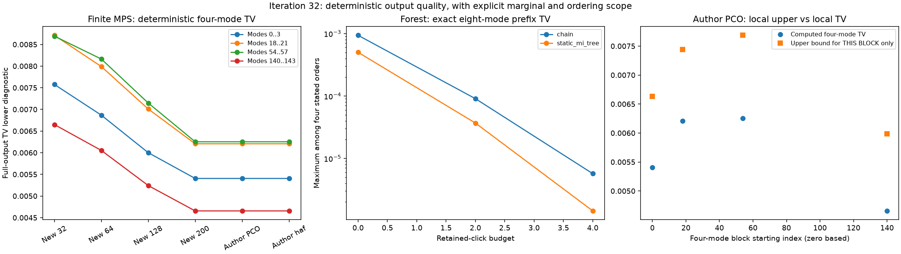

# 第32轮：四模式输出见证与八模式森林前缀质量

日期：2026-11-09。本轮完成48项确定性计算，把秩200有限MPS经相同Gaussian位移后的完整输出TV下界诊断加强到约**0.00625239**。另外枚举明确测量顺序下的完整八模式森林前缀分布，量化预算与森林规则的影响。没有获得完整144模式TV上界。

## 有限MPS见证增强

沿用第28轮主B、噪声F及第31轮冻结混合协方差，六种有限态均使用同一位移通道。检查零基起点0、18、54、140的连续四模式块；18/54依据此前双模式结果预选，其余为两端控制。每块保存完整256×256输入密度矩阵及16个阈值输出概率，不新增位移后输出光子截断，不做局部重归一化或PSD投影。

| 有限输入 | 最强四模式块（零基） | 完整输出TV下界诊断 | 仅该块的Cauchy上界 |
|---|---|---:|---:|
| 新秩32 | 18…21 | 0.00871026336 | 0.01045087771 |
| 新秩64 | 54…57 | 0.00816317489 | 0.01007629508 |
| 新秩128 | 54…57 | 0.00714720904 | 0.00879316774 |
| 新秩200 | 54…57 | 0.00625239293 | 0.00768543218 |
| 作者PCO | 54…57 | 0.00625239293 | 0.00768543218 |
| 作者hafnian | 54…57 | 0.00625239339 | 0.00768543276 |

秩200最强块对应通常编号的第55至58模式。与第29轮约0.00462045相比，这是在同一模型上增强了下界证据，**不是物理误差随轮次增加，也不是完整TV已等于0.00625239**。表末列只约束对应四模式分布，不能解释为完整输出TV小于0.00769。

## 森林前缀的完整法则

选取起点0、18、54、136的八模式集合，将各集合置于测量顺序最前，分别枚举保留预算0/2/4、链/静态MI树的全部256个点击原子。起点0保留自然顺序；其余三个是不同的重排算法，不能把结果当作自然顺序代理的任意八模式边缘。

| 保留预算 | 链：四个明确顺序中的最大前缀TV | 静态MI树：最大前缀TV |
|---:|---:|---:|
| 0 | 9.37932e−4 | 5.00739e−4 |
| 2 | 9.04595e−5 | 3.67700e−5 |
| 4 | 5.68191e−6 | 1.43647e−6 |

本面板中增加预算减小了这些前缀误差，但静态MI树并非逐例更优：起点18、预算4时，链约1.27454e−7，静态MI树约2.53081e−7。不能把总体趋势当作一般单调性或最优性定理。

24个前缀配置各选4个预定历史，在完整144模式实现中核对保留集合、物理森林边及条件概率；96项概率比较逐值一致。另从全部6,120个前缀条件重新构造八模式法则。此前新接口确实用于本轮质量计算，而不只停留在编码测试。

这里计算的是停止于第八步的概率律；未来数值失败尚未穷举，不能保证完整输出一定成功或给出其全局TV上界。四模式MPS与八模式森林的范围也不同，不能凭这些数值给完整144模式采样质量排名。



## 独立核验与已有样本交叉检查

1,192项独立核验全部通过。60个非空子集真空效应由复Q/Bargmann归一化系数递推另算，与主路线实Gaussian Wick矩最大差1.67e−16；全部有限MPS四模式完整分布最大互差9.44e−16。块密度的单模式约化与第29轮保存矩阵最大差4.22e−15，迹、Hermitian与PSD残差检查通过。

第30轮各态保存的4,096条完整样本投影到本轮四模式块，16原子频率最大标准化偏差3.007。这是复用样本的统计校准，不是严格置信界，也未以±1.96作为逐项通过门槛；没有根据这些频率修改块或续抽。

新增7项测试通过。全库473项运行、444通过、0失败、0错误；第31轮wire测试继续显式启用，29案例及7类其它原生依赖跳过保留。所有48项正式工作完成，无失败案例；未执行或重发第三方作者程序。

## 归档与复现

公开533个新冻结产物，共33,326,107字节，引用24项文件依赖共517,115,147字节，包含历史数据及本轮测试辅助源码；第25轮大MPS沿用已有分卷。完整矩阵、子集效应、概率律、固定顺序、条件表、成本试验、源码快照和校准均保留。24项MPS工作累计墙钟约71.90秒，24项森林工作约20.91秒，范围与准备成本不同，不据此作跨方法速度排名。

检出本轮科学提交，恢复既有第25轮大文件，准备哈希匹配的作者压缩包及第31轮wire库；复算目录必须不存在：

```powershell
python publication_support/iteration25_large_artifacts.py restore
python experiments/iteration32_run.py --output results/iteration32_panel_reproduction --archive <作者PCO压缩包完整路径>
```

本轮运行器显式引用 `results/iteration31_build/libwire_forest.dll`。该构建绑定源码/运行库哈希；其他平台或环境应先按第31轮说明重建并调整复制出来的复算配置，不绕过绑定，也不覆盖冻结目录。独立核验器默认针对已冻结结果，输出目录已存在时拒绝覆盖。详见[冻结方案](research/iteration32_panel_plan.md)、[推导与范围](research/iteration32_block_quality.md)、[下一轮方向](research/iteration33_plan.md)。
