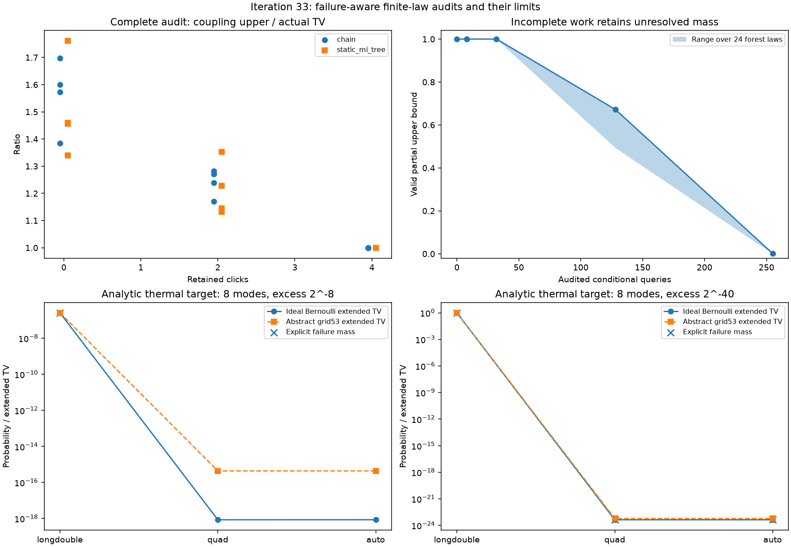

# 第33轮：失败感知误差累积与有限分布精确审核

日期：2026-11-09。本轮完成38项固定工作，建立包含失败符号、未审核质量和有限随机数网格的有理数审核。48,515项独立检查通过。完整审核在小系统上可给出很紧的上界，但较分散分布的部分审核仍很松；**没有获得完整144模式Gaussian输出TV上界**。

## 完整条件树上的误差累积

对第32轮24个八模式森林表重新审核，保存原始二进制条件值，将Gaussian浮点目标表显式归一化为确切有理数。目标原总质量最大偏移1.73e−17；这不代表Gaussian计算误差已被严格包住。有理数精确性只针对所给离散表。与上一轮浮点TV最大变化7.86e−18，未改变其质量结论。

通过追踪目标与代理仍沿相同历史前进的质量，得到耦合上界D，并比较已有目标/代理加权的条件误差求和界。新增贡献是可执行的失败感知审核及原始证据，不将已有求和界或耦合思想称为新定理。

| 保留点击数 | 8个案例中上界D / 实际TV范围 | 最大实际TV | 最大D |
|---:|---:|---:|---:|
| 0 | 1.3391…1.7612 | 9.37932e−4 | 1.47490e−3 |
| 2 | 1.1325…1.3520 | 9.04595e−5 | 1.05819e−4 |
| 4 | 1.00000000052…1.00000013378 | 5.68191e−6 | 5.68191e−6 |

保留4点击时界几乎达到实际TV，但尚无一般紧性保证。相对较小的旧混合界，耦合界的最大绝对改进分别为1.38e−6、7.99e−9、8.47e−21；在高预算案例上两种上界本已极接近，不能夸大改进。

## 未审核部分是主要障碍

按尚未分歧质量最大优先访问条件树。提前停止时，把前沿的未控共同质量全部计入上界，得到D_seen+U=1−已确认共同叶质量。不会把已查节点的损失总和直接冒充全局界。

| 已审核条件数 | 24个八模式案例的有效上界范围 |
|---:|---:|
| 8 | 1…1 |
| 32 | 1…1 |
| 128 | 0.493007…0.672143 |
| 全部255 | 3.57251e−8…1.47490e−3 |

前缀条件本身接近，并不控制尚未展开的输出尾部。高度集中热态能更快确认较大共同叶质量，但本方法仍先需要完整目标表，成本随模式数指数增长，当前限制14模。上述代价现象不构成对其它认证方法的不可能性证明。

## 实际原生失败的概率质量

新增12个独立热态配置、1个端点控制及1个真空控制，全部实际调用第31轮wire接口。固定最近4点击、链森林；longdouble/quad/auto只改变既有精度策略，不修改保护门槛。热态输入V=(1+2^-b)I可精确表示，目标点击率为1/(2^(b+1)+1)。表中只列8模式，完整6模式结果也已保存。

| 热态超额 | 精度策略 | 可达失败节点 | 失败质量 | 包含失败的理想Bernoulli TV |
|---|---|---:|---:|---:|
| 2^-8 | longdouble | 35 | 2.57736e−7 | 2.57736e−7 |
| 2^-8 | quad | 0 | 0 | 8.53928e−19 |
| 2^-8 | auto | 0 | 0 | 8.57263e−19 |
| 2^-40 | longdouble | 1 | 1 | 1 |
| 2^-40 | quad | 21 | 4.34270e−24 | 4.34270e−24 |
| 2^-40 | auto | 21 | 4.34270e−24 | 4.34270e−24 |

2^-40的longdouble路径在根节点就因相对误差指标约1.91e−5超过1e−6门槛而拒绝；quad/auto则在罕见的多点击历史拒绝，导致极小但非零失败质量。保护拒绝本身不证明返回值一定算错，但算法没有返回样本这一事实必须计入法则。单模式V=1e17 I因两个正分支在最终binary64概率中舍入到端点而拒绝，失败质量1；四模式真空为结构性零点击，误差和失败均为0。

9个新增配置包含110个可达失败节点，所有消息与概率质量均保留；它们是预定控制的有效研究结果，不是被丢弃的工作。14项原生配置另起实例，以深度优先顺序重新查询，条件值和失败支持全部逐项一致。有限两种顺序对照不等于任意缓存历史不变性证明。

## 有限网格不是理想Bernoulli

在每次独立均匀取53位网格并严格比较U<q的抽象模型中，有效概率为ceil(2^53 q)/2^53。本轮对此重新枚举完整法则，连同失败一起核算。两种抽样法则的最大TV偏移约4.38e−16，全部满足m/2^53上界。

对于8模式、2^-8热态，quad/auto理想TV约8.5e−19，网格法则TV则约4.37211e−16。绝对量仍极小，但不能用前者替代后者作为端到端精度。这里没有修改采样器，也没有证明某一确定性PRNG的跨调用独立性。第31轮接口的quad事件路径亦不意味着所有评分都使用quad。



## 验证与公开数据

独立审核器不调用主审核函数，采用递归完整枚举及共同叶路径乘积，精确核对14,234条节点记录、全部分布、失败质量、两种混合界、耦合界、部分审核守恒和网格偏移。48,515项检查全部通过。7项新增测试通过；全库480运行、451通过、0失败、0错误，29个案例及7类其它原生依赖跳过保留，第31轮wire测试显式启用。

公开468个新冻结产物，共40,565,029字节，引用33项文件依赖共757,115字节。保存完整有理数分布、条件/错误表、独立查询次序、全部中间审核、源码快照、输入哈希与测试日志。38项正式工作全部完成，累计约16.82秒，不是144模式吞吐率基准。本轮无需读取或执行第三方作者程序。

归档字节核对发现旧原生kernel的.cpp/.h曾由Git自动转换换行。本轮显式保留实际构建绑定的原始CRLF字节，使公开源码与构建哈希一致；忽略行尾差异后代码完全相同，没有修改计算或重新编译原生库。

检出本轮科学提交，在匹配的第31轮Windows原生库与运行库环境中复算；输出目录必须不存在：

```powershell
python experiments/iteration33_run.py --output results/iteration33_panel_reproduction
```

构建与运行库哈希绑定继续生效。跨环境应按第31轮流程显式重建并调整复制出来的配置，不覆盖冻结结果或绕过绑定。完整方法见[失败感知推导](research/iteration33_failure_coupling.md)、[冻结方案](research/iteration33_panel_plan.md)、[后续方向](research/iteration34_plan.md)。持续研究目标保持开放。
