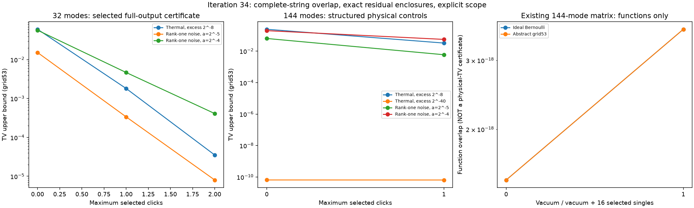

# 第34轮：完整输出重叠界、Gaussian区间与物理目标审计

日期：2026-11-09。本轮实现无需完整目标表的质量审核，在明确的低强度物理控制上推进到144模式；同时严格确认，本项目既有144模浮点构造矩阵按其精确条目解释时存在微小量子不确定关系违例。后者改变了后续研究的优先级：必须先补足有效物理目标及其表示误差，不能只继续改善代理法则。

## 先明确哪一个目标是物理态

第31轮保存的large_input.npz来自此前核心与噪声的浮点构造，并不等于已确认身份的原实验状态。它的Q=(V+I)/2可以被严格证明正定，但这不足以保证V+iΩ半正定。

本轮选取浮点特征向量，再将V及向量条目按精确binary64有理数解释，用两条精确路线计算归一化Rayleigh商，得到**−4.914162490018727e−16**。严格负号证明该存储矩阵不满足量子不确定关系；这不是仅凭浮点负特征值作出的判断。

| 输入 | 浮点最低特征值 | 同一向量的精确Rayleigh商 | 解释 |
|---|---:|---:|---|
| 既有144模存储矩阵 | −7.15410e−15 | −4.91416e−16 | 严格违例见证 |
| 明确物理的秩一位移，a=2^-5 | −1.31585e−14 | +9.68490e−29 | 浮点负号不能判定违例 |
| 明确物理的秩一位移，a=2^-4 | −1.51065e−14 | +1.14625e−28 | 物理性由精确构造保证 |

后两项的非负商本身不证明完整PSD，其物理性来自V=I+aaᵀ的明确经典位移构造。两个热态控制的精确商则分别为2^-8、2^-40。完整矩阵和复见证均保留，详见[物理性审计](research/iteration34_physicality_audit.md)。

这项发现不否定设计中的精确Gaussian核心加噪声模型存在，也不能用于指责原实验输入。它说明存储矩阵的舍入误差必须被控制，才能升格为严格物理保证。此前给定有限表之间的关系、实际原生结果及有限MPS的计算仍按各自范围保留；不能把它们直接提升为该存储矩阵对应的精确量子态证书。

## 不枚举完整目标表的审核

选择一组完整输出串S，包括明确规定其余模式真空的0/1/2点击原子。若目标概率已被包在[l_x,u_x]中，代理完整输出概率为q_x，则

    TV(P,Q) ≤ 1 − Σ_{x∈S} min(l_x,q_x).

没有访问的全部输出和未来失败都保留在剩余质量中；已见失败前缀去重后计入下界，不把它当作完整失败率。增加完整原子会收紧界，但不自动解决目标质量分散的问题。

原生配置固定最近4点击、链、自然顺序、cache_size=0；每条候选轨迹从空历史开始，逐个条件真实调用原生库，重复前缀必须逐值一致。结论针对这一明确的单次尝试法则，不自动认证默认跨轨迹缓存或其它调用历史。没有抽样、续抽或按成功条件化。

## 物理控制的完整模式上界

热态目标有精确有理数概率；秩一控制V=I+aaᵀ有解析真空函数，使用256位dyadic区间包住目标原子。后者是经典Gaussian位移后的真空，输入物理性由精确构造保证。

| 模式数 | 输入 | 已审核完整原子 | 抽象53位网格法则TV上界 |
|---:|---|---|---:|
| 32 | 热态超额2^-8 | 全部0/1/2点击 | 3.52151e−5 |
| 32 | 秩一位移a=2^-5 | 全部0/1/2点击 | 8.00885e−6 |
| 32 | 秩一位移a=2^-4 | 全部0/1/2点击 | 4.10458e−4 |
| 144 | 热态超额2^-8 | 全部0/1点击 | 0.0325964 |
| 144 | 热态超额2^-40，auto | 全部0/1点击 | 6.50289e−11 |
| 144 | 秩一位移a=2^-5 | 全部0/1点击 | 0.00591481 |
| 144 | 秩一位移a=2^-4 | 全部0/1点击 | 0.0557294 |
| 144 | 热态超额2^-40，longdouble | 根节点拒绝 | 1 |

这些是指定完整32/144模式尝试的上界，不是局部边缘上界向上外推。较大的上界主要来自未审核的高点击尾部，而不是已经发现这么大的实际偏差。32模式每个最大层级为529个完整原子、5,488个不同条件；144模式为145个完整原子、10,440个不同条件。按完整轨迹重新计算导致的实际调用量另外记录。

上句144模式条件数适用于没有提前失败的三组常规控制。2^-40热态auto出现143个失败前缀，只需392个不同条件便停止这些路径；10,832次真实调用全部触发高精度回退。部分仅有一个历史点击的轨迹在长度15处，相对事件指标约1.01e−6超过1e−6门槛而拒绝。网格法则已见失败质量为6.502887117464306e−11，TV下界6.502887117464327e−11、上界6.502887117466498e−11，区间宽约2.17e−23。这是失败本身贡献的偏差，不能解释为未控尾部估计。

与第33轮8模式同族热态auto的约4.34e−24失败质量相比，这说明长度和零条件累积会改变数值覆盖。它不是同一规模下的误差增长比较，也不能用保护拒绝推断真实条件概率一定算错。longdouble控制在根节点就拒绝，完整失败质量和TV均为1。

这些热态和经典位移控制本来就可直接经典模拟，不能据此宣称解决困难GBS或构成量子优势反例。相关充分条件见[Rahimi-Keshari、Ralph与Caves，PRX 6, 021039 (2016)](https://doi.org/10.1103/PhysRevX.6.021039)，现有经典阈值采样接口见[The Walrus](https://the-walrus.readthedocs.io/en/stable/code/samples.html#thewalrus.samples.torontonian_sample_classical_state)。本轮的进展是审核方法与证据范围，不是这些控制的新采样算法。

理想Bernoulli法则与每步独立53位均匀网格、严格U<q的抽象法则分别计算；后者条件率为ceil(2^53 q)/2^53。没有证明特定确定性PRNG的跨调用独立性。

## Gaussian行列式函数的精确包络

浮点Cholesky只提出三角白化矩阵R。将Q、R转为共同2的幂分母上的整数矩阵，精确核验δ=||RQRᵀ−I||∞；δ<1时证明Q正定，并以detR/(1±δ)^m包住真空函数。逆矩阵主块、Jacobi恒等式与区间容斥进一步给出完整0/1/2点击函数包络。所有端点向外舍入，不用浮点误差指标冒充严格区间。

144模式成本试验的δ约8.79480e−15，白化证书约5.72秒。正式输入、三角见证、残差及区间全部保存。区间工具保留可能为负的函数端点；新增测试明确检查“Q正定而量子无效”的例子，避免静默概率修复。

对既有存储矩阵，真空加16个预选单点击函数的重叠约3.60147e−18，代数表达式1−重叠几乎为1。更关键的是其物理前提已被反证，因此这里**只是行列式函数包络，不能称作物理TV证书**。

## 验证、失败记录与下一步

42项固定配置包含9个小物理控制、24个冻结八模法则和9个大系统配置；另完成5项物理性补查。极低点击率案例首次在保存超长有理数时触发Python默认整数转十进制长度限制；原失败目录、源码和消息保留，只对该项关闭此进程的格式长度限制后重跑，概率计算、精度策略和选择路径不变。

有效配置共133,209次原生调用，82,861次重复前缀逐值核对；失败重跑成本另保留。累计各有效案例墙钟约1,079.41秒，包含原失败尝试后约1,700.99秒。这些是工作时长之和，部分恢复计算、后续案例、补查和测试重叠，不是任务实际经过时间或隔离吞吐率基准。

新增9项单元测试通过。全库489运行、460通过、0失败、0错误，29个案例及7类其它原生依赖跳过保留，第31轮wire测试显式启用。

14,053项独立检查全部通过，包括18个整数矩阵证书、156个小系统精确补集行列式、44个独立非负Gaussian积分、4个既有144模矩阵的110位直接补集Cholesky，以及5个精确物理性见证。小系统完整目标上下界的最大剩余宽度约2.83e−74。逐原子乘积审核不调用主前缀树审核函数；高精度数值交叉检查与有理数证书的作用分别说明。



检出本轮科学提交后，在匹配第31轮原生库和运行库的环境中复算，输出目录必须不存在。针对可信的本地超长有理数，显式放开Python十进制格式长度限制：

```powershell
$env:PYTHONINTMAXSTRDIGITS='0'
python experiments/iteration34_run.py --output results/iteration34_panel_reproduction
```

本轮构建绑定和原生保护门槛保持不变；其它平台需按第31轮流程显式重建，不覆盖冻结结果或绕过哈希绑定。物理性补查、核验器及分析器分别保存源码和输入哈希，原始失败与恢复目录均公开。

公开640个新冻结产物，共51,103,135字节，引用35项文件依赖共2,251,322字节。本轮未执行或重发第三方作者程序，未修改原生科学核，未静默修补既有协方差。

方法详见[完整原子与区间推导](research/iteration34_atom_and_interval.md)、[冻结面板](research/iteration34_panel_plan.md)。后续优先推进有效物理目标的区间定义、复Hermitian证书与原生高精度成本，同时延续有限MPS、模式排序、非均匀截断和正级数方向，见[第35轮计划](research/iteration35_plan.md)。持续目标保持开放。
