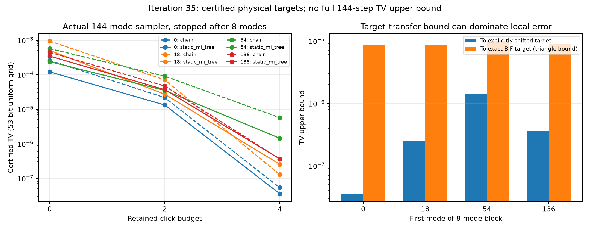

# 第35轮：认证144模物理目标，并恢复严格局部质量评估

日期：2026-11-09。本轮49项冻结任务全部完成，另有四个完整八模目标区间表。持续探索尚未完成，完整144步采样器的全局TV上界仍未获得。

## 核心进展

第34轮发现保存的binary64协方差按精确条目解释时违反量子不确定关系。本轮保留该输入，完成两条可核对路线：

1. 将既有精确binary64配对矩阵B、噪声因子F定义的数学模型V*=V_B+FFᵀ严格认证为有效量子态。128位定点提出的K=I-S逆Cholesky见证，其精确残差上界约3.24469e-37。真空概率约1.4846330991895688e-18，完整有理区间宽度1.68916e-52。
2. 显式对原矩阵每个对角元素加2^-40，得到实际传入原生采样器的Vnew。复Hermitian整数证书证明Vnew+iΩ严格正定。所有实际对角增量恰为2^-40≈9.094947e-13；原矩阵及其它候选全部保留。

相对精确B,F模型，原存储矩阵的算符误差上界为3.091563033123422e-14。因此D=Vnew−V*≥8.78579071441694e-13 I，且||D||₂≤9.404103321041626e-13。共同Gaussian噪声通道、纯核心重叠与迹距离关系给出**任意测量分布之间TV≤8.507544989701984e-6**。这是两个物理目标之间的界，不能直接作为任何采样器的误差界。所有这里展示的十进数是便于阅读的近似，严格端点在原始有理数记录中。

本模型身份仅是既有B,F所定义的数学状态；没有证明它等同于原实验输入。方法与推导见[物理模型及转移界](research/iteration35_physical_model.md)。

## 近边界判断保留三种结论

| 对原144模存储矩阵的请求对角增量 | 判断 | 精确证据的十进近似 |
|---|---|---|
| 0 | 严格违例 | 负Rayleigh商−4.91416e-16 |
| 2^-52 | 严格违例 | 负Rayleigh商−3.07258e-16 |
| 2^-50 | 未判定 | 正定见证失败；候选Rayleigh商为正，不能据此证明有效 |
| 2^-46 | 严格有效 | λmin(V+iΩ)下界1.50612e-16 |
| 2^-40 | 严格有效 | λmin(V+iΩ)下界9.67567e-15 |

2^-46通过物理性验证，但没有通过本轮相对V*的正噪声次序充分条件，故本方法不提供它的目标转移界。主输入2^-40在正式运行前固定，没有根据采样质量择优改变。

八模控制在64/128位均给出预期范围：真空与秩一经典位移位于物理边界，通用严格正定方法报告未判定；0.5I严格违例；(1+2^-40)I严格有效。未判定不等于无效。

## 实际144模采样器的前八步质量

选择四个八模块，将每块放到测量顺序最前，其余模式按自然顺序跟随。使用实际144模原生采样器，关闭条件缓存；每条八位轨迹从空前缀启动。四个目标表各含256个完整点击模式，来源是Vnew的有效约化态，逐真空子集经整数证书与包含排斥得到区间，无浮点归一化。

下表为53位均匀网格、停止在前八步时的扩展TV近似。每个对应严格区间宽度仅约1.31e-35至3.14e-35；同时保留理想连续uniform审核。24组均未出现数值失败。

| 块起点 | 森林 | 预算0 | 预算2 | 预算4 |
|---|---|---:|---:|---:|
| 0 | chain | 2.59243e-4 | 2.16365e-5 | 5.33860e-8 |
| 0 | static_mi_tree | 1.20390e-4 | 1.32461e-5 | 3.57251e-8 |
| 18 | chain | 9.37932e-4 | 7.05003e-5 | 1.27454e-7 |
| 18 | static_mi_tree | 5.00739e-4 | 2.72504e-5 | 2.53081e-7 |
| 54 | chain | 5.65445e-4 | 9.04595e-5 | 5.68191e-6 |
| 54 | static_mi_tree | 2.37975e-4 | 3.50219e-5 | 1.43647e-6 |
| 136 | chain | 4.45880e-4 | 4.69002e-5 | 3.64040e-7 |
| 136 | static_mi_tree | 3.44465e-4 | 3.67700e-5 | 3.64040e-7 |

预算增加在这些固定案例中降低误差，但static_mi_tree并不总胜出：起点18预算4时chain更好，起点136两者相同。对精确B,F模型的八模目标，可由三角不等式再加8.50754e-6。例如起点0、预算4、static_mi_tree的上界由约3.57e-8放宽为约8.54327e-6，说明全局目标转移界会掩盖较小的局部差异。

这些结果是指定顺序的**前八步停止律**。不能称为完整144步分布的上界，也不能忽略后续数值失败导致的最终输出折叠。起点非0的块也不是自然顺序下同一采样器的边缘分布。

## 全流程执行及成本范围

预算0/4和两种森林各固定8次完整尝试，共32次全部完成，保存同一组8×144个uniform、所有实际条件概率及输出；任何失败原计划均保留且不补抽。四配置样本平均点击数分别为92.75、86.25、86.125、78.125。样本量小，差异只能说明这些配置在给定随机输入下行为不同，不能给出分布质量或统计显著性结论。

正式调用原生概率接口53,760次，其中前八步穷举49,152次、完整采样4,608次；重复前缀逐位核对43,032次。49任务记录耗时之和约434.29秒，含证书计算、文件保存及辅助表计算；运行与测试有重叠，不是隔离性能基准或总墙钟时间。科学原生核及其保护门槛未更改。

## 验证与复现

新增10项单元测试通过。全库499项运行、470项通过、0失败、0错误；29个用例与7个测试类的既有依赖跳过保留，因此不能称所有可选后端均通过。

独立验证器不调用本轮证书模块，重新构造输入、整数残差、行列式界、精确中心、噪声次序与转移界，重建全部前缀TV并逐随机数重放32条完整输出。19,710/19,710项检查通过，涵盖1,040份矩阵证书、148个小矩阵精确消元行列式及20项90位高精度交叉检查。高精度复算包括2/4/8/144模B,F模型真空概率与四个目标表的选定子集；严格性仍由整数区间证据提供。完整记录见[验证结果](results/iteration35_validation/validation.json)。

文件入口：[冻结方案](research/iteration35_panel_plan.md)、[正式任务](results/iteration35_panel/plan.json)、[摘要](results/iteration35_analysis/summary.json)、[24组比较表](results/iteration35_analysis/prefix_comparison.csv)、[全库测试](results/iteration35_tests/validation.json)、[产物清单](results/iteration35_manifest.json)。所有输出目录新建、来源先快照并在结束时核对不变，未覆盖旧结果。

## 与先进工具和九章的对照

已按2026-11-09一手资料对照The Walrus、Piquasso、FrugalGBS、低纠缠MPS、近期有损采样理论和九章4.0。九章团队报告8176模式和25.6微秒每样本，而本轮是144模模型认证及八步局部审核，两者任务与精度不相同；本轮未取得端到端速度优势或完成九章模拟。[九章团队来源](https://quantum.ustc.edu.cn/en/node/1227)。完整比较区分作者声明、理论假设、本项目实测和未复现部分，见[前沿比较](research/iteration35_frontier_comparison.md)。

后续优先直接传播精确B,F模型的局部协方差区间，收紧目标转移；再连接MPS、噪声正分支、保留规则与更大事件族，并在每次重大进展时更新同口径前沿比较。详见[第36轮及持续方向](research/iteration36_plan.md)。
