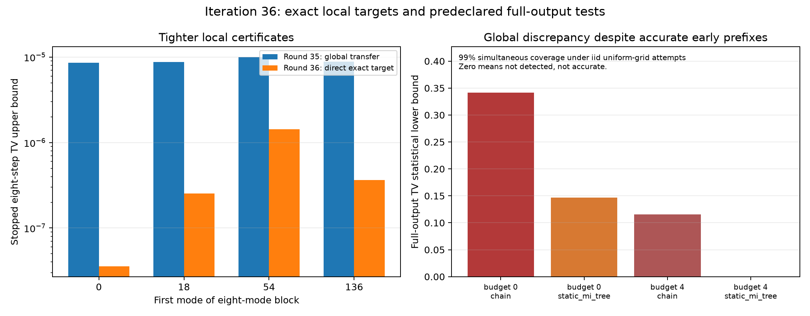

# 第36轮：精确局部目标与完整采样偏差

日期：2026-11-09。有效16项任务完成，195,531项独立检查通过。本轮一方面收紧精确物理模型的局部质量界，另一方面得到部分森林代理的**完整144位输出TV统计下界**。持续目标未完成，完整采样的全局上界仍然缺失。

## 核心结论

将第35轮精确B,F模型的有理协方差中心与算符误差直接传播至局部真空概率后，不再需要先加约8.51e-6的全局目标转移界。例如起点0、预算4、static_mi_tree的前八步TV上界，由约8.54327e-6收紧到约3.57254e-8；这是对同一实际停止采样律的更紧证明，不是改变采样器后取得的质量改善。

但新的固定完整样本显示，早期前缀准确不足以保证全局准确。在下文明确的独立同分布均匀网格尝试假设下，32个预声明检验具有至少99%同时覆盖率，三个配置的完整扩展输出TV分别至少约0.341、0.147、0.115。第四个配置未检出，不能认定它准确。

## 直接认证的局部目标

V*是第35轮定义并认证的精确B,F物理模型。Vnew是实际采样器使用的显式加2^-40对角噪声输入。本轮没有再改变任何输入或原生保护规则。对于四个八模式约化态，两物理目标之间的TV区间定位到以下尺度：

| 八模块起点 | 两局部物理目标TV约值 | 预算4、chain对精确目标的前八步TV约值 | 预算4、static_mi_tree对应值 |
|---|---:|---:|---:|
| 0 | 3.24069015e-13 | 5.33863092e-8 | 3.57253992e-8 |
| 18 | 3.68491378e-13 | 1.27453885e-7 | 2.53081085e-7 |
| 54 | 2.45424232e-13 | 5.68190615e-6 | 1.43647221e-6 |
| 136 | 3.22085950e-13 | 3.64039948e-7 | 3.64039948e-7 |

24组前缀审核的严格TV区间最大宽度约9.88126e-31。表中十进值为近似显示，完整端点为有理数；上下界显示相同不表示区间宽度为零。完整比较含预算0/2/4和理想连续/53位网格两种法则，见[局部比较表](results/iteration36_analysis/direct_local_comparison.csv)与原始审核记录。

这些仍是把所选块放在测量顺序最前的**八步停止律**。起点非0的块不是自然顺序完整代理的边缘；后续失败输出折叠也不能忽略。2.45e-13至3.68e-13只描述这些局部物理目标的差异，不能宣称完整144模目标TV同样这么小。

## 全局目标矩与预声明检验

用144个单模式与10,296个双模式的真空区间得到目标总点击数N的认证矩：

- E[N]≈66.86590898657595，区间宽度约1.68069e-32。
- Var(N)≈81.35913766394007，区间宽度约1.22980e-29。

因此对事件N≥80，单侧Cantelli给出目标概率上界约0.320483813779336。本轮预先固定阈值40、50、60、70、80、90、100及失败事件，每个配置固定64次新尝试，四配置共256次。第35轮观察过的32个样本不并入本轮检验。

实际结果如下。TV下界相对于精确B,F目标；取32项已共同控制的结果中各配置最大下界。

| 预算 | 森林 | 完成/尝试 | 样本平均点击数 | 完整TV统计下界约值 |
|---|---|---:|---:|---:|
| 0 | chain | 64/64 | 90.09375 | 0.341245061 |
| 0 | static_mi_tree | 64/64 | 82.71875 | 0.147067879 |
| 4 | chain | 64/64 | 82.125 | 0.115338354 |
| 4 | static_mi_tree | 64/64 | 77.0 | 0，未检出 |

前三项最强事件均为“完整输出且点击数≥80”，分别观测到55、44、42次。以预算0的chain为例，精确二项尾反演给出事件概率下界约0.6617288749，减去目标上界即得到TV下界约0.3412450611。

每事件单侧α=1/3200，四配置各八个事件合计32项，联合失败预算≤0.01。采用40位二进有理向下舍入的Clopper–Pearson下界，二项尾由精确整数验证。这个**统计覆盖率以各配置内部独立同分布的均匀网格尝试为前提**。固定PCG64种子与所有uniform已保存，但没有把伪随机流的数学独立性当作已证明事实。不同配置共用uniform不影响联合界。

256次均完成，无数值失败；这本身不是准确性证据。若有失败，原计划保留失败符号，不补抽，也不从分母剔除。仅比较三个下界的大小不能证明对应真实TV的排序，第四项下界为0也不能证明其准确。

扣除第35轮两物理目标间的通用转移界，前三配置相对实际Vnew物理目标的完整TV统计下界仍约为0.341236554、0.147059371、0.115329847。数值输入与精确B,F目标的微小差异无法解释这些偏差。

## 独立复核与保留的停止记录

独立验证器没有调用本轮区间和置信模块。195,531/195,531项检查通过，重算11,876份矩阵证书、全部目标矩、局部包含排斥、32个二项反演端点，并逐条件概率和uniform重放全部256条完整输出。另有1,581项90位高精度原子/跨块概率交叉检查；严格数值区间的依据仍是整数证书，高精度复算用于独立核对。

新增10项单元测试通过，包括完整小系统解析控制和精确二项覆盖检查。全库509项运行、480项通过、0失败、0错误，29个用例和7个测试类的既有依赖跳过保留。

原正式运行完成前6项后，第6号主模型的证书比对因tuple与JSON list类型不同触发断言，后续9项依赖任务停止。原目录16项记录完整保留。恢复程序只统一比较表示，从原编号6至15继续10项；数学值、输入、算法核心、随机流与统计事件均未改变，恢复后的主模型证书与第35轮逐项一致。不能把这一软件表示问题称作物理认证失败，也没有覆盖旧记录。

新增实际原生概率调用36,864次。前缀部分复用了第35轮24组冻结条件律，没有把其旧调用重复计入本轮。有效16项记录耗时之和约970.48秒，与其它测试存在重叠，含审核和保存工作，不是隔离性能基准。所有失败/恢复、来源快照、原子区间和每次尝试均可审查。

## 当前先进工具与九章的位置

本轮提供了可用于共同目标测试的认证真值与全局偏差检验，未取得对FrugalGBS、MPS、The Walrus或Piquasso的同机速度优势。Frugal论文的百模统计基准结论、近期损耗可模拟定理的假设，以及九章4.0的8176模实验规模，仍需各自按任务、误差、模型与成本对齐；当前森林失真不反驳其它经典方法，也不证明或否定九章最大实例的量子优势。[本轮对照与来源限制](research/iteration36_frontier_comparison.md)。

下一轮优先追查长历史保留规则与条件近似，并把同一有效目标和全局观测量接到既有Frugal/MPS路径。所有新算法筛选与独立确认数据分开，继续报告不利结果。[第37轮及持续方向](research/iteration37_plan.md)。

复现入口：[冻结方案](research/iteration36_panel_plan.md)、[区间与统计推导](research/iteration36_direct_target_and_events.md)、[原运行](results/iteration36_panel/summary.json)、[恢复](results/iteration36_recovery/summary.json)、[独立核验](results/iteration36_validation/validation.json)、[全库测试](results/iteration36_tests/validation.json)、[摘要](results/iteration36_analysis/summary.json)、[产物清单](results/iteration36_manifest.json)。
