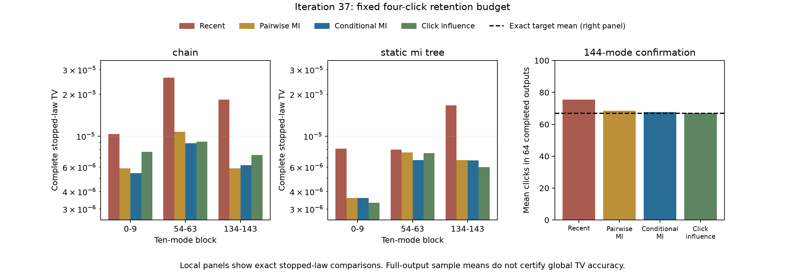

# 第37轮：固定预算下的点击保留规则比较

日期：2026-11-09。28组正式工作及3份目标表完成，256次完整尝试全部成功，281,404项独立核验通过。本轮将已有的零条件化互信息规则接入正点击补全及森林接口，比较recent、pairwise、conditional_mi、click_influence四种保留规则。规则本身不主张创新；固定保留四个点击、原生概率核、精度策略与目标输入，避免把多项变化混成一个效果。

## 证据范围

目标仍是第35轮经精确残差认证的144模B,F物理模型；实际采样输入沿用明确加2^-40对角噪声的协方差。其与数学目标的任意测量TV转移上界约8.507545e-6。原始微小物理性违例未被删除或静默修复。

正式计划包含24组十模式完整停止律、4组各64次完整144步尝试，另有3份直接目标概率表。此前8组各一次的试跑只用于成本和行为检查，没有用单样本精度选择胜者。完整确认使用新种子372440，与试跑371440及第36轮361440分开。

十模式面板把三个区块分别置于完整144模测量顺序开头；它们是明确不同顺序下的停止律，不是自然顺序代理分布的三个任意边缘。每组保存全部1023个前缀的条件概率、保留集合和森林边，再按相反次序遍历。完整十步分布使用精确有理运算重建，分别审核理想均匀数和53位均匀网格。

144模式确认固定static_mi_tree和预算4，隔离保留规则变化。选择这个森林是依据第36轮既有诊断，它不是已证明全局TV最优的森林。七个点击数尾事件及失败事件共32项，错误预算1/3200各项；在独立同分布均匀网格尝试假设下具有至少99%同时覆盖率。固定伪随机流本身不证明独立性，未检出也不意味着准确。

## 数值结果与核验

下表是53位网格下完整十步停止律的TV约值。严格有理端点另存，24组区间的最大宽度约5.71e-30；显示的十进制约值不是向外舍入端点。

| 区块（零基） | 森林 | recent | pairwise | conditional_mi | click_influence |
|---|---|---:|---:|---:|---:|
| 0–9 | chain | 1.03617e-5 | 5.86718e-6 | 5.42263e-6 | 7.73221e-6 |
| 0–9 | static_mi_tree | 8.12820e-6 | 3.60603e-6 | 3.60747e-6 | 3.32405e-6 |
| 54–63 | chain | 2.63132e-5 | 1.07598e-5 | 8.89396e-6 | 9.15777e-6 |
| 54–63 | static_mi_tree | 8.01010e-6 | 7.65022e-6 | 6.72135e-6 | 7.57521e-6 |
| 134–143 | chain | 1.82791e-5 | 5.88903e-6 | 6.19658e-6 | 7.31573e-6 |
| 134–143 | static_mi_tree | 1.66390e-5 | 6.74793e-6 | 6.69866e-6 | 5.99327e-6 |

条件互信息在这六个区块/森林组合中都优于recent，但只在其中四组优于pairwise；不存在一个规则赢得全部六组。它相对pairwise在三个区块分别改变34、21、59个前缀的保留集合，这不是只有名称变化的同一个算法。选择、树结构和最终条件概率的差异计数均保存。

完整144步确认固定static_mi_tree、预算4；精确目标点击均值约66.86591、方差约81.35914：

| 保留规则 | 完成/尝试 | 样本点击均值 | 预声明完整TV统计下界 |
|---|---:|---:|---:|
| recent | 64/64 | 75.46875 | 0（未检出） |
| pairwise | 64/64 | 68.53125 | 0（未检出） |
| conditional_mi | 64/64 | 67.734375 | 0（未检出） |
| click_influence | 64/64 | 67.00000 | 0（未检出） |

这些均值提供后续线索，但既不是完整TV上界，也不能用来确定真实TV排序。四组所有已预声明事件都未给出正下界；CSV中的best_predeclared_threshold=40只是全零下界时的首个并列项，不是一个检出的事件。目标尾上界较宽是需要继续研究的检验功效问题。



所有24组的正反访问顺序在条件概率十六进制值、保留集合和森林边上完全一致；没有失败前缀。正式面板共85,968次原生调用，其中完整轨迹36,864次全部重放。独立检查覆盖3,071份矩阵证书、3,072个90位目标原子校准，以及24,744次稠密独立选择计算和同数目的独立图结构核对。目标整体矩沿用已认证且哈希匹配的第36轮产物。

新增5项单元测试通过；全库514项运行、485通过、0失败、0错误，既有29案例及7类依赖跳过保留。全库运行开始时343个源文件均有快照，运行后及发布前继续核对。绘图检查发现初稿图例重叠，另存仅调整布局的版本并保留初稿；数值结果不变。

## 图结构方向的一个精确边界

在固定GBS面板之外构造了四个二元变量的严格正概率小例子：联合KL最优的TAN树，在“全部遗漏变量已为一”的后验上误差约0.06862，另一棵树约0.02348。用精确有理数比较指数化KL及边互信息，另由有向树分解通过66项独立检查。这个例子没有Gaussian可实现性证明，不能称为GBS物理反例；它说明后续条件化树不能仅凭联合KL最优性就承诺采样后验更准确。详见[推导与完整概率表](research/iteration37_tree_objective.md)。

## 复现与边界

归档977个新产物，共198,659,323字节，引用8个历史依赖，共31,670,052字节。试跑、全部确认轨迹、两次局部遍历、精确目标区间、独立核验、理论小例子和绘图初稿/修订版均保留；不覆盖原轮次证据。

在独立工作副本中保留历史依赖，把本轮已有结果另行归档，使运行器指定的新输出目录不存在，再执行：

```powershell
python experiments/iteration37_run.py local
python experiments/iteration37_run.py full
python experiments/verify_iteration37.py
python experiments/iteration37_analyze.py
python experiments/iteration37_tests.py
```

这些程序拒绝覆盖已有输出。原生调用显式绑定第31轮wire库及其源码/运行库哈希；跨平台复算需要先按第31轮说明重建，再明确记录所用配置。独立核验器校验本轮冻结证据及依赖，不把不同平台浮点运行要求为逐字节相同。

正式面板与其它检查有并行，且主机出现较长停顿；墙钟计时全部保存，但不据此作速度排名。为保留试跑已经绑定的源文件字节，本轮对相关源文件明确禁止Git换行转换；API实际路由改动与换行表示的差异须分开审阅。

先进路线及九章比较见[本轮前沿对照](research/iteration37_frontier_comparison.md)。FrugalGBS、低纠缠MPS、最新损耗理论和九章4.0各有不同输入、输出、误差与成本范围；本轮未完成外部同目标性能比赛，也未宣称模拟九章最大实例。扩展检索补入了固定比例损耗、GBS hiding证明和函数计算三条相关边界。

下一步优先补强全局检验功效，并推进同物理目标的Frugal/MPS比较。已写出一个利用认证均值的非负乘积见证及整数支撑二次尾界，现阶段只是后续研究设计与旧样本训练分析，不追认为本轮预声明结论。详见[后续计划](research/iteration38_plan.md)、[选择规则及范围](research/iteration37_selector_scope.md)、[冻结方案](research/iteration37_panel_plan.md)。
