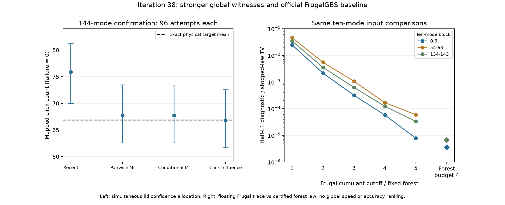

# 第38轮：全局均值证据、官方基线与Gaussian物理反例

日期：2026-11-09。本轮加强质量检验并恢复官方FrugalGBS同输入实测，没有修改第37轮的森林采样规则。384次新的144模式尝试全部完成；recent规则相对精确B,F目标的完整输出TV统计下界约0.02174695，相对实际加噪物理输入目标约0.02173844。其余三种规则未检出正下界，不能据此宣称准确或排序。

另在真实Gaussian点击分布中证明联合KL最优树并非特定后验误差最优，补上第37轮一般二元反例的物理性缺口。官方Frugal基线完成三个十模式输入的15个截断配置，所有校准和重放通过。三个方向的结论各有明确范围。

## 固定新样本上的整体偏差

物理目标沿用第35轮精确B,F模型；实际采样协方差仍显式增加2^-40对角噪声，目标间任意测量TV转移界约8.507545e-6。第36、37轮样本只作训练，不加入本轮确认。固定种子381440，四种规则各96次，保留预算4、static_mi_tree、自然顺序、wire原生核与精度策略均不变，失败预先映射为点击数0且不补样。

除七个点击尾事件及失败事件外，新增归一化点击均值的上下侧乘积见证：对独立同分布X∈[0,1]，由E[∏Xᵢ]=(EX)^n和Markov不等式得到置信界；所有乘积和根端点用精确有理数核验。8个均值尾各分配1/1000，32个事件尾各分配1/16000，联合错误预算0.01。固定伪随机流本身不证明独立同分布，99%同时覆盖的措辞始终带此前提。

| 保留规则 | 完成/尝试 | 样本点击均值 | 均值置信区间约值 | 完整TV统计下界约值 |
|---|---:|---:|---:|---:|
| recent | 96/96 | 75.864583 | [69.997469, 81.202881] | 0.02174695 |
| pairwise | 96/96 | 67.770833 | [62.586524, 73.467361] | 0（未检出） |
| conditional_mi | 96/96 | 67.739583 | [62.576063, 73.424432] | 0（未检出） |
| click_influence | 96/96 | 66.802083 | [61.678359, 72.559245] | 0（未检出） |

目标点击均值约66.865909。新的均值见证检出recent的偏差，而预声明点击尾族仍未检出。第37轮仅用尾事件未检出并不与本轮矛盾；本轮同时增加样本和检验，不能单独归因于其中一项。乘积界一般也不随样本无限增加而收缩到算术均值，详见[推导、整数支撑尾界及功效限制](research/iteration38_mean_witness.md)。完整144模式TV上界仍未获得。

## 官方FrugalGBS同输入基线

重新构建官方提交`fa8b796f2afebd4845a2e335e457735952617ef8`，经GitHub API核实它也是核查当日官方默认分支头。官方采样器主体及既有适配器未修改，Eigen取得来源、编译参数、运行库和源码快照全部保留。15项既有校准通过；三个同协方差十模式输入，各运行截断阶1至5、65,536个官方样本和完整连续阈值追踪。

| 十模式区块 | Frugal阶5导出向量半L1诊断 | 条件互信息静态树预算4的完整局部TV约值 |
|---|---:|---:|
| 0–9 | 7.801274e-6 | 3.607465e-6 |
| 54–63 | 5.883373e-5 | 6.721347e-6 |
| 134–143 | 3.312390e-5 | 6.698657e-6 |

森林数值在所列三组较小，但两列不是相同认证口径或等计算量比较。Frugal导出向量仍含约1e-18归一化缺陷，没有静默重归一化，故只报告相对该向量的半L1诊断；尚非实际有限随机数采样的严格TV证书。森林分别保存理想均匀数和53位网格的严格停止律。

24组独立十模式森林与第37轮完整144模算法的对应停止律逐前缀比对，共24,552项，保留集合、边和条件概率十六进制值完全一致。这个对应关系是实测核对的，不是把独立小输入与完整算法任意边缘默认等同。未进行144模官方Frugal比较，也未建立跨方法速度排名。



## 两个物理范围检查

对精确目标的模式(54,59,62,63)，穷举三个条件TAN树。唯一联合KL最优树的全点击后验误差约0.00343177，另一棵树约0.000328960；差距约0.00310281，其严格区间宽度约9.02e-29。一般原理早已存在，本轮新增的是明确Gaussian实例的可复算证据。探索阶段扫描2,520个候选，随后确定性证明所选实例；没有把事后选择写成统计确认。304项独立检查通过，详见[Gaussian树反例](research/iteration38_gaussian_tree_counterexample.md)。它不自动给出更好的144模采样器。

另用独立双模压缩对作MPS解析控制：每键丢弃权重仅0.01，144模式秩1近似的完整点击TV却为1−0.99^72≈0.515009。八模式版本的256个真空行列式和256个完整点击原子精确相符。这个控制不是主要144模输入，也不是九章数据，只说明不能把最大键截断指标当作全局采样误差，详见[MPS指标范围](research/iteration38_mps_metric_scope.md)。

## 核验、归档和复现

主核验器通过137,847项检查，重放全部55,296个完整条件步，独立检查8个均值根、32个二项分位点、24,552个局部上下文，并另启官方进程重放全部15个Frugal案例的完整向量和直方图。源码与依赖均按哈希核对。另有上述304项Gaussian树检查和MPS解析控制。

全库522项运行、493通过、0失败、0错误；既有29案例及7类依赖跳过继续明示。新增8项均值/整数尾界测试全部通过。全库运行时351个源文件已快照并核对未变；后续增加的独立数学产物单独验证，没有修改已绑定实验源码。

归档1,275个新产物，共158,866,051字节；引用44个历史依赖，共109,644,435字节。构建日志、所有确认轨迹、官方样本直方图、浮点归一化缺陷、探索搜索、严格区间及独立核验全部保留。`build_attempt`目录保留原命名，本轮构建实际成功，返回码0。

使用独立工作副本并保留历史依赖；把原结果归档后，在输出目录不存在时运行：

```powershell
python experiments/iteration38_confirm.py
python experiments/iteration38_external.py
python experiments/verify_iteration38.py
python experiments/iteration38_analyze.py
python experiments/iteration38_tests.py
```

官方CPU可执行文件及运行库随产物保存；其它平台须按记录重新构建并明确记录差异。上述脚本拒绝覆盖输出。数学控制源码位于各自结果目录，复算须保留源码并使用空输出目录。发布使用扩展归档器`results/iteration38_publication/seal.py`，同时纳入独立数学证明的依赖；原归档器及其全库快照未改写。

本轮[先进工具与九章对照](research/iteration38_frontier_comparison.md)进一步核对最新MPS正文、损耗理论适用范围及官方代码版本。局部数值优势、树反例和全局偏差检出均不代表完成九章4.0模拟或超越所有先进经典工具。[第39轮方向](research/iteration39_plan.md)优先补足官方有限随机数律、大系统接口、检验功效及实际条件图收益。持续研究目标保持进行中。
