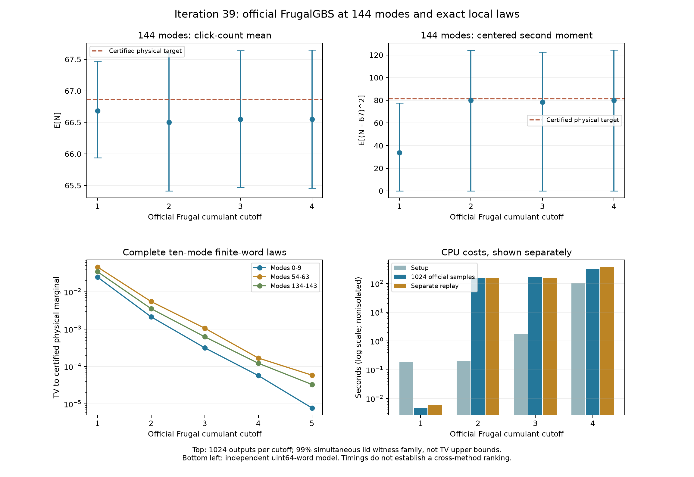

# 第39轮：官方Frugal扩展至144模式，补齐有限随机数局部律

日期：2026-11-09。全部冻结任务完成后发布。本轮进展是将官方基线扩展至完整144模输出，取得十模式精确归一化概率律，并对一阶配置给出不依赖抽样置信度的全局偏差下界。没有取得二至四阶的完整TV上界，也没有建立超过先进经典工具或九章的结论。

## 最重要的新结果

在固定输入、IEEE正规最近舍入及独立均匀64位随机字模型下，官方Frugal一阶配置与精确物理B,F目标的完整144模TV距离至少约**0.009042049308**；转移至实际传入的shifted协方差目标后仍至少约**0.009033541763**。

证明把所有历史上的浮点递推与一个独立伯努利乘积律耦合，整体误差上界约5.416e-14。该代理点击均值约66.86590898660，与物理目标约66.86590898658几乎相同；点击方差却只有34.48515405，目标约81.35913766394。以有界平方偏差的期望差给出上述完整分布下界。这里没有将实际浮点程序直接假定为精确独立模型，也没有用固定种子代替独立性前提。

这项解析控制在确认队列运行后单独建立，使用中心72的有界函数；它不冒充统计计划中固定中心67的检验，也不重复使用统计错误预算。732项精确证明核验通过，另与全部147,456个已记录一阶步骤核对一致。[完整推导及证书](research/iteration39_k1_global_bound.md)

## 正式144模式面板

保持官方采样函数主体不变，累积量截断阶1至4各生成1024个样本，均使用种子391440、单线程和第35轮同一shifted输入。4096个样本全部保留，并独立重放589,824个模式步骤。官方输出与审计版本逐位一致；没有补样本、换种子或删除饱和路径。

预声明X=N/144、Y=(N−67)²/5929和七个计数事件。16个均值尾各分配1/2000，28个事件尾各分配1/14000，总错误预算0.01。表中TV为对精确B,F目标的统计下界，依赖iid随机字前提；真实固定PRNG运行的可重放性并不证明该前提。

| 截断阶 | 样本平均点击数 | 样本平均(N−67)² | 完整TV统计下界 | 饱和阈值步骤 |
|---|---:|---:|---:|---:|
| 1 | 66.682617 | 33.731445 | 0.000652982854 | 0 |
| 2 | 66.502930 | 79.891602 | 0 | 24 |
| 3 | 66.551758 | 78.333008 | 0 | 75 |
| 4 | 66.550781 | 80.078125 | 0 | 82 |

目标E[(N−67)²]约81.377118064。一阶的二阶观测量检出偏差，均值检验没有检出；二至四阶本轮未检出，不能据此宣称准确。统计下界对shifted目标还须减约8.507545e-6，完整有理数结果保存于各配置audit文件。一阶解析下界比本轮统计下界更强，但两者证据类型不同。

全部配置非有限阈值计数为0。二、三阶等配置出现饱和阈值，官方规则仍产生正常位串；这不是目标概率为零的额外失败事件，不能将其频率直接充当TV下界。阈值范围、受影响样本和出现模式见[分析数据](results/iteration39_analysis/global_witnesses.csv)。

## 三个十模式完整律

三个输入块、阶1至5共15组，每组257个样本，包含SIMD尾通道。所有15组新旧接口样本直方图一致；正序与逆序导出的全部15,345个前缀阈值及内部状态一致。独立MT重放覆盖38,550步。

与第38轮浮点终端向量不同，本轮从完整阈值树构造精确有理数概率，严格归一化，不漏掉连续均匀模型下零质量、但有限随机字模型下可能可达的分支。每个物理原子区间直接复用第37轮B,F认证目标。下表为独立uint64字模型下TV区间的下端近似值；最大区间宽度约5.71e-30。

| 十模式块 | 阶1 | 阶2 | 阶3 | 阶4 | 阶5 |
|---|---:|---:|---:|---:|---:|
| 0–9 | 0.024771086 | 0.002140314 | 0.00031749908 | 5.7335348e-05 | 7.8012742e-06 |
| 54–63 | 0.046062672 | 0.0054864076 | 0.001063881 | 0.00016887206 | 5.8833725e-05 |
| 134–143 | 0.03452746 | 0.0035391419 | 0.0006257937 | 0.00012249087 | 3.3123902e-05 |

三个块均随阶数提升而改善，这是本面板的实测结果，不是任意输入单调性的证明。连续均匀与有限随机字两种完整律的实际TV距离最大约1.28e-16，且都满足全路径耦合上界。第38轮浮点向量保留为历史诊断，未静默重归一化或改名为严格证书。[有限随机数推导](research/iteration39_finite_word_law.md)

这些是独立十模式子输入的完整律，不是完整144步输出分布的精度上界。第38轮森林的三组相关局部值仍可作明确范围内的参考；配置预算和成本尚未统一，不给出全局速度或精度胜负。

## 计算成本与工程边界

下列为1024个官方样本的秒数，额外审计重放单列。计时非隔离，包含同一主机上的其它工作，不能直接与论文GPU或其它方法排名。

| 阶数 | 输入、布局及目标准备 | 官方采样 | 额外审计重放 |
|---|---:|---:|---:|
| 1 | 0.179801 | 0.004688 | 0.005815 |
| 2 | 0.200721 | 154.380285 | 152.303587 |
| 3 | 1.709808 | 164.502948 | 160.992941 |
| 4 | 101.805713 | 323.677522 | 373.352775 |

新接口输出位串和N+1大小计数表，避免旧接口的2^N直方图。构建耗时约16.02秒，固定编译器、源码、Eigen/xsimd依赖与运行库。19项探索性试跑全部完成，包含32、64、144模式；其小样本只用于工程校准。144模阶5因预声明两千万布局条目上限明确拒绝，不表示算法上不可能。没有运行GPU后端。

## 核验与复现

- RNG与工程校准：7,516项检查通过，含4,378个原生均匀数映射探针、19项试跑和明确资源拒绝检查。
- 正式独立核验：1,544项通过；独立重放628,374步，核查16个精确根及28个二项式分位点，并独立重建15组完整局部律。
- 一阶解析控制：732项精确检查，另147,456步已观测路径一致性核对；这部分与正式轨迹存在重复核对，不另计新样本。
- 全库：533项运行、504项通过、0失败、0错误；29个案例及7个类因既有依赖条件跳过。新增11项测试通过；364份测试时源文件及快照哈希保留。

冻结计划、运行器、独立核验、完整日志和源文件快照均在仓库中；成功与失败记录不覆盖。主流程：`iteration39_run.py global/local` → `verify_iteration39.py` → `iteration39_analyze.py`，配合独立校准、解析控制及全库测试。输出目录要求不存在；不要在已完成目录上重跑。

## 先进工具、九章与后续

本轮重新核查官方Frugal主分支和原始文献版本，并补充其Science Advances期刊记录。新MPS路线的张量构建指标、最新损耗理论的Haar/输入前提、九章4.0预印本的设备规模和采样指标均分别处理。144模特定配置的偏差下界不等于完整模拟九章，也不能否定其它配置或经典算法。[详细前沿对照与原始来源](research/iteration39_frontier_comparison.md)

下一步继续推进相关项的全局误差、长历史饱和分析、统计检验功效、森林同成本比较、MPS目标对齐和满足损耗理论前提的输入族。[第40轮及持续方向](research/iteration40_plan.md)

发布时将官方CPU头文件已有CRLF行尾按原始字节保存，消除Git默认行尾转换与审计哈希之间的差异；已核对去除CRLF差异后与原提交内容完全相同。实际运行源文件、采样函数主体和所有快照均未改动。
