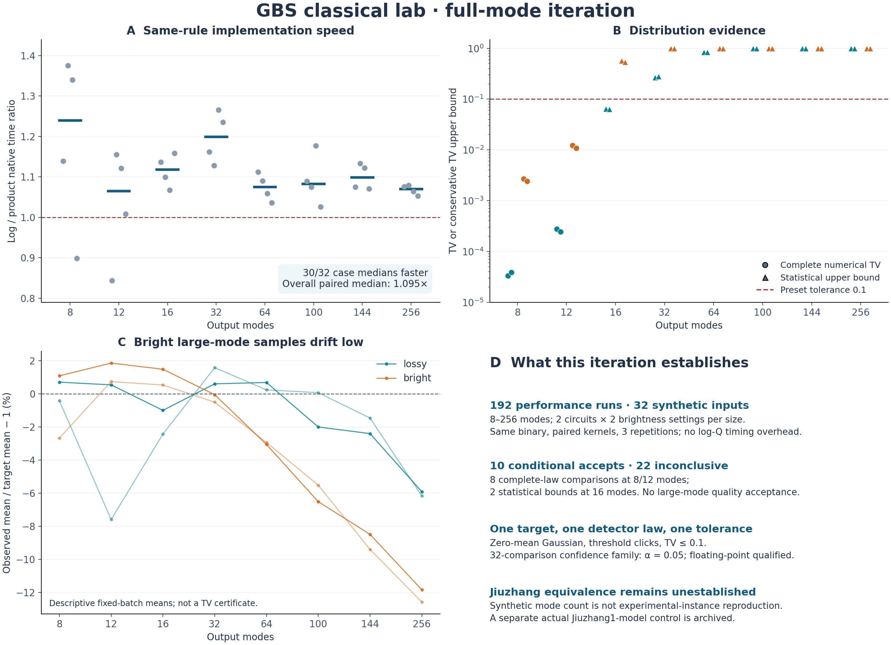

# 第四轮：全模式优化、两个判别器与 FrugalGBS 对照

日期：2026-11-04。基线提交：`729f6ad`。本报告对应独立保存的第四轮输入、程序、固定批次协议与结果；前三轮的结果不重算、不覆盖。

## 结论先行

本轮已经实现两个可运行的证据判别器，并将官方 FrugalGBS 接入相同的目标分布检查。原生优化覆盖8、12、16、32、64、100、144、256模式，完成192次性能运行和32组独立质量批次。没有把模式数或通过少量统计量当成九章级别的完整复现。

目前最准确的算法名称是：**针对给定零均值 Gaussian 态、阈值探测分布的经典近似采样器**。保留有限点击约束的近似并不等于一般精确GBS。小规模完整TV已直接表明两者通常存在非零差异。

- 相同近似规则下，product数值核的32个配对案例有30个原生准备加抽样中位耗时下降；配对加速比中位数为1.09485。
- 固定TV容差0.1下，32组输入有10组得到有条件接受、22组证据不足，采样失败0组。接受包括8个小规模完整分布比较和2个16模式低亮度统计上界。
- 256模式高亮度实例已有可检测偏差：两个预声明见证TV下界为0.06971和0.06355。它们尚未超过0.1拒绝阈值，但不能被描述成高保真大规模GBS。
- Frugal论文确实对标九章二号和粗粒化后的九章三号。它没有提供完整九章四号演示，也没有给出全分布TV证书。论文的统计基准声明与更强的完整任务复现是不同命题。
- 实际九章一号作者协方差用于本地同模型对照；它不是Frugal原文的九章二号／三号数据复现，也不等同于实测硬件分布。
- 该真实模型上的Frugal准备阶段724.27秒、官方生成阶段130.22秒；额外逐样本logQ审计在总预算1800秒处超时，完整样本未输出。这里失败的是我们加入的证据流程，未得到Frugal分布质量的接受或拒绝结论。

汇总数字见[结果表](results/iteration4_analysis/summary_tables.md)，机器可读证据见`results/iteration4_analysis/summary.json`。所有统计保证均带有浮点概率计算、固定独立批次和密度来源等限定。



## 1. Frugal到底宣称到达哪一代九章？

核查截至2026-11-04可验证的最终发表版：Dodd等，*A fast and frugal Gaussian boson sampling emulator*，Science Advances 12(42), eaef8431，2026-10-14在线发表，DOI [10.1126/sciadv.aef8431](https://doi.org/10.1126/sciadv.aef8431)。

最终[PMC正文](https://pmc.ncbi.nlm.nih.gov/articles/PMC13665930/)、发表版图注及[作者机构记录](https://www.research.ed.ac.uk/en/publications/a-fast-and-frugal-gaussian-boson-sampling-emulator/)用于核对发表与主要范围；未在最终版检索片段中核实的方法细节仍明确绑定[arXiv v1](https://arxiv.org/html/2511.14923v1)，没有默认两个版本完全相同。逐项记录在[声明审计](research/iteration4_frugal_claims.md)及`configs/frugal_claims.json`。

| 对标 | 论文实际输出任务 | 论文的质量证据 | 本轮判断 |
|---|---|---|---|
| 九章二号 J2-P65-2 | 完整144位阈值点击 | 低阶点击累积量；有限点击扇区XEB | 明确存在这项基准声明；未独立重现其千万样本图表 |
| 九章二号 J2-P65-5 | 完整144位阈值点击 | 低阶点击累积量；总点击数分布 | 不由这些统计量推出全分布TV接近 |
| 九章三号 J3-high | 1152个检测bin合并为144位二值结果 | 合并后统计量 | 属于粗粒化任务，不能称完整伪PNR分布复现 |
| 九章四号完整L1024 | 本轮未发现完成的8176输出实例演示 | 扩展潜力与方法讨论 | 尚未建立完整复现 |
| 九章一号 | 最终文明确没有纳入主要基准 | 作者引用此前squashed-state工作说明选择 | 本地JZ1运行是我们额外加入的真实模型控制 |

这里的“没有全TV证书”不会自动否定论文的原始命题。论文选择的累积量、XEB和总点击数指标具有科研价值；要复核“这些指标确实达到作者报告的值”，需要同一实验模型、硬件样本、代码设置和足够样本数。当前没有导入原论文的JZ2/JZ3完整数据，所以结论是**范围审计已完成、原图数值尚未独立复现**。

### 采样速度与资源声明

最终文给出1000万样本、8块NVIDIA H100 SXM 80GB、115分钟。图1中的量子采集示意为1000万样本约10秒。这不构成经典采样率超过量子设备的证据。115分钟的名义生成率约1449样本/秒；图中两个时间相差约690倍，但图注没有完整配对的端到端计时边界，不能把这个比值当作我们复测的速度比。

作者强调的是比先前大规模经典模拟更低的资源和更好的实验基准指标。我们没有把它改写成一个容易反驳的“比量子设备更快”的主张。

论文的2GB主要指cumulant载荷，不是整个进程内存。当前公共库是原实现衍生出的库；本地固定提交、CPU布局、双精度与论文GPU实现不完全相同。公共库默认单精度，而本地显式选择双精度；没有根据这个默认值推断论文实际精度。

## 2. 第一判别器：究竟是否在近似指定GBS分布？

实现：`src/gbslab/gbs_identity.py`；入口：`experiments/validate_gbs_identity.py`。

它比较一个**明确给定**的协方差、探测模型和候选采样律。它没有尝试从任意数据拟合“某个可能的Gaussian模型”，也没有把离散点击直方图要求成高斯形状。

### 三层证据

1. **输入和范围。** 检查协方差维度、实对称性和Gaussian不确定性关系。当前支持零均值、hbar=2、xxpp、阈值探测。PNR和非零位移输出`out_of_scope`；不是把这些合法GBS变体判为“不是GBS”。物理协方差通过也不表示采样正确。
2. **完整数值分布。** 小规模逐个二值模式比较目标P和候选Q，给出TV。这是直接的完整离散分布比较，仍受浮点求值限定。
3. **全局统计上界及必要见证。** 大规模使用样本自身的Q概率及可解的目标P点概率，辅以预声明的单模式、邻近对、跨半区对、四模式块的无点击事件和归一化总点击均值。见证通过只能说明未发现该类偏差；见证下界超过容差可以拒绝。

决策有`accepted_within_tolerance_conditional`、`rejected`、`insufficient_evidence`、`invalid_evidence`、`invalid_model`、`out_of_scope`和`evaluation_failed`。**上界大于容差是证据不足，不是证明误差很大。** 相反，完整TV或有效下界超过容差才能拒绝。

### 全局TV上界为什么不需要枚举所有输出？

对目标P和实际采样律Q，有

\[
\operatorname{TV}(P,Q)
=\mathbb E_{X\sim Q}\left[\left(1-\frac{P(X)}{Q(X)}\right)_+\right].
\]

这个得分在[0,1]。若只知道P(X)的下界，得到的是更保守的得分上界。对预先固定的N条独立尝试，可以用Hoeffding误差项构造全局TV上界。

本轮目标点计算限制为最多6个点击。超出上限或数值求解不可靠的点，得分记为最坏值1，保留在总样本数分母中。没有删除高点击样本来美化结果。协方差求值仍是受保护浮点估计，不是向外舍入的严格区间下界；所以“有条件接受”的文字不能省略。

数值失败也必须属于算法输出。我们将失败符号记为⊥，令P(⊥)=0，而Q包含失败质量。成功路径的Q(x)是各真实条件概率的未重归一化乘积。固定批次一旦实际失败，就中止验证并保留失败，不能重抽。全成功时错误接受事件仍包含于原Hoeffding尾事件，因此给出无条件错误接受控制；**不能声称在“条件于批次成功”后仍有同样覆盖率**。

### 误差预算和防自欺控制

32组跨模式比较预先分配族错误概率0.05；每组再平分给全局上界和全部见证。未用完预算不转给别组。1024样本的全局Hoeffding项约0.05911，512样本约0.08359。这也解释为什么一个得分接近零的批次，统计上界仍不会是零。

单独的真实JZ1两方法对照是另一组预声明比较族，族错误概率同为0.05。不能把两个分别95%的比较族合并宣称为所有结论同时95%。

保存的8个控制案例覆盖：真实TMSV采样、匹配单模式均值但缺失关联的Bernoulli伪造器、只给见证、目标点全部不可解、范围外PNR、非法协方差、独立Fock参考及原生精确小实例。伪造器给出见证TV下界约0.2077，能拒绝0.1容差；真实TMSV统计上界约0.0375。控制证据保存在`results/iteration4_identity/`。

## 3. 全模式C++优化：结果与实际边界

### 做了什么

原概率核对小矩阵Cholesky对角元求log之和后调用exp。新核在范围正常时直接取对角乘积的倒数；乘积出现非normal中间值时回退到旧log公式。贪心选集、Gaussian零更新、容斥规则和数值保护均保持原样。

新选项为`--vacuum-kernel product`和`--record-log-probabilities`。原默认仍为log。新增逐样本logQ使用实际选中的分支概率，long double累加，不用目标分布重新拟合，也不访问完整P生成样本。编译为C++20、`-O3 -march=native -ffp-contract=off`，没有fast-math。

54个旧输入/选择器配对中，product/log完整Q最大TV差9.3819e-14；同均匀数样本全部一致；日志与完整Q的最大对数差1.7764e-15。新的8个小规模输入也通过完整Q一致性门槛。解析热态、跨64位边界和原有失败保护分别核验，保存了失败相位，不把预期拒绝例子计作完整分布成功。

### 固定性能实验

使用8个模式数、每个2个Haar线路、每条线路2个亮度，共32组。低亮度为r=0.6、透过率eta=0.35；高亮度为r=0.9、eta=0.65。每组两个核、各3次，共192次方法运行。m≤64每次128样本，更大模式每次64样本；原生计时关闭logQ及profile。全部为合成输入，未套用“九章模式数”名称。

每个输入先分别取3次原生setup+sampling的中位数，再比较log/product比值。总体配对中位加速1.09485，范围0.84396–1.37534；30/32组更快，两个较慢组在8／12模式。三个重复不足以把这些微小耗时差描述为普适统计保证。完整表由`results/iteration4_analysis/summary_tables.md`给出。

### 质量没有随速度一起自动成立

独立质量批次使用固定新随机种子，m≤64各1024样本，m=100/144/256各512样本，保存全部输出及logQ。

| 模式数 | 有条件接受 | 证据不足 | 主要证据 |
|---:|---:|---:|---|
| 8 | 4 | 0 | 完整数值TV约3.3e-5到0.00271 |
| 12 | 4 | 0 | 完整数值TV约0.000243到0.01230 |
| 16 | 2 | 2 | 低亮度统计上界0.06460、0.06369 |
| 32 | 0 | 4 | 点求值预算与数值相消限制上界 |
| 64 | 0 | 4 | 高点击质量大量记为最坏分数 |
| 100 | 0 | 4 | 无全局接受证据 |
| 144 | 0 | 4 | 无全局接受证据，亮态已有正见证下界 |
| 256 | 0 | 4 | 无全局接受证据，亮态TV下界约0.064–0.070 |

16模式通过的两个实例目标平均点击仅约1.94–1.96；这是低点击条件下的进展，不是高计数难实例突破。32模式低亮度既有超过6点击的输出，也有受相消保护拒绝的目标点；所有这些不确定点均按得分1计入，没有伪造概率精度。

256模式高亮度的目标平均点击约103.86、103.88，而观察均值为91.57、90.82。最强预声明见证分别是物理模式(243,244)、(254,255)的共同无点击事件：目标概率约0.353，观察频率约0.541、0.535。扣除同时统计误差后，TV下界仍为0.06971、0.06355。它们在容差0.1下仍是证据不足，但已经给出有用的优化方向。

这些后段偏差与逐步遗忘历史点击的机制相符，**这是待验证解释，不是已证明的因果归因**。下一步适合检验动态点击记忆、保留总点击信息或其他有误差控制的状态表示；新选择应使用新固定输入验证，不能把本轮数据调参后继续当独立确认数据。

## 4. 第二判别器：离九章还差什么？

实现：`src/gbslab/jiuzhang_gap.py`；目录：`configs/jiuzhang_reference.json`。

它同时报告八个方面：真实实例绑定、完整输出范围、探测字母表、噪声／不完美模型、实现容量、分布质量、固定采样协议、资源及计时可比性。缺信息输出未知，已确认不一致输出失败。没有“完成百分比”。

本地D1质量与九章目标质量分开记录。合成协方差通过D1，不会成为九章质量通过。二进制、选择器、k、模式顺序、kernel和协方差都必须与质量批次一致；时间批次的种子和样本数可以不同，但不能交换算法。全局上界还需协议、比较族、alpha和计数一致。

“作者发布Gaussian模型”与“实际硬件分布”是两个目标。前者可绑定协方差；后者还需要真实硬件样本、校准、探测响应和选择规则。有限硬件样本的若干指标通过，同样不会自动产生全TV证明。

最新参考前沿为[九章四号Nature论文](https://www.nature.com/articles/s41586-026-10523-6)：1024个压缩输入态、8176个时空输出模式、最高3050次检测事件。最高事件数不能当作平均光子数或典型实例难度。JZ4使用16个物理探测通道做时域读出，不能以16代替8176。

| 方面 | 本项目当前范围 | 完整九章四号的差距 |
|---|---|---|
| 输出规模 | 原生上限256模式 | 8176输出，当前代码未实现 |
| 实例 | 合成32组；额外JZ1作者协方差 | 尚无完整JZ4已绑定输入与原始数据运行 |
| 状态与探测 | 零均值Gaussian、二值阈值输出 | 需具体实验损耗与部分可区分性等完整绑定 |
| 质量 | 8/12模式完整TV；少量低点击16模式上界 | 大型高点击目标全局证据缺失 |
| 性能 | 单CPU实测本地成本 | 缺同任务、同误差、同样本协议的量子比较 |

仅一个8176模式的稠密实协方差矩阵就有32×8176²=2,139,103,232字节，约1.99GiB。这还不含副本、复数物理性检查和工作区。当前每次零观测更新剩余稠密矩阵，最坏整条样本为O(m³)，输入特征值检查也有立方成本。把256改成8176不会解决这些问题。

第二判别器只有全部任务、质量和资源条件通过才允许生成速度比。当前目录没有擅自填入的配对量子计时，因此所有实际结果的量子速度比均为空。论文对某种历史经典算法的巨大耗时估计没有被当成所有未来经典算法的下界。

## 5. 九章一号真实作者模型与官方Frugal同台对照

输入来自作者仓库[polyquantique/cov_matrix_optimization](https://github.com/polyquantique/cov_matrix_optimization)，固定提交`b1bb0949aeb40de71e55e292489ba83b45be1f7b`。使用原始`cov_0.npy`，200×200、100阈值模式，未使用优化后的协方差。规范化SHA-256为`2af0a953bec2d0a42ddd7ef98baeaa256f44525d3a6b94cb0576ec80bebc31ae`。

该模型的目标平均点击数为41.0423；没有把九章论文其他设置的平均43直接套在此文件上。这里只识别作者分发的数学模型，尚未独立从原始光学校准及硬件样本重建它。

每种方法固定1024样本、同一协方差、相同预声明见证和容差、单CPU线程、无重试。候选为click_influence k4/product；官方Frugal为double-elision K5、固定上游提交`fa8b796f2afebd4845a2e335e457735952617ef8`、双精度。

官方生成函数保持不变，只调用一次。Frugal日志通过事后强制路径重放取得，并将密度求值时间与采样时间分开；候选的日志在实际采样过程中记录，包含在采样时间。这个区别必须保留，不能将两列抽样时间不加说明地当成相同功能成本。

| 指标 | 本项目k4/product | 官方Frugal K5 |
|---|---:|---:|
| 固定请求样本数 | 1024 | 1024 |
| 准备阶段 | 0.00381秒 | 724.27264秒 |
| 官方／本项目生成阶段 | 8.99331秒，含同步logQ | 130.22066秒，不含额外logQ |
| 额外概率审计 | 已含在抽样内 | 未完成，总流程1800秒超时 |
| 包装器总尝试时间 | 9.04641秒 | 1800.15132秒 |
| 子进程生命周期峰值RSS | 约0.0483GiB | 约2.8121GiB |
| 完整样本是否返回并归档 | 是 | 否，v1在审计完成后才输出 |
| 目标平均点击数 | 41.04230 | 同一模型：41.04230 |
| 观察平均点击数 | 39.03809 | 未取得，不能填入论文或推测值 |
| D1结论 | 全局TV上界1，证据不足 | 证据流程失败，未判定分布质量 |

Frugal各阶段的时间来自超时前已刷出的原生日志：bitstring布局37.48513秒、cumulant布局约0.00003秒、目标构建686.78748秒、官方生成130.22066秒。生成函数正常返回后进入密度重放，之后超时。原始失败JSON和stderr保留；[阶段审计](results/iteration4_analysis/actual_control_stage_audit.json)提取了已完成阶段，未把缺失时间填成零。

因此不能把1800秒解释成“Frugal生成1024样本所需时间”，也不能把它解释成Frugal质量不合格。当前逐条密度重放没有有效利用不同样本的SIMD lane，属于本地审计接口成本。此次批次未补抽、未降K、未更换种子，没有用成功的第二次运行覆盖它。

本项目的100模式样本虽然很快返回，但观察均值偏低，且全部1024条样本都超过本轮6点击的目标点计算预算，全局得分都按1处理；D1只给出0.00809的见证下界和无效用的上界1。两个方法都没有在此模型建立要求的全分布质量接受，不能从这张计时表宣称同精度战胜Frugal或九章。

### 超时后修复：先保存样本，再做密度审计

为避免未来重复丢失已生成的批次，新增可选原子样本checkpoint：官方生成函数返回后、密度重放开始前，先保存完整位串、K、种子、模式顺序、样本数及阶段计时；包装器验证并绑定协方差与二进制散列。超时也保留完整生成阶段的记录。它没有logQ，不自动转化为D1接受。

修复使用独立v2构建，SHA-256为`8986aafa436744a65ea72663e77d28b90acf22497ca3d5f6bc50bead674751dd`，位于`.cache/frugal-evidence-checkpoint-native/`。4项小规模定向检查通过，记录在`results/iteration4_frugal_checkpoint_validation/validation.json`。官方生成函数和density trace保持不变；v1二进制、验证和本次实际失败记录经散列复核未变。**没有重跑100模式批次，v2不是本次724.27／130.22秒数据的来源。** 当前主运行器默认使用v2并保存checkpoint；复现原v1过程应使用实际实验的源码快照。

两个方法的D1／D2原报告、输入及二进制哈希、已返回的样本和logQ、完整失败信息和Linux子进程峰值RSS都存放在`results/iteration4_jiuzhang1_control/`。Frugal没有返回的样本没有被伪造或补入归档。正式运行采用固定预算，没有用更低K或更小批次替换失败结果。

RSS通过独立worker的`getrusage(RUSAGE_CHILDREN)`记录，表示其启动子进程的生命周期高水位，不是C++堆分配量；可能包括fork/exec阶段继承的页面。对于很小的原生程序，这个量可能由启动阶段主导。它也不包括父进程同时存活的总内存；因此不拿两个RSS数字推断精确的堆内存改进倍数。

### 为什么没有在本机直接跑论文的144模式K5？

当前公共CPU布局的静态资源检查表明：双精度144模式K5的布局、目标及一份trace工作区约15.850GiB；目标构造阶段同时存活的大向量载荷约19.506GiB，尚不包括分配器等开销。本环境内存限制8GiB，因此本轮没有尝试这一配置。100模式K5对应构造阶段主要载荷约2.809GiB，允许本轮实际测量。

这是对**本地固定代码与布局**的资源判断，不是反驳论文GPU内存声明。论文公共库与原始实验实现、CPU/GPU布局和精度需要分别比较。

## 6. 可复现性与审查

两个采样器均保留原二进制；新的本机构建分别为：

- 候选SHA-256：`5e667bc45ccf6d4a3775d1fb644c7f69d921bcf16aa7adb5c355b2d5de70cbf0`。
- Frugal证据适配器SHA-256：`8009d86b6f46f99c079c2f9dc391a7df8e94132cd19bb0dbfb8645ba541a75b3`。

Frugal适配器对8种编译模式尺寸保存11个验证案例；6个小规模完整Q与冻结旧官方trace完全一致，最大logQ对数误差8.88e-16。17个样本这种非SIMD整数倍批次、跨64位的100/144模式输出、阈值clipping边界和非有限失败均单独核验。大模式解析热态仅验证实现坐标和密度，不充当困难GBS质量证明。

独立审查还发现并修复D2对矛盾协议、alpha、布尔计数和计时边界的5类输入检查缺口。修复后只重审已经保存的证据，不重新采样；旧报告保留，重审记录在`results/iteration4_final_review/`。

最终全项目 **153项测试通过**，unittest报告耗时26.766秒。测试期间源文件散列没有变化，日志和所有源文件散列保存在`results/iteration4_verification/`。这次完整测试没有重新执行正式跨模式批次或100模式九章对照。

本机依赖为Python、NumPy、SciPy、Matplotlib，C++20、OpenMP、Eigen及已固定的FrugalGBS/xsimd源码。编译器g++13.3；本机优化二进制需在具有相容指令集的机器运行，也可按归档脚本重新编译。

### 入口

```bash
python experiments/build_click_sampler.py --native \
  --build-dir .cache/click-iteration4-native
python experiments/build_frugal_evidence.py --native \
  --build-dir .cache/frugal-evidence-checkpoint-native

OPENBLAS_NUM_THREADS=1 OMP_NUM_THREADS=1 PYTHONPATH=src \
  python experiments/validate_gbs_identity.py --demo \
  --executable .cache/click-iteration4-native/click_sampler \
  --vacuum-kernel product --output results/new_identity_demo

OPENBLAS_NUM_THREADS=1 OMP_NUM_THREADS=1 PYTHONPATH=src \
  python experiments/iteration4_quality.py --output results/new_iteration4_quality

OPENBLAS_NUM_THREADS=1 OMP_NUM_THREADS=1 PYTHONPATH=src \
  python experiments/iteration4_jiuzhang1_control.py \
  --frugal-validation results/iteration4_frugal_checkpoint_validation/validation.json \
  --output results/new_jiuzhang1_control

OPENBLAS_NUM_THREADS=1 OMP_NUM_THREADS=1 PYTHONPATH=src \
  python -m unittest discover -s tests -v
```

跨模式性能入口为`experiments/iteration4_benchmark.py`；完整输入生成入口为`experiments/prepare_iteration4_inputs.py`。每次采样实验要求新的输出目录，禁止覆盖第一批结果。构建散列改变后，必须重新进行对应实现一致性核验；不能把旧validation文件当成另一台机器二进制的授权证明。

原始输入、源码快照、固定协议、实际样本、概率和失败记录随代码保存，计算缓存另行归档。原有Git历史与上游许可证保留。用户已建立远程仓库 [qiyuanhuakai/deziroGBS](https://github.com/qiyuanhuakai/deziroGBS)，作为本项目的源码与实验记录版本管理地址；未跟踪的编译产物和作者协方差不推入公共源码树。

## 7. 下一轮最有价值的可检验问题

1. 对全模式高亮度偏差，明确分析历史点击被遗忘后如何影响晚期条件概率。本轮形成了一个具体待检验规则：[累加遗漏点击的条件对数几率增量](research/iteration4_next_hypothesis.md)，它在只遗漏一个点击时恢复精确条件；多个遗漏的相关性可能导致过度修正。尚未实现或查新，后续必须使用新固定输入和同一D1验证。
2. 在状态表示上减少稠密零更新和全协方差复制，而不仅是继续压缩小矩阵核耗时。跨入数千模式需要新的表示与噪声模型支持。
3. 获取并核对原论文JZ2-P65-2／P65-5的校准与样本，使“复现Frugal论文指标”成为独立可执行任务。优先低亮度实例，因为可解目标点覆盖率更高。
4. 让官方Frugal的密度记录复用多条SIMD lane，降低验证开销，并保持官方生成样本及clipping律不变。这个优化应单独验证和计时，不能悄悄回填本轮数据。

这些问题比“已经跑到某个模式数”更接近能够发表且经得起复查的贡献。当前证据支持一套更可审计的研究平台和局部成本改进，尚不支持战胜完整大型九章实验或算法原创性的结论。
