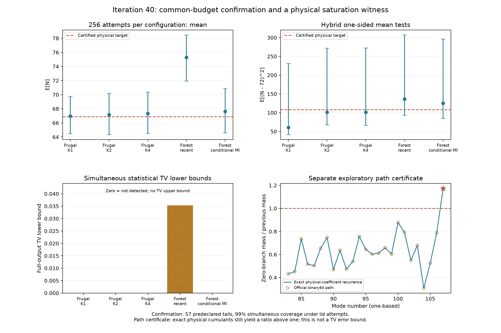

# 第40轮：物理系数超界证书与共同预算确认

日期：2026-11-09。研究目标继续进行中。本轮完成三项相互区分的工作：认证官方Frugal K2近似递推在一个物理实例上确实超界；用固定混合改进二阶观测量下界；完成五配置各256次的新确认面板。没有获得完整144模TV上界，没有宣称超过先进模拟器或九章。

## 主要结果

**物理系数下仍超界。** 在第39轮选出的样本390、第107个模式，官方原生比值约1.1735574627213168。两条不同的整数区间实现核查固定导出系数后，再以5,778份精确小行列式证书构造实际物理态的一阶、二阶系数；实数近似递推仍给出约1.173557462721272，区间宽度约1.02e-52，严格下端点大于1。所有107次实际分支均被认证。因此该实例的超界不是导出系数浮点误差所致。它仍是探索性内部路径诊断，不直接给出输出TV下界。

**新确认面板检出recent森林的整体偏差。** 五配置各256次，共1,280次尝试全部完成，未出现采样失败。预声明57项单侧检验的总错误预算为0.01，在独立同分布随机字/网格尝试假设下同时成立。recent完整144模输出相对于精确B,F目标的TV下界约0.0353329564；对shifted目标约0.0353244488。其他四配置本轮下界为0，表示未检出。第39轮K1确定性下界约0.009042仍然成立。

**二阶下界更有信息，但未新增TV检出。** 旧乘积方法在五配置的二阶观测量上都给出零下界；固定七投注尺度混合给出正下界。然而目标仍在各区间中，不能把区间改善写成新增偏差证据或普遍优于原方法。

## 输入与比较设计

全部正式采样使用第35轮shifted 144模协方差，已按精确条目认证物理性；总体目标矩来自同轮精确B,F物理模型和第36轮矩证书。两个目标之间测量TV转移界约8.507545e-6。原始未修正矩阵的微小物理违例继续保留，没有静默改写输入。

官方Frugal K1、K2、K4使用第39轮固定二进制及公共采样接口；森林recent和conditional_mi均使用static_mi_tree、保留预算4及第31轮固定二进制。各配置种子401440。Frugal按标准MT64重放，森林采用NumPy PCG64共同均匀表；相同种子不意味着两方法具有同一个随机字映射。

观测量X=N/144、Y=(N−72)^2/5184。X双侧沿用原乘积界，Y下侧采用固定均匀七尺度混合，上侧沿用1−Y乘积界。五配置两观测量双尾共20尾，七个计数事件共35尾，两森林失败事件共2尾；每尾α=1/5700。所有尝试都保留，森林失败映射至单独符号，内部Frugal阈值超界不当作失败事件。完整设计见[冻结确认方案](research/iteration40_confirmation_plan.md)。

## 统计结果

表中置信区间属于上述57尾共同覆盖族。目标E[N]≈66.8659089866，E[(N−72)^2]≈107.7180281981。TV定义为完整输出律的总变差距离。

| 配置 | E[N]样本均值 | E[N]区间 | E[(N−72)^2]样本均值 | 二阶区间 | 对B,F目标TV下界 |
|---|---:|---|---:|---|---:|
| Frugal K1 | 66.94922 | [64.46906,69.73111] | 60.64453 | [41.62755,231.44134] | 0 |
| Frugal K2 | 67.14844 | [64.33790,70.19264] | 101.26563 | [68.01505,272.23109] | 0 |
| Frugal K4 | 67.32813 | [64.49307,70.37392] | 101.06250 | [66.22614,272.47780] | 0 |
| Forest recent | 75.29688 | [71.95385,78.47262] | 136.08594 | [93.38682,307.05011] | 0.0353329564 |
| Forest conditional_mi | 67.64063 | [64.60666,70.86067] | 125.33594 | [85.01453,296.35392] | 0 |

以上小数仅供阅读，所有正式判定使用保存的精确端点。recent见证来自X；本轮Y及计数事件未贡献正下界。K2/K4分别记录6/28个饱和步骤，K1为0；三者无非有限阈值。饱和次数不是错误样本数，更不是TV估计。

先用旧队列做16项探索，再冻结混合方法和新样本预算；没有用新数据重新挑选尺度或权重。固定有限投注网格不保证渐近一致性，框架来自标准betting/mixture理论。详见[统计证明与局限](research/iteration40_betting_scope.md)。

## 机制证书

探索路径来自已完成的第39轮K2队列：最早q>1的模式，再取最小样本下标。前向384位区间与独立递归512位区间在固定binary64系数下逐步相交。物理系数版本则完全由精确shifted协方差的一模/两模真空边缘构成，独立验证器以不同的行列式公式复核5,778项，并认证倒平方根相邻网格界。

官方对绝对边缘质量裁剪至[0,1]，并不保证它小于此前历史质量；随后相除仍可能大于1。实数参考保留这些公式和裁剪，没有修改公共采样算法。所得q是近似递推的内部比值，不能解释为真正的物理条件概率。我们未单独归因于累积量截断或额外边缘近似，也未声称所有K2输入有同一缺陷。完整推导、路径及复核入口见[物理超界证书](research/iteration40_saturation_certificate.md)。

## 成本与验证

| 配置 | 端到端秒数 | 官方采样秒数 | 额外审计秒数 |
|---|---:|---:|---:|
| Frugal K1 | 0.617 | 0.002715 | 0.002712 |
| Frugal K2 | 90.012 | 44.759 | 44.586 |
| Frugal K4 | 300.794 | 86.706 | 85.495 |
| Forest recent | 1962.024 | 不适用 | 已含逐步核验 |
| Forest conditional_mi | 2082.508 | 不适用 | 已含逐步核验 |

K4另有约116.18秒目标准备、11.83秒布局生成等成本；森林各36,864次原生调用。进程存在同机并行干扰。共同尝试预算只统一统计样本数，不统一计算成本；这张表不用于算法吞吐量排名。

- 主核验149,635项全部通过，逐步检查184,320个模式步骤，独立核验15个原乘积根、5个混合根及37个二项式端点。
- 机制独立核验23,835项全部通过，包括5,778个精确物理小行列式和两套系数的长路径区间。
- 全库544项运行、515通过、0失败、0错误；29个用例跳过及7个类级跳过因既有依赖条件保留。11项新增测试全部通过。
- 源码、输入、二进制、运行库及复用许可证哈希绑定；图像2430×1620已人工视觉检查。新结果清单由`experiments/iteration40_seal.py`生成，暂存Git字节逐项核对。

## 与前沿和九章的关系

本轮复核官方Frugal主分支、2026年MPS版本、11月热损耗预印本和九章4.0资料。新贡献是同输入确认与精确物理路径诊断；没有把低阶相关量、最大键丢弃权重或内部超界次数误称为完整TV保证。也未把渐近随机干涉仪理论直接套到给定矩阵。具体来源、适用条件、访问限制见[先进工具与九章对照](research/iteration40_frontier_comparison.md)。

## 复现与继续方向

依次使用本轮pilot、target_build、confirm、saturation、physical_coefficients、两个verify、analyze、tests及seal脚本；各脚本参数由`--help`查看。已有结果目录不可覆盖，复现须指定新的独占目录，并保持哈希依赖和科学环境。完整原始数据在`results/iteration40_*`，清单`results/iteration40_manifest.json`，发布验证回执另存`research_archive/publication`。

下一轮优先分解近似公式责任、把路径问题转为可观测输出见证，并扩展物理输入与统计功效；MPS目标对齐继续推进。[后续计划](research/iteration41_plan.md)
