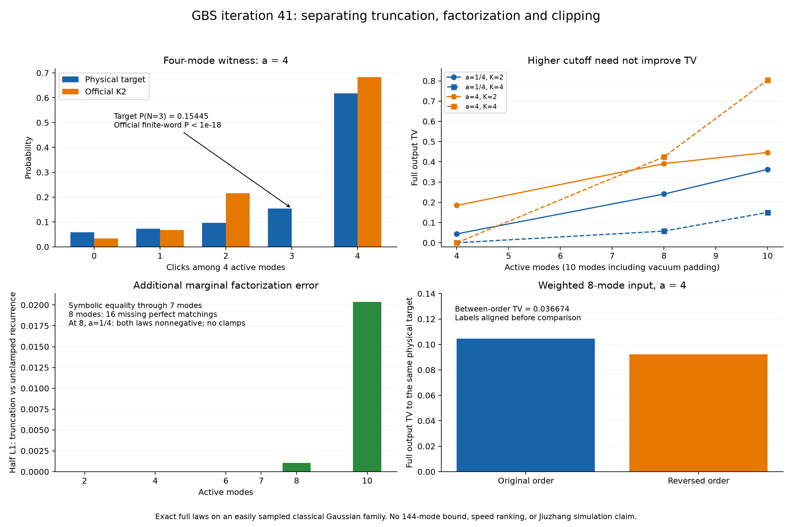

# 第41轮：分解近似机制，获得可观测输出误差证据

日期：2026-11-09。持续探索目标保持进行中。本轮完成44项官方完整输出律面板、精确物理小系统和两套符号代数核验，把第40轮的“内部阈值超界”进一步推进到可观测事件误差，并分开了累积量截断、边缘近似和裁剪的影响。

## 三项主要进展

**四模式物理例子给出直接输出见证。** 目标中“前四模式恰好三次点击”的概率为512/3315≈0.1544494721；官方K2有限随机字输出中的概率仅约3.7007434e-20。两者差异是整个十模式输出的严格TV下界，完整TV约0.1845156360。后六模式是真空填充，全部输出包括浮点泄漏均保留。该输入属于容易经典采样的Gaussian噪声族，不是困难GBS或九章实例。

**精确定位第二层近似。** 对固定K2实现去掉绝对质量裁剪后，递推多项式在前七模式上等于纯二阶累积量截断；第八模式缺少16个覆盖全部顶点的配对项。前向稀疏多项式和独立递归SymPy实现一致。八模式a=1/4物理例子中，全部终端质量为正，所有内部裁剪均未激活；额外边缘近似仍使概率律改变TV=32768/31640625≈0.0010356306。此差异对所有真子集边缘相消，是低阶边缘验证的具体盲区。

**阶数和顺序没有逐例单调保证。** 在十活跃模式a=4的同一输入上，K2完整TV约0.446220，K4约0.804631；a=1/4时K4则明显改善。非均匀八模式亮输入改变访问顺序后，恢复同一标签的两输出律TV约0.036674。不能据此说高阶通常更差或反序总有帮助。

## 物理性与分布口径

所有输入均为V=I+2a diag(vvᵀ,vvᵀ)，a>0。它可由真空施加经典Gaussian位移噪声产生。任意模式子集S的真空概率严格为1/(1+a∑v_i²)。参数均为二进制可精确表示的有理数，CSV按相同精确条目验证，没有重新引入微小物理违例。

目标律用包含排除及独立Möbius变换重建，211个不同小矩阵以有理数消元核对行列式。独立核验对全部子集检查对应关系；相同矩阵的结果复用并明确计数。该族还可通过指数分布的共同强度与条件独立Bernoulli直接采样，其经典可模拟性不依赖本项目启发式。

保存四种控制：纯K2截断有符号质量、无裁剪官方递推有符号质量、保留裁剪的终端有符号质量、最终连续均匀实数参考输出律。前三者出现负数时只称负质量或半L1，不冒称概率分布TV。

官方程序使用未修改公共接口，另保存全部1023个十模式前缀阈值及逆序访问结果。连续均匀、GCC uint64映射两种输出律均以精确有理数重建。有限字律的概率解释假设随机字独立均匀；固定PRNG种子仅作重放校准，不是独立性证明。此次完整律结论无需抽样置信度，也没有把每项65次输出误当成精确分布估计。

## 面板结果与对照

先保留15项探索结果，再冻结44项面板：38项K2覆盖2、4、6、7、8、10活跃模式、五个强度及加权正逆序；另有6项K4控制。四模式强度4和八模式强度1/4的解释实例来自探索选择，不用于估计算法一般失败率。全部44项均完成，共2,860次公共采样校准。

| 活跃模式 | 强度a | K2完整TV | K4完整TV |
|---:|---:|---:|---:|
| 4 | 1/4 | 0.0440761905 | 3.61e-14 |
| 4 | 4 | 0.1845156360 | 4.63e-15 |
| 8 | 1/4 | 0.2407271952 | 0.0575379903 |
| 8 | 4 | 0.3912006738 | 0.4244213495 |
| 10 | 1/4 | 0.3627710813 | 0.1498288296 |
| 10 | 4 | 0.4462197952 | 0.8046306767 |

以上为官方uint64完整十模式输出律到相同物理目标的TV，小数仅供展示，判定保存精确有理数。整个K2面板官方有限字律与精确物理系数实数参考的最大TV约4.11e-15；因此本轮主要差异来自近似结构，而非数值舍入。全部面板最大的有限字真空填充泄漏约3.50e-14，未剔除。

四模式a=4的纯K2截断在每个三点击原子上给出−256/16875；该维数尚无额外边缘因式分解差异。实数递推三个历史上的q=23/15。经过实际裁剪和条件选择后得到归一化输出律，三点击事件缺失，从而可直接比较真实输出事件。这是比“内部异常计数”更强的证据。[物理构造及事件推导](research/iteration41_physical_witness.md)

八模式a=1/4时，16个缺少项的和为D=16(2/75)^4；两个控制律的原子差异为(−1)^{总点击数}D。它们所有真子集边缘相同，但偶数点击事件区分两者。这里比较的是截断律和额外近似律，不是宣称它们所有低阶边缘等于真实物理目标。0.0010356也不是全部目标误差，不能与其它误差来源简单相加。[代数恒等式与适用范围](research/iteration41_missing_matchings.md)

## 核验和封存

- 主核验120,732项全部通过，覆盖28,600个实际模式步骤、90,112个两模型原子概率，所有前缀顺序一致。
- 独立符号核验33项全部通过，复核1至8模式恒等式、项数、源码与快照。
- 全库553项运行、524通过、0失败、0错误；新增9项测试通过。既有29个用例跳过、7个类级跳过保留。
- 原始输入、公共输出、逆序前缀、导出系数、精确律、有符号质量、失败状态和源码快照全部保存。图像2430×1620已视觉核验。
- 清单`results/iteration41_manifest.json`绑定新结果及复用构建依赖、运行库和许可证；发布前后核对工作文件和Git字节，远端提交/文件树另有回执。

复现入口为`iteration41_pilot.py`、`iteration41_run.py`、`verify_iteration41.py`、`iteration41_symbolic.py`、`verify_iteration41_symbolic.py`、`iteration41_analyze.py`、`iteration41_tests.py`及`iteration41_seal.py`。这些脚本使用固定独占结果目录并拒绝覆盖；重复复现应在新的独立检出或另行复制脚本到新目录方案中运行，保留原始冻结证据。

## 前沿定位与后续

已复查官方Frugal主分支、可读预印本的边缘近似解释、MPS v2、最新热损耗预印本和九章4.0资料。论文已明确讨论近似边缘，本轮不声称发现这一概念；新增的是当前实现的精确缺项和物理事件证书。没有公平吞吐量排名、完整144模TV上界或九章模拟结论。[先进工具与九章对照](research/iteration41_frontier_comparison.md)

下一轮优先研究缺项修正的收益与成本、保持非负归一化的控制，以及将可观测事件认证推进到原144模目标；MPS接口对齐继续进行。[后续方向](research/iteration42_plan.md)
