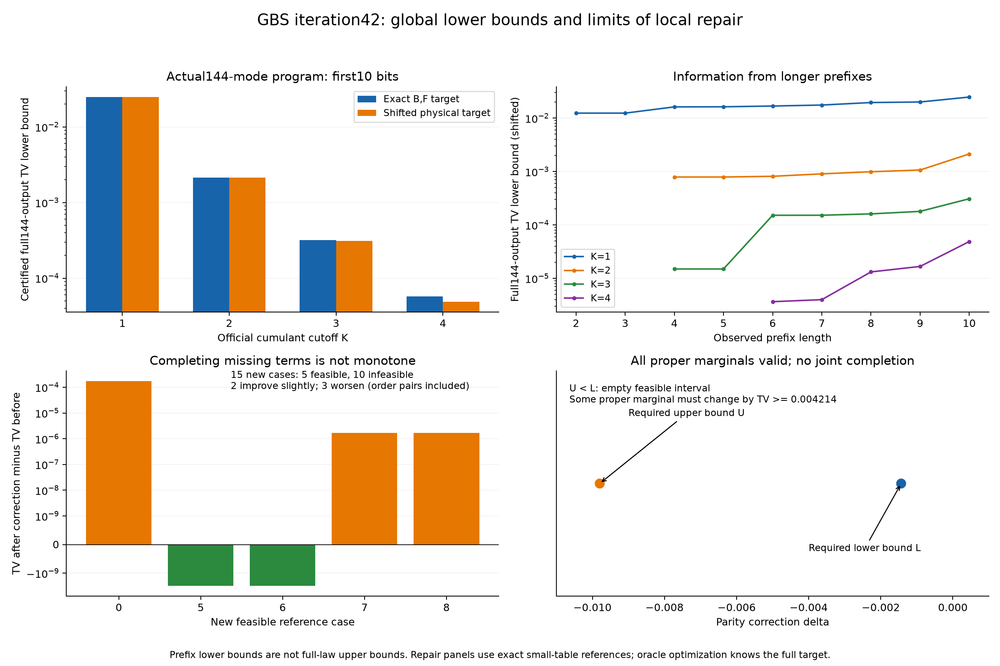

# 第42轮：实际144模整体下界与局部修正的限制

日期：2026-11-09。持续探索目标保持进行中。本轮沿两条方向推进：直接认证实际144模官方程序的前十位输出律，并检验补齐第41轮缺少配对项能否形成更好的非负近似。

## 主要结果

**K1至K4均得到完整144模TV正下界。** 这些结论来自实际N=144目标和采样程序的前缀，不是把另一个十模程序的结果外推。对精确B,F物理目标，下界约为0.0247711、0.00214031、0.000317499、0.0000573353；转移至实际shifted物理输入后仍全部为正。

**补齐公式不保证改善真实目标误差。** 在15项新物理参考例子中，仅5项可以保持全部真子集边缘并形成非负表；其中2项略有改善、3项变差，其余10项明确不可行。正逆序对计入面板，不把这些描述性计数当独立成功率估计。

**合法边缘也可能无法共同延拓。** 一个八模式物理输入产生的近似表，其254个非空真子集边缘全部非负且归一化，却不存在保留它们的非负联合律。显式对偶见证进一步证明：任何非负联合律都必须让其中至少一个真子集边缘的TV改变约0.00421441或更多。所指为近似边缘，不是原Gaussian态的真实边缘。

## 实际144模前缀证书

适配器新增有界前缀深度选项，仍直接调用未修改的官方公共生成器；第39轮审计/前缀函数逐字复用。N=144下构建完整布局和目标，再枚举前十位1023个历史，并反序重算全部阈值、历史质量和零质量。

五项十模K1至K5校准的完整树与第39轮冻结结果一致。四项144模K1至K4各17个公共样本及全部路径，与旧同种子队列前17条逐字一致。总计153个回归校准样本、10,642个模式步骤；它们不是新独立统计样本。

物理目标复用第37轮精确B,F前十模证书，并重新验证1025份矩阵证书及1024个原子的区间构造。连续均匀和uint64映射两种前缀律均精确归一化，另用独立层序传播复核。下表采用独立均匀随机字模型，固定PRNG种子本身不提供独立性保证。

| 截断阶 | 对B,F目标完整144模TV下界 | 对shifted目标完整144模TV下界 |
|---:|---:|---:|
| K1 | 0.0247710860 | 0.0247625785 |
| K2 | 0.0021403140 | 0.0021318064 |
| K3 | 0.0003174991 | 0.0003089915 |
| K4 | 0.0000573353 | 0.0000488278 |

小数仅供阅读，精确有理数端点保存在结果中。前缀TV区间宽度约5.71e-30；转移使用第35轮约8.507545e-6的测量TV界。每项还保存一个前缀可观测事件及严格概率差。

数据处理只允许从前缀误差推得整体**下界**；没有得到完整144模TV上界。K1证书加强了第39轮约0.009042的矩见证，旧证书仍成立。K2至K4此前抽样未检出，与本轮较小的正下界并不矛盾。四个下界的排序也不能决定未知完整TV的排序。

K4约119.28秒中，目标构建约96.84秒、布局约10.36秒；采样与审计各约5.7秒，前缀正反序枚举约0.016秒。这不是同成本速度比较，也未扩展至超出既定布局预算的144模K5。[前缀证明及范围](research/iteration42_full_prefix_bound.md)

## 修正控制与新物理面板

对八位归一化有符号表R，保持全部真子集边缘的任何表只能为R+δχ，其中χ为完整parity。非负性等价于L≤δ≤U，L=max_even(−R_x)、U=min_odd(R_x)。区间为空时返回不可行，不删负项或重归一化。

补项控制将第41轮的期望修正量投影到该可行区间，不使用完整物理目标。另计算已知完整目标时的最优TV oracle，采用残差中位数并独立枚举全部拐点验证最优性。oracle是小表诊断，不能作为可部署GBS算法宣称。

旧九项探索中四项可行且补项均使TV增加。随后冻结新15项：八模式等权重，以及(1,3/4,1/2,1/4)循环权重的正逆序，强度3/16、3/8、3/4、3、12。均为容易经典采样的物理Gaussian位移噪声态。五项可行中，等权重a=3/16的TV从约0.17166536变为0.17183655；加权a=3/16的两项仅改善约3.12e-9；另两项恶化约1.68e-6。没有普遍收益。

特别是等权重a=3/8，所有真子集边缘都有效，但一偶一奇原子的固定质量和为−55898916/6684099653。对应两原子指示函数非负，却由指定边缘算出负期望，构成不可延拓证书。其非恒定Walsh系数绝对值和为127/128，给出任意非负联合律必须改变某一真子集边缘TV至少约0.0042144094的界。这个限制不否定真实物理态存在，也不妨碍仅保留其真实一阶、二阶矩。[修正公式、oracle与对偶证明](research/iteration42_parity_repair_scope.md)

## 验证、恢复和保存

- 前缀独立核验30,688项通过，覆盖9棵完整前缀树、1025份物理矩阵证书及10,642个实际步骤。
- 修正独立核验17,928项通过，覆盖9项旧分析、15项新参考及435个不同精确小行列式。
- 非延拓见证另逐点重建256个原子的非负指示函数，并保存全部254个真子集边缘的最小概率。
- 全库561项运行、532通过、0失败、0错误；新增8项测试通过。既有29个用例跳过及7个类级跳过保留。
- 两次初始核验分别因绝对路径表示差异、JSON列表与内存元组比较而停止。原源码、快照、失败检查/说明全部保留；恢复版本重新完成全部核验，没有覆盖原始结果。初版图注重叠的图像也保留，单独修订版通过视觉检查。

所有源码在相关运行期间固定，结果目录拒绝覆盖。清单`results/iteration42_manifest.json`封存新结果和复用依赖，发布前后核对工作文件与Git字节，远端提交及树另存发布回执。已执行测试通过不等于所有平台依赖均齐备，跳过项没有隐去。

## 与先进工具、九章的关系

本轮重新核查Frugal官方主分支、MPS v2、最新热损耗预印本和九章4.0资料。实质进展是实际完整程序的偏差下界及修正约束；不是论文实验基准的总体否定，没有公平吞吐排名、完整TV准确性保证或九章模拟声明。[先进工具与九章对照](research/iteration42_frontier_comparison.md)

下一轮研究明确选择约束的非负近似，继续扩展实际144模事件证书，并推进MPS输入/测量接口对齐。[第43轮方向](research/iteration43_plan.md)
