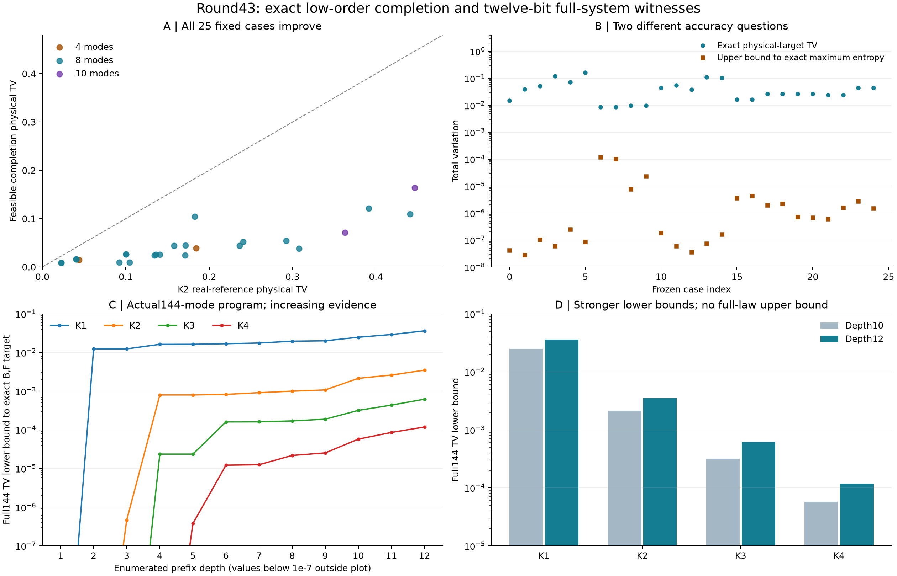

# 第43轮：严格低阶矩完成与十二位整体误差见证

日期：2026-11-10；面板从2026-11-09启动。持续探索目标保持进行中。本轮完成非负近似与实际144模审核两条方向，源码、失败、独立检查和图表全部保存。

## 主要进展

**25个固定小系统均获得严格非负、精确保留真实一阶二阶矩的分布。** 相对此前K2实数参考，物理目标总变差距离下降42.8%—90.8%。进一步认证对应精确最大熵解也优于基线，但它对物理目标的误差仍严格为正。面板来自易经典采样Gaussian噪声族，含正逆序配对，不是困难GBS确认实验。

**实际144模K1—K4的完整分布误差下界提高约1.46—2.06倍。** 使用未修改的第42轮程序，将前缀从10位扩展到12位；同一完整目标下的旧前缀及公共输出逐字一致。这是增强偏差证据，不是算法性能或整体精度改善。

## 严格低阶矩控制

数值优化只提出候选。将权重精确归一化，再按Walsh正交性修正一阶、二阶矩，逐原子验证严格正性。用有理数对数区间给出熵差上界，并转换为距同约束最大熵解的TV上界；该上界介于2.7853e-8和1.19833e-4。完整物理目标TV独立计算，不能与最大熵残差混用。

例如等权8模a=1/4，K2参考TV约0.240727，完成表约0.051977；等权10模a=4，约0.446220降至0.163649。所有25项都改善，但后者仍有明显物理偏差。七组正逆序对齐后的完成表TV最多约2.706e-15。

25次中仅4次BFGS返回success，全部原始状态保留。后续数值细化与精确证书支持最终表，未以“优化成功”代替证明。枚举仍需2^n原子，不能部署为144模完整采样器。约5.44秒总拟合/校正/证书时间不包含旧目标生成和独立核验，不形成公平速度排名。[方法、证明与范围](research/iteration43_maximum_entropy.md)

## 实际144模误差下界

| 截断阶 | 对精确B,F目标完整TV下界 | 对shifted目标完整TV下界 |
|---:|---:|---:|
| K1 | 0.0362252755 | 0.0362167679 |
| K2 | 0.0034835778 | 0.0034750703 |
| K3 | 0.0006186446 | 0.0006101371 |
| K4 | 0.0001181731 | 0.0001096656 |

保存的有理数端点是权威数据。十二位物理边缘包含4096个原子、4095份局部真空证书；连同物理模型核心和噪声，共重新核对4097份矩阵证书。四组各17条旧公共输出合计68条、9,792步骤，仅为回归校准。

核验覆盖独立均匀uint64随机字模型及连续均匀模型，固定PRNG轨迹不证明独立性。由前缀事件和数据处理可推整体下界，不能推整体上界，也不能由四个下界排序判断方法真实精度排序。[推导、成本和事件证据](research/iteration43_prefix_bounds.md)

## 独立核验与恢复

- 完成表核验8,576项通过；独立低阶矩来自真空公式，目标来自Mobius变换，对数采用不同的192位直接有理幂实现。
- 前缀核验79,789项通过；合计88,365项独立检查。新目标全部4096原子及四棵完整十二位树均验证。
- 全库569项运行、540通过、0失败、0错误；新增8项测试通过，既有29个用例跳过及7个类级跳过原样记录。
- 初次目标检查因元组与JSON列表比较而停止，初次完成表核验因旧记录字段名不匹配而停止；两份源码、快照和失败说明保留，分别以新文件/新目录恢复。没有修改候选、证书或物理模型来让检查通过。
- 初版图表保留，修订图增加图例留白并注明对数显示范围，视觉复核通过。

相关运行期间源码固定，结果目录拒绝覆盖。清单`results/iteration43_manifest.json`封存新结果与复用依赖；发布前核对工作文件及Git内容，科学提交与回执提交分别验证远端提交和树。跳过依赖没有隐去，已执行测试通过不代表所有平台测试均已覆盖。

## 与先进工具及九章的关系

重新核查Frugal官方main、Gaussian SVD/MPS v2、11月5日热损耗理论和九章4.0原始资料。本轮是可验证的小表近似进展及实际程序偏差证据；没有同输入MPS端到端比较、完整144模TV上界或模拟九章的结论。[前沿与九章对照](research/iteration43_frontier_comparison.md)

下一轮扩展非经典确认面板，研究可认证条件块完成和更强事件，并继续MPS接口对齐。[第44轮方向](research/iteration44_plan.md)
