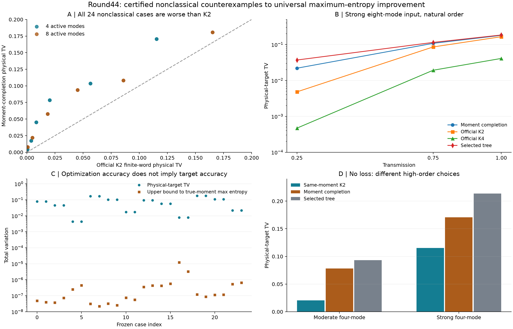

# 第44轮：非经典面板推翻最大熵完成的普遍改善猜想

日期：2026-11-10。持续探索目标保持进行中。本轮推进真实代数矩的区间完成、非经典物理确认、树结构对照及顺序机制，不将第43轮经典噪声族的改善外推。

## 主要结果

**24个新非经典案例中，最大熵完成全部比官方K2和K4更偏离物理目标。** 相对K2，完整TV约为其1.09—11.67倍。认证到真实矩最大熵解的距离仅2.23e-8至1.22e-5，故结果不是区间中点或优化误差造成；真实最大熵解也全部比K2差。

**12个四模控制给出同低阶矩下的严格反例。** 两种完成都非负、归一化且具有相同低阶约束，最大熵仍更差。case0中，另一可行律的物理TV约0.020376，真实最大熵解至少约0.078360，严格差距至少0.0579844。它将“最大化熵不保证最小物理TV”落实为可复查Gaussian实例。

**结构选择与顺序仍需单独审核。** 最大熵候选正逆序对齐TV最多约3.39e-15；K4最多约0.06583；树控制最多约0.02536。树的12组正逆序互信息总分可认证相等，其中6组分布仍不同。

## 严格物理面板与真实矩

面板事前冻结：4/8活跃模、两组非均匀压缩热输入、透射率1、3/4、1/4、自然/反向顺序。去掉顺序重复为12个物理输入，不是24个独立随机样本。固定复干涉器和全部协方差元素可精确用二进有理数表示；单位性、辛关系、损耗物理构造与负的V−I二次型分别验证。非经典性和连通相关图不构成计算困难证明。

目标的真空概率由精确行列式和192位平方根区间围住，所有原子独立重建。候选R只精确匹配真实低阶矩区间中点；新增Walsh桥证明存在相距最多约9.56e-57、精确保留真实矩的正分布，再认证到真实矩最大熵解的距离。没有把未知代数概率假装成有理数。[区间桥接与证明](research/iteration44_interval_bridge.md)

24次BFGS全部报告精度损失，原状态保留；数值细化后最大梯度约1.78e-15。放行依据为精确正性、归一化及独立区间证书，不是数值优化器success。主生产约3.99秒，包含目标小表、拟合和树控制，不是大规模采样吞吐成绩。

## 与官方完整概率律比较

| 自然顺序输入 | 完成R的TV | 官方K2的TV | 官方K4的TV |
|---|---:|---:|---:|
| 4模moderate，无损耗 | 0.0783604 | 0.0203760 | 约8.34e-15 |
| 8模moderate，无损耗 | 0.0937264 | 0.0450747 | 0.00758673 |
| 8模strong，无损耗 | 0.1807054 | 0.1653011 | 0.0410653 |
| 8模strong，透射1/4 | 0.0219623 | 0.00481343 | 0.000469826 |

官方程序统一运行十模式，未活跃位置补真空；保留补位泄漏及IEEE特殊值。48个K2/K4配置均完成，分别输出完整1023前缀并反序核对，完整1024原子律独立重算。每配置3条公共输出仅作回归校准，不作为统计准确性证据。有限字结论以已说明的独立均匀随机字、binary64映射及GCC端点处理为前提。

机制分析在观察主结果后声明，覆盖全部12个四模案例。相同中点矩的二阶matching律与无裁剪递推、归一化参考完全一致，并可桥接至真实矩；全部严格优于真实最大熵解。另保存case0显式事件见证。[同矩反例、顺序与特殊历史](research/iteration44_counterexamples.md)

树控制的根与条件因子严格正且归一化，可以线性存储；只保留单模和树边二阶信息。本轮全部24项树TV更大，但没有认证浮点所选树是精确最优，也没有运行新144模树采样性能测试。

## 验证与原始失败

- 主独立核验113,573项通过，含3,240次行列式检查、2,748个不同矩阵、48个原生配置及1,440个样本步骤。
- 同矩机制核验1,139项、事件/顺序/特殊值核验1,785项通过；合计116,497项。
- 全库579项运行、550通过、0失败、0错误；新增10项测试通过，覆盖区间角点、正性拒绝、真实最大熵界、物理TV区间及树边信息。既有29个用例跳过及7个类级跳过原样保留。
- 初次检查错误要求极相近两个对数的独立区间必须不重叠；首次恢复又误把所有零分母历史当0/0。两次失败及快照保留，第二次恢复按包含关系及IEEE有符号无穷分别核验，没有改变生产结果。
- 完整树有1,709个无穷阈值节点，独立有限字模型下12个有正前缀质量，最大约2.88e-36；其质量已计入完整TV，不解释本轮百分量级的结构误差。

封存脚本首次读取旧第39轮构建记录时，因其没有新版dependencies字段而停止，尚未生成清单；另建恢复脚本按旧格式处理，原失败与源码保存。恢复封存脚本加入于全库测试冻结之后，科学代码与测试未改，额外源码按Git字节单独核验。

所有相关运行保持源码冻结，独立结果目录拒绝覆盖。封存清单、源码快照、发布前Git字节检查及远端提交/树回执与历轮一致；未执行的平台依赖跳过保留。

## 前沿关系与继续方向

重新核对Frugal官方main、Gaussian SVD/MPS v2、热损耗理论及九章4.0。第43轮的经典族改善仍成立，本轮非经典反例也成立；两类输入同时改变多种结构，不能据此证明反转唯一由非经典性导致。本轮没有新完整144模上界、同质量吞吐排名、MPS端到端复现或九章模拟结论。[先进工具与九章对照](research/iteration44_frontier_comparison.md)

下一轮研究少量高阶信息、树平局/混合、K4顺序机制及MPS小系统接口验收，继续实际144模事件证书方向。[第45轮计划](research/iteration45_plan.md)
