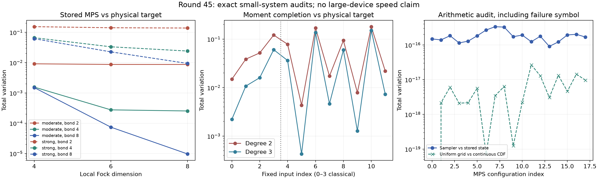

# 第45轮：MPS精确概率律与高阶矩完成

日期：2026-11-10。完成18个四模MPS配置、30个矩完成配置，以及18个保存后重载控制。主要进展是把MPS的物理目标、有限张量状态和实际浮点采样律分开核验，并在12个固定输入上认证三阶最大熵完成比二阶更接近物理目标。实验规模和证书范围仍不足以建立大规模GBS模拟优势。

## 1. MPS：三个对象，三种误差

两个严格物理的四模纯Gaussian输入，各取局部Fock维数4、6、8和最大键维数2、4、8。物理目标由精确二进有理配对矩阵定义；独立消元、精确行列式、倒平方根不等式和区间Möbius变换认证16个阈值输出概率。

保存张量被视为精确的二进有理复数。生产端枚举Fock振幅，独立端用双层密度矩阵传递；两条整数计算路径在18个配置上得到完全相同的阈值质量和归一化。该精确性只针对有限张量状态，不自动给出未截断Gaussian态的误差。

| 输入 | 局部维数 | 最大键 | 张量状态对物理目标TV，约 |
|---|---:|---:|---:|
| moderate | 4 | 2 | 0.0091594243 |
| moderate | 8 | 2 | 0.0087117095 |
| moderate | 8 | 8 | 0.0000096915 |
| strong | 4 | 2 | 0.1540721237 |
| strong | 8 | 2 | 0.1389398099 |
| strong | 8 | 8 | 0.0094237235 |

采样端保存所有隐藏分支的浮点权重、CDF、条件状态和网格计数。独立二分计数及逐层概率传播复核完整输出律，失败符号也计入，没有成功后重新归一化。假设每次调用使用独立均匀53位随机字；不声称这是固定种子PRNG的概率律。每配置7个公共采样输出用于实现回放，不用于统计精度声明。

18个配置中，采样律对精确有限张量状态的TV最大约 **3.36008×10⁻¹⁶**；均匀网格相对连续CDF的TV最大约 **2.67918×10⁻¹⁷**；失败质量均为0。主要观测偏差因此在有限张量近似与物理目标之间，不能把它进一步全部归因于某一截断步骤，也未认证构造器自身浮点误差的单独界。

## 2. 保存格式揭示了逐位复现条件

首次独立核验停在case2、隐藏路径`[2]`。NPZ重载保持了全部张量元素，却改变了非连续数组的内存步长，浮点收缩顺序随之改变。重建原构造布局，并逐元素证明与保存张量一致后，18个原始采样律全部逐位复现。

额外18个重载控制独立重建CDF概率律：其中6个律改变，最大TV约 **1.01321×10⁻¹⁶**。有限张量精确概率律不变。这个差异对本面板物理误差排序没有实质影响，但说明只保存数值元素不足以保证浮点采样律逐位一致。失败目录、恢复核验、布局记录和重载控制均保留；未覆盖原始结果。

## 3. 三阶信息：有认证的改善，也有明确上限

取第41轮4个经典噪声输入、第44轮8个非经典输入，分别完成二阶和三阶矩；其中6个四模输入另完成四阶。拟合只接收预声明阶数内的真空子集矩，完整目标表只用于审计。实现仍枚举完整二元表，不是可直接扩展的大系统算法。

泛化第44轮的真实矩区间桥接：有理候选精确保留矩中点，证书包围真实代数矩对应的严格正可行分布，再用熵差界和Pinsker不等式包围真实最大熵解。12个输入的三阶、二阶真实最大熵物理TV区间全部严格分离，三阶更好。有理候选的物理TV相对下降 **16.26%—90.14%**。这是一组固定面板结果，不是增加约束必然降低目标TV的一般定理。

| 例子 | 二阶完成TV，约 | 三阶完成TV，约 |
|---|---:|---:|
| 经典四模，较弱强度 | 0.01488342 | 0.00221482 |
| 非经典四模，原case0 | 0.07836041 | 0.03623480 |
| 非经典八模，原case18 | 0.18070539 | 0.15132294 |
| 非经典八模，原case22 | 0.02196232 | 0.00732156 |

六个四模四阶控制已经给出全部15个非平凡Walsh矩，独立验证完备正交基后，真实约束下唯一分布就是物理目标，真实最大熵TV精确为0。这是全信息校准；不能宣传为低阶推断恢复高阶结构。相应有理中点候选与代数目标仍由区间区分。

复用第44轮同输入官方Frugal完整有限字律：8个非经典输入中，三阶真实最大熵解在2个上优于官方K2、6个上更差，在8个上全部比官方K4差。这些比较的“阶”在不同算法中含义不同，既不等工作量，也不构成吞吐排名。

## 4. 验证、边界和产物

- 独立MPS核验17,499项、矩层级核验5,753项、重载控制11,168项，共 **34,420项通过**。
- 全库592项运行、563项通过、0失败、0错误；新增13项测试通过。既有29个用例跳过、7个类跳过保留，不能称为无跳过全覆盖。
- 源码、依赖、输入和输出快照按SHA-256封存，发布另检查Git实际字节和远端提交树。
- 发布时两个旧JSON清单的Git换行与工作区输入字节不同。原清单均未改动，实际输入字节另存于`iteration45_packaging`，补充清单绑定其哈希。打包恢复脚本在全库测试后新增，单独验证；科学源码未改变。
- MPS仅四模、零位移、有限Fock盒；矩完成仅4/8模。两条路线使用不同面板，不横向宣称优劣。
- 第43轮实际144模12位前缀下界仍是既有证据，本轮未扩展它，仍无完整144模TV上界。

方法：[精确概率律与矩层级说明](research/iteration45_methods.md)。前沿：[先进工具与九章对照](research/iteration45_frontier_comparison.md)。下一轮：[持续方向](research/iteration46_plan.md)。
