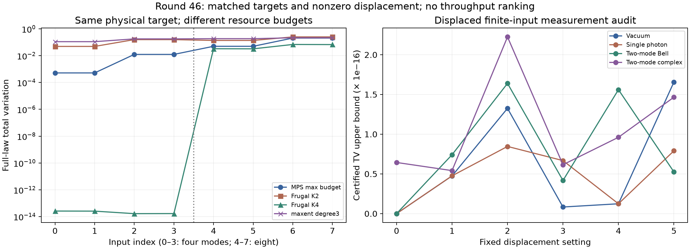

# 第46轮：同物理目标比较与非零位移认证

日期2026-11-10。完成8个输入次序、32个MPS配置、24个官方Frugal配置、20个矩完成配置，以及独立的24个有限态位移控制。四个物理态分别考察正序/逆序，因此8个输入次序不是8个独立物理态。

本轮补上前轮缺口：不同方法直接对照同一个精确物理目标。预声明最高预算MPS在8个输入次序上都比官方K2准确，但全部落后于K4。另首次为项目中的维数2有限态建立非零位移的严格测量概率区间；这尚未认证无限维Gaussian混态的随机位移平均。

## 1. 严格对齐物理目标

用固定复相位Hadamard酉矩阵构造4/8模纯Gaussian态，单模方差互为倒数，协方差V的全部元素均可精确表示为binary64。独立验证酉性、辛变换、纯态恒等式、精确配对矩阵B与V的关系，以及每个真空子集的精确行列式和概率区间。

官方程序读取V并补真空至10模。MPS构造器读取逐元素舍入的B，其差异单独保存；物理目标始终由原精确V定义，未改成舍入B对应的另一个态。因此输入舍入、有限张量近似及后续算术误差均包含在MPS对原目标的最终TV内。

所有MPS保存前统一为C连续布局，重载后核对元素与步长，消除第45轮发现的布局口径不一致。整数Fock振幅和独立双层密度传递一致；完整浮点隐藏路径及随机字计数也独立重建。MPS程序律对有限张量状态的TV最大约4.22319×10⁻¹⁶，不能把这个微小数值误差当作对物理目标的误差。

## 2. 同目标准确性比较

MPS最高预算按运行前声明选取：四模局部维数8、最大键8；八模局部维数3、最大键8。不是看结果后选择最优配置。不同算法参数不代表相同工作量，本轮没有同质量吞吐排名。

下表为正序，TV取近似显示值；完整有理区间及两种次序均保存。

| 物理输入 | MPS最高预算 | Frugal K2 | Frugal K3 | Frugal K4 | 三阶完成候选，约 |
|---|---:|---:|---:|---:|---:|
| 四模moderate | 0.0005190 | 0.0491271 | 0.0503291 | 2.61×10⁻¹⁴ | 0.1110231 |
| 四模strong | 0.0124599 | 0.1578800 | 0.1199463 | 1.67×10⁻¹⁴ | 0.1785199 |
| 八模moderate | 0.0500766 | 0.1373195 | 0.0552489 | 0.0330307 | 0.1853944 |
| 八模strong | 0.2058225 | 0.2511397 | 0.1872523 | 0.0686371 | 0.2156823 |

认证结果：

- 最高预算MPS相对官方K2在8项上均严格改善，相对K4在8项上均严格更差。
- 三阶真实最大熵解在8项上均比二阶接近目标；但其中6项仍比官方K2差。四模四阶是完整15个非平凡矩的校准，真实约束唯一确定物理目标，不能称为低阶推断突破。
- Frugal K3在两个四模moderate次序上都比K2略差，说明本面板中提高截断阶数不保证逐例改善。
- 20项BFGS均返回精度损失状态；后续修正、精确正性/矩约束和独立熵差证书才是验收依据，没有把优化器状态改成成功。

## 3. 顺序敏感性有具体事件见证

对输出重新映射到同一物理模式标签后，四组正逆序中最大TV差异：MPS约2.87×10⁻¹⁵，二/三阶有理完成约2×10⁻¹⁵；官方K2约1.07×10⁻¹⁵，K3约0.0342235，K4约 **0.1034770**。这些是选定面板上的结果，不是顺序不变性的一般定理。

八模strong的K4给出312个十模输出模式组成的明确事件A，包括补位输出且不丢弃真空泄漏：

| 概率 | 约值 |
|---|---:|
| 正序程序P(A) | 0.3684762322 |
| 逆序对齐程序Q(A) | 0.2649992482 |
| 精确物理目标事件概率 | 0.3147518820 |

两程序事件差精确等于其完整TV。正序、逆序对目标的事件偏差分别至少约0.05372435和0.04975263；仅从两程序距离与共同目标，也可推出至少一种次序TV≥0.05173849。事件由完整律事后提取，使用精确概率而非样本检验，无需把事后选择当作预声明统计检验。

见[完整事件及概率证书](results/iteration46_comparison_validation/maximum_order_witness.json)。模式逆序与导出前缀的访问次序不同；本轮还核对了正/逆前缀访问得到完全相同记录，不能把缓存遍历差异误作模式顺序效应。

## 4. 非零位移：先认证有限态测量

24个控制涵盖单模真空、单光子、双模Bell态和一般复有限态，各6个位移设置，其中20项为非零位移。局部输入维数限定为2。对每个真空子集，测量概率等于非负有理系数乘以exp(−有理数)。生产端使用整数振幅与交错Taylor余项界，独立端使用有理双层收缩与正指数级数尾界的倒数，两条证明一致。

所有目标原子区间宽度严格小于10⁻²⁰⁰，最大约3.85077×10⁻²³⁹；部分宽度转成binary64显示为0只是下溢，原始证书保存精确有理端点，并未将其当作零宽区间。采样程序律对理想有限态测量律的TV上界最大约 **2.22481×10⁻¹⁶**，失败质量均为0。

点击效应使用I减真空效应，包含任意输出光子数，没有输出光子截断。仍然只有有限输入态，尚未加入无限Gaussian输入截断的严格误差、较高局部占据或随机位移积分。

## 5. 验证与范围

六组独立核验共 **158,872项通过**：物理输入1,713、MPS102,574、官方程序49,300、矩完成4,191、位移控制887、比较与事件207。全库603项运行、574通过、0失败、0错误，新增11项通过；既有29个用例跳过、7个类跳过保留。

程序律分别采用独立均匀53位随机字及已核对的GCC uint64模型，不声称是固定种子PRNG的完整律。每配置少量公共样本只用于实现回放，不是统计精度证据。构造和审计成本不等于采样吞吐。

本轮没有改写前轮原始结果。源码、结果、依赖和实际Git字节一并封存；旧JSON依赖若只有历史换行差异，则实际输入字节单独归档，不改旧Git对象。第43轮实际144模12位前缀下界继续保留，本轮未扩展它，仍无完整144模TV上界或九章规模模拟结论。

[数学方法](research/iteration46_methods.md) · [先进工具与九章对照](research/iteration46_frontier_comparison.md) · [下一轮方向](research/iteration47_plan.md)
