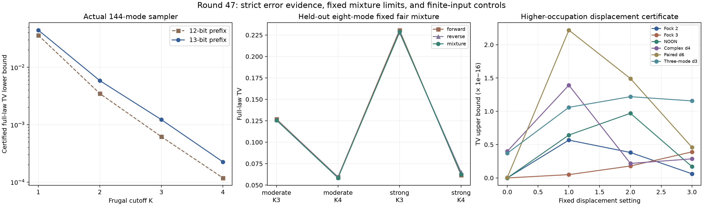

# 第47轮：十三位整体误差下界、固定混合与较高占据位移

日期2026-11-10。本轮推进三条方向：实际144模官方程序的前缀证书由12位扩至13位；固定正逆序公平混合接受新输入留出检验；非零位移测量证书从局部维数2扩至3、4、6，并加入三模链。所有实验、独立核验与新增测试完成，保留历史结果，不把局部成功外推为大规模模拟优势。

## 1. 实际144模：四个整体TV下界继续提高

沿用冻结的第42轮二进制，其接口原本支持最多16位前缀；没有改采样器。K1—K4各保留17个公共输出，全部68个输出及9,792步回放与第43轮一致，旧12位全部前缀记录也逐位不变。新每棵树含8,191个前缀。

物理参考仍为第35轮B,F定义的精确144模Gaussian态，实际程序读取原shifted协方差。认证前13模全部8,192个原子区间，独立复核8,191个子集及核心、噪声共8,193份矩阵证书。以程序完整144模分布的边缘得到整体TV下界；再扣除已认证的整体测量转移界，得到对shifted物理目标的下界。

| 官方阶数 | 第43轮12位下界 | 本轮13位下界 | 转移至shifted目标后的下界 |
|---|---:|---:|---:|
| K1 | 0.03622528 | **0.04444391** | 0.04443540 |
| K2 | 0.00348358 | **0.00585451** | 0.00584600 |
| K3 | 0.00061864 | **0.00122335** | 0.00121484 |
| K4 | 0.00011817 | **0.00022491** | 0.00021640 |

四个下界严格提高到旧值的约1.23、1.68、1.98、1.90倍。它们仍只是下界，不是实际误差的精确值，也没有给完整144模TV上界。

本机此次物理目标生成约45秒。K4程序记录的目标准备约115秒，前缀枚举及逆访问复核约0.44秒；这些记录说明本轮扩大前缀没有要求更换采样器，但并行执行条件下的单次耗时不是稳定吞吐比较。目标区间和审计成本仍随前缀深度迅速增加。

## 2. 固定公平混合：修复正逆序等变性，不保证最佳准确性

运行前固定唯一规则：以独立公平比特选择正序或逆序，各占1/2，输出映射到同一物理模式标签。混合权重与顺序均不根据目标答案调整。历史36项用于诊断，新增4个物理态各两种次序、K2/K3/K4共12项用于留出，共48个混合完整律；所有真空补位泄漏保留。

混合相对于正逆序交换具有精确等变性，TV不大于两种次序TV的平均值。独立核验还逐原子界定误差相互抵消的量。但这个保证不意味着超过更好的那种次序。

以预声明绝对TV差10⁻¹⁰排除末位变化，12个留出配置中：**2项优于两种单独次序，2项劣于较好次序，其余8项无该阈值以上的变化**。历史36项中10项优于两种次序、没有明显劣于较好次序；留出结果因此限制了从历史诊断作过强推断。

| 八模留出配置 | 正序TV | 逆序TV | 固定混合TV | 对较好次序 |
|---|---:|---:|---:|---|
| moderate K3 | 0.12695766 | 0.12617013 | 0.12569736 | 改善 |
| moderate K4 | 0.05948734 | 0.05905638 | 0.05837740 | 改善 |
| strong K3 | 0.23074632 | 0.22786980 | 0.22886766 | 变差 |
| strong K4 | 0.06164103 | 0.06501067 | 0.06252560 | 变差 |

这里给的是两种已核验程序律的精确公平混合，没有实现或测量新的高吞吐端到端混合引擎。一次混合样本理论上只需选中一个分支，但准备和保存两种次序状态可能增加成本。本轮也未完全拆解内部近似递推、内部裁剪与外层饱和的贡献，不能把混合带来的变化归因于单一机制。

## 3. 非零位移：阶乘根式也进入严格证书

新增24个有限态控制，涵盖|2⟩、|3⟩、双模NOON态、一般复四维输入、六维配对输入及三模三维链，各4个位移设置。局部最高保留到5光子，仍是有限输入态。生产端采用192位阶乘倒平方根区间和整数振幅收缩；独立端用密度矩阵双和，将相同平方自由根式系数合并，再用256位整数二分根界。指数函数沿用独立的两种严格包围路径。

全部目标原子区间宽度小于10⁻⁴⁰，最大约 **2.94569×10⁻⁵⁸**。实际浮点采样律对理想有限态位移测量律的TV上界最高约 **2.21879×10⁻¹⁶**，失败质量均为0。24个第46轮维数2输入回归得到与旧目标完全相同的原子区间，旧记录未覆盖。

点击效应包含任意输出光子数，没有输出截断；仍缺无限Gaussian输入尾界与随机位移积分的整体认证。少量公共样本用于程序回放，不是精度统计检验；程序律假设每次使用独立均匀随机字，而非固定种子PRNG的分布定理。

## 4. 验证和交付范围

- 新物理输入1,713项、官方程序49,300项、144模前缀160,758项、位移1,505项、固定混合678项，共 **213,954项独立核验通过**。
- 全库616项运行、587通过、0失败、0错误；新增13项通过。既有29个用例跳过、7个类跳过保留，不能称为无跳过全覆盖。
- 源码、输入、输出和复用依赖按哈希封存，发布另核对实际Git字节及远端提交树。历史JSON换行差异通过归档真实读取字节处理，不重写旧Git对象。
- 本轮没有提高MPS采样预算曲线，也没有实施稀疏高阶特征选择；这些方向继续保留。没有完整144模上界、同质量性能领先或九章规模模拟结论。

[方法说明](research/iteration47_methods.md) · [先进工具与九章对照](research/iteration47_frontier_comparison.md) · [下一轮方向](research/iteration48_plan.md)
