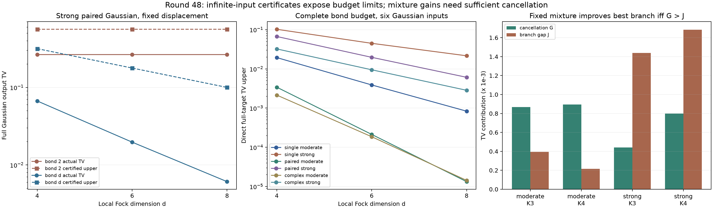

# 第48轮：完整Gaussian输入误差桥接与顺序混合的边界

日期2026-11-10。本轮把第47轮有限输入位移证书接到无限纯Gaussian输入，完成六个目标、30个MPS构造、60项固定测量配置。同时对已冻结的48项固定混合逐原子分解误差。这里新增的是小系统完整误差证据，不是大规模模拟性能突破。

## 1. 从有限态数值精度，走到完整输入精度

目标含单模压缩态、双模配对态和带复相位的双模干涉态，各有moderate/strong两种强度。局部维数为4、6、8；双模同时检查键2及完整键d。每个构造都检查零位移和预声明非零位移。配对矩阵B用精确有理数定义；目标不随浮点构造或截断改变。

新增证书直接包围完整Gaussian态与存储MPS的平方重叠，得到包含输入尾部、投影构造及键截断的纯态迹距离。再加上实际浮点采样律对精确有限态测量的TV误差，形成完整输入的TV上界。另独立计算无限Gaussian位移阈值分布，直接认证实际程序的TV，检查上界的保守程度。

60项均完成，无失败质量；全部实际TV区间都位于共同上界以下。有限态测量的算术TV上界最高约 **2.34694×10⁻¹⁶**，但完整输入TV约在 **1.14443×10⁻⁵至0.265918** 之间。两种指标差异来自输入尾部和有限表示，而不是测量浮点精度。

以下为局部维数8、完整键预算、非零位移的结果。数字取区间端点的近似显示，原始有理上下端点保存在结果文件中。

| 目标 | 实际程序对完整Gaussian的TV | 从状态距离得到的共同上界 |
|---|---:|---:|
| 单模moderate | 0.000834588 | 0.0345733 |
| 单模strong | 0.0215662 | 0.193038 |
| 配对moderate | 0.0000133356 | 0.00390625 |
| 配对strong | 0.00609713 | 0.100113 |
| 复混合moderate | 0.0000143481 | 0.00428550 |
| 复混合strong | 0.00284444 | 0.0697470 |

共同界适用于同一输入态经过任意共同精确量子通道再测量，但通常明显保守。它不自动认证浮点随机位移产生器、噪声分解或随机积分的误差。本轮程序律使用独立均匀53位随机字模型；固定种子回放不是对PRNG完整分布的证明。

## 2. 键预算瓶颈：加大光子截断也可能没有收益

strong配对态的参数λ=3/4。其几何Schmidt谱给出任意纯态键χ近似的最优平方保真度不超过1−λ^(2χ)，即状态迹距离至少λ^χ。这个标准解析控制与存储张量证书一致；它是**状态距离下界，不能单独推成阈值输出TV下界**。

| 局部维数d | 键2：非零位移实际TV | 完整键d：实际TV | 完整键d：共同上界 |
|---|---:|---:|---:|
| 4 | 0.26591786 | 0.06692338 | 0.31640625 |
| 6 | 0.26591786 | 0.01970077 | 0.17797852 |
| 8 | 0.26591786 | 0.00609713 | 0.10011292 |

键2的状态距离约0.5625，在增加局部维数时保持平台；完整键预算则同时降低尾部和实际输出误差。完整键下，浮点构造相对精确投影态的迹距离上界最高约3.96×10⁻¹⁵。稠密Fock展开、SVD构造及完整分布枚举均只用于小系统验证，不是可扩展GSVD构造或吞吐基准。

## 3. 混合何时改善：抵消量必须覆盖分支差距

本轮重分析第47轮全部48项混合，不将它们计为新的留出实验。令两分支TV为A、B，固定公平混合TV为M；逐原子误差抵消量为G=(A+B)/2−M，分支差距为J=|A−B|/2。则

**min(A,B)−M=G−J。**

因此，两分支存在误差抵消仍不足以保证胜过较好分支。第47轮四项八模留出配置得到：

| 配置 | 抵消量G | 分支差距J | 混合相对较好分支的改善G−J |
|---|---:|---:|---:|
| moderate K3 | 0.000866537 | 0.000393765 | +0.000472773 |
| moderate K4 | 0.000894461 | 0.000215480 | +0.000678981 |
| strong K3 | 0.000440396 | 0.001438262 | −0.000997866 |
| strong K4 | 0.000800247 | 0.001684820 | −0.000884573 |

所有原子还按完整输出点击数分组，认证共同高估、共同低估以及抵消量；真空补位泄漏没有删除。这里解释的是输出误差的结构，没有识别内部近似递推、内部裁剪、外层饱和各自的因果贡献，也没有利用目标答案调整混合权重。

## 4. 核验、范围与后续

独立Gaussian核验5,829项、混合分解611项、解析控制219项，共 **6,659项通过**。全库630项运行、601通过、0失败、0错误；新增14项通过。既有29个用例及7个类跳过保留，未称为无跳过覆盖。没有在实验后改动冻结的生产或验证源码。

本轮新增完整输入上界仅覆盖所列单/双模控制。144模仍沿用第47轮下界，**没有完整144模上界**；八模MPS更高预算、稀疏高阶矩、增量前缀证书和随机位移积分继续推进。已重新核对相关先进工具和九章原始资料，没有同质量速度领先或九章规模模拟结论。

[方法、推导与复现](research/iteration48_methods.md) · [先进工具与九章对照](research/iteration48_frontier_comparison.md) · [下一轮方向](research/iteration49_plan.md)
