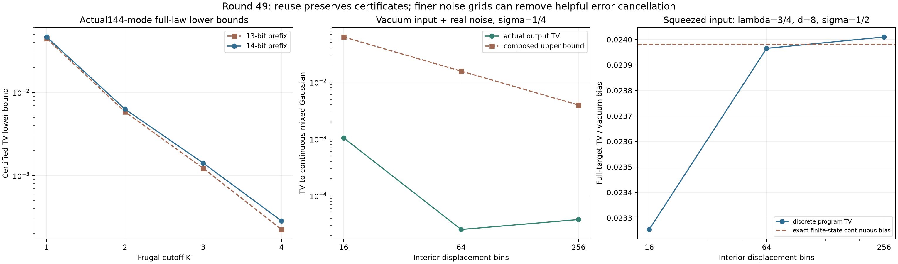

# 第49轮：增量十四位认证与连续位移混态

2026-11-10。本轮在两条方向取得新证据：实际144模前缀扩至14位，旧子集证书按哈希复用；单模离散随机位移模拟器接到完整连续Gaussian混态目标。解析积分控制进一步说明，网格细化可能去掉原来有利的误差抵消。

## 1. 实际144模：复用证书，整体下界继续提高

继续使用第42轮冻结二进制、同一实际144模输入及种子。K1—K4各17个公共输出、共68个输出与9,792步轨迹不变，旧13位全部前缀逐项不变。新的每棵前缀树含16,383个节点。

物理目标仍为第35轮精确B,F模型。原8,191个非空子集区间原样复用，只新建包含第14模式的8,192个子集。13个预声明旧子集从头复算，完整证书与旧记录一致。独立核验重验全部新旧子集，加上核心及噪声模型，共16,385份物理矩阵证书；目标有16,384个原子。

| 阶数 | 第47轮13位整体TV下界 | 本轮14位整体TV下界 | 转移到shifted物理目标的下界 |
|---|---:|---:|---:|
| K1 | 0.04444391 | **0.04639887** | 0.04639036 |
| K2 | 0.00585451 | **0.00630311** | 0.00629461 |
| K3 | 0.00122335 | **0.00141224** | 0.00140374 |
| K4 | 0.000224907 | **0.000285223** | 0.000276716 |

四个下界分别提高约4.40%、7.66%、15.44%、26.82%。这仍是完整144模误差的**下界**，不是准确误差或完整上界。

本机本次旧证书加载约3.25秒、新子集生成27.37秒、13个旧控制复算0.073秒、原子容斥24.69秒、写盘11.95秒，目标总计约74.96秒。K4程序前缀枚举约1.22秒，但目标准备仍约116.65秒。生成和核验成本仍增长；没有从头14位计时对照，不据这些并行执行记录宣布吞吐加速。

## 2. 由连续随机位移形成的真实混态目标

输入B=λ取0、1/2、3/4；实位移X服从N(0,σ²)，σ取1/4、1/2。目标是完整连续混态，协方差为diag((1+λ)/(1−λ)+4σ²,(1−λ)/(1+λ))。λ>0时p方差仍小于真空，不能把全部面板称作经典相干态混合。

程序使用16、64、256个等宽内区间，覆盖±4σ，映射到中点；两侧尾部统一映射到0，**没有丢弃或拒绝尾部**。每个输入取局部维数4、8，共36项、4,068个条件测量节点。正态bin质量、浮点节点选择器、节点测量、输入截断及连续到离散位移误差均纳入证书。

36项全部完成且失败质量为0。实际程序对完整连续混态的TV约在2.56193×10⁻⁵至0.116146之间，均小于相应组合上界。节点测量算术误差上界最高约1.69×10⁻¹⁶，节点选择器误差最高约4.21×10⁻¹⁵；主要误差来自输入表示和位移离散化。

这是一个明确的新离散位移模拟器，不是对`numpy.normal`、历史随机位移引擎或任意多模Gaussian噪声产生器的认证。完整程序律仍假设独立均匀53位随机字，7个公共样本只用于回放。

## 3. 更细网格不保证更小实际误差

12组固定输入/局部维数比较中，**10组从64格增至256格时实际TV变大**，尽管组合上界下降。一个没有输入截断误差的真空控制，σ=1/4、d=4：

| 内区间数 | 实际TV | 组合上界 |
|---|---:|---:|
| 16 | 0.001046642 | 0.06255938 |
| 64 | 0.0000256193 | 0.01568735 |
| 256 | 0.0000382567 | 0.00396935 |

原因之一是固定±4σ之外约6.33425×10⁻⁵的质量仍映射到0。只细化内区间、保持半径和尾部规则不变，**不保证在格数趋于无穷时收敛到原连续目标**。有符号积分控制确认内区间偏差与尾部偏差可以相互抵消。

对有限输入态，我们进一步解析积分全部连续实Gaussian位移，不使用网格。这是12个不同有限输入/噪声目标、36个配置的共同参考。λ=3/4、σ=1/2、d=8时，有限态连续积分对真实Gaussian的真空概率偏差恒为约+0.0239813142：

| 格数 | 网格及数值附加偏差 | 合成实际TV |
|---|---:|---:|
| 16 | −0.0007264885 | 0.0232548257 |
| 64 | −0.0000157949 | 0.0239655193 |
| 256 | +0.0000286592 | 0.0240099734 |

粗网格的负偏差部分抵消了输入表示的正偏差；细化后这种偶然优势消失。不能仅凭保守上界下降，宣称实际误差逐例下降，也不能以目标答案挑选有利网格来制造普遍结论。

## 4. 验证、保留的失败与范围

最终前缀核验320,641项、混态核验33,419项、解析积分恢复核验446项，共 **354,506项通过**。全库643运行、614通过、0失败、0错误，新增13项通过；既有29个用例及7个类跳过保留。

首次积分验证把两个相同真空概率区间相减后的非零宽度，与真实状态距离0比较，导致核验失败。恢复文件通过“存储态精确为真空、积分表达式完全相同”的恒等式证明真实差为0；原验证器、失败记录和快照未覆盖。原图的横轴次刻度重叠也保留，另生成修正版。全库测试之后只新增这两个展示/封存修复脚本，源码哈希和范围写入发布回执；没有修改测试过的科学源码。

当前连续混态上界只覆盖上述单模控制。八模MPS更高预算、稀疏高阶矩、混合内部递推机制和多模相关噪声继续保留；仍无完整144模上界、同质量性能领先或九章规模模拟结论。

[方法及复现](research/iteration49_methods.md) · [先进工具与九章对照](research/iteration49_frontier_comparison.md) · [下一轮方向](research/iteration50_plan.md)
