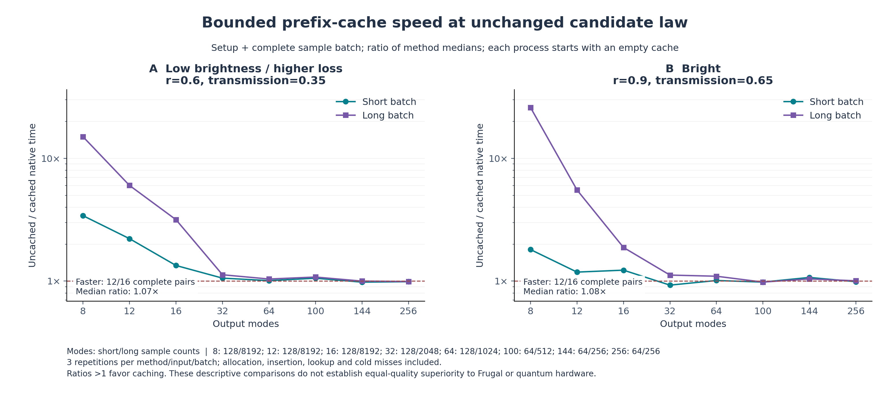
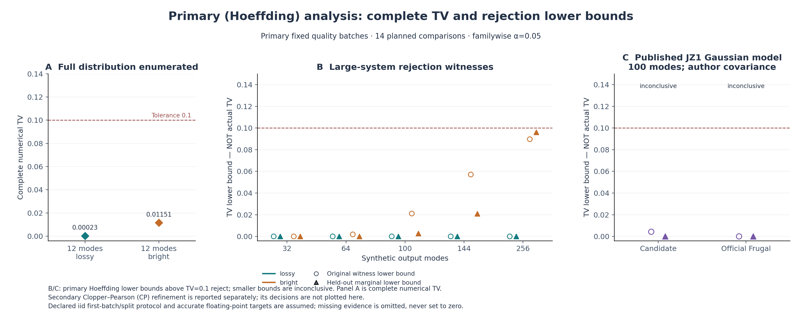

# 第五轮：保持采样律的前缀缓存、完整 Frugal 小规模对照与大模式反例

日期：2026-11-04。项目：量子 / deziroGBS。基线研究提交：`37518d5`；本地历史合并提交：`ce73c2e`。本轮所有数值均来自已经保存的实际运行。

## 1. 本轮得到什么

**小模式持续采样的瓶颈得到明显改善；大模式的主要问题仍是分布质量。** 新增有界前缀缓存复用同一条件概率，不改变 k4 retained-click 近似规则。正式性能实验完成216次方法运行、32组输入×批量配对，0失败。相对于缓存关闭，24/32组的原生准备加采样中位耗时下降，配对加速中位数1.075倍；8/12模式的8192样本批次加速5.534–25.998倍。32–256模式的配对中位数只有1.010倍，不能宣称普适大规模加速。

在预定的四个小模式 Frugal 输入上，补充完整分布枚举显示候选 TV 均较小；其中三个8192样本批次的原生准备加采样成本也较低。12模式高亮度长批次仍由 Frugal 更快。该枚举是完成性能实验后的补充审查，没有新抽样或重新计时。

独立固定质量实验的主分析仍为：**2组有条件接受、12组证据不足、0组采样失败**。保持同一事件、样本和预算的事后 Clopper–Pearson（CP）精化，则在256模式高亮度实例给出 **TV下界0.1066718524**，超过容差0.1。原主分析和D2报告保持原样。这个反例比点击均值偏差更直接，指出当前k4近似不能在该输入上满足本轮质量目标。

九章一号作者 Gaussian 模型上的官方 Frugal K5 新批次成功保存1024条完整样本：准备848.715秒、生成149.121秒，观测平均点击41.153，目标41.042；候选平均点击39.864。两者在此模型均没有获得完整分布质量接受。第四轮的超时记录没有被替换。

最终全项目 **203项测试通过，0失败、0错误、0跳过**。本轮成果是实现优化、可审计对照和质量反例；尚未建立新算法原创性、通用精确GBS采样或战胜九章硬件的结论。

## 2. 任务、输入和冻结范围

研究对象是零均值 Gaussian 态的全模式阈值点击分布，协方差约定为 `hbar=2`、真空 `V=I`、`xxpp` 顺序。输出位1代表该模式至少一次点击。没有把阈值输出当成完整光子数分辨输出，也没有建立真实探测器噪声与实验校准模型。

本轮固定候选为 `click_influence`、`k=4`、`vacuum_kernel=product`。历史零观测仍全部通过Gaussian投影保留，概率比只使用最多4个被选择的历史点击；其余正事件的关联信息仍会丢失。缓存只优化这套固定Q的计算。

| 实验 | 固定输入和规模 | 样本与重复 | 证据用途 |
|---|---|---|---|
| 正式性能 | 8、12、16、32、64、100、144、256模式，各两种参数；Haar种子120501+m | 每输入两种批量、每方法3次；共216次运行 | 缓存开/关成本，8/12模式另有官方Frugal K5 |
| 独立质量 | 12、32、64、100、144、256模式，各两种参数；Haar种子120601+m | 512、2048或1024条；固定pilot/留出划分 | 原D1与新增边缘见证 |
| 九章一号模型 | 作者原始100模式协方差，候选与Frugal各一项 | 各1024条，pilot256；固定新种子7120602 | 指定数学模型上的对照 |
| 小规模补充枚举 | 性能组全部四个8/12模式Frugal输入 | 两接口均请求0个样本，枚举所有位串 | 对已经测得的成本补上完整数值TV |
| CP事后精化 | 上述14项固定质量比较的原事件与留出样本 | 0新样本、0新事件搜索 | 更紧的同事件TV下界；单独报告 |

两种合成参数为 `lossy: r=0.6, eta=0.35` 和 `bright: r=0.9, eta=0.65`，eta表示透过率。性能与质量线路使用不同种子。配置在 `configs/iteration5_prefix_benchmark.json` 与 `configs/iteration5_quality.json`，失败不重试、不降k、不后选择、不挪用未用的置信预算。

质量配置中的窗口规则和划分在第一批采样前固定。具体索引于14:51:05 UTC归档，当时Frugal已启动但尚无完整样本产物，所有候选尚未开始。窗口是维度与固定规则的确定函数，没有根据样本值选择；`witness_schedule_manifest.json` 如实记载这一时间差，没有倒填为所有采样启动前归档。

## 3. 前缀缓存为何保持Q

固定顺序下，候选分布写作

\[
Q(x)=\prod_{t=1}^{m}q_t(x_t\mid x_{<t}).
\]

新缓存以**完整已测位前缀**为键，保存第一次成功计算的条件概率、数值诊断和被保留的物理模式索引。命中时复用同一个函数值；首次未命中时创建Gaussian状态，按原顺序重放该前缀的全部零投影，再使用原条件核继续。达到容量上限后继续计算原核。它不根据历史频率训练概率，不改变随机数消费顺序、模式顺序、选集规则或logQ定义。

命中子节点意味着对应前缀此前已经成功通过同样的数值路径。新的零边仍在消费下一步随机数前执行原投影；失败保持原错误位置与停止行为。实际全轨迹/概率一致性、失败路径和支持边界都纳入门禁，不能用单独的Q枚举替代这些检查。

本轮容量65536项，每项48字节，预留载荷 **3 MiB**。这只是前缀树向量载荷，不是整个进程RSS；硬上限1048576项和64 MiB载荷保护均保留。开关默认关闭，CLI为 `--prefix-cache-entries`，Python参数为 `prefix_cache_entries`。缓存分配、插入、查询、容量耗尽以及所有未命中都计入采样时间，枚举不使用也不预热该缓存。

完整二叉树最多有 `2^m-1` 个条件节点。本实现按需填充并限制容量；小系统大量前缀复用的收益不能外推为困难大系统的渐近改进。大模式深层前缀通常只出现一次，重放零投影的成本仍存在。诊断中条件核调用次数减少也不代表物理误差或浮点精度改善。

实现与验证细节见 [前缀缓存说明](research/iteration5_prefix_cache.md)。

## 4. 实际性能：保留全部快慢案例

主指标是在每次运行中先计算原生 `setup+sampling`，然后分别对各方法3次运行取中位数，最后取未缓存/缓存的比值。每个计时进程从空缓存开始；没有完整Q枚举、logQ审计或验证预热。另存纯采样时间和Python包装器耗时，不能把原生时间称为端到端时间。

216次方法运行包括192次候选运行和24次Frugal运行。96次同种子缓存开/关对照的直方图、点击数直方图和逐模式点击总数一致；完整路径一致性由单独门禁验证，这96项汇总一致不冒充逐样本证明。

| 汇总 | 配对数 | 缓存更快 | 中位加速 | 最小—最大 |
|---|---:|---:|---:|---:|
| 全部原生准备+采样 | 32 | 24 | 1.075× | 0.927—25.998× |
| 全部纯采样 | 32 | 24 | 1.075× | 0.927—26.200× |
| 短批准备+采样 | 16 | 11 | 1.056× | 0.927—3.412× |
| 长批准备+采样 | 16 | 13 | 1.108× | 0.981—25.998× |
| 32–256模式准备+采样 | 20 | 12 | 1.010× | 0.927—1.126× |

长批的分模式结果如下，全部为未缓存/缓存，超过1表示缓存更快：

| 输出模式 | 样本数 | lossy | bright |
|---:|---:|---:|---:|
| 8 | 8192 | 15.011× | 25.998× |
| 12 | 8192 | 6.020× | 5.534× |
| 16 | 8192 | 3.165× | 1.880× |
| 32 | 2048 | 1.126× | 1.120× |
| 64 | 1024 | 1.040× | 1.096× |
| 100 | 512 | 1.079× | 0.981× |
| 144 | 256 | 1.000× | 1.042× |
| 256 | 256 | 0.992× | 1.006× |



这些是本机描述性结果，没有对3次重复建立显著性检验。主计时在两套长质量采样进程结束后开始，调度记录单独保存；机器仍是共享环境，不能声称独占CPU。靠近1的微小变化不宜解释为稳定改进。完整32行表和原始记录见 [结果汇总](results/iteration5_analysis/summary_tables.md) 与 `results/iteration5_performance/`。

### 4.1 同输入的官方Frugal成本与完整TV

为了让成本比较对应具体质量，对预定全部四个8/12模式Frugal输入补充枚举P、候选Q和Frugal Q。输入文件、构建、二进制、参数及正式计时记录均绑定散列；没有选择新输入、重新抽样或重新计时。

| 性能输入 | 候选完整TV | Frugal K5完整TV | 候选8192条准备+采样 | Frugal8192条准备+采样 | Frugal/候选成本 |
|---|---:|---:|---:|---:|---:|
| 8模式lossy | 0.000036408 | 0.000242392 | 3.005 ms | 7.697 ms | 2.561× |
| 8模式bright | 0.003402729 | 0.008936084 | 4.149 ms | 8.058 ms | 1.942× |
| 12模式lossy | 0.000218436 | 0.000567309 | 15.241 ms | 56.519 ms | 3.708× |
| 12模式bright | 0.010762266 | 0.019177721 | 69.519 ms | 58.930 ms | 0.848× |

候选在四个输入上完整数值TV均较小；四个长批中三个同时成本更低。包含128条短批后，8个输入×批量中7个原生准备+采样成本更低；若只看生成阶段，则4/8个更快。因此结果依赖输入、批量和成本边界，不能把最有利的一列推广为全面领先。

Frugal的生成函数来自固定官方源码，完整Q枚举则使用已验证的SIMD强制分支审计接口，不是官方公开API。它描述连续均匀随机阈值模型下的浮点算法律。完整TV采用float64，未作严格向外舍入；补充归一化所致TV变动上界最大约8.03e-17。原概率数组、规范化数组、诊断和native输出保存在 `results/iteration5_small_laws/`。

此审查在性能配置冻结、性能完成后追加，是局部确定性质量审查，不是预注册的独立统计确认。它不用新的统计alpha，也不代表论文的GPU实验或大模式Frugal质量。

## 5. 固定质量批次：主分析与次级精化

### 5.1 主分析保持原判决

14个比较的总族错误预算为0.05：原D1使用0.025，新增边缘通道使用0.025。每比较有4个8模式窗口：前段、中段、末段与等距物理模式。新通道先用pilot选择正偏差事件

\[
A_j=\{z:\widehat Q_{j,\mathrm{pilot}}(z)>P_j(z)\},
\]

再仅用留出部分统计该固定事件的频率。没有利用留出数据改变事件、选择正负方向或停止时刻。每事件预算为 `0.025/(14×4)`，Hoeffding给出

\[
L_j=\max\!\left(0,\widehat Q_{j,\mathrm{test}}(A_j)-P_j(A_j)
-\sqrt{\frac{\log(1/a)}{2n_{\mathrm{test}}}}\right).
\]

边缘事件的差异也是全分布TV的下界；超过0.1可以拒绝，低于0.1不能接受。完整数值TV、全局统计上界和见证下界在记录中分开保存。

| 质量输入 | 目标/样本平均点击 | 完整数值TV | 新边缘主下界 | CP次级下界 | 主D1结论 |
|---|---:|---:|---:|---:|---|
| 12 lossy | 1.436 / 1.363 | 0.000230008 | 0 | 0 | 有条件接受 |
| 12 bright | 4.639 / 4.934 | 0.011509753 | 0 | 0 | 有条件接受 |
| 32 lossy | 3.921 / 3.947 | 未枚举 | 0 | 0 | 证据不足 |
| 32 bright | 12.776 / 12.825 | 未枚举 | 0 | 0 | 证据不足 |
| 64 lossy | 7.915 / 7.946 | 未枚举 | 0 | 0 | 证据不足 |
| 64 bright | 25.868 / 24.910 | 未枚举 | 0 | 0 | 证据不足 |
| 100 lossy | 12.382 / 12.305 | 未枚举 | 0 | 0 | 证据不足 |
| 100 bright | 40.480 / 37.888 | 未枚举 | 0.002630 | 0.013122 | 证据不足 |
| 144 lossy | 17.845 / 17.417 | 未枚举 | 0 | 0 | 证据不足 |
| 144 bright | 58.350 / 53.239 | 未枚举 | 0.021053 | 0.031386 | 证据不足 |
| 256 lossy | 31.765 / 29.897 | 未枚举 | 0 | 0 | 证据不足 |
| **256 bright** | **103.901 / 91.537** | 未枚举 | **0.096167** | **0.106672，拒绝** | 原结论证据不足 |
| 九章一号候选 | 41.042 / 39.864 | 未枚举 | 0 | 0 | 证据不足 |
| 九章一号Frugal | 41.042 / 41.153 | 未枚举 | 0 | 0 | 证据不足 |

上表的新边缘下界不替代原D1的其他见证；例如256 bright原见证下界为0.089695。完整原D1证据在 `results/iteration5_quality/`。点击均值只用于诊断，不是TV估计，不因均值接近而接受分布。



这张图只显示原主分析；下节CP结果单独保存。两个12模式的质量线路与第4节性能线路不同，两个表的TV无需相等。

### 5.2 256模式反例：同事件CP事后精化

看到主分析0.096167接近阈值后，本轮才提出用单侧Clopper–Pearson精化相同二项事件。**它是事后次级分析，没有新独立样本。** 实现对原14个比较全部执行，保留窗口、pilot、留出行、方向、事件成员、P(A)、计数与alpha；原D1/D2报告不改写。

最强事件来自256 bright的物理模式248–255：

| 量 | 实际值 |
|---|---:|
| Pilot / 留出样本数 | 256 / 768 |
| 留出事件命中数 | 448 |
| 目标P(A) | 0.41629823764468765 |
| 留出事件频率 | 0.5833333333333333 |
| 单事件alpha | 0.00044642857142857147 |
| CP的Q(A)下界 | 0.5229700899978389 |
| **全分布TV下界** | **0.10667185235315124** |

结论是在声明的概率数值与随机模型假设下拒绝该输入上的 `TV≤0.1`。它没有给出真实TV的精确值，更不证明其他256模式输入一律失败。

#### 为什么该特定事后替换无需再加一倍方法预算

固定同一事件的计数k、样本量n与alpha=a，令

\[
T_k(p)=\Pr_{\operatorname{Bin}(n,p)}(K\ge k),\qquad
H=\max\left(0,\frac{k}{n}-\sqrt{\frac{\log(1/a)}{2n}}\right).
\]

当k>0时，CP下端点C满足 `T_k(C)=a`，且尾概率随p单调增加。若H>0，Hoeffding保证 `T_k(H)≤a=T_k(C)`，所以H≤C；H=0或k=0时也成立。减去同一个P(A)后，CP的TV下界对所有可能计数逐点不小于旧下界。即使查看结果后在这两个界之间选择，最终报告值也始终不超过有效CP界；相同事件族的原并集预算仍覆盖两者。

这只适用于上述逐点嵌套的两种同事件界，不能推广为任意事后方法搜索无需校正。全部14项和所有预定窗口仍保留，失败窗口不回收预算。原D1的0.025加这个事件族的0.025，仍为本轮0.05；不能把它延伸为整个五轮研究统一95%覆盖。

模块用Beta分位数求端点并以二项生存函数校验尾反演。独立审查另以80位Decimal直接累加二项尾概率、170步二分复核，得到TV下界0.1066718523531512664；与SciPy端点差约2.45e-17。这排除了该阈值跨越来自普通反函数舍入误差的解释，但不是Gaussian概率的严格区间证明。

完整证明、限定与10项测试见 [CP说明](research/iteration5_binomial_refinement.md) 和 [独立审查第6节](research/iteration5_independent_audit.md#6-看到主分析后的独立复核clopperpearson-统计精化)。实际结果位于 `results/iteration5_binomial_refinement/`：14/14成功，边缘通道1拒绝、13证据不足。后一个计数仅指边缘通道，不覆盖小模式的完整TV接受。

### 5.3 统计与数值边界

所有统计界采用理想iid尝试模型；固定种子PRNG不是数学独立实数。缓存只复用固定函数，在实现路径等价条件下不根据pilot学习新Q，因此共享缓存不改变统计划分。见证不依赖Frugal的logQ。

输出空间包含失败符号，目标在失败上概率为0、见证值为0。只对固定首批全部完成时报告统计界；失败批次保留并不重抽。这里覆盖的是无条件首批实验规则，不宣称条件于全成功仍有相同覆盖率。全部本轮实际质量批次均成功，不把失败概率据此假设为零。

目标概率、完整TV和统计界仍依赖浮点计算。边缘计算有显式数值保护和诊断，但未做全流程向外舍入。必要见证可证伪，不足以证明完整分布接近。

## 6. 九章一号对照完成后，距离九章还有什么

本轮使用作者协方差仓库的未优化 `cov_0.npy`，对应指定100模式Gaussian模型；没有拿优化的squashed矩阵替代。文件SHA-256为 `892a143db06952cd939bf080dc3321894108630b01a89c74751e85ca5a9531d5`，规范化协方差散列为 `2af0a953bec2d0a42ddd7ef98baeaa256f44525d3a6b94cb0576ec80bebc31ae`。原始文件没有复制进源码仓库或本轮交付包。

| 同模型本轮批次 | 候选k4+缓存 | 官方Frugal K5 |
|---|---:|---:|
| 完整样本 | 1024 | 1024 |
| 原生准备 | 0.005205 s | 848.714742 s |
| 原生生成 | 12.900247 s | 149.121000 s |
| 原生准备+生成 | 12.905452 s | 997.835742 s |
| 包装器实际调用 | 12.974911 s | 997.960671 s |
| 每样本logQ | 生成时记录 | 不做额外密度回放 |
| 目标平均点击 | 41.042303 | 41.042303 |
| 样本平均点击 | 39.864258 | 41.153320 |
| 原D1 / CP边缘结论 | 证据不足 / 证据不足 | 证据不足 / 证据不足 |

这是各一次固定质量批次的实际成本记录，不是三次重复的配对性能实验。候选生成中包含logQ，Frugal关闭额外密度重放；两者又没有匹配的全分布质量接受，所以不从此表生成“同精度领先”或量子速度优势结论。Frugal均值更接近目标也不能单独证明其完整TV更小。

Frugal生成完成后先原子保存checkpoint，本轮完整1024行及其散列已经验证。其独立子进程峰值RSS约2.812 GiB；候选质量运行器顺序运行多个案例，相关子进程RSS为累计高水位，不能拿来做这一案例的精确内存倍率。3 MiB前缀载荷也不能与进程RSS直接比较。

第四轮v1额外logQ审计在1800秒预算下失败，其记录仍在；本轮是预先定义的新种子、generation-only批次，未用本次成功覆盖旧失败。新批次的完整样本不会因后续分析成本而丢失。

最新参考任务仍按九章四号L1024检查：1024个压缩输入、8176个输出模式；本实现上限256模式，且只实现阈值输出。真实实例匹配、探测输出、实验噪声、全分布质量及资源边界仍未满足。D2对九章一号两种方法保留证据不足，对九章四号为不同或不完整任务。

Frugal论文的144位阈值/粗粒化实验、GPU吞吐和本文单线程CPU模型批次也属于不同设置。论文的必要统计测试不能自动变成本项目的完整TV保证。来源与范围见 [第四轮Frugal审计](research/iteration4_frugal_claims.md)、[九章参考审计](research/iteration4_jiuzhang.md) 及文末原始来源。

## 7. 验证、源码与恢复

### 7.1 已实际运行的检查

| 检查 | 结果 | 记录 |
|---|---|---|
| 初始前缀等价门禁 | 13测试、24详细检查通过，0跳过 | `results/iteration5_prefix_validation/` |
| 可复现门禁CLI | 13测试通过，0跳过 | `results/iteration5_prefix_gate_cli/` |
| 留出边缘见证 | 14测试通过 | 全项目日志及对应测试源码 |
| 质量流程与D1/D2绑定 | 13测试通过 | `results/iteration5_quality_validation/` |
| CP同事件精化 | 10测试通过 | `results/iteration5_binomial_refinement/validation.json` |
| **最终全项目回归** | **203测试通过，0失败/错误/跳过，34.370秒** | `results/iteration5_verification/` |
| 正式性能 | 216运行、0失败、96汇总一致 | `results/iteration5_performance/` |
| 正式质量 / 小规模补充 | 14完整批次 / 4完整枚举 | 各自原始记录 |

上述专项测试包含在203项中，不相加冒充更多独立检查。最终验证在导入测试前，将普通候选适配器默认程序显式指向本轮冻结二进制，避免旧测试悄悄测旧构建；测试前后所有被测源码与候选二进制散列一致。CPU优化仍为C++20、`-O3 -march=native -ffp-contract=off`，没有fast-math或手写汇编。

候选二进制SHA-256：`a8d5a830e7167aab20f829bee74bc404736f2551ff42e6e48491caf301d0fc3f`。对应C++源：`c74c377e81137786cfdd2ae02c66967f3c7920393adf067ab9b3c4348a7fbd28`。

Frugal checkpoint二进制SHA-256：`8986aafa436744a65ea72663e77d28b90acf22497ca3d5f6bc50bead674751dd`。官方源码固定提交：`fa8b796f2afebd4845a2e335e457735952617ef8`；生成函数未因本轮质量接口修改而变化。各结果另存完整构建参数、上游函数散列、输入和native文件散列。

### 7.2 复现入口

先安装Python依赖和C++20/Eigen。`EIGEN3_INCLUDE_DIR`应指向实际Eigen头文件目录，例如 `/usr/include/eigen3`。本机构建不可直接视作跨CPU可移植二进制；重新编译后须重新生成门禁，不能把旧验证JSON中的散列改成新值。

```bash
python -m pip install -e .
export EIGEN3_INCLUDE_DIR=/usr/include/eigen3

# 独立构建旧版参考；不要用新源码覆盖旧版路径。
git worktree add --detach .cache/reference_iteration4 37518d5
python .cache/reference_iteration4/experiments/build_click_sampler.py --native \
  --build-dir "$PWD/.cache/click-iteration4-native"

python experiments/build_click_sampler.py --native \
  --build-dir .cache/click-prefix-native
OPENBLAS_NUM_THREADS=1 OMP_NUM_THREADS=1 PYTHONPATH=src \
  python experiments/validate_prefix_cache.py \
  --output results/new_prefix_gate

python experiments/build_frugal_sampling.py --native
OPENBLAS_NUM_THREADS=1 OMP_NUM_THREADS=1 PYTHONPATH=src \
  python experiments/validate_frugal_native.py \
  --output results/new_frugal_gate

OPENBLAS_NUM_THREADS=1 OMP_NUM_THREADS=1 PYTHONPATH=src \
  python experiments/iteration5_benchmark.py \
  --validation results/new_prefix_gate/validation.json \
  --frugal-validation results/new_frugal_gate/validation.json \
  --output results/new_iteration5_performance
```

质量入口为 `experiments/iteration5_quality.py --case ID`、`--all-candidates` 和 `--evaluate`。前两者抽样，最后一个只读取已保存样本。候选门禁由 `--candidate-validation` 传入，官方checkpoint门禁由 `--frugal-validation` 传入。每个case拒绝覆盖已有尝试。

九章一号复现需要按 [作者数据说明](research/iteration4_jiuzhang.md) 自行取得并校验协方差。官方质量构建命令为 `python experiments/build_frugal_evidence.py --native`，然后需运行 `tests/test_frugal_evidence.py` 的独立v1/v2一致性与checkpoint检查并生成绑定当前二进制的门禁；本轮保存的旧机器门禁不能授权另一构建。原生集成测试依赖相应的独立参考程序，缺失时会跳过，不能引用本机“203项零跳过”作为新机器的结果。

冻结质量产物的CP后处理及全套验证入口如下，均使用新输出目录：

```bash
OPENBLAS_NUM_THREADS=1 OMP_NUM_THREADS=1 PYTHONPATH=src \
  python -m gbslab.binomial_refinement \
  --quality-directory results/iteration5_quality \
  --output results/new_binomial_refinement

OPENBLAS_NUM_THREADS=1 OMP_NUM_THREADS=1 PYTHONPATH=src \
  python experiments/verify_iteration5.py \
  --output results/new_iteration5_verification
```

补充完整Q入口为 `experiments/iteration5_small_laws.py`，分析入口为 `experiments/analyze_iteration5.py`。前者要求正式性能已经完成并绑定其输入；后者读取归档数字和数组、不重新采样。新采样实验与旧结果必须分目录，具体参数见各脚本 `--help`。

### 7.3 归档与公开状态

原四轮研究提交完整保留，`37518d5` 与已知远端初始化历史 `52e38ae` 在本地合为 `ce73c2e`，第五轮在其后继续提交。交付包的Git bundle可恢复这两条历史及本轮最终提交，恢复方法与确切提交SHA由包内清单给出。源码、固定配置、测试、实际结果、报告和上游许可证一起保留。

本轮公开推送被自动审批审查拦截：审查要求明确批准将这一具体研究载荷公开至 `qiyuanhuakai/deziroGBS` 并更新main。本轮没有完成远程发布，也没有改用API或Actions绕过。待用户批准的范围是上述源码和研究记录；编译产物、计算缓存、作者原始协方差不在发布包内。本地恢复和实验完成不依赖公开推送。

## 8. 下一步应解决哪一个问题

当前缓存保留原Q，因此256 bright的反例不是缓存引入的近似，而是原有限点击记忆规则在这个输入上的质量限制。继续只压缩计算耗时不能修复它。下一步优先研究被遗忘正事件如何影响晚期条件概率，以新固定输入检查全分布质量，同时保留本轮k4作为速度与误差基线。

第四轮提出的 [遗漏点击条件logit补偿](research/iteration4_next_hypothesis.md) 仍未实现、调参或验证。它在只遗漏一个点击时恢复相应精确条件，但多遗漏事件相关时可能重复计数并过度修正。下一轮应先验证这个边界及TMSV支持，再用完整小模式TV捕获“均值改善、完整分布反而变差”的反例，最后才进入新大模式留出见证。不能根据本轮256样本调参后继续把同一批样本当独立验证。

缓存目前保留显式开关和容量限制。现有证据支持小模式长批启用；大规模是否启用需依据新的成本目标，不把本轮数据拟合出的模式阈值冒充预定规则。改进概率模型、扩展输出任务和匹配真实实验是后续独立工作。

## 原始来源

- Dodd等，*A fast and frugal Gaussian boson sampling emulator*，Science Advances（2026），[DOI](https://doi.org/10.1126/sciadv.aef8431)，[正式全文](https://pmc.ncbi.nlm.nih.gov/articles/PMC13665930/)，[官方实现](https://github.com/tomdodd4598/FrugalGBS)。
- 九章四号正式论文，[Nature](https://www.nature.com/articles/s41586-026-10523-6)；作者预印本与其他九章来源见仓库参考审计。
- 九章一号原始/优化协方差的作者仓库：[polyquantique/cov_matrix_optimization](https://github.com/polyquantique/cov_matrix_optimization)。本轮使用未优化的原始协方差。
- Clopper与Pearson（1934），[原论文DOI](https://doi.org/10.1093/biomet/26.4.404)；[SciPy官方精确二项置信区间说明](https://docs.scipy.org/doc/scipy/reference/generated/scipy.stats._result_classes.BinomTestResult.proportion_ci.html)。

外部论文提供方法与任务背景。本轮全部成本、TV、样本、判断和测试数字均来自随项目保存的本地实验记录，不是从论文推算。
