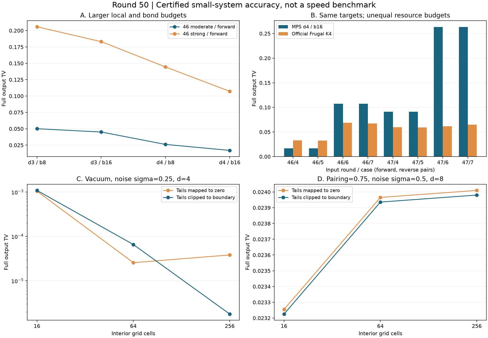

# 第50轮：八模预算提升与连续噪声尾部边界映射

日期：2026-11-10。整体探索继续。本轮在已公开输入上研究预算与尾部映射，未新增留出输入，未扩展144模前缀。

## 主要结果

24项八模 MPS 配置完整生成并独立验证。8个输入次序将局部维数/键预算从(3,8)提高到(4,16)，完整输出TV均下降，旧误差与新误差之比为1.48—2.95。最高预算在8个输入次序中6个优于官方Frugal K2和K3，2个优于K4；这2个属于同一个物理态的正逆次序。不同算法资源预算不等价，没有速度或普遍优势结论。

36项单模连续噪声实验把双尾从零映射改为各自边界。全部36项的认证离散化上界和总上界严格收紧，但真实输出TV为27项改善、9项退化。上界变小不保证实际误差单调下降。

总计 **940,288项独立核验通过**。全库649项运行、620项通过、0失败、0错误；新增6项通过，既有29项用例及7个类跳过保留。MPS外层计时字段有明确错误，冻结原值并排除其成本用途。

## 1. 八模预算提升及同目标官方比较

复用第46、47轮各4个八模输入次序；每轮包含两个物理态的正逆次序。第46轮每个输入做(3,8)、(3,16)、(4,8)、(4,16)四档，第47轮做最低和最高两档，共24项。所有配置包含完整256项阈值输出及失败符号。真实物理目标来自原精确协方差证书，不用截断态重新定义目标。

以下为严格TV区间的十进制近似；原始有理区间保存在比较结果中。

| 原输入 | 次序 | MPS (3,8) | MPS (4,16) | 官方K4 | 最高预算相对K4 |
|---|---|---:|---:|---:|---|
| 46 moderate | 正 | 0.05007659 | 0.01694983 | 0.03303066 | 更小 |
| 46 moderate | 逆 | 0.05007659 | 0.01694983 | 0.03246696 | 更小 |
| 46 strong | 正 | 0.20582247 | 0.10718264 | 0.06863714 | 更大 |
| 46 strong | 逆 | 0.20582247 | 0.10718264 | 0.06728658 | 更大 |
| 47 moderate | 正 | 0.18514215 | 0.09136265 | 0.05948734 | 更大 |
| 47 moderate | 逆 | 0.18514215 | 0.09136265 | 0.05905638 | 更大 |
| 47 strong | 正 | 0.39038970 | 0.26314685 | 0.06164103 | 更大 |
| 47 strong | 逆 | 0.39038970 | 0.26314685 | 0.06501067 | 更大 |

第47轮strong的最高预算还落后K2（约0.234898）。不能由第46轮moderate的成功推断强输入已解决。24项实际程序对存储张量态的TV最高约3.795×10⁻¹⁶，故这里主要误差来自有限态构造，而非末位采样算术。

独立整数双层收缩重建存储张量概率；全部内部节点的浮点核、CDF、53位均匀随机字计数及公开样本重新回放。第46轮4项旧(3,8)配置的张量与完整概率律逐项完全回归。官方24项旧运行从完整1023节点前缀树独立重建64位随机字律，保留10模输出的全部1024项，包括真空填充泄漏；没有只看活跃8模或忽略泄漏。

**计时缺陷：** `iteration50_mps.py` 的分片循环变量 `start` 覆盖外层计时起点，使 `results/iteration50_mps/rows.json` 的 `seconds` 无效。概率、张量、误差和独立回放不依赖该字段。原生产器和数据不改写，另存 `timing_notice.json`；不补造端到端耗时，不作吞吐比较。构造器自身分阶段计时也不能替代完整成本。

## 2. 双尾边界映射：更紧上界，保留退化

标准化半径仍固定4，内区间中点不变，双尾分别映射到−4σ和+4σ，各自质量τ/2。规则预声明、不依赖目标。λ∈{0,1/2,3/4}、σ∈{1/4,1/2}、局部维数4/8、网格16/64/256，共36项和4104个条件测量节点。

| 配置 | 旧尾部回零TV | 新边界TV | 观察 |
|---|---:|---:|---|
| λ=0，σ=1/4，d4，N64 | 2.56193×10⁻⁵ | 6.56594×10⁻⁵ | 退化，原有偏差抵消减少 |
| λ=0，σ=1/4，d4，N256 | 3.82567×10⁻⁵ | 1.78338×10⁻⁶ | 约21.45倍改善 |
| λ=0，σ=1/2，d4，N256 | 5.14823×10⁻⁵ | 1.07001×10⁻⁵ | 约4.81倍改善 |
| λ=1/2，σ=1/2，d8，N16 | 6.67727×10⁻⁴ | 7.15496×10⁻⁴ | 非真空也会退化 |
| λ=3/4，σ=1/2，d8，N256 | 0.02400997 | 0.02398043 | 改善，但有限输入误差仍主导 |

9项退化是8项真空粗网格加1项λ=1/2配置；没有删除不利案例。所有比较均复核同一个存储张量及连续Gaussian目标。第49轮独立认证的有限态连续解析积分作为机制参考：最后一行新程序与有限连续参考的TV约8.828×10⁻⁷，但有限态本身与完整Gaussian目标仍差约0.02398131。继续细化只能减少一类误差，不能消除输入截断。

λ=0、σ=1/4、d4、N256的总认证上界约0.003909575，远比实际TV保守。固定半径边界映射仍有非零极限偏差，本轮没有证明随网格增大收敛到完整连续噪声；下一步需增长半径及独立留出。

## 3. 验证、前沿与限制

| 验证组 | 通过数 |
|---|---:|
| 八模张量、全节点及公开采样回放 | 906,106 |
| 连续噪声、独立CDF/根式、两级程序律 | 33,745 |
| 哈希绑定的旧新比较、官方律与回归 | 437 |
| 合计 | 940,288 |

2026-11-10再次核对官方Frugal提交和四篇前沿原文版本。Frugal仍为`fa8b796f2afebd4845a2e335e457735952617ef8`；GSVD/PCO论文v2、热损耗论文v1、九章4.0论文v3。详见[前沿比较](research/iteration50_frontier_comparison.md)。本仓库MPS是受GSVD/PCO思路启发的实现，不是作者官方程序复现。

本轮精度结果只涵盖小系统公开输入；未给完整144模TV上界、同质量资源排名或九章规模模拟结论。第49轮14位边缘下界继续有效但本轮没有新增相关实验。源代码、原始记录、独立验证、图形、测试和历史依赖通过清单封存；发布回执另记Git及远端核验。

参见[方法与复现](research/iteration50_methods.md)、[下一轮方向](research/iteration51_plan.md)。
