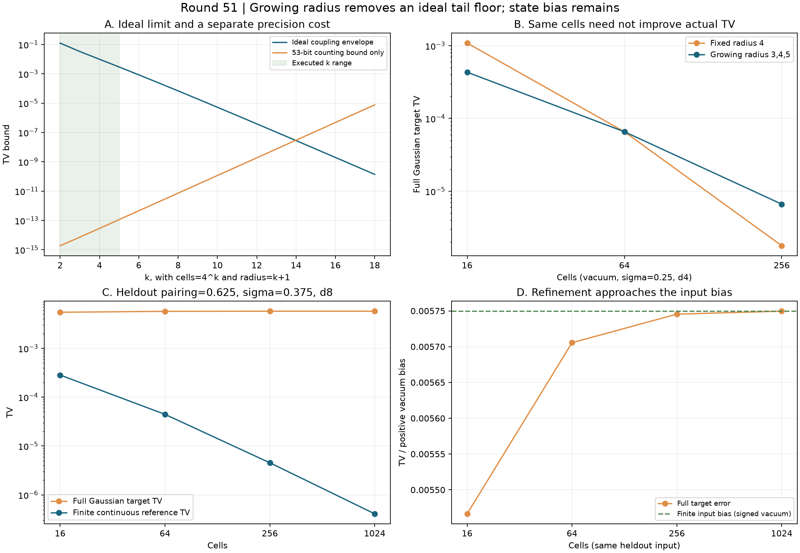

# 第51轮：增长半径的连续噪声认证与有限输入偏差

日期：2026-11-10。整体探索继续。本轮补上固定半径方案缺失的理想收敛证明，并在预声明的新参数上检验完整程序误差；没有新增八模预算或144模前缀实验。

## 主要结果

当网格数N=4^k、覆盖半径R=k+1时，内网格宽度与尾部距离误差同时趋于0。对本轮实位移单模Gaussian族，理想离散化误差有显式统一界 **1/(8·3^(k−2))**，k≥2。固定半径产生的理想尾部底限由此消除。

这不是整个有限精度采样器的任意精度收敛定理。输入态截断、bin质量舍入和固定53位字仍是单独误差；本轮将这些误差全部保留。已有单模收敛层也不解决多模Gaussian到MPS的构造难题。

共50项完整程序实验：36项旧参数配对、12项新参数留出、2项1024格细化。全部保留，没有按结果筛选。对同格数旧方案，13项改善、11项退化、12项程序律完全相同。33次跨格数细化均更接近有限态的连续参考，但对完整Gaussian目标仅10次改善、23次退化。

## 1. 收敛的是哪一层

取X=σZ，标准正态Z，λ为实配对参数，Vp=(1−λ)/(1+λ)。把[−Rσ,Rσ]内各格映射到中点，双尾映射至各自边界。用共同位移耦合和迹距离收缩性，输出误差界为

√Vp [(1−τ_R)Rσ/N + 2σφ(R)−Rστ_R]。

其中τ_R是双尾质量、φ(R)为标准正态密度。对0≤λ<1、0<σ≤1/2，利用e>2得到有理包络

1/2 [(k+1)/4^k + 2^(−floor((k+1)²/2))] ≤ 1/(8·3^(k−2))。

这是对所有k≥2的代数证明，不由有限曲线拟合推出。实际执行k2..5，即N16/64/256/1024、R3/4/5/6；更大的理论表不当成运行记录。这是本仓库噪声层的显式收敛控制，不宣称新的普遍GBS复杂性定理。

CDF认证域扩至[−8,8]，指数域扩至[0,64]。独立正项级数、不同π恒等式及二分根验证扩域，旧36项、4104个条件节点全部回归。旧源码和结果保持原样。

## 2. 相同格数下，不保证更准确

扩大覆盖范围会增加内区间网格宽度，因此理想极限更好不代表每个有限预算都更好。以下为严格区间的十进制近似：

| 真空输入，σ=1/4、d4 | 第50轮固定R4 | 第51轮增长R | 结果 |
|---|---:|---:|---|
| N16，R3 | 1.08668×10⁻³ | 4.32780×10⁻⁴ | 改善 |
| N64，R4 | 6.56594×10⁻⁵ | 6.56594×10⁻⁵ | 完整程序律相同 |
| N256，R5 | 1.78338×10⁻⁶ | 6.64721×10⁻⁶ | 退化 |

全部36项旧参数配对均核对存储张量和连续物理目标完全相同。N64对应同半径，12项完整字律完全回归；其余24项为13改善、11退化。不能挑选更优半径再将其称为预声明策略。

## 3. 留出实验暴露输入偏差

相对第49/50轮噪声面板，新增λ=1/4、5/8，σ=3/8，d4/8四个输入，每个测试三档网格，共12项。规则和任务在计算输出前冻结。另预声明λ=0和5/8、σ3/8、d8两项1024格控制；前者没有本轮低格数配对，不填造趋势。

代表性的留出输入λ=5/8、σ=3/8、d8，其有限态连续测量与完整Gaussian目标的真空偏差约 **+0.005749979547**。

| 格数 / 半径 | 程序对有限连续参考TV | 程序对完整Gaussian目标TV |
|---|---:|---:|
| 16 / 3 | 2.834864×10⁻⁴ | 0.005466493145 |
| 64 / 4 | 4.443769×10⁻⁵ | 0.005705541858 |
| 256 / 5 | 4.531731×10⁻⁶ | 0.005745447816 |
| 1024 / 6 | 4.089151×10⁻⁷ | 0.005749570632 |

网格与算术误差减小约693倍，同时总误差上升，因为原先负的网格偏差抵消了部分正的输入偏差。增加格数逐步去掉这种抵消。全部17个有限态连续参考由解析正态偶数矩积分给出，并由独立根式分组核验，不使用网格积分。

另一预声明真空控制λ0、σ3/8、d8、N1024的实际TV约1.109664×10⁻⁶；输入误差为0，但总认证上界仍约0.002197266，说明耦合上界较保守，不能把上界数值当实际误差。

## 4. 证据、限制与后续

**67,215项独立核验全部通过**：完整噪声程序61,429项、解析积分583项、扩域与旧节点控制4,700项、配对及细化比较503项。全库658项运行、629项通过、0失败、0错误；新增9项通过，既有29项用例、7个类跳过保留。所有本轮代码都包含于全库测试开始快照，无测试后新增代码例外。

全部7524个实际测量节点核验完整算术/CDF和53位字模型。实际节点都是可精确表示的二进制有理数；自定义非二进制位移需另计舍入。固定字数选择器与浮点CDF之间的TV界随节点数增长，图中曲线只是该项上界，不是误差下界，也不包括bin质量舍入。

2026-11-10再次核对Frugal、GSVD/PCO、热损耗理论及九章原始来源。没有新增同质量成本对比，没有完整144模TV上界，也没有九章规模模拟结论。详见[前沿比较](research/iteration51_frontier_comparison.md)。

下一轮优先回到八模构造误差及预算分解，连续噪声进一步扩展到相关、多模与精度调度；144模认证成本、高阶矩与顺序机制继续保留为独立方向。参见[方法与复现](research/iteration51_methods.md)、[后续计划](research/iteration52_plan.md)。
