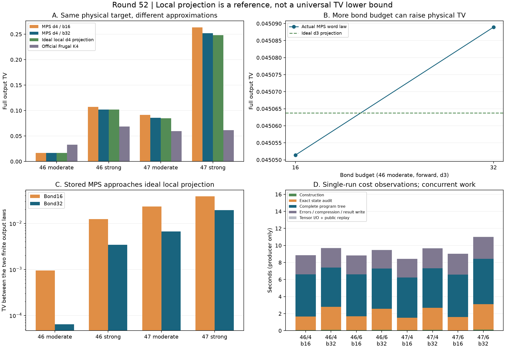

# 第52轮：八模理想截断参照、键预算与共享前缀审核

日期：2026-11-10。持续探索目标保持进行中。全部输入来自第46/47轮公开面板，不声称新增留出；本轮回到八模构造，并追加审核成本控制。

## 主要进展

建立了8个不经过MPS构造的精确理想局部Fock投影参照，覆盖4个八模物理态、局部维数3/4。它使“仅局部截断的输出误差”和“MPS相对理想截断态的偏离”能分别计算，而不依赖构造器的浮点误差估计。

新增20项MPS实验：8个输入次序各d3/b32、d4/b32，加4项d4/b16重建回归。与旧24项和官方24项完整程序律统一比较。更高键预算并不保证物理输出TV单调下降；理想局部投影也不是所有有限维态的TV下限。

审核方面，全路径JSON采用无损压缩；新的共享前缀整数密度算法把八模传递次数从2048降到510，保留全部256个输出。原逐路径算法和独立Fock枚举的6项对照完整相等；新完整审核仍逐个回放实际浮点节点和随机字选择器。

## 1. 维数4的严格参照说明了什么

以下都是正序目标的完整输出TV，数值为严格区间的十进制近似。MPS程序包含失败符号，官方程序包含全部真空填充泄漏。

| 输入 | MPS d4/b16 | MPS d4/b32 | 理想局部d4投影 | 官方K4 |
|---|---:|---:|---:|---:|
| 46 moderate | 0.01694983 | 0.01678137 | 0.01675742 | 0.03303066 |
| 46 strong | 0.10718264 | 0.10212178 | 0.10184983 | 0.06863714 |
| 47 moderate | 0.09136265 | 0.08559067 | 0.08468189 | 0.05948734 |
| 47 strong | 0.26314685 | 0.25196472 | 0.24808478 | 0.06164103 |

最困难的47 strong在理想d4投影中只保留约48.1174%的原态概率，局部投影的输出TV约0.248085；即使该投影没有MPS键误差，也仍落后官方K2约0.234898。增加键预算改善了当前构造，却没有消除局部截断策略的影响。

这不证明所有维数4态都达不到K2质量。理想正交投影是这里的参照，不是阈值输出TV的全局最优近似。较小键预算甚至可能通过偏差抵消获得更低的物理TV。

MPS存储态与理想d4投影的输出TV分别为：

| 输入 | 键16 | 键32 |
|---|---:|---:|
| 46 moderate | 0.0009448631 | 0.0000643388 |
| 46 strong | 0.01238288 | 0.00340711 |
| 47 moderate | 0.02326102 | 0.00668179 |
| 47 strong | 0.03853384 | 0.01947447 |

这里的偏离包括有限键、构造舍入及实际B存储误差等，不能全归于纯键截断。独立比较通过三角界联系这些量，没有把它们强行相加当误差分解。

## 2. 键预算增加也会退化

46 moderate正序、局部维数3时：键16的物理TV约0.0450514052，键32约0.0450889251，理想局部投影约0.0450637826。较小键预算比该投影更接近物理输出，是一个明确的抵消案例；更高预算不保证改善最终TV。逆序同样保留，不能只报告维数4的改善。

12组键16到32配对全部更接近理想投影，但物理TV是10组改善、2组退化。最高预算d4/b32在8个输入次序中6个优于K2/K3、2个优于K4；后2个仍是同一物理态的正逆序。没有新留出，也没有同质量速度优势结论。

## 3. 审核成本、计时修复与无损证据

本轮新生产器用不同变量保存总计时起点与分片偏移，完整记录单调时钟检查点；旧第50轮错误字段和源码不改写。观察到构造通常只占新生产流程的小部分，精确态概率、完整隐藏通道树和证据写入成本显著。阶段时间不包括结束点后的汇总日志，更不包含后续独立验证。

20项隐藏路径的原JSON共558,109,500字节，无损gzip后117,986,624字节，约4.73倍压缩。每片同时保存原字节数、压缩字节数、原SHA256；独立审核解压核对后仍检查全部节点。没有减少输出或证据范围。

原逐路径整数密度审核在每个256项阈值输出上重复8次传递，共2048次。共享前缀算法只计算完整二叉树510条边，不删零分支。六个对照中，所有整数质量、归一化、尺度和输出概率与原算法、独立Fock枚举完全相同。真实八模d3/b32控制的一次并行环境观测约73.30秒对5.50秒；这是约13.3倍的单次观测，不是隔离基准或普遍加速保证。

该优化是观察原审核成本后追加，另有预声明控制计划。在新完整审核20项及6项对照全部通过后，停止了仍在运行的原重复审核。原审核已观察到case0..7完成，但没有最终验证文件；其源码与99个已生成文件保留，明确标记为未完成，不计入通过统计。详见 `results/iteration52_audit_transition/status.json`。

## 4. 验证范围、前沿与持续方向

独立物理投影参考使用生成函数因子乘积，区别于生产整数Hermite递推；同时核对精确协方差、行列式、根区间及全部阈值质量。完整MPS审核用独立密度法与实际浮点回放；官方Frugal由完整1023前缀树重建全部1024输出。

**867,068项独立核验通过**：共享前缀完整MPS审核866,686项，理想投影157项，精确算法对照20项，最终比较205项。全库667项运行、638项通过、0失败、0错误；新增9项通过，既有29项用例及7个类跳过保留。

原成本图图例遮挡柱顶，保留不通过的视觉记录，新图仅增加留白。测试后新增的绘图修复和封存选择两个脚本另做编译、实际执行及字节核验，不冒充全库测试覆盖；科学计算源码不变。

再次核对Frugal、GSVD/PCO、热损耗理论与九章原始来源，详见[前沿比较](research/iteration52_frontier_comparison.md)。本仓库构造不是作者官方GSVD实现，预算参数也不等价。当前没有完整144模TV上界，没有九章规模或匹配质量的速度结论。

参见[方法与复现](research/iteration52_methods.md)、[初始计划](research/iteration52_mps_plan.md)、[追加审核计划](research/iteration52_audit_plan.md)、[后续方向](research/iteration53_plan.md)。
