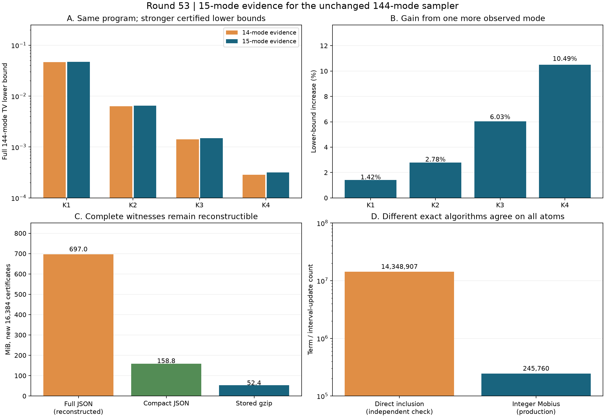

# 第53轮：实际144模十五位证据与无损紧凑证书

日期：2026-11-10。保持官方程序、输入、随机种子和公开样本不变，把完整边缘从14位扩至15位。四个设置的整体144模TV下界全部加强，K4提升10.49%。新增16384份物理证书相对可重建完整JSON缩小约13.30倍，全部数学证据仍可复核。

## 1. 更强的严格下界

| 设置 | 第49轮14位下界 | 本轮15位下界 | 增幅 | 转移到shifted物理目标后的下界 |
|---|---:|---:|---:|---:|
| K1 | 0.04639886860 | 0.04705842562 | 1.4215% | 0.04704991808 |
| K2 | 0.006303113923 | 0.006478410708 | 2.7811% | 0.006469903163 |
| K3 | 0.001412243477 | 0.001497444660 | 6.0330% | 0.001488937115 |
| K4 | 0.0002852230935 | 0.0003151465891 | 10.4913% | 0.0003066390442 |

这些是严格有理界的近似显示，精确值见 `results/iteration53_prefix_validation/bounds.json`。下界越强，表示证明出的程序偏差更多；程序本身没有变好或变坏。每组完整32767节点、32768项边缘律；68个旧公开输出、全部9792步采样记录和所有旧14层节点保持完全相同。

物理模型仍为第35轮B,F。复用16383份旧子集证书，只新建含模式14的16384份，另重新生成14个旧连续前缀作控制。所有32767份子集和两个全模型证书均经过独立整数物理核验，包含矩阵身份、残差、正定性、行列式扰动、根界及概率区间。

仍没有完整144模TV上界。shifted目标使用既有8.507544989701984×10⁻⁶转移界，不能把未经修正的存储协方差当作同一物理目标。

## 2. 完整证据的存储缩减

新增证书的完整JSON可从绑定物理中心、子集、分母、下三角见证及其余诊断重建。省略的矩阵项均可精确导出或已知为零；逐项保存展开记录的规范化摘要。独立实现重建后仍重新检查全部数学证书。

| 新16384份证书的表示 | 字节 | MiB |
|---|---:|---:|
| 可重建完整JSON | 730,830,963 | 696.97 |
| 紧凑JSON | 166,484,083 | 158.77 |
| 实际保存的gzip | 54,947,050 | 52.40 |

结构省略约4.39倍，后续gzip约3.03倍，合计约13.30倍。不是把原始完整JSON单独gzip得到13.30倍，也没有改写旧证书。旧16383份证书全部经历紧凑编码、独立展开和逐字段相等回归；旧控制只保存核验与体积记录，原证书仍由旧清单绑定。

四组新官方stdout及程序律审计从162,507,346字节压缩至40,691,923字节，约3.99倍；原字节摘要、字节数及压缩大小均保存，并在独立审核解压时重新核对。

## 3. 整数计算与分阶段成本

生产将有理真空区间转为共同分母的整数数组，再做精确Mobius变换。15位需要245760次区间更新。独立审核显式枚举容斥项，总计14348907项；全部32768项原始区间及裁剪区间严格相等。旧14位控制也与第49轮全部16384项目标区间相等。

本轮单次并行环境观测：旧证书读取7.68秒，旧控制重算0.089秒，新子集生成62.64秒，原子变换0.702秒，紧凑编码与写入71.61秒，目标总计151.37秒。独立整数显式容斥约2.397秒。两种操作数单位不同，时间也非隔离基准，不推导普遍或端到端加速比；证书生成与保存仍是主要成本。

官方K4观测中目标准备约122.08秒、前缀树约2.90秒、外层总计157.61秒。不同阶段不能混作每样本吞吐，也不能与九章硬件的样本时间直接比较。

## 4. 核验、前沿与持续方向

**673,541项核验通过**：完整前缀与物理审核640536项，旧证书/整数回归32900项，比较105项。全库676项运行、647项通过、0失败、0错误；新增9项通过，既有29项用例及7个类跳过保留。所有本轮源码在全库测试前完成；测试后没有追加源码例外。

已重新核对Frugal官方HEAD、GSVD/PCO、热损耗论文和九章4.0原始来源。具体见[先进工具与九章对照](research/iteration53_frontier_comparison.md)。当前进展是认证与证据保存，没有同质量采样速度胜出、任意精度144模模拟或九章规模模拟结论。

参见[预声明计划](research/iteration53_prefix_plan.md)、[方法与复现](research/iteration53_methods.md)、[后续多方向计划](research/iteration54_plan.md)。整体探索继续。
