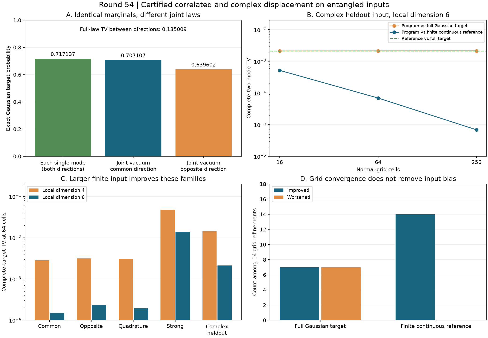

# 第54轮：相关复位移、双模纠缠与输入偏差

日期：2026-11-10。本轮把已认证的单模实位移推进到双模纠缠输入及相关复方向位移。新增解析有限态连续参照，对26项预声明实验保存完整程序律；其中6项是固定参数留出。相关性、输入截断、网格及程序算术误差分别核查。

## 1. 单模边缘相同，联合分布仍相差明显

对λ=1/2的双模压缩态及σ=1/4，分别令位移为(X,X)和(X,−X)，X为同一个实Gaussian变量。两种目标的单模阈值边缘完全相同，各自真空概率约0.717137166；联合真空概率分别约0.707106781和0.639602149。完整双模阈值分布的TV距离严格包围在 **0.13500926423943244** 附近。

这是一个明确的相关性对照：通过相同单模边缘，不能推出联合采样律接近。位移生成元方差同向为2/3、反向为6，相差9倍，连续网格耦合界中的平方根系数相差3倍；不能把单模常数直接用于相关纠缠输入。

## 2. 更细的网格仍可能离真实目标更远

14组预声明网格细化全部更接近有限存储态的连续积分参照，但对无限Gaussian物理目标只有7组改善、7组退化。全部退化和完整区间保留。网格细化不消除输入态截断，二者偏差可能互相抵消。

复方向留出使用λ=5/8、配对相位i、v=(1,(1+i)/2)、σ=3/8。局部维数6时：

| 网格数 | 程序对完整Gaussian目标TV | 程序对有限连续参照TV |
|---|---:|---:|
| 16 | 0.002120980847 | 0.0005182780964 |
| 64 | 0.002134466378 | 0.00006938141427 |
| 256 | 0.002144829899 | 0.000006875619513 |

有限连续参照与完整目标的TV约0.002146140540。网格误差持续下降，而程序对完整目标的误差向该输入偏差靠近。这一结论来自完整四项阈值律，而不是有限样本统计。

## 3. 增大输入局部维数确实帮助本面板

13组维数4→6配对中，11组非真空输入的完整目标TV全部改善。两个真空配对表示相同物理态，差别只在程序浮点路径，不能计作输入质量进展。64格时部分结果如下：

| 输入族 | 维数4 TV | 维数6 TV |
|---|---:|---:|
| 同向，λ=1/2 | 0.002827306277 | 0.0001505493334 |
| 反向，λ=1/2 | 0.003154685444 | 0.0002307108361 |
| 正交复方向，λ=1/2 | 0.003005797221 | 0.0001962334220 |
| 同向较强输入，λ=3/4 | 0.04756248386 | 0.01397509358 |
| 复配对留出，λ=5/8 | 0.01430525400 | 0.002134466378 |

这里使用特殊双模压缩态的显式MPS，不是一般Gaussian构造算法；局部维数和键数一起随该表示变化。不能将改善全部标为单独的键截断贡献，也没有证明所有输入的单调性。较强输入的完整误差仍明显高于算术误差。

## 4. 解析连续参照与完整审核

新参照对有限MPS的真空振幅作多项式展开，利用Gaussian偶次矩解析积分。独立验证改用占据密度双和、平方自由根分组及256位二分根。没有数值积分或位移后输出光子截断。所有旧50项单模连续积分同时接受新通用模型与独立算法回归。

物理目标协方差V+4σ²wwᵀ精确计算；w为复方向的实部、虚部拼接。所有1524个位移节点、10666个实际测量树节点都核查，完整程序分布包含失败项，实际失败质量为零。每项固定种子的7个公开输出只用于程序回放，不用于估计TV。

节点原JSON共66,077,388字节，无损gzip后11,593,637字节，约5.70倍。解压字节摘要验证后仍执行全部数学核验。各阶段时间仅为本机观测，不作同质量吞吐排名。

**73,419项核验通过**：完整相关噪声审核72961项，旧单模控制303项，最终比较155项。全库687项运行、658项通过、0失败、0错误；新增11项通过，既有29项用例及7个类跳过保留。科学代码、绘图与封存脚本均在全库测试前完成，测试后没有新增源码例外。

## 5. 前沿与后续

已重新核对Frugal、GSVD/PCO、热损耗理论和九章4.0原始来源，详见[前沿比较](research/iteration54_frontier_comparison.md)。本轮执行两模、一个共同Gaussian变量；尚未解决一般满秩噪声的离散化成本，没有新增完整144模TV上界、官方算法同目标速度排名或九章规模模拟。

参见[预声明计划](research/iteration54_noise_plan.md)、[方法与复现](research/iteration54_methods.md)、[下一轮多方向计划](research/iteration55_plan.md)。整体探索继续。
